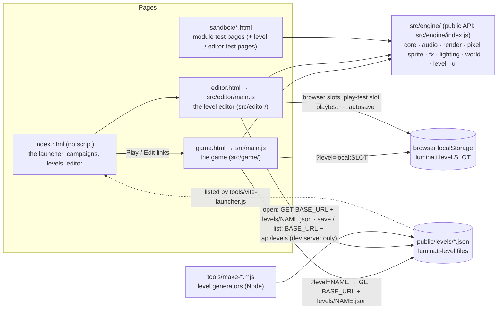
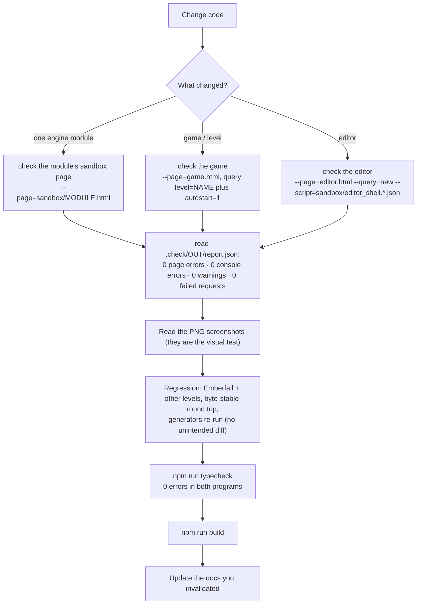

# AI 智能体入门——从这里开始

[English](AGENT_ONBOARDING.md) | 简体中文

> **用途。** 这是全新的 AI 编码会话（或新加入的人类贡献者）应当最先阅读的文件。它说明 Luminati 是什么、哪类任务该读哪些文档、各部分内容位于何处、哪些不变量容易被破坏、如何验证改动，以及如何协调较大的改动。本文有意少谈 API 细节，转而链接到规范的参考文档。
>
> **读者。** 没有任何先验上下文、刚开始参与本项目的 AI 智能体；想快速了解项目的人类读者。
>
> **事实来源。** 代码：[`src/`](../../src/)、[`tools/`](../../tools/)、[`sandbox/`](../../sandbox/)、[`public/levels/`](../../public/levels/)。约束性契约：[`ARCHITECTURE.md`](../../ARCHITECTURE.md)（引擎）和 [`docs/contracts/LEVEL_EDITOR.md`](../contracts/LEVEL_EDITOR.md)（关卡格式、编辑器）。文档与代码不一致时，**以代码为准**——并记录这一差异（[KNOWN_ISSUES.md § 文档](KNOWN_ISSUES.md#documentation-discrepancies)）。
>
> **相关文档。** [TASK_PLAYBOOKS.md](TASK_PLAYBOOKS.md)（分步操作手册）· [KNOWN_ISSUES.md](KNOWN_ISSUES.md)（限制与易错点）· [`AGENTS.md`](../../AGENTS.md)（面向贡献者和编码工具的共享指南）· [文档索引](../README.zh-CN.md) · [术语表](../GLOSSARY.md)（术语，包括有两种含义的词）。

---

## 1. Luminati 是什么

**Luminati** 是一款受 Square Enix HD-2D 游戏启发的 *2.5D 像素艺术* 引擎：像素风精灵站在一个有光照、有阴影、带移轴模糊的 3D 微缩场景中。它运行在 **three.js r186** 上，使用 **纯 JavaScript ES 模块** 编写（由 `tsc` 通过 JSDoc 进行类型检查——没有 `.ts` 文件——不使用框架、测试运行器或 linter），并且 **在运行时生成纹理、角色图集、粒子、音效和音乐**。游戏不附带任何预制的图像或音频资源；UI 字体单独加载。文档截图位于 `docs/assets/` 下；其中三个 `ui-backdrop-*.jpg` 文件也用作 UI 沙盒的背景。

| 烬落村（Emberfall），48 × 40，黄金时刻 | 星落谷（Starfall Vale），128 × 128，夜晚 | 关卡编辑器 |
| --- | --- | --- |
|  |  |  |
| **烬望隘口（Cinderwatch Pass），96 × 120，战斗** | **Boss 烬心（Cinderheart）** | **编辑器中的敌人组** |
|  |  |  |

三个前端共用一个引擎。首页，即 **启动器**（`index.html`），不属于其中任何一个：它是一份纯英文列表，列出每个战役和关卡，并附有进入游戏和编辑器的链接，页面不含脚本——Vite 插件 [`tools/vite-launcher.js`](../../tools/vite-launcher.js) 根据 `public/` 生成该列表，开发模式下每次请求都会生成，构建时只生成一次（[入门指南](../user/GETTING_STARTED.zh-CN.md)）：



随附的关卡（全部位于 [`public/levels/`](../../public/levels/)）：

| 文件 | 关卡 | 尺寸 | 对象 | 制作方式 | 游玩 |
| --- | --- | --- | --- | --- | --- |
| `emberfall.json` | 烬落村——河畔村庄（默认关卡） | 48 × 40 | 137（8 名村民） | 以 JSON 形式编辑 / 在编辑器中编辑 | `game.html` |
| `starfall-vale.json` | 星落谷——群星归来之地 | 128 × 128 | 875（29 名村民，95 个光源描述符） | 由 [`tools/make-starfall-vale.mjs`](../../tools/make-starfall-vale.mjs) **生成** | `game.html?level=starfall-vale` |
| `brightwater-crossing.json` | 明水渡（Brightwater Crossing）——河畔小村落 | 36 × 28 | 68（4 名村民） | 在编辑器界面中手工搭建 | `game.html?level=brightwater-crossing` |
| `sample-hamlet.json` | 柳湖村（Willowmere）——池畔小村 | 28 × 22 | 38（3 名村民） | 由 [`tools/make-sample-hamlet.mjs`](../../tools/make-sample-hamlet.mjs) **生成** | `game.html?level=sample-hamlet` |
| `gildhaven.json` | 鎏金港（Gildhaven）——鎏金河畔集市日（一座有城墙的河畔城镇） | 128 × 128 | 518（68 名村民，53 座房屋，86 个光源描述符） | 由 [`tools/make-gildhaven.mjs`](../../tools/make-gildhaven.mjs) **生成** | `game.html?level=gildhaven` |
| `cinderwatch-pass.json` | 烬望隘口——古火苏醒之地（**战斗**关卡） | 96 × 120 | 283（7 名村民，24 个敌人组 = 58 个敌人，6 个宝箱，3 块路标石，4 个剧情事件） | 由 [`tools/make-cinderwatch-pass.mjs`](../../tools/make-cinderwatch-pass.mjs) **生成** | `game.html?level=cinderwatch-pass` |

只有烬望隘口包含 `enemy` 对象，因此它是唯一有战斗的关卡（[contracts/COMBAT.md](../contracts/COMBAT.md)）；其他五个关卡保持和平，完全不应察觉到战斗代码的存在（规则 14）。它按 **四人队伍** 进行平衡：其中三名村民会通过各自的对话脚本加入玩家的队伍——路标石营地（Waystone Camp）的伊尔莎修女（Sister Ilse，秘术师，担任治疗者）和鲁克（Rook，游侠），以及十字路口的路标石（Crossroads Waystone）处的瑟拉（Sela，守卫）（[specs/PARTY.md §9](../specs/PARTY.md#9-the-demo-the-companions-of-cinderwatch-pass)）——而单人游玩按设计就很困难（[COMBAT.md](../contracts/COMBAT.md)）；通关机器人会招募他们（`sandbox/combat_play.js`，`party: false` 则独自游玩）。

项目随附两个 **战役**——由多个关卡组成、在同一页面中连续游玩的故事（[specs/CAMPAIGN_FORMAT.md](../specs/CAMPAIGN_FORMAT.md)）。第一个是 *摆渡人的提灯*（*The Ferryman's Lantern*），位于 `public/campaigns/ferrymans-lantern/`（`campaign.json` 和五个关卡文件：磨溪村（Millbrook）、磨坊路（Mill Road）、带战斗的旧采石场（Old Quarry）、磨坊地窖，以及第二章黄昏时分的磨溪村），由 [`tools/make-ferrymans-lantern.mjs`](../../tools/make-ferrymans-lantern.mjs) **生成**；通过 `game.html?campaign=ferrymans-lantern` 游玩。它的故事使用 **故事语言** 编写（[specs/STORY_SCRIPT.md](../specs/STORY_SCRIPT.md)）：条件、村民的对话脚本和演员、带触发器的 `event` 对象、战役的 `story/main.json` 和 `story/dialogue.story`（物品、任务、演员、脚本）、过场动画、可实时出现和消失的对象，以及日志（B）。只有带故事的关卡才会获得按需懒加载的故事运行时；其他一切照旧运行。第二个战役 *烬落村——敞开的门*（*Emberfall — Open Doors*，`public/campaigns/emberfall-interiors/`，由 [`tools/make-emberfall-interiors.mjs`](../../tools/make-emberfall-interiors.mjs) 根据烬落村自身的文件 **生成**）展示了 **房间**：烬落村的每扇门后都有一个布置好的房间，旅店、风车和谷仓还有楼上一层——共十个室内关卡（`environment.interior`），涵盖每一种室内家具类型（[design/campaigns/emberfall-interiors.md](../design/campaigns/emberfall-interiors.md)）；通过 `game.html?campaign=emberfall-interiors` 游玩。

各关卡的设计笔记：[design/levels/](../design/levels/)。功能概览：[features/FEATURES.md](../features/FEATURES.md)。

---

## 2. 10 分钟快速上手

每个人都要读第一行，然后选择与你的任务对应的那一行。

| 任务 | 按以下顺序阅读 |
| --- | --- |
| **任何任务** | 本文件 → [`AGENTS.md`](../../AGENTS.md) → [KNOWN_ISSUES.md](KNOWN_ISSUES.md) 中与你的领域相关的部分 → [architecture/OVERVIEW.md](../architecture/OVERVIEW.md) → [TASK_PLAYBOOKS.md](TASK_PLAYBOOKS.md) 中对应的操作手册 |
| 修改引擎模块 | [`ARCHITECTURE.md`](../../ARCHITECTURE.md) §1–2 及该模块的 §4.x 契约 → [architecture/modules/](../architecture/modules/README.zh-CN.md) `<module>.md` → [contracts/MODULE_NOTES.md](../contracts/MODULE_NOTES.md) 中该模块的章节 → 它的沙盒页面 |
| 渲染、画面观感、光照、后期处理 | [architecture/RENDER_PIPELINE.md](../architecture/RENDER_PIPELINE.md) → [design/VISUAL_DESIGN.md](../design/VISUAL_DESIGN.md) → [modules/render.md](../architecture/modules/render.md)、[modules/lighting.md](../architecture/modules/lighting.md) → [architecture/PERFORMANCE.md](../architecture/PERFORMANCE.md) |
| 关卡格式 / 关卡内容 | [specs/LEVEL_FORMAT.md](../specs/LEVEL_FORMAT.md) → [specs/OBJECT_CATALOG.md](../specs/OBJECT_CATALOG.md) → [contracts/LEVEL_EDITOR.md](../contracts/LEVEL_EDITOR.md) §1–5（约束性）→ [design/LEVEL_DESIGN_GUIDE.md](../design/LEVEL_DESIGN_GUIDE.zh-CN.md) → [design/levels/](../design/levels/) |
| 游戏行为（玩家、村民、对话、天气、HUD） | [architecture/GAME.md](../architecture/GAME.md) → [specs/INPUT_AND_CONTROLS.md](../specs/INPUT_AND_CONTROLS.md) → [specs/AUTOMATION_API.md](../specs/AUTOMATION_API.md) → [user/PLAYING_THE_GAME.md](../user/PLAYING_THE_GAME.zh-CN.md) |
| 战斗（规则、敌人、Boss、烬望隘口） | [contracts/COMBAT.md](../contracts/COMBAT.md) §1–4、§22 以及你所在领域的章节（约束性；§27 列出代码与契约不同之处）→ [architecture/GAME.md §15](../architecture/GAME.md#15-combat-combat-levels-only) → [KNOWN_ISSUES.md](KNOWN_ISSUES.md#combat) 中的 COMBAT-xx 条目 → [TASK_PLAYBOOKS §19 / §20](TASK_PLAYBOOKS.md#19-add-an-enemy-kind) → [design/levels/cinderwatch-pass.md](../design/levels/cinderwatch-pass.md) |
| 关卡编辑器 | [architecture/EDITOR.md](../architecture/EDITOR.md) → [contracts/LEVEL_EDITOR.md](../contracts/LEVEL_EDITOR.md) §6–9 → [user/LEVEL_EDITOR_GUIDE.md](../user/LEVEL_EDITOR_GUIDE.zh-CN.md) → [specs/LEVEL_STORAGE_API.md](../specs/LEVEL_STORAGE_API.md) |
| 性能 | [architecture/PERFORMANCE.md](../architecture/PERFORMANCE.md) → [TASK_PLAYBOOKS § 性能分析](TASK_PLAYBOOKS.md#14-profile-and-fix-a-performance-problem) → [KNOWN_ISSUES.md](KNOWN_ISSUES.md) 中的性能条目 |
| 工具、测试、工作流程 | [development/TESTING_AND_VERIFICATION.md](../development/TESTING_AND_VERIFICATION.md) → [development/DEVELOPMENT_WORKFLOW.md](../development/DEVELOPMENT_WORKFLOW.zh-CN.md) → [development/CONVENTIONS.md](../development/CONVENTIONS.md) → [`tools/check.mjs`](../../tools/check.mjs) 的文件头注释 |
| 设计依据与约束 | [architecture/OVERVIEW.md](../architecture/OVERVIEW.md) → 相关的契约或规范 → [KNOWN_ISSUES.md](KNOWN_ISSUES.md) |
| 文档工作 | [docs/README.md](../README.zh-CN.md)（§ 保持文档正确）→ [contracts/README.md](../contracts/README.zh-CN.md) → 每次改动后运行 `npm run docs:check` |

然后打开你要修改的代码并阅读它——模块头部注释详尽且与代码同步。任何文档（包括本文）中的数字或签名，未经核对代码都不要轻信。

---

## 3. 仓库地图

```text
luminati/
├─ index.html · game.html · editor.html   the three Vite entry pages (launcher, game, editor);
│                                multi-page build in vite.config.js
├─ package.json                  scripts: dev · build · preview · check · typecheck · docs:check · level:check
│                                (deps: three, lil-gui, @fontsource/*; dev: vite, puppeteer-core,
│                                typescript, @types/three, @types/node)
├─ tsconfig.json                 the type check of src/ + sandbox/ (allowJs, checkJs, noEmit, strict off)
├─ vite.config.js                dev server 127.0.0.1:5173 + the level-save API and launcher plugins
├─ ARCHITECTURE.md               BINDING engine contract (visual target §1, conventions §2, module APIs §4)
├─ AGENTS.md                     shared guidance for contributors and coding tools
├─ CLAUDE.md                     points Claude Code to the shared guidance
├─ README.md                     features, controls, editor workflow, performance numbers
├─ src/
│  ├─ globals.d.ts               types of the window.__* hooks (type check only)
│  ├─ main.js                    game entry: resolves ?level=, shows loading errors, boots game/Game
│  ├─ launcher/launcher.css      the launcher's styles (index.html; the sandbox gallery's look)
│  ├─ engine/                    the engine (public barrel: index.js)
│  │  ├─ constants.js · utils/math.js · render/GlobalUniforms.js   shared foundation
│  │  ├─ core/        Engine (loop, systems, resize) · Input · CameraRig · EventEmitter
│  │  ├─ audio/       AudioSystem (procedural WebAudio sfx, ambience, music)
│  │  ├─ render/      PostFX + shaders/ (DOF, bloom, grade)
│  │  ├─ pixel/       PixelCanvas · Palette · Textures (TextureLibrary) · CharacterSprites · PropSprites
│  │  ├─ sprite/      Sprite3D · SpriteManager · Foliage · BlobBatch
│  │  ├─ fx/          Particles · GodRays
│  │  ├─ lighting/    LightingSystem (24 h palette) · LightPool · Sky
│  │  ├─ world/       TileMap · Water · WaterShore + shoreWorker · Props (PropFactory) + props/* ·
│  │  │               SpatialSplit · ShadowCasters
│  │  ├─ level/       LevelFormat · ObjectCatalog · ObjectBuilder · LevelStorage · LevelMap ·
│  │  │               types.d.ts (the level document's types; other folders have a types.d.ts too)
│  │  ├─ i18n/        I18n (t(), languages) · ContentText (loc() / term()) · ContentKeys (text keys:
│  │  │               readers, #line: tags, cleaners, minting) · TextKeys (keys through edits: editor,
│  │  │               generators, tools — never the game) · ContentStrings (the extractor, tools only) ·
│  │  │               strings/*
│  │  └─ ui/          UI · DialogBox · Banner · TitleScreen · HUD · Minimap/WorldMap · InteractPrompt ·
│  │                  Fader · DebugPanel · the pixel UI kit (UiScale · FontLoader · GlyphFont · art/ ·
│  │                  layout/) · one stylesheet per component
│  ├─ game/          the game: Game · World · Player · Npc · Critters · dialogue · Weather · Scenery ·
│  │                 GroundDetail · SnowCover · AudioDirector · ResolutionGovernor · AtmosphereFog ·
│  │                 DebugControls · config · combat/* · campaign/* (CampaignFormat · CampaignStorage ·
│  │                 CampaignState · CampaignRuntime · StoryFormat) · story/* (StoryRunner ·
│  │                 StoryState · storyUI)
│  └─ editor/        the level editor: EditorApp · EditorState · textKeys (text keys through edits) ·
│                    autosave · icons · editor.css · tools/* · ui/* · map2d/Map2DView · viewport3d/*
├─ public/levels/*.json          level files (served as /levels/<name>.json, copied into dist/ by the build)
├─ public/campaigns/<name>/      campaigns: campaign.json + levels/<id>.json
├─ tools/
│  ├─ check.mjs                  headless-Chrome verification harness (npm run check)
│  ├─ typecheck.mjs              the type check (npm run typecheck); tools/tsconfig.json: the Node program
│  ├─ vite-level-api.js          dev-server REST API GET/PUT/DELETE /api/levels
│  ├─ vite-launcher.js           writes the launcher's list (index.html) from public/: every request in dev,
│  │                             once in a build
│  ├─ make-starfall-vale.mjs     Starfall Vale generator + validator
│  ├─ make-sample-hamlet.mjs     Willowmere generator
│  ├─ make-cinderwatch-pass.mjs  Cinderwatch Pass generator + validator (the combat level)
│  ├─ make-gildhaven.mjs         Gildhaven generator + validator (the 128 × 128 town)
│  ├─ make-ferrymans-lantern.mjs the demo campaign's generator
│  ├─ make-emberfall-interiors.mjs  the rooms demo's generator (Emberfall + ten rooms)
│  ├─ lib/levelgen.mjs           helpers shared by the Cinderwatch and Gildhaven generators
│  ├─ lib/levelcheck.mjs         the level checks (checkLevel), shared by make-gildhaven and check-level
│  ├─ check-level.mjs            the level checks on any level file (npm run level:check)
│  ├─ test-story.mjs             the story system's self-test (npm run story:test)
│  ├─ test-levelcheck.mjs        the level checks' self-test: story states (npm run level:test)
│  ├─ test-level-api.mjs         the level API's self-test (npm run api:test)
│  ├─ check-i18n.mjs             the content tables' checker (npm run i18n:check; lib/i18n.mjs)
│  ├─ i18n-keys.mjs              the text keys of level / campaign / story files (npm run i18n:keys):
│  │                             --check, --assign, --fix
│  ├─ i18n-worklist.mjs          translators' worklists: write (JSON / PO), --merge, --prune, --init
│  ├─ test-i18n.mjs              the content-text self-test (npm run i18n:test)
│  ├─ test-text-keys.mjs         the text keys' self-test (npm run keys:test)
│  └─ check-docs-links.mjs       docs link checker (npm run docs:check)
├─ sandbox/                      module test pages (*.html/*.js) + scripted checks (*.json);
│                                /sandbox/ is a gallery page
├─ docs/                         this documentation (contracts/ holds the binding level/editor contract)
├─ .claude/launch.json           optional Claude Code preview preset (npm run dev, port 5173)
├─ .gitattributes                "* text=auto eol=lf", "*.png binary"
├─ .gitignore                    node_modules/ · dist/ · .check/ · *.log
├─ dist/                         build output (gitignored; may be stale)
└─ .check/                       LOCAL-ONLY harness output (gitignored)
```

关于 **`.check/`**：每次 `npm run check` 都会写入 `.check/<out>/report.json` 以及 PNG 截图。这个被 git 忽略的目录存放的是可随时丢弃的本地验证输出。切勿在发布的文档中依赖其内容，也不要假设其他检出副本里有这些文件。值得发布的证据应复制到合适的文档资源目录，例如 [`docs/assets/screenshots/`](../assets/screenshots/)。每次运行使用一个新的 `--out` 名称：验证工具会删除该文件夹中已有的 PNG 和 `report.json`。删除输出之前，请保留其他进行中任务所需的证据。

---

## 4. 黄金法则（容易被破坏的不变量）

每条规则都说明了是什么、为什么以及如何遵守。[TASK_PLAYBOOKS.md](TASK_PLAYBOOKS.md) 中的操作手册会逐步应用这些规则。

1. **最多 12 个点光源，全部在第一帧之前创建；此后数量永不改变。** 添加或移除光源，或切换 `light.visible`，都会改变 three.js 的光源数量，导致所有受光照着色器重新编译（造成明显卡顿）。请改为渐变光强。游戏把所有光源描述符交给 [`LightPool`](../../src/engine/lighting/LightPool.js)（[`src/game/World.js`](../../src/game/World.js) 中的 `MAX_POINT_LIGHTS = 12`）：描述符不超过 12 个时，每个描述符获得一个固定光源（因此小关卡的光源 *少于* 12 个——烬落村 12 个、明水渡 10 个、柳湖村 6 个）；超过 12 个时，恰好 12 个光源围绕相机焦点共享使用，按淡出 → 移动 → 淡入的方式轮换（星落谷：95 个描述符）。编辑器的 3D 预览使用同一个引擎 `LightPool`，参数为 `fixed: true` 和 `size: LIGHT_POOL_SIZE`（12，[`viewport3d/ObjectPreview.js`](../../src/editor/viewport3d/ObjectPreview.js)）：它始终恰好拥有 12 个 THREE 光源（多余的以光强 0 闲置），与游戏一样根据描述符数量进入静态模式或池化模式，编辑操作通过 `setDescriptors` 传入新的描述符集合，而不增删光源。一个关卡可以包含任意数量的光源。
2. **针对 `postfx.sceneTarget` 预热着色器。** three.js 按所绑定渲染目标的色彩空间区分着色器程序；场景渲染到 PostFX 的线性 HDR 目标中，因此针对画布编译只会生成用不到的变体。`Game._compileScene()` 绑定 `postfx.sceneTarget` 并调用 `renderer.compileAsync`；`postfx.warmup()` 编译后期处理通道；`Game.start()` 在加载画面后方强制开启雨和雪并绘制五帧（`WARM_FRAMES`）；一次性爆发特效通过在世界下方很远处放置一个粒子来预热（`footstep` 总是预热，关卡有溅水瀑布时还预热 `splash` 和 `sparkle`），每种阴影投射体的深度程序也通过下方远处的代理物预热（`Game._primeShadows`，REN-13）。任何可能在游戏中途出现的新东西（材质、发射器预设、爆发特效）都必须在这次预热 **之前** 存在或被预热，否则首次使用时会卡顿。检查方法：游戏过程中 `renderer.info.programs.length` 不得增长（烬落村：57）。
3. **确定性的程序化内容。** 使用 [`src/engine/utils/math.js`](../../src/engine/utils/math.js) 中带种子的 `RNG`、`hash2`、`fbm2`、`hashString`；任何影响世界形态的东西都不要用 `Math.random()`。（`Math.random` 只出现在以下场合：运行时抖动——`Game.js` 中对话提示音的音高和瀑布水雾的位置——；编辑器中 Place 工具的下一个变体种子（`PlaceTool.js`；该种子随后存入对象的 `opts.seed`）；自动保存 / 会话 id 和 DOM id；以及验证工具的端口选择。对象 id 是确定性的：`generateObjectId` → `<type>_<n>`。）道具的种子来自类型 + 位置 + `opts.seed`（`PropFactory.rng`），纹理的种子来自其名称和纹理库种子（`TextureLibrary.seedOf`；游戏使用种子 1337），地形色调的种子来自关卡名称（规则 7），因此同一关卡每次加载都会构建出完全相同的结果。
4. **契约改动只能是增量式的。** 绝不重命名或改变 `ARCHITECTURE.md` §4 或 `docs/contracts/LEVEL_EDITOR.md` 中某个成员的含义。可以添加可选成员、选项和关卡字段；并在同一次改动中为它们编写文档（契约文件、其类型化副本——规则 15——、模块参考、相应的 `docs/` 页面，若用户可见还包括 `README.md`）。除非明确要求，否则不要添加迁移、兼容读取器或别名。格式变更时同步更新随附数据，并报告哪些现有用户数据将无法再加载。
5. **字节稳定的关卡文件。** `parseLevel` → `serializeLevel` 必须精确重现已保存的文件；在编辑器中打开一个关卡并原样保存后，`git diff` 必须为空。由此带来的后果：`normalizeObject` 保持键的顺序；新的 *默认值*（添加到某个对象类型 `defaults` 中的键、添加到 `DEFAULT_ENVIRONMENT` 中的键，或默认图例中新的 `TILE_TYPES` 字符）会在每个文件下次保存时被写入——因此优先使用默认缺省的可选字段；如果必须添加默认值，就在同一次改动中重新保存 / 重新生成所有随附关卡。使用 §5 中的往返代码片段进行检查。
6. **生成的关卡只能通过其生成器修改。** `starfall-vale.json` ← `node tools/make-starfall-vale.mjs`，`sample-hamlet.json` ← `node tools/make-sample-hamlet.mjs`，`cinderwatch-pass.json` ← `node tools/make-cinderwatch-pass.mjs`（自带包含 20 条规则的 `validate()`，以及覆盖每种战斗类型、敌人种类和宝箱升级的 `coverage()`；支持 `--check`）。绝不手工编辑它们的 JSON（下次运行会将其覆盖）。星落谷生成器在验证失败时拒绝写入（`--force` 会写入以供检查，但仍以 1 退出），其覆盖清单要求 **每一种** 图块类型、对象类型、NPC 动作 / 行为、小动物种类和粒子区域预设都出现在关卡中（参见 [TASK_PLAYBOOKS § 开始任何操作手册之前](TASK_PLAYBOOKS.md#0-before-any-recipe)）。两个生成器都能逐字节重现已提交的文件；`make-sample-hamlet.mjs` 按自己的键顺序写出每个对象（`id, type`、位置键、目录默认值、其他键），并且除非输出能通过 `parseLevel` → `serializeLevel` 往返，否则拒绝写入。
7. **随附关卡不得回归。** 烬落村是画面观感的基准；除非任务就是要修改它们，否则它和其他小关卡的渲染与游玩必须与之前完全一致（与 [`docs/assets/screenshots/`](../assets/screenshots/) 中的截图以及改动前后的指纹——绘制调用、三角形、光源、着色器程序——进行比较；参见 [TASK_PLAYBOOKS § 回归检查](TASK_PLAYBOOKS.md#16-regression-check-before-you-finish)）。不要随意重命名随附关卡：地形噪声的种子来自 `level.name`（[KNOWN_ISSUES LVL-10](KNOWN_ISSUES.md#levels-and-generators)）。
8. **两条构建路径：小关卡与大关卡。** 当任意一边 **> 64 个图块** 时，`World.isBigLevel(level)` 为真（[`src/game/World.js`](../../src/game/World.js) 中的 `SMALL_LEVEL = 64`）。大关卡（星落谷）使用 `BIG_LEVEL_BATCHING`：按包围盒剔除的 k-d 分割批次、仅用于阴影的代理投射体、阴影深度范围、在 worker 中烘焙岸线、远处角色的降频更新、34 个单位外的粒子剔除，以及一次实例化的斑点阴影绘制调用（`BlobBatch`）。不超过 64 × 64 的关卡保留原有的单次合并路径，并且 **必须渲染得完全相同**——每项大关卡优化都要以 `this.batching` / `World.isBigLevel` 作为开关。编辑器也有同样的划分（`BATCH_CHUNK` 16 与 `BATCH_CHUNK_BIG` 32 个图块）。
9. **色彩管理和色调映射各自只有一个负责者。** `Engine` 设置 `renderer.outputColorSpace = SRGBColorSpace`、`toneMapping = ACESFilmicToneMapping` 以及阴影贴图类型（`PCFShadowMap`）；颜色纹理使用 `SRGBColorSpace`，数据纹理（法线贴图、遮罩）使用 `NoColorSpace`。色调映射只应用 **一次**，由 PostFX 内部的 `OutputPass` 执行（它读取渲染器的设置）；调色在其后于显示空间中进行。`LightingSystem` 负责 `renderer.toneMappingExposure`、`scene.fog`（FogExp2）、太阳光 / 半球光，以及 `uNight` / `uSunDirection` / `uSunColor` / `uFogColor` uniform（其 `settings.shadows` 可关闭太阳的阴影）。在游戏中，`Weather.update` 每帧都会根据 `weather.tuning` 改写 `postfx.settings.grade.temperature` / `.saturation` 和 `lighting.settings.*Mul`——请修改这些基准值，而不是实时设置。
10. **坐标约定。** Y 轴朝上。图块 `(i, j)` 覆盖 `x ∈ [i, i+1]`、`z ∈ [j, j+1]`（中心为 `i + 0.5, j + 0.5`）；`tiles` / `heights` 的行沿 +Z 方向排列。世界高度 = 层级 × `LEVEL_HEIGHT`（0.5）；高度字符 `'0'–'9'`、`'a'–'z'` = 层级 0–35。`PPU = 16`，即每个世界单位 16 个纹素。相机偏航角为 0 时位于 +Z 一侧并朝向 −Z，因此屏幕向下即 +Z；精灵朝向：`down` = +Z（面向相机），`up` = −Z，`left` = −X，`right` = +X；楼梯 `'N'` 朝 −Z 方向升高。对象的 `rotation` 是绕 Y 轴的弧度。像素纹理通过 `makePixelTexture` / `PixelCanvas#toTexture` 生成（放大过滤为 NEAREST）。参见 [`src/engine/constants.js`](../../src/engine/constants.js)。
11. **不要动不是你创建的未跟踪关卡。** `public/levels/` 中的关卡文件——或 `public/campaigns/` 中的任何内容——如果不在 git 中，就属于用户：不要编辑、删除、重新生成、“清理”或提交它。注意，把名为 “Untitled” 的关卡（新关卡的默认名称，`createEmptyLevel`）或名称为空的关卡保存到项目文件夹，会写入 `public/levels/untitled.json`（`slugify('Untitled') === slugify('') === 'untitled'`）。编辑器的 Save As（另存为）在关卡仍为 “Untitled” 时会要求输入真实名称，并在替换文件前请求确认，但调用 `saveProjectLevel` 或 `PUT /api/levels/untitled` 的脚本会绕过这些保护。保存关卡的脚本必须使用自己的名称，并在之后删除其临时文件。
12. **开发预算**（1600 × 900，目标 60 fps）：包括阴影通道在内，场景绘制调用不超过约 300 次；一张 2048² 的太阳阴影贴图；景深以半分辨率运行；点光源不超过 12 个。使用 `state()` 和 PostFX 的 GPU 计时进行测量，而不是无头模式下的帧率（参见 §7）。
13. **约定中的其他一切：** 不使用二进制资源（UI 字体首先从 Google Fonts 加载，否则使用构建到 `dist/` 中的 `@fontsource/*` 副本）；导入时没有全局副作用（UI CSS / 字体除外）；每个分配 GPU 资源的类都有 `dispose()`；公共 API 带 JSDoc（会被检查——规则 15）；自定义着色器直接引用 `globalUniforms` 对象，并在需要受雾影响时包含雾相关的着色器片段。
14. **战斗按关卡选择性启用，在其他地方必须保持不可见。** 只有当 `levelHasCombat(level)` 为真（存在 `enemy` 对象，或 `environment.combat: true`）时，`Game` 才会创建 `CombatSystem`；在其他所有关卡上 `game.combat === null`，不存在任何战斗图集、材质、爆发特效池、DOM 节点或按键绑定，指纹保持不变（烬落村 57 个程序）。战斗时钟采用子步进，其命中停顿只作用于战斗内部——绝不要碰 `engine.time.timeScale`。每个战斗材质、批次和爆发特效都在加载时创建并预热（`combat.warmup`），因此完整战斗后的 `stats().programs` 等于加载时的数量（`sandbox/combat.programs.json`）。现有精灵图集保持像素级一致：在对普通图集做了有意的修改之后，要在同一次提交中重新获取 `sprite_art.html?mode=hashes` 并写入 `sandbox/sprite_art.hashes.json`（[COMBAT.md §2](../contracts/COMBAT.md#2-must-not-change)）。
15. **类型检查保持零错误。** `npm run typecheck` 在两个程序中（`tsconfig.json`：`src/` + `sandbox/`；`tools/tsconfig.json`：Node 工具）对 JavaScript 及其 JSDoc 运行 `tsc`，两者都必须报告 0 个错误；Vite 从不做类型检查，所以类型错误不会在浏览器中显现。用 JSDoc 为新的公共 API 标注类型；修正声明的类型，而不是强制转换（`/** @type {X} */ (expr)` 只用于检查器无法理解的正确代码）；`@ts-expect-error` 必须附带原因；延迟创建的字段在所在文件夹的 `types.d.ts` 中通过模块扩充声明，绝不放在 `Foo.js` 旁边的 `Foo.d.ts` 中。各契约都有类型化副本——关卡文档（`src/engine/level/types.d.ts`）、战斗接口（`src/game/combat/types.d.ts`）、工具接口（`src/editor/tools/index.js`）、钩子（`GameHooks`、`EditorHooks`、`LuminatiHooks`，`src/globals.d.ts`）——因此重命名一个成员会在每个使用处报错：请修正这些使用处。Node 生成器导入的模块不得通过其类型引入浏览器模块。该检查看不到动作脚本中的 `eval` 字符串，并且在 `strict` 关闭时未标注类型的值为 `any`（[CONVENTIONS.md §3.1](../development/CONVENTIONS.md#31-the-type-check)，KNOWN_ISSUES [TC-01 – TC-05](KNOWN_ISSUES.md#type-check)）。
16. **来自关卡数据的名称是不可信的键。** 关卡可能来自任何文件（项目文件、浏览器存档槽、从磁盘选取的文件、开发 API），而 `TABLE[name]` 会找到 `Object.prototype` 的成员，因此 `"constructor"` 或 `"__proto__"` 能通过表查找测试，却在取值时出错。请使用 [`src/engine/utils/own.js`](../../src/engine/utils/own.js) 中的 `isOwnKey` / `ownValue` 查找这类名称（或对列表使用 `includes`，或使用 `Map`）；以关卡数据为键的字典保持无原型（`Object.create(null)`）；加载时用 `toText` / `toNumber` 转换，并用 `showValue` 格式化消息（[CONVENTIONS.md §13](../development/CONVENTIONS.md#13-error-handling-and-logging)，[KNOWN_ISSUES LVL-17](KNOWN_ISSUES.md#resolved-2026-10-01)）。使用 `sandbox/game_levels.html?case=hostile` 及其脚本 `sandbox/game_levels.hostile.json` 进行检查。
17. **UI 是以完整美术像素绘制的像素艺术，支持三种语言。** UI 的尺寸和位置以像素 UI 640 × 360 参考画面中的美术像素为单位（`--px`；`group()`、`txt()`、美术工具包——绝不使用 `vw` / `clamp()` 或自定义缩放），颜色只取自 G 的调色板。玩家读到的每个词都是字符串表的键（`t()`，带有其 `ja` 和 `zh` 条目），或是 **在显示时** 翻译的数据——正文通过数据所带的键翻译（`loc(key, english)`，键用 `ContentKeys.js` 的读取器读取，提取器也以同样方式读取），名称作为术语翻译（`term(name)`）——绝不写入关卡、战役、故事或存档；代码用来查找的名称保持英文。改动文本或显示位置后，要在 ja 和 zh 下分别运行两种 i18n 巡检（0 遗漏）。测量之前先用 `fonts.ensure` 加载 CJK 字形；绝不信任 `document.fonts.check`。UI 工作要在 1280 × 720、1920 × 1080 和 1024 × 768 下，并使用 `--lang=ja` / `--lang=zh` 进行检查（[PIXEL_UI.md](../specs/PIXEL_UI.md)、[I18N.md](../specs/I18N.md)、[KNOWN_ISSUES › UI 与语言](KNOWN_ISSUES.md#ui-and-languages)）。
18. **文本键存在于数据中；没有人手工输入它们。** 每个可翻译文本旁边都带有一个 GUID（对象、关卡根节点、战役和故事文件上的 `textKeys`；每个含文本的脚本行上的 `#line:<GUID>` 标签），由编辑器、生成器（`keyLevel`）或 `npm run i18n:keys -- --assign` 生成，并由 `TextKeys.js` 在每次编辑中延续，因此插入、重新排序或重命名的文本都能保留其翻译。绝不手工编辑或复制键或标签；手工编辑关卡文本后运行 `npm run i18n:keys`（`--fix` 会拆分英文已经不同的副本）。`TextKeys.js` 绝不会进入游戏的代码块。新的可翻译字段要加入 `TEXT_KEY_FIELDS`（未加入时 `npm run keys:test` 会失败）（[I18N.md §4.2](../specs/I18N.md#42-keys-and-lookup)，[TASK_PLAYBOOKS §27–28](TASK_PLAYBOOKS.md#27-add-a-display-site-or-a-translatable-field)）。
19. **不从站点根路径加载任何内容。** 项目可能部署在子路径下（`npm run dev -- --base=/project/`；构建使用相对路径 `base: './'`，因此同一个 `dist/` 可以部署在任何位置）。每个 URL 都要基于 `import.meta.env.BASE_URL` 构建（`<base>levels/…`、`<base>i18n/…`，关卡 API 通过 `LevelStorage.levelsApi()`），或相对于页面或模块构建（`./src/main.js`、`import('../src/…')`、`new URL(…, import.meta.url)`），绝不使用 `/levels/…` 或 `/api/…`。使用 `npm run check -- --base=project` 检查，构建之后再用 `--dist --base=project` 检查。

---

## 5. 标准验证循环

项目没有外部测试运行器。浏览器验证使用 [`tools/check.mjs`](../../tools/check.mjs) 驱动真实页面，然后检查报告和截图；Node 自测覆盖数据格式、故事运行时、关卡 API 和翻译工具。验证工具会请求硬件加速和 ANGLE D3D11；请核对报告中的 GPU / 后端，而不要假设每位贡献者的环境都相同。对于仅涉及文档的改动，运行 `npm run docs:check`；下面的渲染检查适用于影响应用程序的改动。



1. **先运行范围最小的页面。** 先是模块的沙盒（`sandbox/<module>.html`，列表见 [development/TESTING_AND_VERIFICATION.md](../development/TESTING_AND_VERIFICATION.md)），然后是游戏或编辑器。

   ```bash
   npm run check -- --page=sandbox/terrain.html --out=terrain
   npm run check -- --page=game.html --query=autostart=1 --out=game --wait=6000
   npm run check -- --page=game.html --query="level=starfall-vale&autostart=1" --out=sv --wait=9000
   npm run check -- --page=editor.html --query=open=emberfall --out=ed --fps=0
   npm run check -- --page=editor.html --query=new --out=perf --fps=0 --script=sandbox/editor_perf.json
   npm run check -- --page=index.html --query= --out=launcher --fps=0 --script=sandbox/launcher.json
   ```

   最后一条检查的是启动器（`index.html`，首页）：将它的链接与关卡 API 的列表核对，然后点击一个 *Play* 和一个 *Edit* 链接，分别进入游戏和编辑器。

   选项：`--page`（默认 `game.html`，即游戏）、`--query`（默认 **`autostart=1`**——传入 `--query=` 表示不带查询参数）、`--out`（`.check/` 下的文件夹；默认为页面的基本名称）、`--wait` 第一张截图前等待的毫秒数（默认 4000）、`--fps` 测量帧率的毫秒数（默认 3000，`0` = 跳过）、`--width` / `--height`（默认 1600 × 900）、`--script=<actions.json>`（相对于仓库根目录的路径）、`--headful`、`--keep-cache`（保留 Vite 依赖缓存，否则每次运行都会删除它）、`--base=project`（在 `/project/` 下提供服务）、`--dist`（通过 `vite preview` 检查 `dist/`——`index.html`、`game.html`、`editor.html`，没有关卡 API；需先构建）。等待结束后，验证工具总会保存 `initial.png`，然后运行脚本。动作脚本的步骤（`wait`、`key`、`press`、`eval`、`shot`、`fps`、`click`、`dblclick`、`move`、`mouse`、`drag`、`wheel`、`type`、`combo`、`goto`、`tab`）在该文件的头部注释中有说明。页面钩子：`window.__game`、`window.__editor`、`window.__luminati`、`window.__engine`——参见 [specs/AUTOMATION_API.md](../specs/AUTOMATION_API.md)。
2. **阅读报告。** 控制台摘要会列出页面错误、控制台错误、警告、失败的请求以及每个 `eval` 的结果。**默认情况下，只有页面错误才会使退出码为 1**（未捕获的异常、验证工具故障；找不到 Chrome / Edge 时为 2）；控制台错误、警告、失败的请求以及抛出异常的 `eval`（在 `report.json` 中存为 `evals[].error`）都不会使运行失败——你必须自己阅读它们。`--strict` 会让其中任何一项也以 1 退出（一行 `Strict:` 列出原因），适用于本应干净的页面。目标是每一项都为零（诸如 `[Luminati] …` 的关卡规范化警告是真实的问题）。
3. **查看截图。** 用你环境中可用的图片查看器打开 `.check/<out>/*.png`。即使报告干净，空白、全黑、洋红棋盘格（未知纹理）或发白的画面也算失败。
4. **回归检查。** 对于任何可能影响渲染或关卡构建的改动：烬落村以及其他随附关卡（改动前后的指纹——操作手册 16），以及关卡往返检查：

   ```bash
   node --input-type=module -e "
   import fs from 'node:fs';
   import { parseLevel, serializeLevel } from './src/engine/level/LevelFormat.js';
   for (const f of fs.readdirSync('public/levels').filter((n) => n.endsWith('.json'))) {
     const text = fs.readFileSync('public/levels/' + f, 'utf8');
     const { level, warnings } = parseLevel(text);
     console.log(f.padEnd(28), serializeLevel(level) === text ? 'byte-stable' : 'CHANGED', warnings.length ? warnings : '');
   }"
   ```

   如果你改动了关卡格式、对象目录或生成器，请重新运行生成器，并确认 `git diff public/levels` 只显示你预期的内容。生成器能逐字节重现它们的文件。若想在不触碰已提交文件的情况下试运行：`node tools/make-starfall-vale.mjs --out=<scratch>/sv.json`（然后进行比较，例如用 `git hash-object`），以及 `node tools/make-sample-hamlet.mjs --check`（不写入任何内容；文件匹配时以 0 退出，否则以 1 退出，并说明是数据不同还是仅键顺序 / 格式不同）或 `--out=<scratch>/hamlet.json`。

   如果你改动了玩家读到的文本（关卡、战役、故事或 `dialogue.js` 中的文本）或显示这些文本的位置：运行 `npm run i18n:keys`（所有文本都有键，0 个问题）和 `npm run i18n:check`（只应剩下 *changed*——编辑过的随附文本行，即同一个键对应了不同的英文——和 *untranslated*——新文本——有待翻译：[TASK_PLAYBOOKS §26](TASK_PLAYBOOKS.md#26-translate-or-fix-content-text-with-the-worklist)），以及在 `--lang=ja` 和 `--lang=zh` 下的两次内容文本巡检，只要有文本未经翻译就显示出来，巡检就会失败（[TESTING_AND_VERIFICATION.md §8.5](../development/TESTING_AND_VERIFICATION.md#85-languages-and-fonts)）。改动了文本键相关代码时：运行 `npm run keys:test`、`npm run i18n:test`、`npm run story:test`。
5. **类型检查。** `npm run typecheck` 必须在两个程序中都报告 0 个错误（每个大约一秒）。它能捕获类型化代码中被重命名或拼错的成员、错误的结构和参数个数——请修复根本原因，而不是用类型转换掩盖它（[CONVENTIONS.md §3.1](../development/CONVENTIONS.md#31-the-type-check)；操作手册：[TASK_PLAYBOOKS §21](TASK_PLAYBOOKS.md#21-fix-a-failing-type-check)）。
6. **构建。** `npm run build`（Vite 多页面构建，把 `index.html`——启动器，已内嵌其列表——+ `game.html` + `editor.html` 构建到 `dist/`；耗时几秒）。构建必须成功。（若要不动 `dist/`，例如另一个会话正在使用它：`npx vite build --outDir <some temp dir> --emptyOutDir`。）构建使用相对路径（`base: './'`）；改动了页面加载的 URL 后，运行 `npm run check -- --dist --base=project`（它会检查 `index.html`、`game.html` 和 `editor.html`）。
7. **更新你使之过时的文档**——契约、模块说明、`README.md`、`docs/` 下的页面。在本项目中，文档是“完成”的一部分。

只要沙盒或页面显示错误、截图看起来不对、随附关卡发生了非预期的变化、类型检查报告错误或构建失败，任务就不算完成。

---

## 6. 协调较大的改动

对于跨越多个模块的改动，先就共享契约和集成点达成一致。并行工作时，明确分配文件 / 模块的归属，并为每个模块提供一个独立的沙盒，使其能在不依赖其他未完成工作的情况下证明自身行为。在可行时独立审查集成结果，然后重新运行相关的复现步骤和回归检查。在该模块的规范参考文档中记录有意添加的契约内容和实现约束。

对于较小的改动，同样的纪律按比例缩小即可：阅读契约，修改模块，在其沙盒中验证，然后集成并运行相应的回归检查。在再次报告某个已知限制之前，先查阅 [KNOWN_ISSUES.md](KNOWN_ISSUES.md)。

---

## 7. 环境与可移植性

| 要求或行为 | 指导 |
| --- | --- |
| Node.js、npm 和本地项目依赖 | 推荐 Node.js 24；支持的版本见[环境要求](../user/GETTING_STARTED.zh-CN.md#2-环境要求)。运行 `npm ci`；各脚本使用本地工具（包括 TypeScript），因此无需全局安装。 |
| 浏览器验证工具 | 它会在 Windows 的标准 Chrome/Edge 路径中查找浏览器，或使用 `CHROME_PATH`。它会请求 ANGLE D3D11；在其他平台上请核对浏览器 / 后端，并报告不受支持的检查。 |
| GPU 测量 | 历史上的桌面测量使用 1600 × 900 的视口。比较结果时请记录你的硬件 / 浏览器。避免同时运行其他占用 GPU 的任务；在 fps 之外同时使用 `postfx.timingsMin`、CPU 计时和绘制调用次数。 |
| 无头模式的帧节奏 | 参考环境的帧率上限约为 57–60 Hz。合成器的帧率上限无法衡量 GPU 余量；请在一致的条件下比较计时。 |
| 开发服务器 | `npm run dev` 在 `http://127.0.0.1:5173/` 提供启动器，在 `/game.html` 提供游戏，在 `/editor.html` 提供编辑器，并提供沙盒 / 文档页面。启动器在重新加载时会反映 `public/` 的变化。 |
| 关卡保存 API | 每次针对源码的验证工具运行都会启动一个启用该 API 的 Vite 服务器；脚本化的编辑器保存会真实写入 `public/levels/<name>.json`。构建后的预览没有保存 API。 |
| Shell 与换行符 | 使用适合当前 shell 的命令，并为路径加引号。`.gitattributes` 规定使用 LF。在 Git Bash 中，优先使用验证工具的 `--base=project`，以避免 MSYS 路径转换。 |
| 音频 | 无头验证无法确认实际的听感。音频改动请结合离线分析和人工试听。 |

---

## 8. 工作树与署名

- 编辑前先检查工作树，保留任务范围之外的改动。未经授权，不要修改、删除或暂存不是你创建的未跟踪关卡 / 战役。
- 不要假设分支名称、远程仓库、操作系统、shell 或贡献者身份。提交和发布遵循任务的授权；编码智能体不得自动提交或发布。
- 保持改动范围集中，并说明其行为和验证方式。不要添加固定的 AI 作者署名尾注；在被要求或有必要时使用准确的署名。
- 不要跳过钩子，也不要改写他人的工作。不要把 `.check/`、`dist/`、临时关卡、日志、凭据和个人机器配置纳入提交。使用 LF 换行符。

---

## 9. 在哪里找到 X

| 要找的内容 | 位置 |
| --- | --- |
| 公共引擎 API | [`src/engine/index.js`](../../src/engine/index.js)（汇总导出）· [architecture/modules/](../architecture/modules/README.zh-CN.md) 中的模块参考 |
| 帧顺序 / 系统接线 | [`src/game/Game.js`](../../src/game/Game.js) 中的 `Game.init`（lighting −10、game 0、audio 20、UI 在 `lateUpdate` 中、PostFX 作为渲染函数）；[`core/Engine.js`](../../src/engine/core/Engine.js) 中的 `Engine` |
| 共享着色器 uniform | [`render/GlobalUniforms.js`](../../src/engine/render/GlobalUniforms.js)（`uTime`、`uNight`、`uWind`、`uWindStrength`、`uCameraYaw`、`uCameraPosition`、`uSunDirection`、`uSunColor`、`uFogColor`） |
| 按键绑定 | [`core/Input.js`](../../src/engine/core/Input.js) 中的 `DEFAULT_BINDINGS` / `DEFAULT_PAD_BINDINGS`；`Game.js` 中的 HUD 按键说明 `CONTROLS`；编辑器快捷键：[`EditorApp.js`](../../src/editor/EditorApp.js) 中的命令表 + 每个工具的 `shortcut` |
| 一日调色板 | [`lighting/LightingSystem.js`](../../src/engine/lighting/LightingSystem.js) 中的 `DEFAULT_KEYFRAMES` + [`game/config.js`](../../src/game/config.js) 中的 `KEYFRAME_OVERRIDES` |
| 游戏画面观感（景深、泛光、调色数值） | `Game._tunePost`；天气偏移量 `WEATHER_PARAMS` 在 [`game/WeatherLook.js`](../../src/game/WeatherLook.js) 中（与编辑器预览共享；混合逻辑在 [`game/Weather.js`](../../src/game/Weather.js) 中） |
| 相机取景 | `game/config.js` 中的 `CAMERA`；每个关卡的 `environment.camera` / `highGround` / `titleCamera` |
| 时段预设（T 键） | `game/Weather.js` 中的 `TIME_PRESETS` |
| 图块调色板 | [`level/LevelFormat.js`](../../src/engine/level/LevelFormat.js) 中的 `TILE_TYPES` |
| 对象类型、检查器字段 | [`level/ObjectCatalog.js`](../../src/engine/level/ObjectCatalog.js) 中的 `OBJECT_TYPES` |
| 对象 → 3D 构建 | [`level/ObjectBuilder.js`](../../src/engine/level/ObjectBuilder.js) 中的 `LevelObjectBuilder.build` → [`world/Props.js`](../../src/engine/world/Props.js) 中的 `PropFactory` → [`world/props/*`](../../src/engine/world/props/) |
| 光源优先级 | `ObjectBuilder.js` 中的 `LIGHT_PRIORITY`（campfire / hearth 0，wallTorch / light 1，lamppost 2，house 3） |
| 大关卡预算 | [`game/World.js`](../../src/game/World.js) 中的 `BIG_LEVEL_BATCHING` |
| 村民对话 | [`game/dialogue.js`](../../src/game/dialogue.js) 中的 `CONVERSATIONS`（脚本 id）和 `levelConversation`（普通对话 + `action`） |
| NPC 行为 | [`game/Npc.js`](../../src/game/Npc.js) 中的 `Npc.update`；小动物种类 `KINDS` 在 [`game/Critters.js`](../../src/game/Critters.js) 中 |
| 森林边界、外围景物 | [`game/Scenery.js`](../../src/game/Scenery.js)（`scatterForest`、`forestKindAreas`、`mergeTrees`、`buildOuterGround`） |
| 地面植被 | [`game/GroundDetail.js`](../../src/game/GroundDetail.js) 中的 `buildGroundDetail` |
| 地面 / 屋顶积雪 | [`game/SnowCover.js`](../../src/game/SnowCover.js)（`addSnowCover`、`snowCover.value`）；`World.build` 将其应用于地形、外围地面、植被，以及材质名称匹配 `luminati:roof*` 的合并静态网格 |
| 从相机前方开始的雾 | [`game/AtmosphereFog.js`](../../src/game/AtmosphereFog.js) 中的 `installFogStart`（全局修补 `THREE.ShaderChunk.fog_vertex`；仅限游戏）；起始距离是 uniform `globalUniforms.uFogStart`，由 `Game._applyLevel` 按关卡设置（`setFogStart`） |
| 动态分辨率 | [`game/ResolutionGovernor.js`](../../src/game/ResolutionGovernor.js) |
| 小地图 / 世界地图 | [`ui/Minimap.js`](../../src/engine/ui/Minimap.js) + [`level/LevelMap.js`](../../src/engine/level/LevelMap.js) 中的 `renderLevelMap`；像素地图美术在 [`ui/art/minimap.js`](../../src/engine/ui/art/minimap.js) 中 |
| 像素 UI：缩放、美术、字体排版、布局 | [`ui/UiScale.js`](../../src/engine/ui/UiScale.js)、[`ui/art/`](../../src/engine/ui/art/index.js)、[`ui/layout/type.js`](../../src/engine/ui/layout/type.js)、[`ui/layout/layout.js`](../../src/engine/ui/layout/layout.js)；每个组件的做法见 [specs/PIXEL_UI.md §5](../specs/PIXEL_UI.md#5-component-recipes) |
| 语言、UI 字符串、翻译、字体 | [`i18n/I18n.js`](../../src/engine/i18n/I18n.js)（`t()`）、`i18n/strings/*.js` 和 `src/game/*/strings.js`（UI 字符串表）、[`i18n/ContentText.js`](../../src/engine/i18n/ContentText.js)（`loc()`、`term()`、遗漏记录）、[`i18n/ContentKeys.js`](../../src/engine/i18n/ContentKeys.js)（文本键：读取器、标签、生成）、[`i18n/TextKeys.js`](../../src/engine/i18n/TextKeys.js)（编辑过程中的键；编辑器一侧在 [`editor/textKeys.js`](../../src/editor/textKeys.js) 中）、[`tools/i18n-keys.mjs`](../../tools/i18n-keys.mjs)（`npm run i18n:keys`）、[`i18n/ContentStrings.js`](../../src/engine/i18n/ContentStrings.js)（提取器）、`public/i18n/<lang>/`（内容表）、[`tools/i18n-worklist.mjs`](../../tools/i18n-worklist.mjs) 和 [`tools/check-i18n.mjs`](../../tools/check-i18n.mjs)（译者工作清单和检查器；[TASK_PLAYBOOKS §26](TASK_PLAYBOOKS.md#26-translate-or-fix-content-text-with-the-worklist)）、[`ui/FontLoader.js`](../../src/engine/ui/FontLoader.js)；[specs/I18N.md](../specs/I18N.md)，名称见 [specs/I18N_GLOSSARY.md](../specs/I18N_GLOSSARY.md) |
| 故事：脚本、事件、条件、过场动画、出场状态、日志 | [`level/StoryScript.js`](../../src/engine/level/StoryScript.js)（故事语言；其条件和名称位于小巧的 [`level/StoryCondition.js`](../../src/engine/level/StoryCondition.js) 中，这也是每个关卡唯一会加载的部分）、[`level/StoryChecks.js`](../../src/engine/level/StoryChecks.js)、[`game/story/StoryRunner.js`](../../src/game/story/StoryRunner.js)（触发器、运行、命令、镜头导演、行走、出场状态）、[`game/story/StoryState.js`](../../src/game/story/StoryState.js)、[`game/campaign/StoryFormat.js`](../../src/game/campaign/StoryFormat.js)（故事文件）、`World.applyStory`（实时分组）、`LightPool.setHidden`、[`ui/Journal.js`](../../src/engine/ui/Journal.js)；[specs/STORY_SCRIPT.md](../specs/STORY_SCRIPT.md) |
| 战役：旅行、出口、故事、存档 | [`game/campaign/`](../../src/game/campaign/CampaignRuntime.js)（`CampaignRuntime.travel`、`arrival`、`setFlag`、`worldMap`；`CampaignState` 存档）、`Game.swapLevel` / `_buildLevel`、[`level/Travel.js`](../../src/engine/level/Travel.js)（出口、入口、`when` / `unless`）；[specs/CAMPAIGN_FORMAT.md](../specs/CAMPAIGN_FORMAT.md) |
| 启动器（首页的列表） | [`index.html`](../../index.html) + [`tools/vite-launcher.js`](../../tools/vite-launcher.js)（根据 `public/` 生成列表，`transformIndexHtml`）+ [`src/launcher/launcher.css`](../../src/launcher/launcher.css)；检查：`sandbox/launcher.json` |
| 关卡保存 / 加载 | [`level/LevelStorage.js`](../../src/engine/level/LevelStorage.js)（浏览器存档槽 `luminati.level.<slot>`、项目 API、文件、`resolveLevelFromURL`）+ [`tools/vite-level-api.js`](../../tools/vite-level-api.js) |
| 编辑器文档与撤销 | [`editor/EditorState.js`](../../src/editor/EditorState.js)（`begin` / `commit` 事务） |
| 编辑器工具 | [`editor/tools/index.js`](../../src/editor/tools/index.js)（`TOOLS`）+ 每个工具一个文件 |
| 编辑器 3D 预览的内部实现 | [`editor/viewport3d/Viewport3D.js`](../../src/editor/viewport3d/Viewport3D.js)、`ObjectPreview`、`TerrainPreview`、`ActorPreview`、`SceneryPreview` |
| 自动保存 / 恢复的副本 | [`editor/autosave.js`](../../src/editor/autosave.js) |
| 验证工具 | [`tools/check.mjs`](../../tools/check.mjs)（用法见其头部注释） |
| 类型检查 | [`tsconfig.json`](../../tsconfig.json)、[`tools/tsconfig.json`](../../tools/tsconfig.json)、[`tools/typecheck.mjs`](../../tools/typecheck.mjs)；规则和契约类型列表：[CONVENTIONS.md §3.1](../development/CONVENTIONS.md#31-the-type-check) |
| 契约类型 | 关卡文档 [`level/types.d.ts`](../../src/engine/level/types.d.ts) · [`world/Props.js`](../../src/engine/world/Props.js) 中的 `PropResult` · 战斗 [`combat/types.d.ts`](../../src/game/combat/types.d.ts) + [`combat/defs.js`](../../src/game/combat/defs.js) 中的 `EnemyDef` · 工具 [`editor/tools/index.js`](../../src/editor/tools/index.js) 中的 `Tool` / `PointerEv` · 钩子 `GameHooks` / `EditorHooks` / `LuminatiHooks` 及 [`src/globals.d.ts`](../../src/globals.d.ts) |
| 脚本化检查 | `sandbox/*.actions.json`、`sandbox/editor_shell.*.json`、`sandbox/editor3d.*.actions.json`、`sandbox/editor_perf*.json`、`sandbox/combat.*.json`（战斗；测试关卡在 `sandbox/combat_fixture.js` 中，通关机器人在 `sandbox/combat_play.js` 中——在固定步长下是确定性的，比较其 `summary` / `digest`）、`sandbox/combat_audio.actions.json`（战斗音频 QA）、`sandbox/launcher.json`（启动器：`--page=index.html --query= --fps=0`） |
| 战斗 | [`src/game/combat/`](../../src/game/combat/CombatSystem.js)（`CombatSystem`、`PlayerCombat`、`Enemy` + `ai/*`、`rules.js`、`defs.js`、`Feel.js`），契约 [contracts/COMBAT.md](../contracts/COMBAT.md)，概览 [GAME.md §15](../architecture/GAME.md#15-combat-combat-levels-only)，钩子 `window.__game.combat`（[AUTOMATION_API.md](../specs/AUTOMATION_API.md)） |
| 游戏自动化钩子 | `Game._exposeGlobal`（`window.__game`）、[`src/main.js`](../../src/main.js) 中的 `exposeHook`（`window.__luminati`） |

---

## 10. 开始编码之前——检查清单

- [ ] 我已阅读 §2 中与我的任务对应的行，以及 [KNOWN_ISSUES.md](KNOWN_ISSUES.md) 中的相关条目。
- [ ] 我知道自己会触及哪些契约成员，并且我的改动是增量式的。
- [ ] 我知道哪个沙盒 / 页面能证明我的改动、适用哪些回归检查（§5），并且我会运行 `npm run typecheck`。
- [ ] 我不会手工编辑生成的关卡，也不会编辑不是我创建的未跟踪关卡。
- [ ] 我会更新因我的改动而过时的文档。
