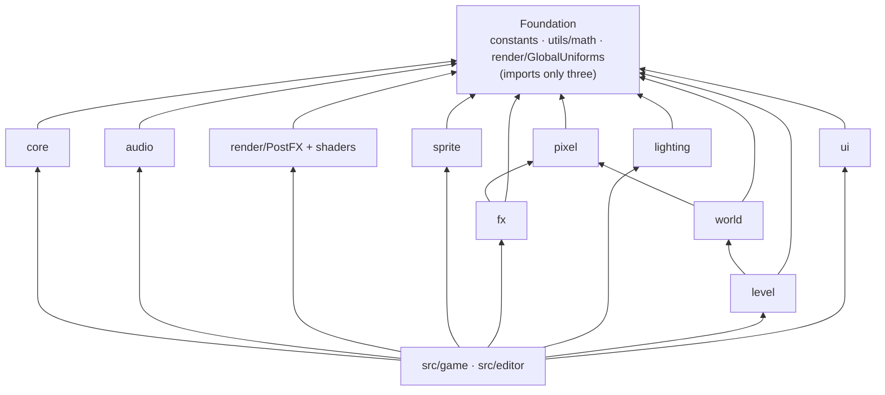

# 引擎模块参考：索引

[English](README.md) | 简体中文

> **用途**。这是 Luminati 引擎（`src/engine/`）各模块参考文档的入口。它列出每个模块领域，附一句话职责说明和指向其参考页的链接；展示各领域之间的依赖关系；完整转录 [`src/engine/index.js`](../../../src/engine/index.js) 导出的公开 API；并列出那些需要直接导入、而不通过汇总模块（barrel）导入的模块。当你需要在打开源码之前找到某样东西在哪里、或某个模块暴露了什么时，请从这里开始。
>
> **读者**：初次接触代码库的程序员和 AI 智能体，以及任何要添加或接入引擎模块的人。
>
> **权威来源：**[`src/engine/`](../../../src/engine/) 和汇总模块 [`src/engine/index.js`](../../../src/engine/index.js)。约束性的模块契约位于 [ARCHITECTURE.md §4](../../../ARCHITECTURE.md)。构建者和审核者的笔记位于 [MODULE_NOTES.md](../../contracts/MODULE_NOTES.md)。当它们不一致时，以代码为准。
>
> **相关文档：**[OVERVIEW.md](../OVERVIEW.md)（系统架构）· [RENDER_PIPELINE.md](../RENDER_PIPELINE.md) · [PERFORMANCE.md](../PERFORMANCE.md) · [GAME.md](../GAME.md) · [EDITOR.md](../EDITOR.md) · [diagrams.html](../diagrams.html) · [AGENT_ONBOARDING.md](../../ai/AGENT_ONBOARDING.zh-CN.md)

---

## 1. 模块地图

| 领域 | 文件（`src/engine/…`） | 职责 | 参考 |
| --- | --- | --- | --- |
| **基础** | `constants.js`、`utils/math.js`、`utils/own.js` | 世界单位（`PPU` 16、`LEVEL_HEIGHT` 0.5）、`DIRECTIONS`、`RENDER_ORDER`；带种子的随机数生成器、哈希、噪声、fBm、阻尼、Bayer 抖动；针对关卡数据的自有键查找和安全转换（`own.js`，不在汇总模块中）。 | [core.md §6–7](core.md#6-constants-srcengineconstantsjs) |
| **核心** | `core/Engine.js`、`core/Input.js`、`core/CameraRig.js`、`core/EventEmitter.js` | 渲染器、场景、相机和按顺序执行的系统循环；键盘、滚轮、指针和手柄动作；微缩场景跟随相机；事件总线。 | [core.md](core.md) |
| **音频** | `audio/AudioSystem.js` | 程序化 WebAudio：8 种音效、5 个环境音层、民谣循环曲《烬落之暮》（"Emberfall Evening"）。 | [audio.md](audio.md) |
| **渲染** | `render/PostFX.js`、`render/GlobalUniforms.js`、`render/shaders/*` | MSAA HDR 场景 → 带散景的移轴景深 → 软拐点泛光 → ACES → 调色。共享的逐帧 uniform（时间、夜晚、风、相机偏航角、太阳、雾）。 | [render.md](render.md) |
| **像素美术** | `pixel/PixelCanvas.js`、`pixel/Palette.js`、`pixel/Textures.js`、`pixel/CharacterSprites.js`、`pixel/PropSprites.js` | 像素绘制图元和纹理；共享调色板；46 种带法线贴图和自发光贴图的世界纹理；14 个角色预设、4 种生物和 23 种道具精灵，全部程序化生成。 | [pixel.md](pixel.md) |
| **精灵** | `sprite/Sprite3D.js`、`sprite/SpriteManager.js`、`sprite/Foliage.js`、`sprite/BlobBatch.js` | 受光照、投射阴影的动画公告板；逐帧精灵注册表；实例化的随风摇曳植被；实例化的接触阴影。 | [sprite.md](sprite.md) |
| **特效** | `fx/Particles.js`、`fx/GodRays.js` | 无状态的 GPU 粒子发射器和爆发（12 个预设）；跟随太阳的光束。 | [fx.md](fx.md) |
| **光照** | `lighting/LightingSystem.js`、`lighting/Sky.js`、`lighting/LightPool.js` | 24 小时关键帧调色板（太阳和月亮、按纹素对齐的阴影、半球光、雾、曝光、闪烁的点光源、自发光）；天空穹顶；在大关卡中共享的 12 个点光源固定池。 | [lighting.md](lighting.md) |
| **世界** | `world/TileMap.js`、`world/Water.js`、`world/WaterShore.js`、`world/shoreWorker.js`、`world/Props.js` + `world/props/*`、`world/SpatialSplit.js`、`world/ShadowCasters.js` | 地形网格、高度、可行走性与碰撞；带岸线烘焙（在 worker 中进行）的动画像素水面和瀑布；程序化道具工厂（房屋、树木、灯具、栅栏、桥梁、风车……）；大关卡合批、剔除和仅投影的阴影投射体。 | [world.md](world.md) |
| **关卡** | `level/LevelFormat.js`、`level/ObjectCatalog.js`、`level/ObjectBuilder.js`、`level/LevelStorage.js`、`level/LevelMap.js` | `luminati-level` JSON 格式（规范化、校验、字节稳定的序列化）；对象目录；根据关卡构建地形和对象；保存与加载（浏览器、开发服务器 API、文件）；绘制的俯视地图。 | [level.md](level.md) |
| **UI** | `ui/UI.js`、`ui/DialogBox.js`、`ui/Banner.js`、`ui/TitleScreen.js`、`ui/HUD.js`、`ui/InteractPrompt.js`、`ui/Fader.js`、`ui/DebugPanel.js`、`ui/Minimap.js`、像素 UI 套件（`ui/UiScale.js`、`ui/FontLoader.js`、`ui/GlyphFont.js`、`ui/art/`、`ui/layout/`），每个组件一份样式表 | 按照设计稿 G 绘制的像素风 DOM 叠加层，支持英语、日语和中文：带头像、打字机效果和选项的对话窗口，区域横幅，带语言选择行的标题画面，地点 / 时钟 / 图例 HUD，提示消息（toast），交互提示，淡入淡出，以及带统计信息、小地图和世界地图的调试面板（[PIXEL_UI.md](../../specs/PIXEL_UI.md)、[I18N.md](../../specs/I18N.md)）。 | [ui.md](ui.md) |

### 1.1 领域之间的依赖关系

导入关系在下图中只会指向“下方”（箭头表示“导入”）。游戏（`src/game/`）和编辑器（`src/editor/`）位于最上层，负责把各领域连接起来。



每个领域都会导入 `utils/math`。`render/GlobalUniforms` 被 core（`Engine`、`CameraRig`）、sprite、fx、lighting 和 world 导入；`PostFX` 本身并不使用它。除基础层之外，仅有的跨领域导入是 fx → pixel、world → pixel 和 level → world：core、audio、render、sprite、fx、lighting、level 和 ui 不会被其他任何引擎领域导入（只被汇总模块导入），并且 `src/engine/` 中没有任何代码导入 `src/game/` 或 `src/editor/`。

模块之间从不为了逐帧同步而相互调用。它们共享 `globalUniforms` 中的 uniform 对象（[render.md §2](render.md#2-globaluniforms)）：

- `Engine` 写入 `uTime`。
- `CameraRig` 写入 `uCameraYaw` 和 `uCameraPosition`（在编辑器中由 `EditorCamera` 写入）。
- `LightingSystem` 写入 `uNight`、`uSunDirection`、`uSunColor` 和 `uFogColor`。
- 游戏写入 `uWind` 和 `uWindStrength`。在阴天（雨、雪）期间，演示中的 `Weather` 还会在 `LightingSystem.update` 重新计算 `uSunColor` 和 `uFogColor` 之后，每帧将它们调灰。它每个关卡只设置一次 `uFogStart`（`Game._applyLevel`），而不是每帧设置。

### 1.2 演示中的逐帧顺序

```text
Engine tick: input.update
  → LightingSystem.update (order −10: clock, palette, sun/moon, uniforms)
  → game system (order 0): player → NPCs/critters → CameraRig.update → SpriteManager.update
      → BlobBatch.update → Weather → World.update → GodRays.update → Particles.update → HUD …
  → AudioSystem.update (order 20)
  → LightingSystem.lateUpdate (shadow frustum re-centred on this frame's camera)
  → 'lateUpdate' event: UI.update
  → uTime written → render fn: PostFX.setFocus + PostFX.render
  → 'afterRender': DebugStats.update → input.endFrame
```

详情：[core.md §2.3](core.md#23-frame-order)、[GAME.md](../GAME.md)、[RENDER_PIPELINE.md](../RENDER_PIPELINE.md)。

---

## 2. 公开 API（`src/engine/index.js`）

```js
import { Engine, CameraRig, PostFX, LightingSystem, TileMap /* … */ } from './engine/index.js';
```

导入汇总模块没有副作用，唯一的例外是 `ui/UI.js` 和各组件引入的 UI 样式表（不会导入任何字体：UI 的字体在运行时通过 `ui/FontLoader.js` 加载）。以下所有内容都**严格**以这些名称导出。

| 分区 | 导出 | 来源 | 参考 |
| --- | --- | --- | --- |
| 基础 | `PPU, TILE_SIZE, LEVEL_HEIGHT, DIRECTIONS, RENDER_ORDER` | `constants.js` | [core.md](core.md#6-constants-srcengineconstantsjs) |
| | `clamp, lerp, invLerp, remap, smoothstep, fract, damp, angleDelta, DEG2RAD, RAD2DEG, mulberry32, hashString, RNG, hash2, valueNoise2, fbm2, bayer4` | `utils/math.js` | [core.md](core.md#7-math-noise-and-randomness-srcengineutilsmathjs) |
| | `globalUniforms` | `render/GlobalUniforms.js` | [render.md](render.md#2-globaluniforms) |
| 核心 | `EventEmitter` | `core/EventEmitter.js` | [core.md](core.md#5-eventemitter) |
| | `Input, DEFAULT_BINDINGS, DEFAULT_PAD_BINDINGS, GAMEPAD_BUTTON_CODES` | `core/Input.js` | [core.md](core.md#3-input) |
| | `Engine, disposeObjectTree` | `core/Engine.js` | [core.md](core.md#2-engine) |
| | `CameraRig` | `core/CameraRig.js` | [core.md](core.md#4-camerarig) |
| 音频 | `AudioSystem, SFX_NAMES, AMBIENCE_LAYERS, COMBAT_SFX_NAMES, MUSIC_TRACKS, MUSIC_STINGERS` | `audio/AudioSystem.js` | [audio.md](audio.md) |
| 渲染 | `PostFX` | `render/PostFX.js` | [render.md](render.md#3-postfx-api) |
| 像素美术 | `PixelCanvas, parseColor, toHex, toCss, toThreeColor, mixColor, rgbToHsl, hslToRgb, shadeColor, rampFrom, makePixelTexture, normalMapFromHeight` | `pixel/PixelCanvas.js` | [pixel.md](pixel.md#2-pixelcanvas) |
| | `PALETTE, rampAt` | `pixel/Palette.js` | [pixel.md](pixel.md#3-palette) |
| | `TextureLibrary, TEXTURE_NAMES` | `pixel/Textures.js` | [pixel.md](pixel.md#4-texturelibrary-world-textures) |
| | `createCharacterSheet, createCreatureSheet, CHARACTER_PRESETS, materialRamp, COMBAT_POSE_NAMES` | `pixel/CharacterSprites.js` | [pixel.md](pixel.md#5-charactersprites) |
| | `createEnemySheet, ENEMY_SHEET_KINDS`（战斗） | `pixel/MonsterSprites.js` | [pixel.md](pixel.md) |
| | `createFxAtlas, FX_FRAMES`（战斗） | `pixel/FxSprites.js` | [pixel.md](pixel.md) |
| | `createPropSprite, PROP_SPRITE_KINDS` | `pixel/PropSprites.js` | [pixel.md](pixel.md#6-propsprites) |
| 精灵 | `Sprite3D, spriteSheetFromProp, patchSpriteLighting, cloneSharedTexture, GLSL_BAYER4` | `sprite/Sprite3D.js` | [sprite.md](sprite.md#2-sprite3d) |
| | `SpriteManager` | `sprite/SpriteManager.js` | [sprite.md](sprite.md#3-spritemanager) |
| | `BlobBatch` | `sprite/BlobBatch.js` | [sprite.md](sprite.md#5-blobbatch) |
| | `Foliage` | `sprite/Foliage.js` | [sprite.md](sprite.md#4-foliage) |
| 特效 | `Particles, PARTICLE_PRESETS, Emitter` | `fx/Particles.js` | [fx.md](fx.md) |
| | `GodRays` | `fx/GodRays.js` | [fx.md](fx.md#5-godrays) |
| | `FxQuads`（战斗） | `fx/FxQuads.js` | [fx.md](fx.md) |
| | `GroundMarkers, MARKER_GRID`（战斗） | `fx/GroundMarkers.js` | [fx.md](fx.md) |
| 光照 | `LightingSystem, DEFAULT_KEYFRAMES` | `lighting/LightingSystem.js` | [lighting.md](lighting.md) |
| | `Sky` | `lighting/Sky.js` | [lighting.md](lighting.md) |
| | `LightPool` | `lighting/LightPool.js` | [lighting.md](lighting.md) |
| 世界 | `TileMap, ORGANIC_TOPS, GRASS_TOPS, FRINGE_RECEIVERS, FRINGE_PRIORITY, paintDecalMask` | `world/TileMap.js` | [world.md](world.md) |
| | `Water, createWaterfall` | `world/Water.js` | [world.md](world.md) |
| | `PropFactory` | `world/Props.js` | [world.md](world.md) |
| UI | `UI, DialogBox, Banner, TitleScreen, HUD, InteractPrompt, Fader, DebugPanel, Minimap, WorldMap` | `ui/UI.js`（重新导出） | [ui.md](ui.md) |
| | `CombatHUD, BossBar, WorldLabels, Announcer, DeathScreen`（战斗；通过 `UI.useCombatUI()` 注册，由 `UI.enableCombat()` 创建） | `ui/CombatHUD.js`、`ui/BossBar.js`、`ui/WorldLabels.js`、`ui/Announcer.js`、`ui/DeathScreen.js`（在构建中无副作用：不使用它们的代码块不会包含它们） | [ui.md](ui.md) |
| | （*不在汇总模块中*）`Journal`、`Emotes`、`EndCard`（剧情；从各自的文件导入，并传给 `ui.useStoryUI()`） | `ui/Journal.js`、`ui/Emotes.js`、`ui/EndCard.js`（+ `ui/story.css`；在构建中无副作用） | [ui.md §11](ui.md#11-story-ui-story-levels-only) |
| | `DebugStats` | `ui/DebugPanel.js` | [ui.md](ui.md) |
| | `DEFAULT_CONTROLS, TIME_PHASES, timePhase, createKeycaps` | `ui/HUD.js` | [ui.md](ui.md) |
| 进阶：自定义道具 | `MeshBuilder, trs` | `world/props/MeshBuilder.js` | [world.md](world.md) |
| | `applyWind, createWindDepthMaterial` | `world/props/Wind.js` | [world.md](world.md) |
| | `createFlame, createFlameMaterial, createGlowMaterial` | `world/props/Flame.js` | [world.md](world.md) |
| | `PropTextureSet` | `world/props/PropTextures.js` | [world.md](world.md) |
| 进阶：自定义后期通道 | `FULLSCREEN_VERTEX, POST_COMMON_GLSL, CopyShader` | `render/shaders/PostCommon.js` | [render.md §7](render.md#7-shader-modules-exported-for-custom-passes) |
| | `GradeShader` | `render/shaders/GradeShader.js` | [render.md §7](render.md#7-shader-modules-exported-for-custom-passes) |
| | `BloomBrightPassShader` | `render/shaders/BloomShaders.js` | [render.md §7](render.md#7-shader-modules-exported-for-custom-passes) |
| | `createCocUniforms, DOF_COC_GLSL, DofPrefilterShader, goldenAngleKernel, createDofGatherShader, DofTentShader, DofBokehSpriteShader, DofCompositeShader` | `render/shaders/DofShaders.js` | [render.md §7](render.md#7-shader-modules-exported-for-custom-passes) |

### 2.1 不在汇总模块中：请直接导入

| 模块 | 主要导出 | 使用者 |
| --- | --- | --- |
| `level/LevelFormat.js` | `LEVEL_FORMAT`、`LEVEL_VERSION`、`createEmptyLevel`、`normalizeLevel`、`validateLevel`、`serializeLevel`、`parseLevel`、`getTile`/`setTile`、`getHeightLevel`/`setHeightLevel`、`toTileMapInput`、`resizeLevel`、`shiftLevelContent`、`levelStats` …… | 游戏、编辑器、`tools/` 中的生成器 |
| `level/ObjectCatalog.js` | `OBJECT_TYPES`、`OBJECT_CATEGORIES`、`CHARACTER_PRESET_NAMES`、`CRITTER_KINDS`、`EMITTER_PRESETS`、`NPC_ACTIONS`、`NPC_BEHAVIOURS`、`createObject`、`normalizeObject`、`objectBounds`、`hitTestObject` …… | 编辑器检查器、游戏、构建器 |
| `level/ObjectBuilder.js` | `LevelObjectBuilder`、`buildLevelTerrain`、`buildWaterfall`、`computeCameraBounds`、`waterGlint`、`LIGHT_PRIORITY`、`bridgeDeckHeight` | 游戏的 `World`、编辑器 3D 预览 |
| `level/LevelStorage.js` | `resolveLevelFromURL`、`listProjectLevels`、`saveProjectLevel`、`loadProjectLevel`、`saveLocalLevel`、`loadLocalLevel`、`PLAYTEST_SLOT` …… | `src/main.js`、`src/game/Game.js`、编辑器 |
| `level/LevelMap.js` | `renderLevelMap(level, { pixelsPerTile })` → `{ canvas, pixelsPerTile, width, depth }` | 游戏（`Game._setupMaps`），它将画布交给 UI 的 `Minimap` 和 `WorldMap` |
| `world/SpatialSplit.js` | `kdSplit`、`triangleCount`、`cullByBox` | 大关卡合批 |
| `world/ShadowCasters.js` | `buildShadowCasters`、`makeShadowOnly`、`isProxyCaster`、`isShadowFrustum` | 大关卡阴影、精灵代理 |
| `world/WaterShore.js`、`world/shoreWorker.js` | `bakeShore`（纯函数），以及供 `Water.refreshAsync()` 使用的 worker | `Water`、编辑器 |
| `world/props/*.js` | `buildHouse`、`buildTree`、`buildLamppost`、`buildWallTorch`、`buildCampfire`、`buildFence`、`buildWell`、`buildMarketStall`、`buildBridge`、`buildWindmill` …… | `PropFactory` 内部 |

关卡格式及其 API 在 [LEVEL_FORMAT.md](../../specs/LEVEL_FORMAT.md)、[OBJECT_CATALOG.md](../../specs/OBJECT_CATALOG.md) 和 [LEVEL_STORAGE_API.md](../../specs/LEVEL_STORAGE_API.md) 中定义。约束性契约是 [contracts/LEVEL_EDITOR.md](../../contracts/LEVEL_EDITOR.md)。

---

## 3. 沙盒（单独测试一个模块）

每个模块在 [`sandbox/`](../../../sandbox/) 下都有一个独立的测试页面。运行 `npm run dev` 后，打开 `http://127.0.0.1:5173/sandbox/`（可从 `/` 处的启动器进入），即可看到一个附有链接和 URL 变体的索引页。无头验证（见 [TESTING_AND_VERIFICATION.md](../../development/TESTING_AND_VERIFICATION.md)）：

```bash
npm run check -- --page=sandbox/<page>.html --query= --out=<name> [--script=sandbox/<script>.json]
```

`--query` 默认为 `autostart=1`（针对游戏页面 `game.html`，即默认的 `--page`）。传入 `--query=` 表示不带参数，或传入页面自己的参数（例如 `--query=view=atlas`）。所有脚本都位于 `sandbox/` 中。

| 页面 | 模块 | `window` 句柄 | 动作脚本 |
| --- | --- | --- | --- |
| `core.html` | Engine、Input、CameraRig、AudioSystem | `__core`（以及 `__engine`） | `core.actions.json`、`core.audio.actions.json`、`core.audio2.actions.json` |
| `postfx.html` | PostFX、景深、泛光、调色 | `__postfx` | `postfx.actions.json`、`postfx.robust.json`、`postfx.flicker.json`、`postfx.nan.json`、`postfx.perf.json` |
| `textures.html` | TextureLibrary、PixelCanvas、Palette | `__tex` | `textures.actions.json` |
| `sprite_art.html` | CharacterSprites、PropSprites；MonsterSprites、FxSprites、Sprite3D `combatFx`（`?mode=combat`、`?mode=hashes`） | `__sprites`、`__spriteCombat` | `sprite_art.actions.json`、`sprite_art.combat.json` |
| `sprite_runtime.html` | Sprite3D、SpriteManager、Foliage、Particles | `__sb` | `sprite_runtime.actions.json` |
| `lighting.html` | LightingSystem、Sky、GodRays | `__lighting` | `lighting.actions.json`、`lighting.quick.json`、`lighting.shadow.json` |
| `lighting_engine.html` | LightingSystem + Engine + CameraRig + PostFX + GodRays | `__lightEngine` | `lighting_engine.actions.json` |
| `terrain.html` | TileMap、Water、createWaterfall | `__terrain` | `terrain.actions.json`、`terrain.detail.json`、`terrain.perf.json`、`terrain.quick.json` |
| `props.html` | PropFactory、mergeStatic | `__props` | `props.actions.json`、`props.flame.json`、`props.gallery.json`、`props.merge.json`、`props.wind.json` |
| `ui.html` | UI 组件（`?combat=1`：战斗 UI） | `__ui`、`__sandbox` | `ui.actions.json`、`ui.combat.actions.json` |
| `combat_fx.html` | FxQuads、GroundMarkers、战斗爆发效果、战斗音频、鼠标输入、摇杆缩放 | `__cfx` | `combat_fx.actions.json` |
| `combat_audio.html` | 战斗音频 QA 与试听页面：每个战斗音效、短乐句（stinger）、音乐段落和密集混音都会离线渲染并测量（响度、真峰值、截断、阶跃、泄漏、频谱），附有波形、频谱图和实时播放 | `__caudio` | `combat_audio.actions.json` |
| `enemy_ai.html` | 敌人和八种 AI 大脑（游戏层代码，单独测试；行走网格 `Nav` 位于模拟的岩架上） | `__sb` | `enemy_ai.actions.json` |
| `game_levels.html` | 游戏关卡加载的边界情况（`?case=hostile`：关卡数据中的 `Object.prototype` 名称和无法转换的值，分别在游戏和编辑器中测试） | `__levelCases` | `game_levels.hostile.json` |
| `level_builder.html` | LevelFormat + LevelObjectBuilder 冒烟测试 | `__smoke` | 无 |
| `editor3d.html` | 单独测试编辑器的 3D 视口 | `__vp` | `editor3d.actions.json`、`editor3d.audit.actions.json`、`editor3d.real.actions.json`、`editor3d.tilemap.actions.json`（`editor3d.app.actions.json` 通过 `window.__editor` 驱动 `editor.html`） |
| `smoke.html` | three.js 冒烟测试 | 无 | 无 |

`sandbox/editor_shell.*.json` 和 `sandbox/editor_perf*.json` 脚本驱动真实的 `editor.html`（见 [EDITOR.md](../EDITOR.md) 和 [TESTING_AND_VERIFICATION.md](../../development/TESTING_AND_VERIFICATION.md)）；`sandbox/launcher.json` 驱动启动器 `index.html`（`--page=index.html --query= --fps=0`）。

---

## 4. 所有模块都遵循的约定

以下是简要列表；完整规则见 [ARCHITECTURE.md §2](../../../ARCHITECTURE.md) 和 [CONVENTIONS.md](../../development/CONVENTIONS.md)。

- three.js **r186**、原生 JS ES 模块、公开 API 带 JSDoc、`import * as THREE from 'three'`。JSDoc 会经过类型检查（`npm run typecheck`）；含有延迟创建字段或共享契约类型的文件夹有一个仅含类型的 `types.d.ts`（`core`、`audio`、`render`、`lighting`、`world`、`level`、`ui`）——见 [CONVENTIONS.md §3.1](../../development/CONVENTIONS.md#31-the-type-check)。
- **Y 轴朝上**。瓦片 `(i, j)` 覆盖 `x∈[i,i+1], z∈[j,j+1]`。世界高度 = 层级 × 0.5。每单位 16 个纹素。相机偏航角为 0 时朝向 −Z，因此屏幕向下即 +Z。
- **色彩管理**：SRGB 输出。颜色纹理为 SRGB，数据纹理为 `NoColorSpace`。ACES 色调映射只进行一次，在 PostFX 的 `OutputPass` 中。`toneMappingExposure` 归 `LightingSystem` 所有。
- **确定性**：程序化内容使用带种子的 `RNG` / `hash2` / `fbm2`，绝不使用 `Math.random()`。
- **资源释放**：每个分配 GPU 资源的类都有 `dispose()`。
- **固定光源数量**：最多 12 个点光源（游戏中为 `min(12, light descriptors)`），全部在第一帧之前创建。改变数量（或切换 `light.visible`）会重新编译所有受光照的着色器。请改为渐变光照强度（[lighting.md](lighting.md)）。
- **针对 `postfx.sceneTarget` 预热着色器**（[render.md §6](render.md#6-wiring-rules-read-before-touching-the-pipeline)）。
- **契约修改必须是增量式的**。绝不重命名契约成员或改变其含义。记录你新增的内容。

各模块的已知限制和未解决问题汇总在 [KNOWN_ISSUES.md](../../ai/KNOWN_ISSUES.md) 中。常见改动的操作手册见 [TASK_PLAYBOOKS.md](../../ai/TASK_PLAYBOOKS.md)。

模块页面保留了那些能解释设计选择或限制的实现说明。扩展模块时，请以当前的 API 章节和源文件为准。[架构概览](../OVERVIEW.md)描述了各模块如何组合在一起。
