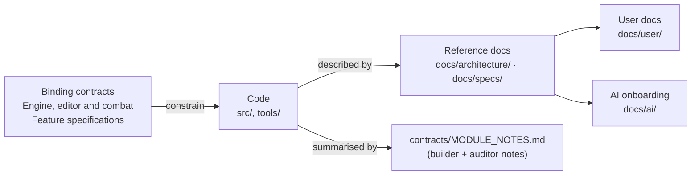

# Contracts — what is binding, what is descriptive, and how to change it

English | [简体中文](README.zh-CN.md)

> **Purpose.** Luminati uses written contracts to define exported names, signatures, units and
> conventions. This page explains which
> documents are *binding* contracts, which are *descriptive* notes, how they relate to the code
> and to the rest of `docs/`, and the rules for changing a contract without breaking the modules
> and level files that depend on it.
>
> **Audience:** anyone (human or AI agent) about to change a public engine API, the level format,
> the editor's internal interfaces, or one of the contract documents themselves.
>
> **Source of truth:** [`ARCHITECTURE.md`](../../ARCHITECTURE.md),
> [`LEVEL_EDITOR.md`](LEVEL_EDITOR.md), [`COMBAT.md`](COMBAT.md), [`MODULE_NOTES.md`](MODULE_NOTES.md), and the code they
> describe: [`src/engine/`](../../src/engine/), [`src/engine/level/`](../../src/engine/level/),
> [`src/editor/`](../../src/editor/), [`tools/vite-level-api.js`](../../tools/vite-level-api.js).
>
> **Related:** [Architecture overview](../architecture/OVERVIEW.md) ·
> [CONVENTIONS.md](../development/CONVENTIONS.md) (the code rules the contracts imply) ·
> [DEVELOPMENT_WORKFLOW.md](../development/DEVELOPMENT_WORKFLOW.md) (contribution and verification workflow) · [architecture/modules/](../architecture/modules/README.md) (current module
> reference) · [specs/LEVEL_FORMAT.md](../specs/LEVEL_FORMAT.md) (readable level-format spec)

---

## 1. Core contracts and feature specifications

| Document | Status | Scope | Read it when… |
| --- | --- | --- | --- |
| [`ARCHITECTURE.md`](../../ARCHITECTURE.md) (repository root) | **Binding** | The visual target (§1), engine conventions (§2: units, axes, colour management, materials, pixel textures, shared uniforms, seeded randomness, disposal, no side effects on import), the shared foundation files, directory ownership (§3), the public contract of every engine module (§4.1 core … §4.8 UI), the demo integration brief (§5) and the sandbox rule (§6). | You change anything under `src/engine/` that another module, the demo or the editor calls. |
| [`docs/contracts/LEVEL_EDITOR.md`](LEVEL_EDITOR.md) | **Binding** | The `luminati-level` v1 JSON format (§1), the object catalog (§2), the level builder (§3), saving and loading incl. the dev-server API (§4), how the game loads levels and every optional field (§5), the editor architecture incl. the `Viewport3D` and `Map2DView` contracts (§6), the tool interface (§7), UX and visual spec (§8) and the performance design with measurements (§9). | You touch `src/engine/level/`, `src/editor/`, the game's level loading (`src/main.js`, `src/game/World.js`, `src/game/Game.js`), a level generator, or a level file's schema. |
| [`docs/contracts/COMBAT.md`](COMBAT.md) | **Binding** | The ARPG combat (2026-09-28): per-level enabling (§3), architecture and frame order (§4), controls and combat-only rebinding (§5), player rules (§6), enemies (§7), the Cinderheart boss (§8), the runtime interfaces between the combat core and the enemies (§9), sprites (§10), VFX (§11), audio (§12), UI (§13), the three combat catalog types (§14), the demo level Cinderwatch Pass (§15), budgets, warm-up, automation and tests (§18–§21), and the **deviations recorded at integration and after the review** (§27; revisions 4 and 5 amend the changed values in place). | You touch `src/game/combat/`, a combat engine piece (`FxQuads`, `GroundMarkers`, the combat UI components, `MonsterSprites`, `FxSprites`, the `Sprite3D` `combatFx` variant), `tools/make-cinderwatch-pass.mjs`, or anything a peaceful level must not notice (§2). |
| [`docs/contracts/MODULE_NOTES.md`](MODULE_NOTES.md) | **Descriptive** | What each engine module *actually* implements, condensed from the builder and auditor reports: files, API summary, deviations and additions, integrator notes, known limitations, remaining audit issues; plus the big-level scalability section and the Starfall Vale integration and review passes. | You need to know how a module behaves beyond its contract (extras, interpretations, caveats) before wiring or changing it. |

The first three are *binding*: their names, signatures and meanings must keep working.
`MODULE_NOTES.md` is an implementation record that can lag the code. The current module references
and typed interfaces are the starting point for maintenance.

Feature specifications add their own contracts, including [the pixel UI](../specs/PIXEL_UI.md),
[campaigns](../specs/CAMPAIGN_FORMAT.md), [story scripts](../specs/STORY_SCRIPT.md),
[the party](../specs/PARTY.md) and [automation hooks](../specs/AUTOMATION_API.md).
Read the relevant specification alongside the core contract when changing those features; the
same additive rule applies to their interfaces and data formats.

---

## 2. Precedence: which document wins?

There are two different questions, and they have different answers.

**"What does the code do today?"** — the **code** wins, then the reference docs in
[`docs/architecture/`](../architecture/OVERVIEW.md) and [`docs/specs/`](../specs/LEVEL_FORMAT.md)
(written against the code), then `MODULE_NOTES.md`, then the contracts.
[`AGENTS.md`](../../AGENTS.md) provides the shared development guidance.

**"What am I allowed to change?"** — the **contracts** win. A member, field or behaviour named in
any binding contract must not be renamed or given a different meaning, even if
nothing in the repository calls it today: level files written by users, the editor, generators
and test scripts depend on it.

When you find a disagreement:

1. The code differs from a **binding contract** in a way that renames or changes the meaning of a
   member → treat it as a bug unless `MODULE_NOTES.md` or [§4](#4-known-differences-between-the-contracts-and-the-code)
   below lists it as a deliberate deviation.
2. The code has **more** than the contract (extra options, extra members) → normal; additions are
   allowed and are documented in the reference docs.
3. A **reference doc** differs from the code → fix the doc.

**Typed copies.** Since 2026-09-30 the contracts' interfaces are also declared as types the code is
checked against (`npm run typecheck`): the level document in
[`src/engine/level/types.d.ts`](../../src/engine/level/types.d.ts) (LEVEL_EDITOR.md §1–§2), the
`PropResult` typedef in [`Props.js`](../../src/engine/world/Props.js) (ARCHITECTURE.md §4), the
combat interfaces in [`src/game/combat/types.d.ts`](../../src/game/combat/types.d.ts) (COMBAT.md §9,
§20), the tool interface in [`src/editor/tools/index.js`](../../src/editor/tools/index.js)
(LEVEL_EDITOR.md §7) and the automation hooks (`GameHooks`, `EditorHooks`, `LuminatiHooks`,
[`src/globals.d.ts`](../../src/globals.d.ts)) — the full list is in
[CONVENTIONS.md §3.1](../development/CONVENTIONS.md#31-the-type-check). They were written from the
code and say where the contract text differs, so for "what does the code do" they rank with the
code. The additive rule applies to them as well: a member renamed in a type fails the check
everywhere it is used, which is how the check guards the contracts.

---

## 3. How to change a contract (the additive rule)

The default rule is: **changes to contracts must be additive — never rename or change the meaning
of a contract member; update the docs when adding behaviour.**

### 3.1 Allowed without discussion

| Kind of change | Rule | Examples |
| --- | --- | --- |
| New optional option, member, method or export | Give it a default that reproduces the old behaviour exactly. | `TileMap.rebuildRect`, `Engine.resizeThrottleMs`, `LightingSystem.retargetPointLight` / `setShadowDepthRange`, `BlobBatch` export. |
| New input action or binding | Add it; keep existing bindings unless the change is documented. | `map` action on `KeyN` / `Tab` / gamepad Back. This one *moved* photo mode from gamepad Back to the right-stick click — the only binding change so far, recorded in `ARCHITECTURE.md` §4.1 and `MODULE_NOTES.md`. |
| New optional level field | `normalizeLevel` / `normalizeObject` must give it a default that means "as before"; the editor must not write the default into files that lacked the field; unknown fields are preserved on save. | `environment.minimap`, `environment.forest.areas`, `environment.fogScale`, `water.glint`, npc `talkOffset` / `area` / `behaviour`, critters `spotOffsets`, the text keys (`textKeys` on the level and its objects, absent when there is nothing to key). |
| New event payload field | Add fields; never remove or retype existing ones. | `EditorState` `'change'` events gained `ids`; `null` still means "unknown, diff everything". |
| A behaviour that only applies past a threshold | Gate it so existing content is bit-identical. | Big-level batching only for levels wider or deeper than 64 tiles (`World.isBigLevel`, budgets in the exported `BIG_LEVEL_BATCHING` of `src/game/World.js`); Emberfall, Willowmere and Brightwater Crossing were verified to build identical meshes, lights, draw calls and triangles. (The same workflow's god-ray culling was *not* gated and took one shaft off Emberfall, 203 → 202 draw calls — an accepted, documented change.) |

### 3.2 Needs a documented decision

- **Changing a default value** that affects existing content (for example `LightPool`
  `priorityWeight` 4 → 1.5, which only affects pooled levels) — record the reason and
  the measurement in `MODULE_NOTES.md` and the module reference.
- **Removing or renaming** a contract member, or changing a unit, axis, colour space or stored
  format, requires an explicitly agreed breaking change. Document the reason, update the affected
  specifications and typed interfaces, and regenerate or re-save all shipped data in the same
  change. State which existing files or browser saves will no longer load.
- **Compatibility policy:** support the current names and formats only. Do not add migration
  readers, old-name aliases or storage fallbacks unless compatibility is explicitly requested.

### 3.3 Checklist for a contract change

1. Make the change additive (defaults reproduce the old behaviour).
2. Update the relevant binding document in the same change
   and its typed copy (§2), and run `npm run typecheck`.
3. Update the reference doc under [`docs/architecture/modules/`](../architecture/modules/README.md) or
   [`docs/specs/`](../specs/LEVEL_FORMAT.md), and `MODULE_NOTES.md` if it records a deviation or caveat.
4. If players or level authors can see it, update [`docs/user/`](../user/GETTING_STARTED.md) and
   `README.md`.
5. Run the regression checks for the area you touched
   ([TESTING_AND_VERIFICATION.md §12](../development/TESTING_AND_VERIFICATION.md#12-pre-commit-verification-checklist)):
   Emberfall fingerprint, level round-trip byte-stability, generator determinism, shader-program
   count.

---

## 4. Known differences between the contracts and the code

These are documented deviations or stale statements in the original contract text. The
differences the type-check pass found on
2026-09-30 were written into the contracts additively (KNOWN_ISSUES DOC-15, COMBAT.md §27.21).

| Contract text | Code | Where it is recorded |
| --- | --- | --- |
| `ARCHITECTURE.md` §4.1: the renderer uses `PCFSoftShadowMap`. | three r186 removed `PCFSoftShadowMap` for WebGL (it logs a warning and falls back). `Engine` defaults to `THREE.PCFShadowMap` (which is soft and radius-aware in r186) and maps an explicit `PCFSoftShadowMap` to it; `LightingSystem` does the same. | `MODULE_NOTES.md` (core, postfx, sprite_runtime, lighting and props sections); `Engine.js` constructor comment; since 2026-10-07 a correction note under the `Engine` contract in `ARCHITECTURE.md` §4.1. |
| `ARCHITECTURE.md` §3 directory layout. | Incomplete: it predates `src/engine/level/`, `LightPool.js`, `SpatialSplit.js`, `ShadowCasters.js`, `WaterShore.js`, `shoreWorker.js`, `BlobBatch.js`, `Minimap.js` and `src/editor/` (it does allow the optional `world/props/*.js` split that exists). | [architecture/OVERVIEW.md](../architecture/OVERVIEW.md) has the current layout; since 2026-10-07 `ARCHITECTURE.md` §3 lists the newer files below its original sketch. |
| `ARCHITECTURE.md` §2: addons such as `three/addons/postprocessing/EffectComposer.js`. | Only an example: `PostFX` drives its passes by hand (`UnrealBloomPass`, `OutputPass`, `FullScreenQuad`) and uses no `EffectComposer`; only the lighting sandbox (`sandbox/lighting.js`) builds a stand-in bloom chain with one. | [architecture/RENDER_PIPELINE.md](../architecture/RENDER_PIPELINE.md); since 2026-10-07 a note in `ARCHITECTURE.md` §2. |
| `ARCHITECTURE.md` §5: `window.__game` exposes `{ engine, setTime(h), teleport(x, z), player, postfx, lighting, ui }`. | A superset: also `rig, audio, tileMap, textures, particles, godRays, npcs, world, weather, game, level, levelSource, talkTo, setWeather, cycleTime, cycleWeather, setMusic, photo, map, state`. | [specs/AUTOMATION_API.md](../specs/AUTOMATION_API.md); since 2026-10-07 a note in `ARCHITECTURE.md` §5. |
| `ARCHITECTURE.md` §4.2: `PostFX` options `{ samples, dofScale }`. | Adds the option `maxTaps` (48 / 64 / 96, default 96; the game passes 64) and the members `enableTimings()`, `timings`, `timingsMin`, `sceneInfo`, `sceneTarget`, `warmup()`. | `MODULE_NOTES.md` (postfx); [architecture/modules/render.md](../architecture/modules/render.md). |
| `ARCHITECTURE.md` §1 budget "≤ 12 active point lights". | Still true for the GPU, but a level may have any number of light *descriptors*; `LightPool` shares the 12 lights. | `MODULE_NOTES.md` (scalability); [Fixed light pool](../architecture/modules/lighting.md). |
| `MODULE_NOTES.md` core section: gamepad "Start = help, Back = photo". | Stale: gamepad Back opens the world map (`map`) and photo mode is on the right-stick click (`GamepadRS`, `DEFAULT_PAD_BINDINGS` in `Input.js`). The scalability section of the same file records the move. | `ARCHITECTURE.md` §4.1; [specs/INPUT_AND_CONTROLS.md](../specs/INPUT_AND_CONTROLS.md); since 2026-10-07 an inline errata mark at the stale sentence. |

---

## 5. Map of the contract sections to the current reference

| Contract section | What it fixes | Current reference |
| --- | --- | --- |
| `ARCHITECTURE.md` §1 | The 2.5D pixel-art look and the performance target (60 fps at 1600×900 with hardware acceleration; ≤ 300 draw calls, ≤ 12 point lights, one 2048² shadow map, DOF at half resolution). | [design/VISUAL_DESIGN.md](../design/VISUAL_DESIGN.md), [architecture/PERFORMANCE.md](../architecture/PERFORMANCE.md) |
| `ARCHITECTURE.md` §2 | Conventions. | [CONVENTIONS.md](../development/CONVENTIONS.md) |
| `ARCHITECTURE.md` §4.1–§4.8 | Module APIs. | [architecture/modules/](../architecture/modules/README.md) (`core`, `audio`, `render`, `pixel`, `sprite`, `fx`, `lighting`, `world`, `ui`) |
| `ARCHITECTURE.md` §5 | Game integration. | [architecture/GAME.md](../architecture/GAME.md) |
| `ARCHITECTURE.md` §6 | Sandbox-first module testing. | [TESTING_AND_VERIFICATION.md](../development/TESTING_AND_VERIFICATION.md) |
| `LEVEL_EDITOR.md` §1–§2 | Level format and object catalog. | [specs/LEVEL_FORMAT.md](../specs/LEVEL_FORMAT.md), [specs/OBJECT_CATALOG.md](../specs/OBJECT_CATALOG.md) |
| `LEVEL_EDITOR.md` §3, §5 | Building levels; game integration. | [architecture/modules/level.md](../architecture/modules/level.md), [architecture/GAME.md](../architecture/GAME.md) |
| `LEVEL_EDITOR.md` §4 | Storage and the dev-server API. | [specs/LEVEL_STORAGE_API.md](../specs/LEVEL_STORAGE_API.md) |
| `LEVEL_EDITOR.md` §6–§9 | Editor architecture, tools, UX, performance design. | [architecture/EDITOR.md](../architecture/EDITOR.md), [user/LEVEL_EDITOR_GUIDE.md](../user/LEVEL_EDITOR_GUIDE.md) |
| `COMBAT.md` §4–§9, §20 | Combat wiring, rules and interfaces, the automation hooks. | [architecture/GAME.md §15](../architecture/GAME.md#15-combat-combat-levels-only), [specs/AUTOMATION_API.md](../specs/AUTOMATION_API.md) |
| `COMBAT.md` §10–§13 | Combat sprites, VFX, audio, UI. | [pixel.md](../architecture/modules/pixel.md), [sprite.md](../architecture/modules/sprite.md), [fx.md](../architecture/modules/fx.md), [audio.md](../architecture/modules/audio.md), [ui.md](../architecture/modules/ui.md) |
| `COMBAT.md` §14–§17 | Combat catalog types, Cinderwatch Pass, the editor. | [specs/OBJECT_CATALOG.md](../specs/OBJECT_CATALOG.md), [design/levels/cinderwatch-pass.md](../design/levels/cinderwatch-pass.md), [architecture/EDITOR.md](../architecture/EDITOR.md) |
