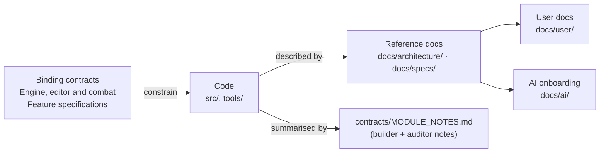

# 契约——哪些具有约束力，哪些是描述性的，以及如何修改

[English](README.md) | 简体中文

> **用途**。Luminati 使用书面契约来规定导出名称、函数签名、单位和约定。本页说明哪些文档是*约束性*契约、哪些是*描述性*笔记，它们与代码以及 `docs/` 其他部分的关系，以及在不破坏依赖于契约的模块和关卡文件的前提下修改契约的规则。
>
> **读者**：任何即将修改公开引擎 API、关卡格式、编辑器内部接口或契约文档本身的人（人类或 AI 智能体）。
>
> **权威来源：**[`ARCHITECTURE.md`](../../ARCHITECTURE.md)、[`LEVEL_EDITOR.md`](LEVEL_EDITOR.md)、[`COMBAT.md`](COMBAT.md)、[`MODULE_NOTES.md`](MODULE_NOTES.md)，以及它们所描述的代码：[`src/engine/`](../../src/engine/)、[`src/engine/level/`](../../src/engine/level/)、[`src/editor/`](../../src/editor/)、[`tools/vite-level-api.js`](../../tools/vite-level-api.js)。
>
> **相关文档：**[架构概览](../architecture/OVERVIEW.md) · [CONVENTIONS.md](../development/CONVENTIONS.md)（契约所隐含的代码规则）· [DEVELOPMENT_WORKFLOW.md](../development/DEVELOPMENT_WORKFLOW.zh-CN.md)（贡献与验证工作流程）· [architecture/modules/](../architecture/modules/README.zh-CN.md)（当前的模块参考）· [specs/LEVEL_FORMAT.md](../specs/LEVEL_FORMAT.md)（易读的关卡格式规范）

---

## 1. 核心契约与功能规范

| 文档 | 状态 | 范围 | 何时阅读…… |
| --- | --- | --- | --- |
| [`ARCHITECTURE.md`](../../ARCHITECTURE.md)（仓库根目录） | **约束性** | 视觉目标（§1）、引擎约定（§2：单位、坐标轴、色彩管理、材质、像素纹理、共享 uniform、带种子的随机数、资源释放、导入时无副作用）、共享的基础文件、目录归属（§3）、每个引擎模块的公开契约（§4.1 core … §4.8 UI）、演示集成说明（§5）以及沙盒规则（§6）。 | 当你修改 `src/engine/` 下任何会被其他模块、演示或编辑器调用的内容时。 |
| [`docs/contracts/LEVEL_EDITOR.md`](LEVEL_EDITOR.md) | **约束性** | `luminati-level` v1 JSON 格式（§1）、对象目录（§2）、关卡构建器（§3）、保存与加载（含开发服务器 API）（§4）、游戏如何加载关卡及每个可选字段（§5）、编辑器架构（含 `Viewport3D` 和 `Map2DView` 契约）（§6）、工具接口（§7）、用户体验与视觉规范（§8），以及附测量数据的性能设计（§9）。 | 当你修改 `src/engine/level/`、`src/editor/`、游戏的关卡加载（`src/main.js`、`src/game/World.js`、`src/game/Game.js`）、某个关卡生成器或关卡文件的模式时。 |
| [`docs/contracts/COMBAT.md`](COMBAT.md) | **约束性** | ARPG 战斗（2026-09-28）：按关卡启用（§3）、架构与帧顺序（§4）、操作与仅限战斗的重新绑定（§5）、玩家规则（§6）、敌人（§7）、首领烬心（Cinderheart）（§8）、战斗核心与敌人之间的运行时接口（§9）、精灵（§10）、视觉特效（§11）、音频（§12）、UI（§13）、三种战斗目录类型（§14）、演示关卡烬望隘口（Cinderwatch Pass）（§15）、预算、预热、自动化和测试（§18–§21），以及**集成时和评审后记录的偏差**（§27；第 4 和第 5 次修订直接在原处修正了变更的数值）。 | 当你修改 `src/game/combat/`、某个战斗引擎部件（`FxQuads`、`GroundMarkers`、战斗 UI 组件、`MonsterSprites`、`FxSprites`、`Sprite3D` 的 `combatFx` 变体）、`tools/make-cinderwatch-pass.mjs`，或任何和平关卡不应察觉到的内容（§2）时。 |
| [`docs/contracts/MODULE_NOTES.md`](MODULE_NOTES.md) | **描述性** | 每个引擎模块*实际*实现了什么，由构建者和审核者的报告浓缩而成：文件、API 摘要、偏差与新增内容、集成者笔记、已知限制、尚存的审核问题；另有大关卡可扩展性章节，以及星落谷（Starfall Vale）的集成和评审记录。 | 当你在接入或修改某个模块之前，需要了解它超出契约之外的行为（额外功能、解读方式、注意事项）时。 |

前三份是*约束性*的：其中的名称、签名和含义必须持续有效。`MODULE_NOTES.md` 是一份实现记录，可能落后于代码。当前的模块参考和带类型的接口才是维护工作的起点。

功能规范也包含各自的契约，包括[像素 UI](../specs/PIXEL_UI.md)、[战役](../specs/CAMPAIGN_FORMAT.md)、[剧情脚本](../specs/STORY_SCRIPT.md)、[队伍](../specs/PARTY.md)和[自动化钩子](../specs/AUTOMATION_API.md)。修改这些功能时，请将相关规范与核心契约一并阅读；同样的“只增不改”规则也适用于它们的接口和数据格式。

---

## 2. 优先级：以哪份文档为准？

这里有两个不同的问题，答案也不同。

**“代码现在做的是什么？”**——以**代码**为准，其次是 [`docs/architecture/`](../architecture/OVERVIEW.md) 和 [`docs/specs/`](../specs/LEVEL_FORMAT.md) 中的参考文档（依据代码编写），然后是 `MODULE_NOTES.md`，最后是契约。[`AGENTS.md`](../../AGENTS.md) 提供通用的开发指引。

**“我可以修改什么？”**——以**契约**为准。任何约束性契约中提到的成员、字段或行为都不得重命名或赋予不同的含义，即使仓库中目前没有任何地方调用它：用户编写的关卡文件、编辑器、生成器和测试脚本都依赖于它。

发现不一致时：

1. 代码与某份**约束性契约**不同，且重命名了某个成员或改变了其含义 → 视为缺陷，除非 `MODULE_NOTES.md` 或下文 [§4](#4-契约与代码之间的已知差异) 将其列为有意为之的偏差。
2. 代码比契约**多**出一些内容（额外的选项、额外的成员）→ 这很正常；新增是允许的，并会记录在参考文档中。
3. **参考文档**与代码不同 → 修正文档。

**带类型的副本**。自 2026-09-30 起，契约中的接口也被声明为类型，代码会依据这些类型进行检查（`npm run typecheck`）：关卡文档在 [`src/engine/level/types.d.ts`](../../src/engine/level/types.d.ts) 中（LEVEL_EDITOR.md §1–§2），`PropResult` typedef 在 [`Props.js`](../../src/engine/world/Props.js) 中（ARCHITECTURE.md §4），战斗接口在 [`src/game/combat/types.d.ts`](../../src/game/combat/types.d.ts) 中（COMBAT.md §9、§20），工具接口在 [`src/editor/tools/index.js`](../../src/editor/tools/index.js) 中（LEVEL_EDITOR.md §7），自动化钩子（`GameHooks`、`EditorHooks`、`LuminatiHooks`）在 [`src/globals.d.ts`](../../src/globals.d.ts) 中——完整列表见 [CONVENTIONS.md §3.1](../development/CONVENTIONS.md#31-the-type-check)。这些类型依据代码编写，并注明了与契约文本不同之处，因此在“代码做的是什么”这一问题上，它们与代码具有同等地位。“只增不改”规则同样适用于它们：在类型中重命名一个成员，会导致所有使用它的地方检查失败——类型检查正是以这种方式守护契约的。

---

## 3. 如何修改契约（“只增不改”规则）

默认规则是：**对契约的修改必须是增量式的——绝不重命名契约成员或改变其含义；新增行为时要同步更新文档。**

### 3.1 无需讨论即可进行的修改

| 修改类型 | 规则 | 示例 |
| --- | --- | --- |
| 新的可选选项、成员、方法或导出 | 为其提供一个能精确重现旧行为的默认值。 | `TileMap.rebuildRect`、`Engine.resizeThrottleMs`、`LightingSystem.retargetPointLight` / `setShadowDepthRange`、`BlobBatch` 导出。 |
| 新的输入动作或绑定 | 直接添加；除非改动已记录在文档中，否则保留现有绑定。 | 绑定在 `KeyN` / `Tab` / 手柄 Back 键上的 `map` 动作。这一改动把拍照模式从手柄 Back 键*移到*了右摇杆按下——这是迄今为止唯一的绑定变更，已记录在 `ARCHITECTURE.md` §4.1 和 `MODULE_NOTES.md` 中。 |
| 新的可选关卡字段 | `normalizeLevel` / `normalizeObject` 必须为其提供表示“与以前相同”的默认值；对于原本没有该字段的文件，编辑器不得将默认值写入；保存时保留未知字段。 | `environment.minimap`、`environment.forest.areas`、`environment.fogScale`、`water.glint`、npc 的 `talkOffset` / `area` / `behaviour`、critters 的 `spotOffsets`、文本键（关卡及其对象上的 `textKeys`，没有需要键的内容时不出现）。 |
| 新的事件负载字段 | 只添加字段；绝不删除已有字段或更改其类型。 | `EditorState` 的 `'change'` 事件新增了 `ids`；`null` 仍表示“未知，全部比对”。 |
| 仅在超过某个阈值时才生效的行为 | 对其加以限定，使现有内容保持逐位一致。 | 大关卡合批仅用于宽度或深度超过 64 个瓦片的关卡（`World.isBigLevel`，预算位于 `src/game/World.js` 导出的 `BIG_LEVEL_BATCHING` 中）；已验证烬落村（Emberfall）、柳湖村（Willowmere）和明水渡（Brightwater Crossing）构建出的网格、光源、绘制调用和三角形完全一致。（同一工作中的体积光剔除*没有*加以限定，导致烬落村少了一道光束，绘制调用从 203 降到 202——这是一项已被接受并记录在案的变更。） |

### 3.2 需要有记录的决策

- **修改会影响现有内容的默认值**（例如 `LightPool` 的 `priorityWeight` 从 4 改为 1.5，这只影响使用光源池的关卡）——请在 `MODULE_NOTES.md` 和模块参考中记录原因和测量数据。
- **删除或重命名**契约成员，或者更改单位、坐标轴、色彩空间或存储格式，都需要经过明确同意的破坏性变更。请记录原因，更新受影响的规范和带类型的接口，并在同一次改动中重新生成或重新保存所有随附数据。说明哪些现有文件或浏览器存档将无法再加载。
- **兼容性策略**：只支持当前的名称和格式。除非明确要求兼容，否则不要添加迁移读取器、旧名称别名或存储回退。

### 3.3 契约修改检查清单

1. 让改动保持增量式（默认值重现旧行为）。
2. 在同一次改动中更新相关的约束性文档及其带类型的副本（§2），并运行 `npm run typecheck`。
3. 更新 [`docs/architecture/modules/`](../architecture/modules/README.zh-CN.md) 或 [`docs/specs/`](../specs/LEVEL_FORMAT.md) 下的参考文档；如果它记录了偏差或注意事项，还要更新 `MODULE_NOTES.md`。
4. 如果玩家或关卡作者能看到这项改动，请更新 [`docs/user/`](../user/GETTING_STARTED.zh-CN.md) 和 `README.md`。
5. 针对你改动的领域运行回归检查（[TESTING_AND_VERIFICATION.md §12](../development/TESTING_AND_VERIFICATION.md#12-pre-commit-verification-checklist)）：烬落村指纹、关卡往返的字节稳定性、生成器确定性、着色器程序数量。

---

## 4. 契约与代码之间的已知差异

以下是原始契约文本中有记录的偏差或过时陈述。2026-09-30 类型检查过程中发现的差异已以增量方式写入契约（KNOWN_ISSUES DOC-15、COMBAT.md §27.21）。

| 契约文本 | 代码 | 记录位置 |
| --- | --- | --- |
| `ARCHITECTURE.md` §4.1：渲染器使用 `PCFSoftShadowMap`。 | three r186 已针对 WebGL 移除 `PCFSoftShadowMap`（会输出警告并回退）。`Engine` 默认使用 `THREE.PCFShadowMap`（在 r186 中它是柔和的且会考虑半径），并将显式指定的 `PCFSoftShadowMap` 映射到它；`LightingSystem` 也是如此。 | `MODULE_NOTES.md`（core、postfx、sprite_runtime、lighting 和 props 章节）；`Engine.js` 构造函数注释；自 2026-10-07 起，`ARCHITECTURE.md` §4.1 中 `Engine` 契约下附有更正说明。 |
| `ARCHITECTURE.md` §3 目录结构。 | 不完整：它早于 `src/engine/level/`、`LightPool.js`、`SpatialSplit.js`、`ShadowCasters.js`、`WaterShore.js`、`shoreWorker.js`、`BlobBatch.js`、`Minimap.js` 和 `src/editor/`（它确实允许现已存在的可选 `world/props/*.js` 拆分）。 | [architecture/OVERVIEW.md](../architecture/OVERVIEW.md) 给出了当前的目录结构；自 2026-10-07 起，`ARCHITECTURE.md` §3 在其原始草图下方列出了较新的文件。 |
| `ARCHITECTURE.md` §2：诸如 `three/addons/postprocessing/EffectComposer.js` 之类的附加模块。 | 这只是一个示例：`PostFX` 手动驱动各个通道（`UnrealBloomPass`、`OutputPass`、`FullScreenQuad`），并不使用 `EffectComposer`；只有光照沙盒（`sandbox/lighting.js`）用它搭建了一条替代的泛光链。 | [architecture/RENDER_PIPELINE.md](../architecture/RENDER_PIPELINE.md)；自 2026-10-07 起，`ARCHITECTURE.md` §2 中附有说明。 |
| `ARCHITECTURE.md` §5：`window.__game` 暴露 `{ engine, setTime(h), teleport(x, z), player, postfx, lighting, ui }`。 | 实际是其超集：还包括 `rig, audio, tileMap, textures, particles, godRays, npcs, world, weather, game, level, levelSource, talkTo, setWeather, cycleTime, cycleWeather, setMusic, photo, map, state`。 | [specs/AUTOMATION_API.md](../specs/AUTOMATION_API.md)；自 2026-10-07 起，`ARCHITECTURE.md` §5 中附有说明。 |
| `ARCHITECTURE.md` §4.2：`PostFX` 选项 `{ samples, dofScale }`。 | 新增了选项 `maxTaps`（48 / 64 / 96，默认 96；游戏传入 64），以及成员 `enableTimings()`、`timings`、`timingsMin`、`sceneInfo`、`sceneTarget`、`warmup()`。 | `MODULE_NOTES.md`（postfx）；[architecture/modules/render.md](../architecture/modules/render.md)。 |
| `ARCHITECTURE.md` §1 预算“≤ 12 个活动点光源”。 | 对 GPU 而言仍然成立，但一个关卡可以有任意数量的光源*描述符*；`LightPool` 让它们共享这 12 个光源。 | `MODULE_NOTES.md`（可扩展性）；[固定光源池](../architecture/modules/lighting.md)。 |
| `MODULE_NOTES.md` core 章节：手柄“Start = 帮助，Back = 拍照”。 | 已过时：手柄 Back 键打开世界地图（`map`），拍照模式在右摇杆按下（`GamepadRS`，见 `Input.js` 中的 `DEFAULT_PAD_BINDINGS`）。该文件的可扩展性章节记录了这一变动。 | `ARCHITECTURE.md` §4.1；[specs/INPUT_AND_CONTROLS.md](../specs/INPUT_AND_CONTROLS.md)；自 2026-10-07 起，在该过时语句处有内联勘误标记。 |

---

## 5. 契约章节与当前参考文档的对应关系

| 契约章节 | 规定的内容 | 当前参考 |
| --- | --- | --- |
| `ARCHITECTURE.md` §1 | 2.5D 像素艺术画面风格和性能目标（在硬件加速下以 1600×900 达到 60 fps；≤ 300 次绘制调用、≤ 12 个点光源、一张 2048² 阴影贴图、半分辨率景深）。 | [design/VISUAL_DESIGN.md](../design/VISUAL_DESIGN.md)、[architecture/PERFORMANCE.md](../architecture/PERFORMANCE.md) |
| `ARCHITECTURE.md` §2 | 约定。 | [CONVENTIONS.md](../development/CONVENTIONS.md) |
| `ARCHITECTURE.md` §4.1–§4.8 | 模块 API。 | [architecture/modules/](../architecture/modules/README.zh-CN.md)（`core`、`audio`、`render`、`pixel`、`sprite`、`fx`、`lighting`、`world`、`ui`） |
| `ARCHITECTURE.md` §5 | 游戏集成。 | [architecture/GAME.md](../architecture/GAME.md) |
| `ARCHITECTURE.md` §6 | 沙盒优先的模块测试。 | [TESTING_AND_VERIFICATION.md](../development/TESTING_AND_VERIFICATION.md) |
| `LEVEL_EDITOR.md` §1–§2 | 关卡格式和对象目录。 | [specs/LEVEL_FORMAT.md](../specs/LEVEL_FORMAT.md)、[specs/OBJECT_CATALOG.md](../specs/OBJECT_CATALOG.md) |
| `LEVEL_EDITOR.md` §3, §5 | 构建关卡；游戏集成。 | [architecture/modules/level.md](../architecture/modules/level.md)、[architecture/GAME.md](../architecture/GAME.md) |
| `LEVEL_EDITOR.md` §4 | 存储和开发服务器 API。 | [specs/LEVEL_STORAGE_API.md](../specs/LEVEL_STORAGE_API.md) |
| `LEVEL_EDITOR.md` §6–§9 | 编辑器架构、工具、用户体验、性能设计。 | [architecture/EDITOR.md](../architecture/EDITOR.md)、[user/LEVEL_EDITOR_GUIDE.md](../user/LEVEL_EDITOR_GUIDE.zh-CN.md) |
| `COMBAT.md` §4–§9, §20 | 战斗的接线、规则和接口，自动化钩子。 | [architecture/GAME.md §15](../architecture/GAME.md#15-combat-combat-levels-only)、[specs/AUTOMATION_API.md](../specs/AUTOMATION_API.md) |
| `COMBAT.md` §10–§13 | 战斗精灵、视觉特效、音频、UI。 | [pixel.md](../architecture/modules/pixel.md)、[sprite.md](../architecture/modules/sprite.md)、[fx.md](../architecture/modules/fx.md)、[audio.md](../architecture/modules/audio.md)、[ui.md](../architecture/modules/ui.md) |
| `COMBAT.md` §14–§17 | 战斗目录类型、烬望隘口、编辑器。 | [specs/OBJECT_CATALOG.md](../specs/OBJECT_CATALOG.md)、[design/levels/cinderwatch-pass.md](../design/levels/cinderwatch-pass.md)、[architecture/EDITOR.md](../architecture/EDITOR.md) |
