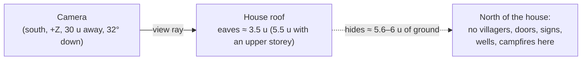

# 关卡设计指南——用教训换来的规则

[English](LEVEL_DESIGN_GUIDE.md) | 简体中文

构建 Luminati 关卡的实用规则：让关卡从立体模型（diorama）镜头看起来正确，玩起来没有死路。其中大多数规则事先并不显而易见：它们来自对烬落村（Emberfall）、关卡编辑器和星落谷（Starfall Vale）的评审（每个阶段四位独立评审者，共约 160 条发现），以及 `tools/make-starfall-vale.mjs` 如今强制执行的检查。每条规则都说明**原因**，并在有对应检查时指出由哪项检查捕获。

| | |
| --- | --- |
| **读者** | 关卡设计者（使用编辑器或生成器），以及被要求构建、扩展或评审关卡的 AI 智能体。 |
| **权威来源** | [`src/engine/world/TileMap.js`](../../src/engine/world/TileMap.js)（`move`、水面、楼梯）、[`src/engine/level/ObjectBuilder.js`](../../src/engine/level/ObjectBuilder.js)（`bridgeDeckHeight`、`buildWaterfall`、`LIGHT_PRIORITY`、`computeCameraBounds`）、[`src/engine/lighting/LightPool.js`](../../src/engine/lighting/LightPool.js)、[`src/game/Game.js`](../../src/game/Game.js)（镜头、交互、区域）、[`src/game/Scenery.js`](../../src/game/Scenery.js)（边界森林）、[`src/editor/EditorApp.js`](../../src/editor/EditorApp.js)（`validate`、`_softWarnings`、`bridgeStepIssues`）、[`tools/make-starfall-vale.mjs`](../../tools/make-starfall-vale.mjs)（`validate`、`sightlines`、`clearCrowns`、`TREE_RULES`、`ROUTES`） |
| **相关文档** | [关卡格式规范](../specs/LEVEL_FORMAT.md) · [对象目录](../specs/OBJECT_CATALOG.md) · [关卡编辑器指南](../user/LEVEL_EDITOR_GUIDE.zh-CN.md) · [视觉设计](VISUAL_DESIGN.md) · [性能](../architecture/PERFORMANCE.md) · 关卡设计文档：[烬落村](levels/emberfall.md)、[星落谷](levels/starfall-vale.md)、[明水渡（Brightwater Crossing）](levels/brightwater-crossing.md)、[柳湖村（Willowmere）](levels/sample-hamlet.md)、[烬望隘口（Cinderwatch Pass）](levels/cinderwatch-pass.md)、[鎏金港（Gildhaven）](levels/gildhaven.md) · 战役：[战役格式](../specs/CAMPAIGN_FORMAT.md)、[摆渡人的提灯（The Ferryman's Lantern）](campaigns/ferrymans-lantern.md) · 约束性契约 [contracts/LEVEL_EDITOR.md](../contracts/LEVEL_EDITOR.md)、[contracts/COMBAT.md](../contracts/COMBAT.md) |

---

## 0. 精简清单

如果别的都不读，至少读这些：

1. **镜头朝北看**。任何高的东西——房屋、井的顶棚、树冠——都会遮住它*北侧*的地面。永远不要把村民、门、指示牌、井或篝火放在房屋以北约 6 个单位以内，也不要放在正南方有树冠的位置。（[§2](#2-镜头朝北看)）
2. **玩家最多能爬升 0.55**。一个高度层级（0.5）是可行走的台阶；两级或以上就是悬崖。楼梯每格把层级 *L* 连接到 *L* + 1。（[§3](#3-高度悬崖与台阶)、[§4](#4-楼梯)）
3. **桥面与岸齐平**。比拱形桥面低一级的岸，距第一块桥板 0.558——刚好高到踩不上去。（[§5](#5-桥梁与栈桥)）
4. **水床比岸低一级；瀑布需要真正的落差**（≥ 0.5），放在格子边上，朝南面向镜头。（[§6](#6-水)、[§7](#7-瀑布)）
5. **真正的点光源最多 12 个**。光源超过 12 个时，它们由镜头周围的灯共享：场景需要多少灯就放多少，但任何一个视野内保持在十二个左右。（[§9](#9-灯光)）
6. **区域：小地方优先**（先匹配者胜出），并且地图的每个角落都要落在某个区域内。（[§10](#10-区域与横幅)）
7. **村民需要一个可见的对话位置**；柜台后面的商人需要 `talkOffset`。第一个对话选项必须是无害的那个。（[§11](#11-村民)）
8. **指示牌箭头是默认镜头下的地图方向**：↑ 北（−Z）、↓ 南（+Z）、← 西、→ 东——而且必须指得对。（[§12](#12-指示牌门与井)）
9. **运行 Level › Check for problems**（编辑器）或生成器的验证器，然后亲自走一遍。（[§14](#14-验证)）
10. **生成的关卡要通过其生成器编辑**，绝不手改。（[§15](#15-生成器与编辑器工作流)）
11. **只要有一个敌人组，就是战斗关卡**。让各群敌人保持距离，给它们清晰可读的地面，并在每场硬仗之前放一块路标石。（[§16](#16-战斗关卡)）
12. **由多个关卡组成的故事就是战役**。户外关卡在接缝处相连，门和房间通过入口相连，并用剧情标志把守通路，而这些标志要在玩家能拿到的地方设置。（[§17](#17-战役多个关卡一个故事)）

---

## 1. 设计时使用的单位

| 量 | 值 | 说明 |
| --- | --- | --- |
| 格子 | 1 × 1 世界单位 | 格子 `(i, j)` 覆盖 `x ∈ [i, i+1]`、`z ∈ [j, j+1]`；行号朝 +Z 方向增长（南，朝向镜头）。 |
| 高度层级 | 0.5 单位 | 高度 `'0'–'9'`、`'a'–'z'` = 层级 0–35；世界 y = 层级 × 0.5。 |
| 玩家 | 半径 0.3，行走 3.2 u/s，奔跑 5.6 u/s | `src/game/Player.js`；最大台阶 0.55（`TileMap.move`）。 |
| 村民碰撞体 | 半径 0.34 | 随村民移动（`dynamic`）。 |
| 关卡尺寸 | 每边 8 – 128 格 | `LevelFormat.js` 中的 `MIN_SIZE` / `MAX_SIZE`。超过 64 时使用大关卡路径（[§13](#13-性能预算)）。 |
| 镜头 | 视野 28°，俯仰 32°，距离 30（缩放 18–42），偏航 ±60° | [视觉设计 §6](VISUAL_DESIGN.md#6-the-diorama-camera)。 |

关卡文件格式见 [LEVEL_FORMAT](../specs/LEVEL_FORMAT.md)；对象字段见 [OBJECT_CATALOG](../specs/OBJECT_CATALOG.md)。

---

## 2. 镜头朝北看

偏航为 0 时，镜头位于玩家的 +Z 一侧，朝 −Z 方向看，向下俯 32°。玩家只能把它转动 ±60°，所以**按偏航 0 来设计**。屏幕上方是北（−Z），屏幕下方是南（+Z）。

### 房屋会遮住身后的地面

- 一层的房屋会遮住它以北约 **5.6–6 个单位**的地面；第二层还会遮住更多。星落谷的验证器按 `PropFactory` 构建房屋的方式来建模（屋檐高出地面 3.5——0.5 的基座加 3 的墙——有上层时为 5.5，最陡 45° 的屋顶，四周 0.35 的挑檐），外加井的顶棚（高出地面 1.85–2.65）和风车塔。
- **规则**：任何村民、对话位置、门前、指示牌、井或篝火都不得被屋顶挡住默认镜头的视线。星落谷生成器中的 `validate()` 一旦发现这种情况，就判定关卡不合格。
- **道路的经验法则**：被屋顶遮住的路面格比例保持在 **≤ 3 %**（星落谷：2.5 %，1876 个路面格中有 46 个；超过 3 % 时生成器会发出警告）。
- 教训：星落谷最初的布局把阿玛兰莎修女（Sister Amarantha）、巴纳比（Barnaby）、加里克（Garrick）以及礼拜堂、面包房和铁匠铺的门都藏在了东侧街区后面（评审者在对话时只能看到玩家的 X 光身影）；修复方法是把面包房挪到礼拜堂门的东边，把铁匠铺往后退并把锻炉放在开阔的院子里，并把 Merrow House 削减为一层，因为它的上层占据了从广场看过去的三分之一视野。在明水渡，位于 (20, 22) 的 Riverside Cottage 的屋顶盖住了它以北 4.5 个单位处的集市摊位（屋顶高出地面约 5.3，在默认 32° 俯仰下会遮住小屋以北约 6.7 个单位以内的地面）；修复方法是把摊位组挪到广场北侧、旅店门前，让遮阳篷的阴影落在旅店墙上（[brightwater-crossing.md](levels/brightwater-crossing.md#known-issues)）。
- **摊主会消失在遮阳篷下**。`marketStall` 的遮阳篷（后部高 2.72，前部 2.03）会在游戏镜头下遮住站在摊位中心后方 1–1.35 处的村民（明水渡的波西（Posy）、烬落村的伯特伦（Bertram）——KNOWN_ISSUES PROP-13）。当玩家可以与他们交谈时，他们会显示为 X 光剪影；把摊主安排在柜台旁边，才能让人从远处看到他们。
- **门朝南、朝东或朝西**。房屋的正面（门）是它的局部 +Z：`rotation 0` 面向镜头，`π/2` 朝东，`−π/2` 朝西。朝北的门在房子背后。`doorOffset` 让门沿立面滑动。
- **成排的房屋**在每一排都位于其南面那一排房门的*旁边*而不是*后面*时才行得通（星落谷：“Hollyhock 和 Riverside 立在其南侧房屋的旁边，而不是后面”）。

### 树也会遮挡

- 星落谷的散布在镜头必须看到的一切事物南侧保留了**视线走廊**：村民（半宽 3，纵深 9）、房门（2.5 × 8.5）、井、篝火和指示牌（2 × 4.5），外加有名字的地标（广场、瀑布、出生点……）。走廊里不会有散布生成的树干，而手动放在那里的树会导致验证失败。
- 走廊只检测树干；树干刚好在走廊外的大树冠仍然可能遮住目标。`clearCrowns()` 按 `src/engine/world/props/Trees.js` 构建树冠的方式来建模（`crownOf()`：阔叶树为椭球体，橡树半径为 0.44 × 高度、压扁到 0.8，秋叶树为 0.43 / 0.78，桦树为更窄更高的 0.3 × 高度椭球体；松树为从 0.19 × 高度到树顶的圆锥，底面半径 0.34 × 高度），并剔除遮住目标 ≥ 25 % 的散布树木（目标包括村民、与村民交谈的位置、门前、指示牌及其阅读位置、井、篝火）；`validate()` 则判定任何遮住目标 ≥ 50 % 的树——包括手动放置的——不合格。它曾查出凯斯特雷尔（Kestrel）被一棵秋叶树冠遮住了 73 %，以及流明旧城（Old Lumen）的井被一棵松树完全遮住。
- **路面正南方不要有高树**：如果候选位置以北 `TREE_RULES[zone].south` 行以内有路面格（视区域不同为 2–6 行；为了多样性，此类候选中有 4 % 会被放行），散布就会跳过它，因此行人很少会被树冠挡住。
- **果园要看起来是一排排的，而不是一片树冠**：交错相邻的列，变化高度（3.4–5.0），第一排距步道约 6 个单位开始。一个 5 × 5、树木大小一致的网格曾变成“一整片平坦的树冠吞没了果园步道”。

### 前景构图是一种工具——要节制使用

近处景深会模糊玩家南侧的一切，像 Square Enix 的 HD-2D 游戏那样为画面加框。但烬落村的评审发现，在琥珀叶林（Amberleaf Grove），前景树木和小屋占据了画面的 40–60 %；后来把小屋挪到了池塘东北方向的悬崖边。剩下的盲区（烬落村茅草屋及其砖砌河畔房屋的后面）只能靠玩家的 X 光剪影来补救。**把剪影当作安全网，而不是设计工具**。

### 高地

在高原上，下方模糊的屋顶会填满画面下部。`environment.highGround { minY, pitch }` 会在玩家站在 `minY` 以上时让镜头向下倾（烬落村在 y 3.2 以上为 39°；星落谷和明水渡为 40°）。把 `minY` 设得比高原表面略低一点（烬落村的山丘在 4.0）。

### 地图边缘

- 用**森林边界 `T` 格**（不可行走；游戏会在上面散布树木）围住可玩区域，并设置 `environment.border: 'forest'` + `outerScenery: true`，这样任何视角都看不到世界的边缘。当可行走地面延伸到地图边缘时，编辑器的 Check for problems 会发出警告。
- 边界散布（`src/game/Scenery.js` 中的 `scatterForest`）是针对镜头调校的：**地图最下面三行不放树**（它们会遮住南边的草地），最上面三行只做一半的尝试（让上方的悬崖保持通透），而在东 / 西两侧从第 9 行往南，**离边缘第三列保持空旷，第二列矮 20 %**，这样沿边缘行走的玩家不会被树干挡住。这些参数是按烬落村 3 格宽的边界调校的。
- 靠近东 / 西边缘时，游戏会把镜头朝边缘方向的偏航限制在 10°。
- **森林格之间不要留一格宽的通道**。游戏在 `T` 格上散布的树会把这种缝隙堵上，留下一个谁也进不去的口袋。在评审发现东北角有一个无法到达的口袋之后，星落谷的 `border()` 现在会把它们填满。
- **开放边缘**（连续 3 个以上可行走的边缘格）会让外围森林保持 2.5 个单位的距离。`environment.scenery.southGap` 会在地图南侧留出开阔草地（星落谷：10，这样外围树林就不会挡在镜头和南边缘的出生点之间）。
- **不要让道路终止于一堵看不见的墙**。星落谷的王之大道（King's Road）起初在出生点戛然而止；现在它终止于一道可见的收费关卡栅栏。用一种自定义的不可行走道路格（星落谷中为 `':'`）在视觉上让道路延续到边界之外。
- 边界和外围树林的树种遵循 `environment.forest.areas`（星落谷：秋叶的烬木林（Emberwood），山上是松树）；否则使用一种按烬落村形态设计的自动混合（`scatterForest` 中的 `kindFor`：z 6 以北以松树为主，地图宽度 0.72 倍以东以秋叶树为主）。

---

## 3. 高度、悬崖与台阶

`TileMap.move(from, dx, dz, radius = 0.3, maxStep = 0.55)` 只有在以下情况下才让玩家走到某个点：中心可行走且与当前地面高度相差不超过 0.55，并且玩家半径周围的采样点可行走且与中心相差不超过 0.55（桥面行走矩形算作地面；楼梯使用其平滑坡道高度）。

| 高度差 | 结果 |
| --- | --- |
| 0 | 平地 |
| 1 级（0.5） | **可行走的台阶**——不需要楼梯（烬落村的草地边缘、星落谷的一级小丘；柳湖村的台地在任何地方都能爬上去，它的楼梯只是视觉提示） |
| 2 级以上（≥ 1.0） | **悬崖**——一个垂直面，顶部有 `lip` 纹理；需要楼梯或绕路 |

- 悬崖面是从南边看的。玩家以北的高原会露出它的立面；玩家以南的凸起块只露出顶面，并遮住它后面的东西。
- 层与层之间要留出空间。星落谷的流明山（Mount Lumen）从平原 2 → 山麓 5 → 台地 9 → 高原 15（天文台小丘 16）逐级升高，每一层都足够深，可以在上面行走并回望。
- 建筑的占地要放在同一层级、平坦且干燥的格子上（生成器会检查房屋、摊位、风车、井、篝火和长椅）。
- 装饰性的“墙”只是抬高的阻挡格：星落谷流明旧城的残墙起初只有 0.5 u 高，几乎看不见；后来改成了层级 UPLAND + 3 / + 4（1.5–2 u）。林地里的立石是 2.5–3 u 高的石柱。任何低于约 1.5 u 的东西从 30 个单位外看都只像个小凸起。

---

## 4. 楼梯

| 字符 | 名称 | 升高方向 |
| --- | --- | --- |
| `^` | Stairs up north（向北上行楼梯） | −Z（远离镜头） |
| `v` | Stairs up south（向南上行楼梯） | +Z（朝向镜头） |
| `>` | Stairs up east（向东上行楼梯） | +X |
| `<` | Stairs up west（向西上行楼梯） | −X |

- **层级 *L* 上的楼梯格把 *L* 连接到 *L* + 1**。前方（升高方向）的格子必须是 *L* + 1（平地，或下一个楼梯格）；后方的格子必须是 *L*（平地）或层级 *L* − 1 的楼梯。爬上 *n* 级悬崖的一段楼梯是一排 *n* 个楼梯格，层级依次为 *L*、*L* + 1……顶端为 *L* + *n*。几何上每格有 4 级真实台阶；行走高度平滑过渡。
- **楼梯做成 2–3 格宽**，两端都有平坦的平台。烬落村的山丘楼梯 2 格宽，两侧有栅栏；星落谷王之大道的楼梯 3 格宽。
- **针对镜头的朝向**：`^` 楼梯最清晰——你能看到每一级踢面向远处攀升。`v` 楼梯只显示踏面（踢面朝北，背对镜头），而且上面的台阶会遮住下面的；星落谷只在采石坑里使用 `v`。东 / 西向的楼梯也很清晰，适合做之字形折返。
- 在编辑器中，**Stairs 工具**（T）会自动朝向较高的相邻格，把每格一级雕出的坡道原样变成楼梯，并且——当你从多级悬崖的脚下拖到顶部时——在低的一侧建好整段楼梯（`src/editor/tools/StairsTool.js` 中的 `planStairs`）。
- 星落谷的验证器会检查每个楼梯格（前方 = *L* + 1，后方 = *L*），并把每段有名字的楼梯作为一条**路线**来检查（[§14](#14-验证)）。

---

## 5. 桥梁与栈桥

一个 `bridge` 对象（从 `x0, z0` 到 `x1, z1` 的一条线）会建造木板桥面，并在桥面高度注册行走矩形，这些矩形会覆盖其下方的水格。

- **桥面高度 = 岸的高度**。`deckY: null`（默认值）使用 `bridgeDeckHeight()`：取起点外半格处岸的高度（否则取终点），但不低于跨度下方最高水面 + 0.1；如果两端都没有岸，则取水面 + 0.3。
- **0.558 问题**。拱形桥面（`opts.arch`：在编辑器中放置的桥为 0.25——目录默认值；没有该字段时 `PropFactory` 使用 min(0.4, 0.05 × 长度)）在 *n* = max(2, round(长度 / 0.5)) 段平坦的分段上行走（拱高 ≤ 0.02 时为一段）；第一段比桥面高度高 `arch · sin(π / 2n)`。如果岸比桥面**低一级（0.5）**，第一步就是 0.5 加上这个值——例如星落谷最初的 Southgate Bridge（长度 4.2，拱高 0.3）：0.5 + 0.3 · sin(π/16) = **0.558 > 0.55**，玩家无法踏上去。修复方法：把岸与桥面拉平、设置 `deckY`，或者把拱压平。**Level › Check for problems**（检查问题）会报告这类桥端（`bridgeStepIssues`）。
- 两端都要在岸上（栈桥：陆地一端）；跨度必须跨过水面。穿过水面的道路必须走在桥面上——星落谷的验证器会对每条路径采样。
- **栈桥**是 `arch: 0`、伸入湖中的桥：星落谷的长栈桥（Long Pier）、North Pier 和 South Pier 从层级 1 的岸边（y 0.5）伸出，越过层级 0 的水面（水面 0.4），`deckY` 为 0.5。
- 桥栏是沿两侧的碰撞体；让引桥区域（每端周围 ±1.6 u）不放道具。
- 验证时要**把每座桥从头走到尾**——星落谷的验证器每 0.2 个单位对桥面采样，检查是否可站立以及是否有 > 0.55 的台阶。

---

## 6. 水

| 字符 | 格子 | 流速 |
| --- | --- | --- |
| `~` | River（河流） | 关卡的 `water.flow`（默认 `[0, 0.45]`，向南） |
| `p` | Plunge pool（跌水潭） | × 0.45 |
| `w` | Fast stream（急流） | × 2.2 |
| `o` | Still pond（静水池塘） | 0 |

水格永远不可行走（只有其上方的桥面可以）。

**水面在哪里**（`TileMap._computeWaterSurface`）：如果关卡的 `waterLevel` 比该格的水床高出 0.02 以上，水面就是 `waterLevel`（新关卡和所有随附关卡中为 0.4；文件省略该字段时为 0.35）；否则水面为**水床 + 0.35**（“自动深度”，因此高原上的溪流也能直接正常工作）。图例条目也可以设置自己的 `waterLevel` 或 `waterDepth`。绘制水格不会改变它的高度——用 Height 工具降低水床，或者在 Paint / Fill / Rectangle 的选项中打开 **Also set height**（同时设置高度），然后在层级 0 上绘制水。

规则：

- **把水床降到比岸低一级**。低处的水：水床层级 0（水面 0.4），沙岸在层级 1（0.5）——岸刚好高出水面，就像烬落村的河流和池塘那样。上游溪流：水床比岸低一级，这样自动水面（水床 + 0.35）比岸低 0.15。
- **河流必须真正连通**。星落谷的银流河（Silverrun）曾在入湖前被一道两格宽的沙洲截断，玩家因此可以绕过 Reedmouth Bridge。修复方法是让河流流入湖中，并在每个渡口添加路线检查。
- **不同的流向需要自己的图例字符**。星落谷添加了 `'e'`——一条向东流的河（`flow: [0.45, 0]`），用于银流河流向湖泊的那一段。
- **平静的大湖需要更少的闪光**：`water.glint`（默认 1）——星落谷使用 0.45，配合 `reflect 0.08, neutral 0.55`。
- 无法到达的可行走口袋（岛屿）只有在有意为之时才可以；星落谷的验证器只允许恰好一个（沉睡群星之岛）。

---

## 7. 瀑布

`waterfall` 对象会渲染一道下落的水幕，从其位置上游半格处的水面落到下游半格处的水面。

- **把它放在格子边上**，位于较高和较低的水格之间。对于 `facing` 为 `S` / `N`，`z` 坐标是一条整数边（例如 `z: 11` 位于第 10 行和第 11 行之间）；对于 `E` / `W` 则是 `x`。
- **`facing` 是水落下的方向**。让瀑布朝**南**（朝向镜头），这样才能看到水幕；所有随附的瀑布都朝 `S`。
- **给它真正的落差**。生成器要求两个水面之间 ≥ 0.5（游戏即使在平坦水面上也会画出 0.05 的一条细缝）。瀑布口在整个 `width` 范围内都必须是水。
- `mist: { count, alpha }`（默认每单位宽度 8 个粒子，至少 4 个，alpha 0.07——`src/game/World.js` 中的 `MIST`）以及 `splash: false`（安静的泉水：没有水花迸溅或闪光，没有水花声 / 水声环境锚点）。
- 瀑布从下方看最好：水幕朝南，所以玩家是从水潭南边的地面看它（星落谷从北岸（North Shore）看镜瀑（Mirror Falls）），而不是从顶上的瞭望点。

| 瀑布 | 关卡 | 落差 |
| --- | --- | --- |
| 烬落瀑布（Emberfall Falls，`falls`，31, 11） | 烬落村 | 溪流水面 3.85 → 水潭 0.4 |
| 泉水（`spring`，31, 3） | 烬落村 | 4.85 → 3.85，`splash: false` |
| 明水瀑布（Brightwater Falls，`waterfall_1`，24.5, 4，宽 3） | 明水渡 | 3.35 → 0.4 |
| 三姐妹（Three Sisters，高、中、低）+ 泉水 + 镜瀑 | 星落谷 | 3.00、2.00、1.95、1.00、3.95 |

---

## 8. 密度与构图

随附关卡每个可行走格约有 **0.07–0.1 个对象**（城镇的街道、广场和码头也算可行走：鎏金港看起来热闹，实际只有 0.04）：

| 关卡 | 尺寸 | 可行走格 | 对象 | 每可行走格 |
| --- | --- | --- | --- | --- |
| 烬落村 | 48 × 40 | 1324 | 137 | 0.103 |
| 明水渡 | 36 × 28 | 640 | 68 | 0.106 |
| 柳湖村 | 28 × 22 | 417 | 38 | 0.091 |
| 星落谷 | 128 × 128 | 12555 | 875 | 0.070 |
| 鎏金港（城镇） | 128 × 128 | 13598 | 518 | 0.038 |

行之有效的构图规则：

- **成簇，而不是铺满**。一个有视觉焦点的村中广场（井、摊位，周围有灯），房屋面向它，道具靠墙放。烬落村把它的广场压缩在 11 × 10 格内。
- **保持空旷区**（星落谷生成器，`keepClear`）：门前 1.1 u，井和篝火 2.2 u，桥端 1.6 u，村民 `wander` + 0.9 u（至少 1.4 u）。游戏还会清除每个村民家周围的地面植被（半径 `wander` + 0.8，在 `World` 中），这样没有人会半埋在高草里——这是烬落村评审的一条发现。
- **有人住的房子**：每户 2–3 个木桶、板条箱或花箱，靠侧墙和后墙放（花箱可以放在前角），距门至少 2.2 u，绝不放在路面、水、楼梯、铺装地面上，也不放在与房屋不同的层级上（`dressHouses()`）。
- **按区域散布树木**（`TREE_RULES`）：森林里茂密（间距 2.0–2.3），城镇里稀疏（保留 0.05，间距 5），距路面 2 格（草地上 3 格），距房屋 2.5 u，并且**路灯或壁挂火把 3.6 u 以内**不散布树木（秋叶树冠里的灯笼看起来就像树着火了）。
- **粒子区域**（`emitter` 对象）赋予每个地方各自的氛围——池塘和草地上的萤火虫（仅夜间）、秋林里的落叶、草地上的花瓣、采石场的尘土、瀑布处的水雾和闪光。随着光线变暗，落叶会自动变稀（黄昏时又大又暗的叶片看起来像花瓣或蝙蝠）。
- **体积光**（`environment.godRayAreas`，每处 0–12 道光束，默认 3）放在开阔的广场和林间空地上方，`y` 取该区域的地面高度。
- **花卉和灌木区**（`environment.foliage.flowerAreas` / `shrubAreas`，世界矩形）按区域给地面上色——烬落村南部有一片混合花草地和一片灌木丛林，星落谷有蓝白色的林地花朵和黄色的农田花朵；明水渡和柳湖村没有设置 `foliage`，使用默认的地面细节。

---

## 9. 灯光

游戏最多创建 **12 个点光源**（`src/game/World.js` 中的 `MAX_POINT_LIGHTS`），全部在第一帧之前创建；之后数量不再改变（数量变化会导致所有着色器重新编译）。关卡可以放置任意数量的光源（路灯、壁挂火把、篝火、`light` 对象、带 `light: true` 的房屋）；`World._wireLights` 把它们的描述符交给一个 `LightPool`：

- **≤ 12 个描述符**：每个描述符一个永久光源（所以柳湖村有 6 个点光源），按 `LIGHT_PRIORITY` 顺序——篝火和壁炉 0、壁挂火把 1、`light` 1、路灯 2、房屋 3——同级按对象顺序。烬落村恰好有 12 个。
- **> 12**：12 个光源。每 0.2 s，它们会分配给范围（+ 4 u）触及视野的描述符，离镜头焦点最近的优先，每差一个优先级加 1.5 个单位（`priorityWeight`），保持点亮的有少量加成，白天不亮的灯有惩罚；换到另一盏灯笼的光源会淡出、移动、再淡入（每个方向 0.35 s）。窗户和灯笼玻璃是由夜间系数驱动的自发光材质，因此无论它们的灯当前是否拥有光源，都会持续发光。

设计规则：

- **每个视野约十二盏灯**。星落谷热闹的广场在 12 个单位内有 20 多盏灯，所以总有一些是暗的——这是光源池按设计工作的结果（构建报告测得平均约 3.4 盏未点亮；评审把 `priorityWeight` 从 4 降到 1.5 之后，一次 272 个位置的扫描中，玩家 9 个单位以内总共只发现 5 盏未点亮的灯）。烬落村的 12 个光源是 6 盏路灯（广场周围 4 盏）、2 支壁挂火把（旅店和谷仓）、篝火以及 3 座房屋的门灯。
- **有意照亮暗处**。星落谷广场的井曾是镇上最暗的地方；现在它上方挂着节日灯笼（一个 `light` 对象）。
- **`light` 对象**是不可见的光源——礼拜堂窗后的蜡烛、天文台的蓝色透镜（`nightOnly: false`）、许愿橡树（Wishing Oak）里的许愿灯笼（挪到了树冠前部，这样它们照亮的是镜头看得到的叶子，而不是树皮上的一个亮斑）。
- 路灯和门灯只在夜间亮（雨雪天白天也会微微发光）；壁挂火把和篝火昼夜燃烧。
- 房屋上的 `light: true` 会添加门灯光源；为 `false` 时灯笼玻璃仍然发光。

各光源的灯光数值见[视觉设计 §8](VISUAL_DESIGN.md#point-lights-and-glowing-windows)。

---

## 10. 区域与横幅

`region` 是一个矩形（`minX…maxZ`），为 HUD 地名牌和世界地图上的某个地方命名。

- **先匹配者胜出**（按对象顺序），所以先列出**小地方**，再列出包含它们的大区域。星落谷把“The Lumen Observatory”（流明天文台）列在“Mount Lumen”（流明山）之前，把“Hearthwick Square”（炉火镇广场）列在“Hearthwick”（炉火镇）之前。
- `minY` 让区域只在玩家站在该高度以上时生效——用于高原（烬落村的风车丘（Windmill Hill）：`minY 3.2`；星落谷的高原区域 `7.2`，台地 `4.2`）。
- **把楼梯也覆盖进去**。烬落村的地名牌在爬上山丘时会闪出一个通用名称；在楼梯上方再加一个不带横幅的“Windmill Hill”区域就解决了。在区域之间，地名牌保持当前名称。
- **覆盖每个角落**。星落谷空荡荡的东南角一直显示着过时的地名，直到加上了“Bramble Hollow”（荆棘洼地）。
- `banner`（副标题）会在玩家每次会话中首次进入该区域时显示一条抵达横幅；把横幅留给值得宣告的地方（星落谷：31 个区域中有 14 个）。
- 每个区域都需要可到达的地面（星落谷中会验证）。
- 在世界地图上，包含另一个区域中心的区域会画成**范围**标签。发生碰撞的标签会尝试几个其他位置；仍然找不到位置的范围标签会被设为紧凑样式（更小、分两行）并再试一次；找不到空位的标签会被隐藏（`src/engine/ui/Minimap.js` 中的 `WorldMap._layoutLabels`）。星落谷显示全部 31 个，其中三个为紧凑样式。

---

## 11. 村民

**把他们安排在哪里**

- 在可行走的地面上，避开道具碰撞体，位于 `wander` + 0.9 u 的保持空旷区内。
- **村民和与其交谈的位置都必须在默认镜头下可见**（没有屋顶、没有树冠）。`talkTo(id)` 会先把玩家放在村民旁边（x 方向 ±1.15），让两人的脸都露出来。
- 交互判定：在村民——或其对话位置——的 `talkRadius`（默认 1.6）以内，高度差小于 1.3，并且大致位于玩家前方。
- **柜台后面的商人需要 `talkOffset`** `[dx, dz]`（相对于村民）：烬落村的伯特伦使用 `[0, 2.7]`，明水渡的波西使用 `[0, 2.35]`，星落谷的摊主使用 `[0, 3.15]`（朝东的摊位为 `[2.95, 0]`），配合 `talkRadius 1.5`。没有它，玩家只能从柜台后面交谈（就像波西修复之前那样）。对于默认纵深 1.6、带展示箱的 `marketStall`，经验法则是：碰撞体的前边缘位于 `stall.z + 1.3`，所以把对话点放在它前面一点——`talkOffset` 的 dz = `stall.z + 1.35 − npc.z`（伯特伦 23.7 + 1.35 − 22.35 = 2.7，波西 14.2 + 1.35 − 13.2 = 2.35）。对话点比玩家能到达的位置更靠外，会让柜台处的提示窗口变窄（游戏只在 0.55 以内选择玩家身后或身旁的目标）：在她最初的摊位（18.5, 17.5），波西的窗口用 2.7 时只有 x 18.0–19.0，用 2.35 时为 x 17.55–19.45；在如今更窄的摊位（宽 2.5，中心 x 13.05）为 x ≈ 11.9–14.2。

**行为**（`behaviour`）

| 值 | 用途 | 示例 |
| --- | --- | --- |
| `wander` | 在家附近 `wander` 范围内闲逛；你走到 2.4 u 以内时会瞥你一眼 | 大多数村民 |
| `post` | 站在家的位置（被推开会走回去），你在 2.2 u 以内时面向你，否则时不时四处张望，大多朝向 `facing` | 摊主、守卫、栈桥上的钓鱼人 |
| `perform` | 与 `post` 类似，但张望时大多朝向镜头（`down`）——面向观众的表演者；音乐本身来自 `music` 动作 | 烬落村的吟游诗人、星落谷的剧团 |
| `chase` | 追赶 `area`（相对于村民的矩形）内或附近的小鸡 | 皮普（Pip）、坦西（Tansy） |

`chase` 区域必须大部分可行走（验证：≥ 50 %）；小动物群必须从可行走的地面开始。

**对话**

- 没有 `script` 的村民会说出他们的 `dialogue` 页面，然后执行内置的 `action`（`rest` / `shop` / `music`）。`script` 指定 `src/game/dialogue.js` 中一段手写的对话（仅烬落村）。
- **第一个选项是无害的那个**（“还不是时候”（Not yet）、“随便看看”（Just looking））。连按 Space 跳过文本会落在第一个选项上；旅店不能意外地把玩家送上床。内置动作在除第一个之外的任何回答后执行——但只有一个回答的收尾问题（`[Good night |]`）除外，它唯一的回答会执行动作。只要玩家应当能够拒绝，就使用两个回答，无害的那个放在前面。
- **音乐**：在没有自己的收尾选项时，`music` 村民会开始演奏，或者——如果正在演奏——问 “Another song, or a little quiet?”（再来一首，还是安静一会儿？）。不要给音乐通常已经在播放的吟游诗人添加 “Shall I play?”（要我弹一曲吗？）选项：星落谷的拉克（Lark）起初就有这样一个选项，而它无论怎么选都没有效果。
- **不要承诺不存在的东西**。评审者曾指出一口谁也看不到的钟、一个不存在的稻草人，以及一个没有回应的差事。村民给出的指路必须与地理相符（星落谷的链条：镇长 → 观星者 → 伊索尔德奶奶（Grandmother Isolde）→ 长栈桥的尽头）。
- `{word}` 会以金色显示；用于地名和人名。

---

## 12. 指示牌、门与井

- **箭头是默认镜头下的地图方向**：↑ 北（−Z）、↓ 南（+Z）、← 西（−X）、→ 东（+X），以及对角线 ↖ ↗ ↙ ↘。星落谷的评审把每块指示牌与其目标逐一比对；除了 “← the windmill”（偏差 50°，现改为 “↖ the windmill”）和一块 “→ Mirrormere Landing”（偏差 57°，因为它沿着道路走而被接受）之外，其余都在约 38° 以内。
- 相距很近的两块指示牌必须一致（有一对镜湖码头（Mirrormere Landing）指示牌曾互相矛盾）。
- 多行牌子：在文本中使用 `\n`，并设置 `opts.boards` 为 1–3。用 " · " 分隔目的地，让每个箭头紧挨着它自己的目的地（对齐用的空格在对话框中会被合并）。
- 门、指示牌和井**只有在带文本时**才可交互。Level › Check for problems 会提示有多少房屋没有 “Text when knocking”（敲门时的文本）。
- 阅读位置（指示牌正南方）也必须可见（星落谷验证器）。
- 交互半径：门 1.0（围绕门前台阶，约在门前 1 个单位处——贴墙站立并面向门扇的玩家也会得到*敲门*（Knock）提示），指示牌 1.35，井 1.75；井会播放 `sfx`（默认 `splash`）。不要把其他可交互物放在门前台阶上：放在那里的指示牌会与门争抢（明水渡 `house_5` 门前台阶上的 `signpost_2`，在玩家面向指示牌时显示*阅读*（Read），在玩家径直走向门时显示*敲门*）。

---

## 13. 性能预算

历史桌面测量数据，分辨率 1600 × 900；测量条件和复现步骤见 [PERFORMANCE](../architecture/PERFORMANCE.md)。

| 预算项 | 值 |
| --- | --- |
| 场景绘制调用（含阴影通道） | 默认镜头距离下 ≤ 约 300 |
| 点光源 | ≤ 12（关卡光源更多时由 `LightPool` 共享） |
| 太阳阴影贴图 | 一张 2048² |
| 粒子区域、体积光光束、烟囱烟雾 | 在视野内时各 1 次绘制调用 |

| 关卡 | 尺寸 | 构建路径 | 测量时的对象数 | 光源描述符 | 出生点的绘制调用 | 出生点的三角形 | 评审中测得的范围 |
| --- | --- | --- | --- | --- | --- | --- | --- |
| 柳湖村 | 28 × 22 | 小 | 38 | 6 | 165 | 0.17 M | — |
| 明水渡 | 36 × 28 | 小 | 68 | 10 | 211 | 0.23 M | — |
| 烬落村 | 48 × 40 | 小 | 136 | 12 | 229 | 0.34 M | 170–245 次调用，约 0.34 M |
| 星落谷 | 128 × 128 | **大** | 875 | 95 | 176 | 0.87 M | 26 个位置 135–283 次调用，0.73–1.21 M |
| 鎏金港 | 128 × 128 | **大** | 518 | 86 | 167 | 0.67 M | 26 个视角 124–274 次调用（在广场上方完全拉远时为 280） |

（出生点数值：使用 `autostart=1` 加载后立即调用 `__game.state()`，1600 × 900，针对所示的历史关卡版本测得；当前的对象数可能不同。村民和时间在变化，所以预计会有几次调用的上下浮动。）

- **每边 ≤ 64 格**：原有的单次合并批处理；绘制调用随视野内的材质数量增长。
- **> 64**：`BIG_LEVEL_BATCHING`（`src/game/World.js`）：按 k-d 划分的批次，以其包围盒进行剔除；仅投射阴影的代理投影体；以每块 4000 簇为单位的实例化植被；远处的村民和小动物每 4 帧更新一次；距镜头焦点超过 **34 个单位**的粒子区域 / 水雾 / 烟雾会被关闭。大关卡要按视角做预算，而不是按总量。
- 在星落谷热闹的广场完全拉远（距离 42）时，可达约 300 次调用；在默认缩放下，让最密集的地方略低于预算。
- **编辑器**：一个约 200 个对象的 64 × 64 关卡能以显示刷新率编辑；星落谷（874 个对象）在分屏布局下打开时约 915 次绘制调用，空闲时保持显示刷新率（README 的 “Performance” 一节）。
- 加载：在已预热的开发服务器上，星落谷约 2.4–2.8 s 到达第一个游戏帧（着色器缓存为冷时为 4.0–4.4 s）。

---

## 14. 验证

### 在编辑器中

- **Level › Check for problems** 会运行 `validateLevel`（错误：行长度、玩家起点在地图之外或不在可行走地面 / 桥面上）以及软警告：桥端比岸高或低超过一个台阶、对象在地图之外、没有村民、房屋没有敲门文本、可行走地面延伸到地图边缘。
- **Play ▶ / F5** 在有错误时拒绝启动，并用面向用户的措辞说明错误（"The player start is on water…"），然后打开 `game.html?level=local:__playtest__&autostart=1`。
- 要进行生成器那样更深入的检查，请保存关卡并运行 `npm run level:check -- <name>`（[见下文](#从命令行任何关卡)）。

### 在生成器中

`tools/make-starfall-vale.mjs` 是参考实现；只要有任何检查失败，它就拒绝写出关卡（`--force` 会写出关卡以供检查，但仍以 1 退出）。它证明了：

- `normalizeLevel` 产生零条警告且不修复任何东西；`validateLevel` 干净；保存往返是逐字节稳定的。
- 从出生点在四分之一单位网格上按游戏规则进行**行走 BFS**（可行走格和桥面、台阶 ≤ 0.55、楼梯坡道、玩家半径 0.3 对照近似的道具碰撞体）：每个村民（从其对话位置）、门、指示牌、井和区域都可到达；≥ 3 格的无法到达口袋都是错误，岛屿除外。
- **路线**：指示牌或村民承诺的行走路线——以及每个有名字的渡口（桥、楼梯段）——必须保持在直线距离的 1.5 倍 + 3 个单位以内（在行走网格上用 Dijkstra 计算）。一条封闭的小巷即使远端可以绕远路到达，也会失败。
- 水上的道路走在桥面上；路面没有被道具阻挡；门没有被阻挡；道具互不重叠；建筑占地平坦且干燥。
- 楼梯朝其方向升高；瀑布位于格子边上，瀑布口处有水且落差 ≥ 0.5；桥从岸到岸跨过水面；每座桥和栈桥都能从头走到尾。
- 镜头检查：没有东西藏在屋顶后面（§2），被遮住的路面格 ≤ 3 %（警告），视线走廊中没有手动放置的树，没有遮住目标一半的树冠。
- 小动物从可行走的地面开始，追赶区域大部分可行走，壁挂火把挂在墙或悬崖上，每个对象和环境矩形都位于地图上。
- 一份功能覆盖清单（每种格子类型和对象类型、每种 NPC 动作和行为……）。

星落谷评审期间的一次变异测试显示了路线检查的价值：在加入它之前，验证器放过了 6 次删桥和 3 次删楼梯段；加入之后，44 次破坏中它拒绝了 43 次（天文台那一级台阶不需要楼梯也能走上去）。

### 从命令行（任何关卡）

`npm run level:check -- <level> [<level> …] [--strict] [--routes=<file.json>] [--quiet]`（[`tools/check-level.mjs`](../../tools/check-level.mjs)）会对已保存的关卡文件（`public/levels/` 中的名称或一个路径）运行鎏金港生成器的检查——即 [`tools/lib/levelcheck.mjs`](../../tools/lib/levelcheck.mjs) 中的 `checkLevel`，`make-gildhaven.mjs` 本身也调用它。它是只读的。对于文件，它会推断生成器所知道的信息：街道是泥土路、鹅卵石、石砖、桥面和楼梯格（泥土算作地面），每棵树都算作手动放置，自动桥面（`deckY: null`）按游戏的方式求解，一端在水上的桥算作栈桥。

- **错误**（退出码 1）——关卡是坏的：谁也到不了的村民、门、指示牌或井；不是每格升高一级的楼梯段；没有落差的瀑布；无法从头走到尾的桥或栈桥；从不可行走地面开始的小动物；未知的字符或粒子预设；使用 `--routes` 时，绕远路的行走路线。
- **警告**——本指南的构图规则：任何被屋顶或树冠遮住的东西（§2）、超过 3 % 的街道格在屋顶后面、视线走廊中有手动放置的树、占地不平、道具重叠、门被阻挡、无法到达的口袋、会遮住行人的墙、对象在地图之外、可到达的地面不在任何区域内。`--strict` 会把它们变成错误——这是生成器坚持的标准。
- `--routes=<file.json>` 添加必须保持直接的行走路线（≤ 直线的 1.5 倍 + 3）：`[["the square → the bridge", [x0, z0], [x1, z1]], …]`。
- **剧情状态**——当对象带有 `when` / `unless` 且条件生效时（战役的关卡、有剧情的关卡），检查会针对每个剧情状态各运行一次：条件所测试内容在同一个故事中可能产生的每种组合（`day > 2` 和 `day < 3` 永远不会同时成立），每组不同的在场对象运行一次——在 128 × 128 的关卡上最多 64 个状态，在更小的关卡上更多；超出后改为抽样，并且报告会说明这一点（此时没有任何已检查状态能到达的地方是警告，而不是错误）。`when: bridge-mended` 的桥和其桥面上 `unless: bridge-mended` 的洪水残骸永远不会重叠；在其对象在场的每个状态中都出现的发现，会被视为没有条件（在每个状态中都无法到达：即原来的错误）；只在某些状态中能到达的地方会合并为一条警告并列出这些状态（"reached only with `bridge-mended`: exit exit_east (→ old-quarry), the walkable ground round (44.7, 8.9) …"），而其他只出现在某些状态中的发现会在括号里列出这些状态。没有剧情的单个关卡会忽略其条件，与游戏一致（会有一行信息说明这一点）——[CAMPAIGN_FORMAT §9](../specs/CAMPAIGN_FORMAT.md#9-checks)。

在随附关卡上（2026-10-02）：鎏金港、星落谷和烬望隘口没有错误（它们自己的生成器会用真实的街道和散布检查更多内容；共享的屋顶模型还会把每个候选烟囱位置都算进去，所以它给出的警告比星落谷自己的稍多一些）。明水渡和柳湖村也没有错误，但各有 15–17 条警告：它们是在这些规则之前构建的（LVL-15、LVL-16）。烬落村有一个错误——老托宾（Old Tobin）的围栏田地是封闭的（[KNOWN_ISSUES LVL-20](../ai/KNOWN_ISSUES.md#levels-and-generators)）。演示战役的关卡（2026-10-07，在其各剧情状态下）没有错误；磨坊路（Mill Road）警告其东岸和通往采石场的出口只有在 `bridge-mended` 时才能到达——这是桥的标志，符合设计。

### 在游戏中

亲自走一遍。无头测试框架可以用真实的按键按住和 `window.__game`（`teleport`、`talkTo`、`setTime`、`state()`）来完成这件事；参见 [TESTING_AND_VERIFICATION](../development/TESTING_AND_VERIFICATION.md) 和[自动化 API](../specs/AUTOMATION_API.md)。在黄金时刻和夜间检查每个村民、指示牌、门、井、桥、楼梯段和区域。

---

## 15. 生成器与编辑器工作流

| 关卡 | 制作方式 | 修改方式 |
| --- | --- | --- |
| 烬落村 | 从旧的手写地图一次性转换而来 | 编辑器（`editor.html?open=emberfall`）或 JSON |
| 星落谷 | `tools/make-starfall-vale.mjs` | 编辑生成器并重新运行；绝不手改 JSON |
| 明水渡 | 仅用编辑器界面 | 编辑器 |
| 柳湖村（`sample-hamlet`） | `tools/make-sample-hamlet.mjs` | 生成器（`--check` 确认文件是最新的；见[它的页面](levels/sample-hamlet.md)） |
| 烬望隘口 | `tools/make-cinderwatch-pass.mjs` | 生成器（20 条验证规则；`--check`；见[它的页面](levels/cinderwatch-pass.md)） |
| 鎏金港 | `tools/make-gildhaven.mjs` | 生成器（`--check`；见[它的页面](levels/gildhaven.md)） |
| 摆渡人的提灯（一个战役：五个关卡文件和 `campaign.json`） | `tools/make-ferrymans-lantern.mjs` | 生成器（`--check`；写出前检查整个战役；见[它的页面](campaigns/ferrymans-lantern.md)） |

- **只选一个主来源**。在编辑器中编辑过的生成关卡，会在下次运行生成器时被覆盖。要手工继续制作一个生成的关卡，请以新名称保存一个副本（**Save as**（另存为）），并把它当作一个新的、由编辑器制作的关卡。
- **编辑器的保存是逐字节稳定的**：打开一个关卡并原样保存，`git diff` 会是空的（对星落谷的生成器输出也一样）。
- **生成器必须是确定性的**：使用 `src/engine/utils/math.js` 中带种子的 `RNG` / `hash2` / `fbm2`，绝不使用 `Math.random()`。抽取种子的放置操作（星落谷生成器中的 `nextSeed()`）会让其后的每个种子都发生偏移，而一个新的碰撞体会改变散布可以放置的内容——任何编辑之后都要预期散布的树木和岩石会移动，重新运行验证器，并重新截图热闹的地方。
- **编辑器制作的关卡**会得到通用 id（`house_1`、`npc_2`）；如果脚本或测试要引用村民，请给他们起可读的 id（柳湖村把它的村民重命名为 `mira`、`fen`、`tilda`）。

### 发布关卡之前

- [ ] Check for problems 干净（或者生成器打印 "all checks passed"），并且 `npm run level:check -- <name>` 没有报告错误（阅读它的警告）。
- [ ] 每个村民、门、指示牌和井都可到达，并且在默认镜头下可见。
- [ ] 每座桥、栈桥和楼梯段都能从头走到尾。
- [ ] 指示牌指向正确；村民的指路与地图相符。
- [ ] 区域覆盖整张地图，小地方优先；在重要的地方设置横幅。
- [ ] 夜间：重要的地方有照明；每个视野不超过约 12 盏灯。
- [ ] 默认缩放下的视角保持在 ≤ 约 300 次绘制调用（`__game.state().drawCalls`）。
- [ ] 从标题画面完整玩过一次（音乐、横幅、T / R / N 都能正常工作）。
- [ ] 战斗关卡：每场战斗都玩过一次（F5），没有一群敌人会惊动另一个区域的敌群，Boss 之前有一块路标石，Boss 竞技场在偏航 −60 / 0 / +60 下都清晰可见。

---

## 16. 战斗关卡

带有 `enemy` 对象的关卡会以实时战斗方式进行（[COMBAT.md](../contracts/COMBAT.md)）；没有的话就保持和平。下面的规则是烬望隘口的生成器所验证的内容（COMBAT.md §15.5；[它的设计页面](levels/cinderwatch-pass.md)）——在编辑器中请手动遵循它们，因为 *Check for problems* 只能捕获其中一部分。

- **朝镜头背后的方向攀登**。把路线建成从南 → 北（沿屏幕向上），这样镜头始终朝前看，攻击者也从可见的一侧过来。
- **保证起点安全**。敌对单位的家距玩家起点 ≥ 20 格，距每块路标石和每个村民 ≥ 12 格；如果关卡要教授按键，营地里要有训练假人和一个使用 `drillmaster` 脚本的村民。
- **让各群敌人保持距离**。玩家与一群敌人战斗时不得惊动另一群（敌人在 3 u 以内会察觉，或者在有视线时于其仇恨范围内察觉）。不同区域的敌群之间需要一堵墙、一道两级的悬崖或 ≥ 仇恨范围 + 6 u 的距离；在路标石休息的玩家不能惊动任何敌人。
- **区域就是敌群的地盘**。游戏把每群敌人限制在它的地盘内——即包含敌群中心的第一个 `region`（按关卡顺序，与地名牌的规则相同），并扩大到能容纳它的家圆盘：一群敌人只会惊动同一地盘的敌群，忽略在地盘外超过 3 u 的玩家，离开这个边距时会折返。所以要给每个战斗区域单独设一个区域，小区域放在前面，并把覆盖整张地图的区域放在最后（中心只落在它里面的敌群没有地盘限制）。不同地盘的敌群，其游荡成员之间也需要 ≥ 6 u（有视线时）的距离。
- **楼梯也是敌人上去的路**。敌人在行走网格上寻路：它们会跟着玩家走上楼梯、登上高一级的平台，但不会爬上两级的悬崖；玩家在够不着的地方时，它们会放弃并回家。想要成为安全区的平台需要四周都是两级悬崖，或者没有楼梯。
- **清晰可读的地面**。家圆盘大部分可行走（半径 + 2 范围内 ≥ 70 %）；战斗区域南侧没有高大的树冠或屋顶（在偏航 −60 / 0 / +60 下，被遮住超过四分之一的视角 ≤ 15 %）；史莱姆下面不要有花坛（绿上加绿）；为野猪提供 ≥ 8 u 的开阔平坦通道，如果希望它们冲撞后眩晕，就在通道尽头放岩石或墙。
- **远程敌人需要射击线**，按投射物高度模型计算（从地面 + 0.9 到目标身体）：站在高一级平台上的弓手能看到下方的场地；站在两级悬崖脚下的弓手什么也看不到。
- **Boss 竞技场**：同一个高度层级，除大门外完全封闭（两级的悬崖也算），南侧没有高的东西，火盆（篝火）在边缘以内 ≥ 2 u 处作为冲锋目标，其他敌群在 ≥ 6 u 之外——其他敌人都进不了竞技场，但紧挨着它的敌群会挤在边缘，并在战斗开始时被遣送回家。
- **检查点与奖励**：起点附近和每场硬仗之前放一块路标石；宝箱前方 0.8 u 处要有可站立的位置；升级道具分散布置，让岔路的两条分支给出同样的强度。
- **节奏**：敌人等级会缩放 HP、伤害和 XP；让每一段路程的 XP 对准你希望玩家在下一段时达到的等级（烬望隘口：林地之后 Lv 2，一条分支之后 Lv 3，Boss 时 Lv 5——见[它的页面](levels/cinderwatch-pass.md#pacing-and-rewards)上的表格）。
- **灯光与预算**：战斗不会增加光源，但敌人会增加绘制调用（每个可见敌人约 2 次；在编辑器的预览中它们会被批处理，约每个精灵 0.3 次）；在隐藏敌人的情况下，让一个区域的基线保持在 ≤ 约 200 次调用。
- **让道路远离屋顶下方**。从游戏镜头（俯仰约 34°）看，房屋会遮住其以北约 1.5 倍其高度以内的地面；那里的道路只会把玩家显示为 X 光剪影（烬望隘口的生成器会判定屋顶遮住行人膝盖以上部分的路面格不合格）。
- **商店**：在战斗关卡中，使用 `shopkeeper` 脚本的村民出售药水和一次性商品——一个值得放在硬仗之前的金币消耗点。

---

## 17. 战役：多个关卡，一个故事

战役把多个关卡串联成一个故事游戏（[CAMPAIGN_FORMAT.md](../specs/CAMPAIGN_FORMAT.md)）：`public/campaigns/<name>/campaign.json` 列出这些关卡及其位置，`exit` 对象从一个关卡通往另一个，`entrance` 对象说明玩家抵达的位置。演示战役[摆渡人的提灯](campaigns/ferrymans-lantern.md)展示了下面的每条规则。

- **每个地方一个关卡，小到能快速构建**。游戏在淡出画面后面构建下一个关卡：16 × 12 的室内约 0.5 s，56 × 18 的道路约 1.4 s，128 × 128 的城镇要好几秒。40–128 格的城镇、长条形的道路（56 × 18）、16 × 12 的室内都效果良好；大关卡会带来漫长的淡出。
- **户外用接缝连接**。把相连的户外关卡放在战役平面上（`at`），让它们的边缘相接，让道路在两侧以相同的平面坐标和相同的高度延伸出地图，并且只在那里打开边界森林。在每一侧用一个行走出口（不需要入口）覆盖道路最后 1.5 格：玩家会在离开的位置穿过去，越过返回的路。`level:check --campaign` 会比较边缘格。
- **其他一切都用入口**。门、楼梯和洞口是 Space 出口（`mode: use`），它们指定目标关卡中的一个入口；把入口放在门前台阶上，并给返回的路设一个出口，指定这一侧的入口。室内不放置在平面上（不用 `at`），并显示自己的地图。
- **抵达点要可见**。镜头朝北看：抵达点在高树或屋顶南侧时，只会显示 X 光身影。让抵达后最初的几米保持开阔（演示中道路抵达点位于边界树木之间，是一个已知的折中）。
- **室内和特定场景有自己的时刻**。`environment.clock: false` 配合 `timeOfDay`：关卡显示那个时刻，战役时钟暂停，直到玩家离开。对于房间，关闭 `border` 和 `outerScenery`、小地图和体积光；把镜头拉近（`camera.distance` 约 20），并用 `light` 对象照明（`nightOnly: false`）。
- **故事不留死路**。用出口的 `requires` 及其 `locked` 文本把守通路——玩家会被告知原因——并确保能打开它的东西可以先被拿到（战役检查的标志不动点分析会报告永远无法打开的出口）。`level:check --campaign` 会对被读取但从未设置的标志发出警告。
- **在玩家看得到的地方做出变化**。每个对象都会随 `when` / `unless` **实时**出现和消失——村民、小动物、粒子区域、每个道具（板条箱、栅栏、桥、树、灯、指示牌、摊位、房屋、风车、井、瀑布）以及战斗对象（敌人组、宝箱、路标石）：围绕它构建一个场景（演示中的渡口过场动画会建起那座桥；在设置某个标志时出现的敌群会在它的家出生）。给属于房屋的东西（墙上的壁挂火把、靠墙的板条箱和木桶、门口的路灯）设置与房屋相同的条件，让它们一起出现和消失。地面会保留：不在场的房屋会留下一块光秃秃的占地（没有草，也没有沿墙的灌木），不在场的瀑布会留下水中的台阶——把稍后出现的房屋放在路面或院子上，把稍后出现的瀑布放在即使没有它、水中的台阶看起来也自然的地方。格子、高度和水只能通过章节变体来改变。
- **把故事写成数据**（[STORY_SCRIPT.md](../specs/STORY_SCRIPT.md)）：反复出现的角色作为演员（actor），在剧情文件中有一份对话脚本；一次性的村民使用自己的 `talk`；用事件表示在某个地方发生的事（`use` 用于可查看的东西，`enter` 用于途中的场景，`arrive` 用于关卡的开场，`change` 用于反应，`cleared` 用于战斗之后）；`once` 用于不能重复的场景；`cycle` / `pick` 让村民不会一字不差地重复自己；带有命名阶段的任务，让日志告诉玩家下一步做什么。
- **过场动画要短，并且可以跳过**。用 `cutscene` 开始（上下黑边，按住 Esc 跳过），看向重要的东西（`camera <who or place>`），把镜头交还（`camera reset`）；用 `marker` 对象为演员要走到的位置命名（地图被编辑后坐标会失效）。
- **大的变化用章节**。章节会把一个关卡换成一个变体文件（同一个地方的黄昏、火灾之后）。变体必须保留其他关卡的出口所指定的每个入口；用 `--campaign` 检查。在变体中，`level` 仍然是战役的关卡 id（`millbrook-dusk` 中为 `level = millbrook`），绝不是文件名。
- **在编辑器中查看每个剧情状态**。*View › Story preview…* 会针对你输入的值，隐藏 `when` / `unless` 所隐藏的内容，并按游戏的方式解读它们：任务的 `stage:` 按声明顺序计算它已到达的阶段，而它尚未到达的阶段（或剧情文件未声明的阶段）被视为晚于所有阶段——在任务到达之前，`stage:q >= later` 为假（[LEVEL_EDITOR_GUIDE.md §5.5](../user/LEVEL_EDITOR_GUIDE.zh-CN.md#55-剧情事件标记脚本与剧情预览)）。
- **每个地方都可到达**。战役检查会从起点沿着出口走一遍，并对它无法到达的关卡发出警告；现在每个关卡自己的检查也会从它的入口开始走，并判定谁也到不了的出口不合格。

### 发布战役之前

- [ ] `npm run level:check -- --campaign=<name>` 没有报告错误（并阅读它的警告）。
- [ ] 每个出口都双向走过；每个 Space 出口的提示读起来都正确。
- [ ] 在从 `?campaign=<name>&new=1` 开始的一次游玩中，打开了每道关卡、设置了每个标志。
- [ ] 进入过每个章节的变体。
- [ ] 继续过一次已保存的游戏（重新加载后使用 `?campaign=<name>`）。
