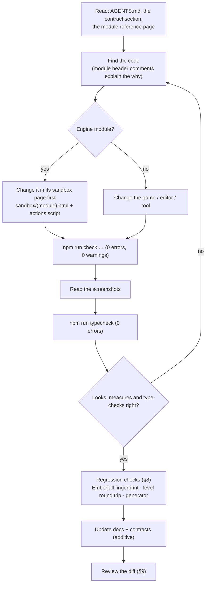

# Development workflow

English | [简体中文](DEVELOPMENT_WORKFLOW.zh-CN.md)

> **Purpose.** How to work on Luminati day to day: setup, the project layout, running and building,
> the sandbox-first approach for engine work, how levels are edited or generated, the regression
> practice that keeps Emberfall and the level files stable, version-control hygiene, platform
> notes and coordination for changes that span several modules.
>
> **Audience:** developers and AI agents starting work on the repository.
>
> **Source of truth:** [`package.json`](../../package.json), [`vite.config.js`](../../vite.config.js),
> [`tools/`](../../tools/) (`check.mjs`, `vite-level-api.js`, `vite-launcher.js`, `make-starfall-vale.mjs`,
> `make-sample-hamlet.mjs`, `make-cinderwatch-pass.mjs`, `make-gildhaven.mjs`, `check-docs-links.mjs`), [`sandbox/`](../../sandbox/),
> [`.gitattributes`](../../.gitattributes) and [`.gitignore`](../../.gitignore).
>
> **Related:** [TESTING_AND_VERIFICATION.md](TESTING_AND_VERIFICATION.md) (the harness in depth) ·
> [CONVENTIONS.md](CONVENTIONS.md) · [contracts/README.md](../contracts/README.md) ·
> [ai/AGENT_ONBOARDING.md](../ai/AGENT_ONBOARDING.md) · [ai/TASK_PLAYBOOKS.md](../ai/TASK_PLAYBOOKS.md) ·
> [user/GETTING_STARTED.md](../user/GETTING_STARTED.md)

---

## 1. At a glance

| Command | What it does |
| --- | --- |
| `npm ci` | Install the dependency versions recorded in `package-lock.json`. Use `npm install` when intentionally updating dependencies and review the lockfile change. |
| `npm run dev` | Vite dev server on **http://127.0.0.1:5173** with the level-save API; `/` is the launcher (every campaign and level, the editor), the game is `/game.html`. |
| `npm run build` | Production build of `index.html` (the launcher, its list baked in), `game.html` and `editor.html` into `dist/`; `public/levels/` is copied to `dist/levels/`. |
| `npm run preview` | Serve `dist/` (Vite's default preview port, 4173). |
| `npm run check -- --page=… [--query=… --out=… --script=… --wait=… --fps=… --strict --base=project --dist]` | Headless browser check: errors, evals, fps, screenshots → `.check/<out>/`. The project's "test". Exit 1 on page errors; with `--strict` also on console errors, warnings, failed requests and throwing evals. `--base` serves the project under a sub-path, `--dist` checks the build (`dist/`, through `vite preview`) instead of the sources. |
| `npm run typecheck` | Type-check the JavaScript through its JSDoc (`tsc`, both programs, ~2 s; exit 1 on any error). Nothing is emitted and Vite never type-checks ([CONVENTIONS.md §3.1](CONVENTIONS.md#31-the-type-check)). |
| `npm run docs:check` | Validate relative links, images and anchors in `docs/` and root Markdown files. |
| `npm run api:test` | Self-test of the dev-server level API (`tools/test-level-api.mjs`): a throwaway Vite server with only the plugin, on a temporary folder — never `public/`; exit 1 on a failed check ([LEVEL_STORAGE_API §5.5](../specs/LEVEL_STORAGE_API.md#55-self-test)). |
| `npm run level:check -- <level> [--strict] [--routes=<file>]` | Run the generators' level checks on any level file (a name in `public/levels/` or a path) — e.g. after saving a level in the editor. Read-only; exit 1 on errors ([LEVEL_DESIGN_GUIDE §14](../design/LEVEL_DESIGN_GUIDE.md#from-the-command-line-any-level)). |
| `npm run level:test` | Self-test of the level checks' story states (`tools/test-levelcheck.mjs`): `checkLevel` on small in-memory levels with `when` / `unless` — overlaps, reachability per state, the wording; exit 1 on a failed assertion ([CAMPAIGN_FORMAT §9](../specs/CAMPAIGN_FORMAT.md#9-checks)). |
| `npm run story:test` | Self-tests of the story language, files and checks, then the runtime on a stub game (`tools/test-story.mjs`, `tools/test-story-runtime.mjs`; 648 + 244 assertions). |
| `npm run i18n:check` | The content tables (`public/i18n/`) against what the data shows: untranslated, changed, orphans, texts with no key, markup; one key with two Englishes and a table that is not version 3 are errors (`tools/check-i18n.mjs`; [I18N.md §4.7](../specs/I18N.md#47-checker-worklist-and-exchange)). |
| `npm run i18n:test` | Self-test of the tables, lookup chain, extractor, checker, worklist and PO (`tools/test-i18n.mjs`; 314 assertions). |
| `npm run i18n:keys -- [<file\|campaign> …] [--check\|--assign\|--fix]` | The text keys of level, campaign and story files (`tools/i18n-keys.mjs`): `--check` (the default; nothing named: the shipped tree) lists missing, stray and repeated keys and keys with two Englishes; `--assign` keys keyless texts; `--fix` splits a copy edited apart. Never writes a generated file ([TASK_PLAYBOOKS §28](../ai/TASK_PLAYBOOKS.md#28-key-a-new-level-or-campaign)). |
| `npm run keys:test` | Self-test of the text keys (`tools/test-text-keys.mjs`; 256 checks): the library, the cleaners, the extractor's keys and `i18n:keys` on a temp tree. |
| `node tools/make-starfall-vale.mjs` | Regenerate and validate `public/levels/starfall-vale.json` (128 × 128); `--check` writes nothing and exits 1 unless the file matches byte for byte. |
| `node tools/make-cinderwatch-pass.mjs` | Regenerate and validate `public/levels/cinderwatch-pass.json` (combat); `--check` writes nothing and compares the generated file. |
| `node tools/make-gildhaven.mjs` | Regenerate and validate `public/levels/gildhaven.json` (the 128 × 128 town); `--check` writes nothing and exits 1 unless the file matches byte for byte. |
| `node tools/make-ferrymans-lantern.mjs` | Regenerate the demo campaign `public/campaigns/ferrymans-lantern/` (`campaign.json` + five level files), checked as a whole (`checkCampaign`) before writing; `--check` compares its generated files. |
| `node tools/make-emberfall-interiors.mjs` | Regenerate the rooms demo `public/campaigns/emberfall-interiors/` (`campaign.json`, the town read from `public/levels/emberfall.json`, ten rooms), checked as a whole before writing; `--check` compares all twelve files. |
| `node tools/make-sample-hamlet.mjs` | Regenerate `public/levels/sample-hamlet.json` (Willowmere). `--out=<path>` writes elsewhere; `--check` writes nothing and exits 1 unless the file matches byte for byte. |

---

## 2. Setup

- **Node.js 24** is recommended; the installed development dependencies require **22.12 or
  newer** (`puppeteer-core` sets the stricter minimum). npm installs the local tools; no global
  Vite or TypeScript installation is needed.
- **A Chromium browser for the harness** — Chrome or Edge is detected in standard Windows
  locations. Set `CHROME_PATH` for another installation. The harness currently passes the
  Windows-specific `--use-angle=d3d11` flag; other platforms need separate verification
  ([TESTING_AND_VERIFICATION.md §3](TESTING_AND_VERIFICATION.md#3-how-the-harness-works)).
- **WebGL 2 with hardware acceleration** for the game and the editor's 3D view. Performance
  depends on the browser, driver, resolution and scene; see
  [performance measurements](../architecture/PERFORMANCE.md).
- Run `npm ci`, then `npm run dev` and open the URL Vite prints (normally
  `http://127.0.0.1:5173/`). The launcher links to the game, editor, sandboxes and documentation.

The game needs no backend, database, account or API key. World art and audio are generated at
runtime; fonts are loaded from Google Fonts with bundled copies available when that fails.
The local dev server includes a file-writing level API, so keep it bound to loopback; publish
`dist/` on a static host instead of exposing the dev server.

---

## 3. Project layout

```
.
├─ index.html                  the launcher: campaigns, levels, editor links (no script; list by tools/vite-launcher.js)
├─ game.html                   game page: loading screen, #app, boots src/main.js
├─ editor.html                 level editor page: boot splash, boots src/editor/main.js
├─ src/
│  ├─ main.js                  game entry: resolves ?level=, shows load errors, exposes window.__luminati
│  ├─ globals.d.ts             types of the window.__* hooks (type check only; folders add a types.d.ts)
│  ├─ engine/                  the engine (public API: engine/index.js)
│  │  ├─ constants.js · utils/math.js · render/GlobalUniforms.js     shared foundation files
│  │  ├─ core/  audio/  render/  pixel/  sprite/  fx/  lighting/  world/  level/  ui/
│  ├─ game/                    the game layer: Game, World, Player, Npc, Critters, Weather, dialogue, combat/, campaign/ …
│  ├─ editor/                  the level editor: EditorApp, EditorState, tools/, map2d/, viewport3d/, ui/
│  └─ launcher/launcher.css    the launcher's styles (the sandbox gallery's look)
├─ public/levels/*.json        shipped levels (served as /levels/<name>.json, copied into dist/)
├─ public/campaigns/<c>/       campaigns: campaign.json + levels/<id>.json
├─ sandbox/                    per-module test pages (*.html + *.js), action scripts (*.json), test helpers
├─ tools/
│  ├─ check.mjs                the headless check harness (npm run check)
│  ├─ typecheck.mjs            the type check (npm run typecheck); tools/tsconfig.json = the Node program
│  ├─ vite-level-api.js        dev-server plugin: GET/PUT/DELETE /api/levels
│  ├─ vite-launcher.js         Vite plugin: writes the launcher's list into index.html (each dev request; once in a build)
│  ├─ make-starfall-vale.mjs   deterministic generator + validator for starfall-vale.json
│  ├─ make-sample-hamlet.mjs   generator for sample-hamlet.json
│  ├─ make-cinderwatch-pass.mjs  generator + validator for cinderwatch-pass.json (the combat level)
│  ├─ make-gildhaven.mjs       generator + validator for gildhaven.json (the 128 × 128 town)
│  ├─ make-ferrymans-lantern.mjs  generator of the demo campaign (checked with lib/campaigncheck.mjs)
│  ├─ make-emberfall-interiors.mjs  generator of the rooms demo (Emberfall + ten rooms; checkCampaign)
│  ├─ lib/levelgen.mjs         helpers shared by the two generators above
│  ├─ lib/levelcheck.mjs       the level checks (checkLevel): make-gildhaven.mjs and check-level.mjs
│  ├─ check-level.mjs          the level checks on any level file (npm run level:check)
│  ├─ test-story.mjs           the story system's self-test (npm run story:test)
│  ├─ test-levelcheck.mjs      the level checks' self-test: story states (npm run level:test)
│  ├─ test-level-api.mjs       the level API's self-test (npm run api:test)
│  ├─ check-i18n.mjs           the content tables' checker (npm run i18n:check; lib/i18n.mjs)
│  ├─ i18n-keys.mjs            the text keys of level / campaign / story files (npm run i18n:keys)
│  ├─ i18n-worklist.mjs        translators' worklists: write (JSON / PO), --merge, --prune, --init
│  ├─ test-i18n.mjs            the content-text self-test (npm run i18n:test)
│  ├─ test-text-keys.mjs       the text keys' self-test (npm run keys:test)
│  └─ check-docs-links.mjs     docs link / image / anchor checker (npm run docs:check)
├─ docs/                       this documentation; docs/contracts/ holds LEVEL_EDITOR.md (binding) and MODULE_NOTES.md
├─ ARCHITECTURE.md             binding engine contract and visual target
├─ README.md                   project overview and quick start
├─ AGENTS.md                   shared guidance for contributors and coding tools
├─ CLAUDE.md                   points Claude Code to the shared guidance
├─ vite.config.js              dev server 127.0.0.1:5173, level API and launcher plugins, relative three-page build (base './')
├─ tsconfig.json               the type check of src/ + sandbox/ (allowJs, checkJs, noEmit, strict off)
├─ dist/                       build output (gitignored)
├─ .check/                     harness output: screenshots + report.json per --out (gitignored)
└─ node_modules/.vite-check/   Vite dependency caches of running harness checks (each run deletes its own)
```

Module-by-module detail: [architecture/OVERVIEW.md](../architecture/OVERVIEW.md) and
[architecture/modules/](../architecture/modules/README.md).

---

## 4. Running and building

### 4.1 Dev server

`npm run dev` serves the whole project root, so every page and module is reachable:

| URL | Page |
| --- | --- |
| `/` or `/index.html` | The launcher: every campaign (`public/campaigns/<c>/campaign.json`) and level (`public/levels/*.json`) with Play and Edit links, the editor, the sandboxes and these docs. A plain English page without script; `tools/vite-launcher.js` writes the list on every request (a level the editor saves shows on the next reload) and names a file it cannot list in a *Not listed* note. It takes no query. |
| `/game.html` | The game; Emberfall by default, title screen first. |
| `/game.html?autostart=1` | Skip the title screen (`?autostart` without a value works too; `autostart=0` does not skip). |
| `/game.html?level=<name>` | Play `public/levels/<name>.json` (`starfall-vale`, `brightwater-crossing`, `sample-hamlet`, `emberfall`). |
| `/game.html?level=local:<slot>` | Play a level stored in this browser; the editor's play-test uses `local:__playtest__`. |
| `/game.html?campaign=<name>` | Play a campaign: its title screen continues the saved journey or starts one (`&new=1` starts over). |
| `/editor.html` | The editor (restores the last layout and offers an autosaved copy). |
| `/editor.html?open=<name>` · `?new` · `?local=<slot>` | Open a project level (`open=<campaign>/<level>`: a campaign's level) · start blank (`new=room`: a room) · open a browser-stored level. |
| `/sandbox/` | Gallery of the module test pages. |
| `/docs/` | This documentation's landing page ([`docs/index.html`](../index.html)) and its other HTML pages; they also work opened from `file://`. |
| `/api/levels`, `/api/levels/<name>` | The level API (dev only): list, read, write, delete. Under the server's base like everything else: `npm run dev -- --base=/project/` serves the pages at `/project/…` and the API at `/project/api/levels`. |

Full parameter lists: [specs/INPUT_AND_CONTROLS.md](../specs/INPUT_AND_CONTROLS.md),
[specs/LEVEL_STORAGE_API.md](../specs/LEVEL_STORAGE_API.md) and
[user/GETTING_STARTED.md](../user/GETTING_STARTED.md).

### 4.2 Build and preview

`npm run build` bundles the three pages (`rollupOptions.input`: `launcher` = `index.html`, `game` =
`game.html`, `editor` = `editor.html`; target `es2022`; chunk-size warning raised to 2,000 kB; the
game's entry chunk is `assets/game-*.js`) and copies `public/` — including **every** file in
`public/levels/`, also untracked scratch levels (for example an `untitled.json` saved from the
editor). The launcher's list is written once, from what `public/` holds at build time, into
`dist/index.html` (rebuild after adding a level; the built list has no sandbox or docs links). The
sandboxes and `docs/` are not part of the build.
The build emits the shore worker as a separate asset (`dist/assets/shoreWorker-*.js`).
Its URLs are relative (`base: './'`: `./assets/…`,
`BASE_URL` `./`), so the same `dist/` works at the site root and under any sub-path
([GETTING_STARTED §5](../user/GETTING_STARTED.md#5-build-and-deploy));
`npm run check -- --page=game.html --dist --base=project --out=built-game` checks the game there;
repeat with `--page=index.html --query=` and `--page=editor.html` for the other entry pages.

In `npm run preview` (and any static hosting of `dist/`) the level API does not exist
(`apply: 'serve'`): the game still loads `levels/<name>.json`, but the editor cannot save to the
project folder — it offers browser storage and downloads instead. (`vite preview` answers
`/api/levels` with its `index.html` fallback — the launcher —, HTTP 200;
`LevelStorage.hasProjectApi` checks for a JSON content type, so the editor correctly treats the API
as absent.)

### 4.3 Preview tooling

An IDE browser preview can use the same URL printed by `npm run dev`. A game or editor tab
renders continuously while active and competes for GPU time with harness measurements. Close
unused rendering tabs before collecting performance numbers.

---

## 5. The daily loop



1. **Read before editing.** [`AGENTS.md`](../../AGENTS.md) (shared guidance), the contract section for the
   area ([contracts/README.md](../contracts/README.md)), and the module reference page. Every
   source file starts with a header comment that explains its rules — read it.
2. **Make the change** following [CONVENTIONS.md](CONVENTIONS.md).
3. **Check it in the real renderer** with `npm run check` and read the PNGs. Use `--headful` or
   `npm run dev` in a browser when you need to look interactively.
4. **Run `npm run typecheck`** (0 errors) and **the regression checks** that match the change
   ([§8](#8-regression-practice)).
5. **Update the docs** in the same change and review the final diff.

---

## 6. Sandbox-first engine work

Every engine module was built and audited in isolation before any integration
(ARCHITECTURE §6): *each module author creates `sandbox/<module>.html` (+ `.js`) that exercises
the module with raw three.js and the shared foundation files only … A module is not done until its
sandbox renders correctly with zero errors.* Keep working that way:

- **Reproduce in the sandbox first.** It isolates the module from the game's weather, time,
  post-processing and 100+ other meshes, and it loads in a second. The sandbox pages have views and
  query parameters that frame the interesting cases
  ([TESTING_AND_VERIFICATION.md §8](TESTING_AND_VERIFICATION.md#8-sandbox-pages-and-scripted-suites)).
- **Expose a hook** (`window.__<module>`) with setters and self-tests (`runTests()`, `check()`,
  `info()`), and add assertions to the module's action script when you fix a bug — the audits
  added regression evals for their fixes (for example `interruptedResolvedWith` in the UI
  sandbox, `disposeTest()` in the props sandbox).
- **Then check the integration**: the game (`game.html`), the editor preview when the module is
  used there (`editor.html?open=emberfall`), and the big level if performance is involved.
- New module? Create `sandbox/<name>.html`, `sandbox/<name>.js` and `sandbox/<name>.actions.json`,
  and link the page from `sandbox/index.html`.

---

## 7. Working with levels

| Level | Source of truth | How to change it |
| --- | --- | --- |
| `emberfall.json` (48 × 40, 137 objects) | the JSON file itself | In the editor (`editor.html?open=emberfall`, Ctrl+S saves back through the dev API) or by hand in the JSON. NPC `script` ids point to hand-written conversations in `src/game/dialogue.js`. |
| `brightwater-crossing.json` (36 × 28, 68 objects) | the JSON file (built through the editor UI) | In the editor. |
| `sample-hamlet.json` (Willowmere, 28 × 22, 38 objects) | `tools/make-sample-hamlet.mjs` | Edit the script, run `node tools/make-sample-hamlet.mjs`. See the note below. |
| `starfall-vale.json` (128 × 128, 875 objects) | `tools/make-starfall-vale.mjs` | Edit the generator, run it; **never hand-edit the JSON**. To continue it by hand, copy it to a new name first. |
| `cinderwatch-pass.json` (96 × 120, combat) | `tools/make-cinderwatch-pass.mjs` | Edit the generator and regenerate; check the combat and party balance as well as the level data. |
| `gildhaven.json` (128 × 128, 518 objects) | `tools/make-gildhaven.mjs` | The same: edit the generator, run it (`--check` confirms the file is up to date); see [its page](../design/levels/gildhaven.md). |
| `public/campaigns/ferrymans-lantern/` (a campaign: five level files) | `tools/make-ferrymans-lantern.mjs` | The same; the whole campaign is checked before it is written; see [its page](../design/campaigns/ferrymans-lantern.md). |
| `public/campaigns/emberfall-interiors/` (a campaign: the town + ten rooms) | `tools/make-emberfall-interiors.mjs` | The same; its town is read from `emberfall.json`, so an edit to Emberfall needs a re-run; see [its page](../design/campaigns/emberfall-interiors.md). |
| other untracked `*.json` files | Local levels, including work made by another contributor or session | Inspect their ownership before editing; include only files intended for the change. |

Every shipped level and campaign file is **keyed**: each translatable text carries its text key
(`textKeys`, `#line:` tags; [I18N.md §4.2](../specs/I18N.md#42-keys-and-lookup)). The editor and
the generators keep the keys through every edit; never hand-edit a key or tag. After a hand edit of
Emberfall's or Brightwater's text, run `npm run i18n:keys` (`-- --assign <file>` keys new texts;
`--fix` splits a copy whose English now differs) and `npm run i18n:check`
([TASK_PLAYBOOKS §13](../ai/TASK_PLAYBOOKS.md#13-change-an-existing-level)). The interiors
generator fails on a town text without a key: key Emberfall first.

- **Generators are deterministic.** `make-starfall-vale.mjs` validates the level (reachability,
  routes, bridges, stairs, sightlines, coverage, round trip) and writes nothing if a check fails.
  Options: `--out=<path>` (write elsewhere), `--ascii` (print the tile map), `--quiet`, `--force`
  (write a failing level for inspection; still exits 1), `--check` (write nothing; exit 1 unless the
  file matches byte for byte). It runs in under a second. Changing an early scatter rule reshuffles
  every tree placed after it — re-run your checks afterwards. Every generator keys its output
  (`keyLevel`: the keys of its last output at the default path carried over, new ones seeded by the
  file) and fails on any text-key issue.
- **`make-sample-hamlet.mjs`** writes `public/levels/sample-hamlet.json` (`--out=<path>` writes
  elsewhere, relative to the repository root). `--check` writes nothing and compares: exit 0 when
  the file matches byte for byte, else exit 1 saying whether the data or only the key order /
  formatting differs. It pins each object's key order itself and refuses to write unless the output
  round-trips byte-identically, so an unchanged script reproduces the committed file exactly.
- **New levels**: editor *File › New*, build, *Save as › Project folder* → `public/levels/<name>.json`,
  play with `game.html?level=<name>`. Format reference: [specs/LEVEL_FORMAT.md](../specs/LEVEL_FORMAT.md);
  workflow: [user/LEVEL_EDITOR_GUIDE.md](../user/LEVEL_EDITOR_GUIDE.md); design advice:
  [design/LEVEL_DESIGN_GUIDE.md](../design/LEVEL_DESIGN_GUIDE.md).
- **Scripted editor tests can write levels** through the dev API. Delete any temporary level you
  create (`zz-…`, `rv-…` names were used) and check `git status public/levels` before committing.

---

## 8. Regression practice

### 8.1 What to run for which change

| You changed… | Run |
| --- | --- |
| source code or runtime data | `npm run typecheck`; `npm run build`; the affected game/editor pages clean in the harness; screenshots read |
| documentation only | `npm run docs:check`; render any HTML documentation page whose appearance changed |
| an engine module | its sandbox suite; Emberfall fingerprint ([§8.2](#82-emberfall-fingerprint-and-screenshots)); shader-program count; draw calls |
| rendering or look | shots across hours and weather; frozen-frame image diffs where nothing should change |
| the level format, catalog or storage | round trip ([§8.3](#83-byte-stable-level-round-trip)); editor open + Ctrl+S + `git diff`; `sandbox/game_levels.html` cases |
| a generator or anything it imports | determinism and validation ([§8.4](#84-generator-determinism)) |
| big-level code | small levels identical ([§8.5](#85-small-levels-must-not-change)); Starfall draw calls, load time, light pool |
| the editor | the editor suites, `editor_perf.json` exactness, play-test |

The complete checklist is in
[TESTING_AND_VERIFICATION.md §12](TESTING_AND_VERIFICATION.md#12-pre-commit-verification-checklist).

### 8.2 Emberfall fingerprint and screenshots

Emberfall is the reference scene: every engine change during the build was checked against it.
Two techniques, both documented with working snippets in
[TESTING_AND_VERIFICATION.md §11](TESTING_AND_VERIFICATION.md#11-visual-regression-techniques-used-in-this-project):

- **World fingerprint** — hashes of lights, static colliders and world meshes, plus
  interactables and program counts. Record a baseline from the revision you are changing and
  compare after the edit; a deliberate world change may change its fingerprint.
- **Frozen-frame screenshot diffs** — `timeScale = 0`, grain off, particles hidden, then a mean
  absolute pixel difference. Two runs of the same code differ by a mean of ~0.4; unfrozen runs by
  ~5–7.

### 8.3 Byte-stable level round trip

Parsing and re-serialising a normalised level must reproduce the file byte for byte:

```bash
node --input-type=module -e "
import fs from 'node:fs';
import { parseLevel, serializeLevel } from './src/engine/level/LevelFormat.js';
for (const f of fs.readdirSync('public/levels').filter((f) => f.endsWith('.json'))) {
  const text = fs.readFileSync('public/levels/' + f, 'utf8');
  console.log(f, serializeLevel(parseLevel(text).level) === text ? 'byte-identical' : 'CHANGED');
}"
```

All six shipped standalone levels should print `byte-identical`. The in-editor version: open a level
(`editor.html?open=emberfall`), press Ctrl+S, and `git diff public/levels` must be empty.

### 8.4 Generator determinism

```bash
node tools/make-starfall-vale.mjs --check
```

The generator validates its result, writes nothing and exits unsuccessfully if the output does
not match the committed file byte for byte. Use the corresponding `--check` for each generator
you change. For an intentional change, regenerate without `--check`, review the data diff and
the in-game result, and include the generated files with the generator change.

### 8.5 Small levels must not change

Big-level systems are gated at 64 tiles. After touching them, compare Emberfall, sample-hamlet and
brightwater-crossing before and after at fixed teleports and hours: draw calls, triangles and the
light list should match the baseline for an unrelated change, and
frozen screenshots must differ only where villagers walked.

### 8.6 Shader programs and hitches

`renderer.info.programs.length` after load (57 Emberfall, 59 Starfall Vale) must not grow while
cycling time (T), weather (R), opening the world map (N) or photo mode (P). A new program at
runtime can cause a visible hitch; compile it during loading against the HDR render target.

---

## 9. Git conventions

- Review `git status` and the diff before and after making a change. Preserve unrelated work.
- Keep each change focused and describe the problem, resulting behaviour and relevant checks.
- Use LF line endings, as configured by `.gitattributes`; avoid line-ending-only diffs.
- `node_modules/`, `dist/`, `.check/` and logs are local outputs. Do not include them in commits.
  Save reusable check scripts in `sandbox/` and durable documentation under `docs/`.
- Include only intended level changes. Editor checks can create temporary files; remove only
  the files your run created, and leave other people's untracked levels alone.
- Do not rewrite shared history or skip repository hooks. No branch name, remote configuration
  or author identity is required by the codebase.

---

## 10. Windows notes

- **Shells.** Examples use repository-relative paths. Single-line `npm` commands work in
  PowerShell and Git Bash; shell-specific environment-variable syntax differs. Quote paths
  containing spaces and query strings containing `&`.
- **Browser location.** The harness detects standard Chrome and Edge installations on Windows;
  set `CHROME_PATH` for another installation. See the
  [harness setup](TESTING_AND_VERIFICATION.md#3-how-the-harness-works).
- **Sub-path checks.** Use `--base=project` with the harness. Git Bash otherwise rewrites a
  leading-slash argument as a Windows path. For Vite's own `--base=/project/`, prefix the command
  with `MSYS_NO_PATHCONV=1` in Git Bash.
- **Reserved file names.** Windows reserves names such as `con`, `nul`, `prn`, `aux`, `com1` and
  `lpt1`. The level name slugifier and the level API guard against these names.
- **Locked or read-only files.** A save can fail with `EPERM`, `EACCES` or `EBUSY`. The level API
  reports that the file is read-only or in use and removes its temporary file.
- **Disk space.** Completed harness runs remove their own Vite cache by default. Interrupted
  runs can leave caches in `node_modules/.vite-check/`; clear those only when no check is running.
  Reports and screenshots in `.check/` remain until you remove them or reuse their output name.
- **GPU sharing.** Desktop applications and concurrent harness runs share GPU time. Keep timing
  runs separate and record the conditions; see
  [measurement practice](TESTING_AND_VERIFICATION.md#9-measuring-performance-correctly).

---

## 11. Coordinating larger changes

When several contributors or coding agents work at once, agree on file ownership and interfaces
before editing. Keep independent changes in separate areas and coordinate changes to shared
foundation files. Give each browser check its own `--out` name; run timing-sensitive checks alone.

For a new module, define its contract and shared types, add a sandbox that can exercise it, then
integrate it with the game and editor. Review the integrated result as well as each module in
isolation. A handoff should state what changed, the checks performed, expected warnings and any
remaining issues. Do not rely on private session logs as the only explanation for code behaviour.

---

## 12. Before you finish

- The harness is clean for the pages you touched, and you have looked at the screenshots.
- The regression checks for your change pass ([§8](#8-regression-practice)).
- Contracts and docs are updated ([contracts/README.md](../contracts/README.md)), and
  `npm run docs:check` reports no broken link.
- `git status` shows no temporary levels and no `.check/` files, and nothing stages a user's
  untracked level.
- Full list: [TESTING_AND_VERIFICATION.md §12](TESTING_AND_VERIFICATION.md#12-pre-commit-verification-checklist).
