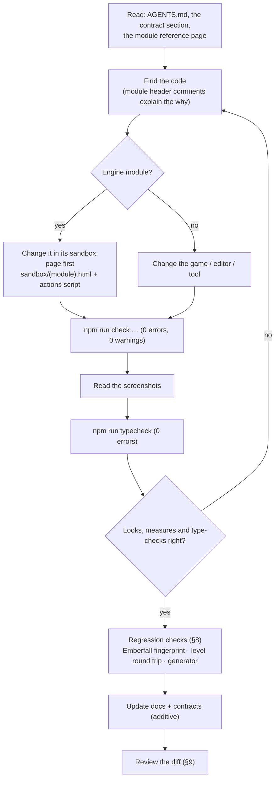

# 开发工作流程

[English](DEVELOPMENT_WORKFLOW.md) | 简体中文

> **用途。** 说明日常如何开发 Luminati：环境搭建、项目结构、运行与构建、引擎工作的“沙盒优先”方法、如何编辑或生成关卡、保持烬落村（Emberfall）和关卡文件稳定的回归实践、版本控制规范、平台说明，以及跨多个模块的改动如何协调。
>
> **读者：** 刚开始参与本仓库的开发者和 AI 智能体。
>
> **事实来源：** [`package.json`](../../package.json)、[`vite.config.js`](../../vite.config.js)、[`tools/`](../../tools/)（`check.mjs`、`vite-level-api.js`、`vite-launcher.js`、`make-starfall-vale.mjs`、`make-sample-hamlet.mjs`、`make-cinderwatch-pass.mjs`、`make-gildhaven.mjs`、`check-docs-links.mjs`）、[`sandbox/`](../../sandbox/)、[`.gitattributes`](../../.gitattributes) 和 [`.gitignore`](../../.gitignore)。
>
> **相关文档：** [TESTING_AND_VERIFICATION.md](TESTING_AND_VERIFICATION.md)（验证工具详解）· [CONVENTIONS.md](CONVENTIONS.md) · [contracts/README.md](../contracts/README.zh-CN.md) · [ai/AGENT_ONBOARDING.md](../ai/AGENT_ONBOARDING.zh-CN.md) · [ai/TASK_PLAYBOOKS.md](../ai/TASK_PLAYBOOKS.md) · [user/GETTING_STARTED.md](../user/GETTING_STARTED.zh-CN.md)

---

## 1. 概览

| 命令 | 作用 |
| --- | --- |
| `npm ci` | 安装 `package-lock.json` 中记录的依赖版本。有意更新依赖时使用 `npm install`，并审查 lockfile 的变化。 |
| `npm run dev` | 在 **http://127.0.0.1:5173** 启动带关卡保存 API 的 Vite 开发服务器；`/` 是启动器（所有战役和关卡，以及编辑器），游戏位于 `/game.html`。 |
| `npm run build` | 将 `index.html`（启动器，已内嵌其列表）、`game.html` 和 `editor.html` 生产构建到 `dist/`；`public/levels/` 会被复制到 `dist/levels/`。 |
| `npm run preview` | 提供 `dist/` 服务（Vite 默认预览端口 4173）。 |
| `npm run check -- --page=… [--query=… --out=… --script=… --wait=… --fps=… --strict --base=project --dist]` | 无头浏览器检查：错误、eval、fps、截图 → `.check/<out>/`。这是本项目的“测试”。出现页面错误时以 1 退出；加上 `--strict` 后，控制台错误、警告、失败的请求和抛出异常的 eval 也会以 1 退出。`--base` 在子路径下提供项目服务，`--dist` 检查构建产物（`dist/`，通过 `vite preview`）而不是源码。 |
| `npm run typecheck` | 通过 JSDoc 对 JavaScript 进行类型检查（`tsc`，两个程序，约 2 秒；有任何错误时以 1 退出）。不输出任何文件，且 Vite 从不做类型检查（[CONVENTIONS.md §3.1](CONVENTIONS.md#31-the-type-check)）。 |
| `npm run docs:check` | 校验 `docs/` 和根目录 Markdown 文件中的相对链接、图片和锚点。 |
| `npm run api:test` | 开发服务器关卡 API 的自测（`tools/test-level-api.mjs`）：一个只含该插件的一次性 Vite 服务器，作用于临时文件夹——绝不是 `public/`；有检查失败时以 1 退出（[LEVEL_STORAGE_API §5.5](../specs/LEVEL_STORAGE_API.md#55-self-test)）。 |
| `npm run level:check -- <level> [--strict] [--routes=<file>]` | 对任意关卡文件（`public/levels/` 中的名称或一个路径）运行生成器所用的关卡检查——例如在编辑器中保存关卡之后。只读；有错误时以 1 退出（[LEVEL_DESIGN_GUIDE §14](../design/LEVEL_DESIGN_GUIDE.zh-CN.md#从命令行任何关卡)）。 |
| `npm run level:test` | 关卡检查中故事状态部分的自测（`tools/test-levelcheck.mjs`）：在带 `when` / `unless` 的小型内存关卡上运行 `checkLevel`——重叠、每种状态下的可达性、措辞；有断言失败时以 1 退出（[CAMPAIGN_FORMAT §9](../specs/CAMPAIGN_FORMAT.md#9-checks)）。 |
| `npm run story:test` | 故事语言、文件和检查的自测，然后在一个桩游戏上测试运行时（`tools/test-story.mjs`、`tools/test-story-runtime.mjs`；648 + 244 个断言）。 |
| `npm run i18n:check` | 将内容表（`public/i18n/`）与数据实际显示的内容进行比对：未翻译、已变更、孤立条目、没有键的文本、标记；一个键对应两种英文、以及版本不是 3 的表都算错误（`tools/check-i18n.mjs`；[I18N.md §4.7](../specs/I18N.md#47-checker-worklist-and-exchange)）。 |
| `npm run i18n:test` | 字符串表、查找链、提取器、检查器、工作清单和 PO 的自测（`tools/test-i18n.mjs`；314 个断言）。 |
| `npm run i18n:keys -- [<file\|campaign> …] [--check\|--assign\|--fix]` | 关卡、战役和故事文件的文本键（`tools/i18n-keys.mjs`）：`--check`（默认；未指定文件时检查随附的整个目录树）列出缺失、多余和重复的键，以及对应两种英文的键；`--assign` 为没有键的文本分配键；`--fix` 拆分被编辑得不再一致的副本。从不写入生成的文件（[TASK_PLAYBOOKS §28](../ai/TASK_PLAYBOOKS.md#28-key-a-new-level-or-campaign)）。 |
| `npm run keys:test` | 文本键的自测（`tools/test-text-keys.mjs`；256 项检查）：库本身、清理器、提取器的键，以及在临时目录树上运行的 `i18n:keys`。 |
| `node tools/make-starfall-vale.mjs` | 重新生成并校验 `public/levels/starfall-vale.json`（128 × 128）；`--check` 不写入任何内容，除非文件逐字节匹配，否则以 1 退出。 |
| `node tools/make-cinderwatch-pass.mjs` | 重新生成并校验 `public/levels/cinderwatch-pass.json`（战斗关卡）；`--check` 不写入任何内容，只比较生成的文件。 |
| `node tools/make-gildhaven.mjs` | 重新生成并校验 `public/levels/gildhaven.json`（128 × 128 的城镇）；`--check` 不写入任何内容，除非文件逐字节匹配，否则以 1 退出。 |
| `node tools/make-ferrymans-lantern.mjs` | 重新生成演示战役 `public/campaigns/ferrymans-lantern/`（`campaign.json` + 五个关卡文件），写入前作为整体进行检查（`checkCampaign`）；`--check` 比较其生成的文件。 |
| `node tools/make-emberfall-interiors.mjs` | 重新生成房间演示 `public/campaigns/emberfall-interiors/`（`campaign.json`、从 `public/levels/emberfall.json` 读取的城镇、十个房间），写入前作为整体进行检查；`--check` 比较全部十二个文件。 |
| `node tools/make-sample-hamlet.mjs` | 重新生成 `public/levels/sample-hamlet.json`（柳湖村（Willowmere））。`--out=<path>` 写到其他位置；`--check` 不写入任何内容，除非文件逐字节匹配，否则以 1 退出。 |

---

## 2. 环境搭建

- 推荐使用 **Node.js 24**；已安装的开发依赖要求 **22.12 或更高版本**（更严格的最低版本由 `puppeteer-core` 决定）。npm 会安装本地工具；无需全局安装 Vite 或 TypeScript。
- **验证工具需要一个 Chromium 浏览器**——会在 Windows 的标准位置检测 Chrome 或 Edge。若安装在其他位置，请设置 `CHROME_PATH`。验证工具目前会传入 Windows 专用的 `--use-angle=d3d11` 标志；其他平台需要另行验证（[TESTING_AND_VERIFICATION.md §3](TESTING_AND_VERIFICATION.md#3-how-the-harness-works)）。
- 游戏和编辑器的 3D 视图需要 **支持硬件加速的 WebGL 2**。性能取决于浏览器、驱动、分辨率和场景；参见[性能测量](../architecture/PERFORMANCE.md)。
- 运行 `npm ci`，然后运行 `npm run dev` 并打开 Vite 输出的 URL（通常为 `http://127.0.0.1:5173/`）。启动器链接到游戏、编辑器、沙盒和文档。

游戏不需要后端、数据库、账户或 API 密钥。世界美术和音频在运行时生成；字体从 Google Fonts 加载，失败时使用打包的副本。本地开发服务器包含一个会写入文件的关卡 API，因此要让它只绑定在回环地址上；发布时请把 `dist/` 放到静态托管上，而不要暴露开发服务器。

---

## 3. 项目结构

```
.
├─ index.html                  the launcher: campaigns, levels, editor links (no script; list by tools/vite-launcher.js)
├─ game.html                   game page: loading screen, #app, boots src/main.js
├─ editor.html                 level editor page: boot splash, boots src/editor/main.js
├─ src/
│  ├─ main.js                  game entry: resolves ?level=, shows load errors, exposes window.__luminati
│  ├─ globals.d.ts             types of the window.__* hooks (type check only; folders add a types.d.ts)
│  ├─ engine/                  the engine (public API: engine/index.js)
│  │  ├─ constants.js · utils/math.js · render/GlobalUniforms.js     shared foundation files
│  │  ├─ core/  audio/  render/  pixel/  sprite/  fx/  lighting/  world/  level/  ui/
│  ├─ game/                    the game layer: Game, World, Player, Npc, Critters, Weather, dialogue, combat/, campaign/ …
│  ├─ editor/                  the level editor: EditorApp, EditorState, tools/, map2d/, viewport3d/, ui/
│  └─ launcher/launcher.css    the launcher's styles (the sandbox gallery's look)
├─ public/levels/*.json        shipped levels (served as /levels/<name>.json, copied into dist/)
├─ public/campaigns/<c>/       campaigns: campaign.json + levels/<id>.json
├─ sandbox/                    per-module test pages (*.html + *.js), action scripts (*.json), test helpers
├─ tools/
│  ├─ check.mjs                the headless check harness (npm run check)
│  ├─ typecheck.mjs            the type check (npm run typecheck); tools/tsconfig.json = the Node program
│  ├─ vite-level-api.js        dev-server plugin: GET/PUT/DELETE /api/levels
│  ├─ vite-launcher.js         Vite plugin: writes the launcher's list into index.html (each dev request; once in a build)
│  ├─ make-starfall-vale.mjs   deterministic generator + validator for starfall-vale.json
│  ├─ make-sample-hamlet.mjs   generator for sample-hamlet.json
│  ├─ make-cinderwatch-pass.mjs  generator + validator for cinderwatch-pass.json (the combat level)
│  ├─ make-gildhaven.mjs       generator + validator for gildhaven.json (the 128 × 128 town)
│  ├─ make-ferrymans-lantern.mjs  generator of the demo campaign (checked with lib/campaigncheck.mjs)
│  ├─ make-emberfall-interiors.mjs  generator of the rooms demo (Emberfall + ten rooms; checkCampaign)
│  ├─ lib/levelgen.mjs         helpers shared by the two generators above
│  ├─ lib/levelcheck.mjs       the level checks (checkLevel): make-gildhaven.mjs and check-level.mjs
│  ├─ check-level.mjs          the level checks on any level file (npm run level:check)
│  ├─ test-story.mjs           the story system's self-test (npm run story:test)
│  ├─ test-levelcheck.mjs      the level checks' self-test: story states (npm run level:test)
│  ├─ test-level-api.mjs       the level API's self-test (npm run api:test)
│  ├─ check-i18n.mjs           the content tables' checker (npm run i18n:check; lib/i18n.mjs)
│  ├─ i18n-keys.mjs            the text keys of level / campaign / story files (npm run i18n:keys)
│  ├─ i18n-worklist.mjs        translators' worklists: write (JSON / PO), --merge, --prune, --init
│  ├─ test-i18n.mjs            the content-text self-test (npm run i18n:test)
│  ├─ test-text-keys.mjs       the text keys' self-test (npm run keys:test)
│  └─ check-docs-links.mjs     docs link / image / anchor checker (npm run docs:check)
├─ docs/                       this documentation; docs/contracts/ holds LEVEL_EDITOR.md (binding) and MODULE_NOTES.md
├─ ARCHITECTURE.md             binding engine contract and visual target
├─ README.md                   project overview and quick start
├─ AGENTS.md                   shared guidance for contributors and coding tools
├─ CLAUDE.md                   points Claude Code to the shared guidance
├─ vite.config.js              dev server 127.0.0.1:5173, level API and launcher plugins, relative three-page build (base './')
├─ tsconfig.json               the type check of src/ + sandbox/ (allowJs, checkJs, noEmit, strict off)
├─ dist/                       build output (gitignored)
├─ .check/                     harness output: screenshots + report.json per --out (gitignored)
└─ node_modules/.vite-check/   Vite dependency caches of running harness checks (each run deletes its own)
```

各模块的详细说明：[architecture/OVERVIEW.md](../architecture/OVERVIEW.md) 和 [architecture/modules/](../architecture/modules/README.zh-CN.md)。

---

## 4. 运行与构建

### 4.1 开发服务器

`npm run dev` 以整个项目根目录提供服务，因此每个页面和模块都可以访问：

| URL | 页面 |
| --- | --- |
| `/` 或 `/index.html` | 启动器：列出每个战役（`public/campaigns/<c>/campaign.json`）和关卡（`public/levels/*.json`）及其 Play 和 Edit 链接，以及编辑器、沙盒和这些文档。这是一个不含脚本的纯英文页面；`tools/vite-launcher.js` 在每次请求时写入列表（编辑器保存的关卡会在下次重新加载时显示），并在 *Not listed* 注释中列出无法列入的文件名。它不接受查询参数。 |
| `/game.html` | 游戏；默认为烬落村，先显示标题画面。 |
| `/game.html?autostart=1` | 跳过标题画面（不带值的 `?autostart` 也可以；`autostart=0` 不会跳过）。 |
| `/game.html?level=<name>` | 游玩 `public/levels/<name>.json`（`starfall-vale`、`brightwater-crossing`、`sample-hamlet`、`emberfall`）。 |
| `/game.html?level=local:<slot>` | 游玩存储在此浏览器中的关卡；编辑器的试玩使用 `local:__playtest__`。 |
| `/game.html?campaign=<name>` | 游玩战役：其标题画面会继续已保存的旅程或开始新旅程（`&new=1` 从头开始）。 |
| `/editor.html` | 编辑器（恢复上次的布局，并提供自动保存的副本）。 |
| `/editor.html?open=<name>` · `?new` · `?local=<slot>` | 打开项目关卡（`open=<campaign>/<level>`：战役中的关卡）· 从空白开始（`new=room`：一个房间）· 打开存储在浏览器中的关卡。 |
| `/sandbox/` | 模块测试页面的画廊。 |
| `/docs/` | 本文档的落地页（[`docs/index.html`](../index.html)）及其他 HTML 页面；它们也可以通过 `file://` 打开。 |
| `/api/levels`、`/api/levels/<name>` | 关卡 API（仅限开发）：列出、读取、写入、删除。与其他一切一样位于服务器的 base 之下：`npm run dev -- --base=/project/` 会在 `/project/…` 下提供页面，在 `/project/api/levels` 下提供 API。 |

完整的参数列表：[specs/INPUT_AND_CONTROLS.md](../specs/INPUT_AND_CONTROLS.md)、[specs/LEVEL_STORAGE_API.md](../specs/LEVEL_STORAGE_API.md) 和 [user/GETTING_STARTED.md](../user/GETTING_STARTED.zh-CN.md)。

### 4.2 构建与预览

`npm run build` 打包三个页面（`rollupOptions.input`：`launcher` = `index.html`，`game` = `game.html`，`editor` = `editor.html`；目标为 `es2022`；代码块大小警告阈值提高到 2,000 kB；游戏的入口代码块是 `assets/game-*.js`），并复制 `public/`——包括 `public/levels/` 中的 **每一个** 文件，也包括未跟踪的临时关卡（例如从编辑器保存的 `untitled.json`）。启动器的列表根据构建时 `public/` 中的内容一次性写入 `dist/index.html`（添加关卡后需要重新构建；构建出的列表没有沙盒或文档链接）。沙盒和 `docs/` 不属于构建产物。构建会把岸线 worker 输出为单独的资源（`dist/assets/shoreWorker-*.js`）。其 URL 是相对路径（`base: './'`：`./assets/…`，`BASE_URL` 为 `./`），因此同一个 `dist/` 既能部署在站点根路径，也能部署在任意子路径下（[GETTING_STARTED §5](../user/GETTING_STARTED.zh-CN.md#5-构建与部署)）；`npm run check -- --page=game.html --dist --base=project --out=built-game` 会在该环境下检查游戏；对其他入口页面，使用 `--page=index.html --query=` 和 `--page=editor.html` 重复执行。

在 `npm run preview`（以及任何 `dist/` 的静态托管）中，关卡 API 并不存在（`apply: 'serve'`）：游戏仍能加载 `levels/<name>.json`，但编辑器无法保存到项目文件夹——它会改为提供浏览器存储和下载。（`vite preview` 会用其 `index.html` 回退页面——即启动器——响应 `/api/levels`，返回 HTTP 200；`LevelStorage.hasProjectApi` 会检查内容类型是否为 JSON，因此编辑器能正确地判断 API 不存在。）

### 4.3 预览工具

IDE 的浏览器预览可以使用 `npm run dev` 输出的同一个 URL。游戏或编辑器标签页在活动状态下会持续渲染，与验证工具的测量争用 GPU 时间。收集性能数据之前，请关闭不用的渲染标签页。

---

## 5. 日常循环



1. **编辑前先阅读。** [`AGENTS.md`](../../AGENTS.md)（共享指南）、该领域的契约章节（[contracts/README.md](../contracts/README.zh-CN.md)），以及模块参考页面。每个源文件开头都有一段说明其规则的头部注释——请阅读它。
2. **按照 [CONVENTIONS.md](CONVENTIONS.md) 进行改动。**
3. **在真实渲染器中检查**：使用 `npm run check` 并查看 PNG 截图。需要交互式查看时，使用 `--headful` 或在浏览器中运行 `npm run dev`。
4. **运行 `npm run typecheck`**（0 个错误）以及与改动相匹配的 **回归检查**（[§8](#8-回归实践)）。
5. 在同一次改动中 **更新文档**，并审查最终的 diff。

---

## 6. 沙盒优先的引擎开发

每个引擎模块在集成之前都是单独构建和审查的（ARCHITECTURE §6）：*每个模块的作者都要创建 `sandbox/<module>.html`（+ `.js`），只使用原生 three.js 和共享基础文件来运行该模块……只有当模块的沙盒能以零错误正确渲染时，模块才算完成。* 请继续保持这种工作方式：

- **先在沙盒中复现。** 沙盒把模块与游戏的天气、时间、后期处理以及 100 多个其他网格隔离开来，并且一秒内就能加载完成。沙盒页面提供了用于呈现关键情况的视图和查询参数（[TESTING_AND_VERIFICATION.md §8](TESTING_AND_VERIFICATION.md#8-sandbox-pages-and-scripted-suites)）。
- **暴露一个钩子**（`window.__<module>`），提供 setter 和自测方法（`runTests()`、`check()`、`info()`），并在修复 bug 时向模块的动作脚本添加断言——审查中为修复添加了回归 eval（例如 UI 沙盒中的 `interruptedResolvedWith`，道具沙盒中的 `disposeTest()`）。
- **然后检查集成情况**：游戏（`game.html`）、使用了该模块时的编辑器预览（`editor.html?open=emberfall`），以及涉及性能时的大关卡。
- 新模块？创建 `sandbox/<name>.html`、`sandbox/<name>.js` 和 `sandbox/<name>.actions.json`，并在 `sandbox/index.html` 中链接该页面。

---

## 7. 处理关卡

| 关卡 | 事实来源 | 如何修改 |
| --- | --- | --- |
| `emberfall.json`（48 × 40，137 个对象） | JSON 文件本身 | 在编辑器中修改（`editor.html?open=emberfall`，Ctrl+S 通过开发 API 保存回去），或手工编辑 JSON。NPC 的 `script` id 指向 `src/game/dialogue.js` 中手写的对话。 |
| `brightwater-crossing.json`（36 × 28，68 个对象） | JSON 文件（通过编辑器界面搭建） | 在编辑器中修改。 |
| `sample-hamlet.json`（柳湖村，28 × 22，38 个对象） | `tools/make-sample-hamlet.mjs` | 编辑脚本，运行 `node tools/make-sample-hamlet.mjs`。参见下方说明。 |
| `starfall-vale.json`（128 × 128，875 个对象） | `tools/make-starfall-vale.mjs` | 编辑生成器并运行它；**绝不手工编辑 JSON**。若要在其基础上手工继续制作，请先将其复制为新名称。 |
| `cinderwatch-pass.json`（96 × 120，战斗） | `tools/make-cinderwatch-pass.mjs` | 编辑生成器并重新生成；除关卡数据外，还要检查战斗和队伍平衡。 |
| `gildhaven.json`（128 × 128，518 个对象） | `tools/make-gildhaven.mjs` | 同上：编辑生成器并运行它（`--check` 可确认文件是最新的）；参见[它的页面](../design/levels/gildhaven.md)。 |
| `public/campaigns/ferrymans-lantern/`（一个战役：五个关卡文件） | `tools/make-ferrymans-lantern.mjs` | 同上；整个战役在写入前会被检查；参见[它的页面](../design/campaigns/ferrymans-lantern.md)。 |
| `public/campaigns/emberfall-interiors/`（一个战役：城镇 + 十个房间） | `tools/make-emberfall-interiors.mjs` | 同上；其城镇从 `emberfall.json` 读取，因此修改烬落村后需要重新运行；参见[它的页面](../design/campaigns/emberfall-interiors.md)。 |
| 其他未跟踪的 `*.json` 文件 | 本地关卡，包括其他贡献者或会话制作的内容 | 编辑前先确认其归属；只纳入本次改动有意包含的文件。 |

每个随附的关卡和战役文件都已 **分配键**：每个可翻译文本都带有其文本键（`textKeys`、`#line:` 标签；[I18N.md §4.2](../specs/I18N.md#42-keys-and-lookup)）。编辑器和生成器会在每次编辑中保留这些键；绝不手工编辑键或标签。手工编辑烬落村或明水渡（Brightwater Crossing）的文本后，运行 `npm run i18n:keys`（`-- --assign <file>` 为新文本分配键；`--fix` 拆分英文已经不同的副本）和 `npm run i18n:check`（[TASK_PLAYBOOKS §13](../ai/TASK_PLAYBOOKS.md#13-change-an-existing-level)）。室内生成器遇到没有键的城镇文本时会失败：请先为烬落村分配键。

- **生成器是确定性的。** `make-starfall-vale.mjs` 会校验关卡（可达性、路线、桥梁、楼梯、视线、覆盖度、往返），任何检查失败时都不写入。选项：`--out=<path>`（写到其他位置）、`--ascii`（打印图块地图）、`--quiet`、`--force`（写出未通过检查的关卡以供检查；仍以 1 退出）、`--check`（不写入任何内容；除非文件逐字节匹配，否则以 1 退出）。它的运行时间不到一秒。修改较早的散布规则会打乱其后放置的每一棵树——之后请重新运行检查。每个生成器都会为其输出分配键（`keyLevel`：沿用默认路径上最近一次输出的键，新键以文件为种子生成），并在出现任何文本键问题时失败。
- **`make-sample-hamlet.mjs`** 写入 `public/levels/sample-hamlet.json`（`--out=<path>` 写到其他位置，路径相对于仓库根目录）。`--check` 不写入任何内容，只做比较：文件逐字节匹配时以 0 退出，否则以 1 退出，并说明是数据不同还是仅键顺序 / 格式不同。它自行固定每个对象的键顺序，并且除非输出能逐字节一致地完成往返，否则拒绝写入，因此未修改的脚本能精确重现已提交的文件。
- **新关卡**：在编辑器中使用 *File › New*（文件 › 新建），搭建关卡，然后 *Save as › Project folder*（另存为 › 项目文件夹）→ `public/levels/<name>.json`，并通过 `game.html?level=<name>` 游玩。格式参考：[specs/LEVEL_FORMAT.md](../specs/LEVEL_FORMAT.md)；工作流程：[user/LEVEL_EDITOR_GUIDE.md](../user/LEVEL_EDITOR_GUIDE.zh-CN.md)；设计建议：[design/LEVEL_DESIGN_GUIDE.md](../design/LEVEL_DESIGN_GUIDE.zh-CN.md)。
- **脚本化的编辑器测试可能会通过开发 API 写入关卡。** 删除你创建的所有临时关卡（曾使用过 `zz-…`、`rv-…` 之类的名称），并在提交前检查 `git status public/levels`。

---

## 8. 回归实践

### 8.1 哪种改动运行哪些检查

| 你改动了…… | 运行 |
| --- | --- |
| 源代码或运行时数据 | `npm run typecheck`；`npm run build`；受影响的游戏 / 编辑器页面在验证工具中干净无误；查看截图 |
| 仅文档 | `npm run docs:check`；渲染外观有变化的 HTML 文档页面 |
| 引擎模块 | 它的沙盒测试套件；烬落村指纹（[§8.2](#82-烬落村指纹与截图)）；着色器程序数量；绘制调用 |
| 渲染或画面观感 | 不同时段和天气下的截图；在不应有变化之处做冻结帧图像比对 |
| 关卡格式、对象目录或存储 | 往返检查（[§8.3](#83-字节稳定的关卡往返)）；在编辑器中打开 + Ctrl+S + `git diff`；`sandbox/game_levels.html` 的各个用例 |
| 生成器或它导入的任何内容 | 确定性和校验（[§8.4](#84-生成器的确定性)） |
| 大关卡代码 | 小关卡保持不变（[§8.5](#85-小关卡不得改变)）；星落谷（Starfall Vale）的绘制调用、加载时间、光源池 |
| 编辑器 | 编辑器测试套件、`editor_perf.json` 的精确性、试玩 |

完整的检查清单见 [TESTING_AND_VERIFICATION.md §12](TESTING_AND_VERIFICATION.md#12-pre-commit-verification-checklist)。

### 8.2 烬落村指纹与截图

烬落村是基准场景：构建期间的每项引擎改动都以它为参照进行检查。有两种技术，均在 [TESTING_AND_VERIFICATION.md §11](TESTING_AND_VERIFICATION.md#11-visual-regression-techniques-used-in-this-project) 中附有可用的代码片段：

- **世界指纹**——光源、静态碰撞体和世界网格的哈希值，以及可交互对象和程序数量。从你正在修改的版本记录一份基线，编辑后进行比较；有意的世界改动可能会改变其指纹。
- **冻结帧截图比对**——`timeScale = 0`、关闭胶片颗粒、隐藏粒子，然后计算平均绝对像素差。同一代码的两次运行平均相差约 0.4；未冻结的运行相差约 5–7。

### 8.3 字节稳定的关卡往返

解析并重新序列化一个已规范化的关卡，必须逐字节重现该文件：

```bash
node --input-type=module -e "
import fs from 'node:fs';
import { parseLevel, serializeLevel } from './src/engine/level/LevelFormat.js';
for (const f of fs.readdirSync('public/levels').filter((f) => f.endsWith('.json'))) {
  const text = fs.readFileSync('public/levels/' + f, 'utf8');
  console.log(f, serializeLevel(parseLevel(text).level) === text ? 'byte-identical' : 'CHANGED');
}"
```

全部六个随附的独立关卡都应打印 `byte-identical`。编辑器内的版本：打开一个关卡（`editor.html?open=emberfall`），按 Ctrl+S，`git diff public/levels` 必须为空。

### 8.4 生成器的确定性

```bash
node tools/make-starfall-vale.mjs --check
```

生成器会校验其结果，不写入任何内容；如果输出与已提交的文件不能逐字节匹配，就以失败状态退出。对你修改的每个生成器使用相应的 `--check`。对于有意的改动，不带 `--check` 重新生成，审查数据 diff 和游戏中的效果，并把生成的文件与生成器的改动一起提交。

### 8.5 小关卡不得改变

大关卡系统以 64 个图块为界启用。改动这些系统后，在固定的传送点和时刻比较烬落村、sample-hamlet 和 brightwater-crossing 改动前后的情况：对于无关的改动，绘制调用、三角形和光源列表应与基线一致，冻结截图只允许在村民走动过的地方有差异。

### 8.6 着色器程序与卡顿

加载后的 `renderer.info.programs.length`（烬落村 57，星落谷 59）在循环切换时间（T）、天气（R）、打开世界地图（N）或拍照模式（P）时不得增长。运行时出现新的程序可能导致明显卡顿；请在加载期间针对 HDR 渲染目标编译它。

---

## 9. Git 约定

- 在改动前后都审查 `git status` 和 diff。保留无关的工作。
- 让每次改动保持聚焦，并描述问题、最终行为以及相关的检查。
- 按照 `.gitattributes` 的配置使用 LF 换行符；避免只涉及换行符的 diff。
- `node_modules/`、`dist/`、`.check/` 和日志都是本地输出。不要把它们纳入提交。可复用的检查脚本保存在 `sandbox/` 中，长期保留的文档放在 `docs/` 下。
- 只纳入有意的关卡改动。编辑器检查可能会创建临时文件；只删除你的运行所创建的文件，不要动其他人未跟踪的关卡。
- 不要改写共享的历史，也不要跳过仓库钩子。代码库不要求特定的分支名称、远程配置或作者身份。

---

## 10. Windows 说明

- **Shell。** 示例使用相对于仓库的路径。单行的 `npm` 命令在 PowerShell 和 Git Bash 中都能运行；各 shell 设置环境变量的语法不同。包含空格的路径和包含 `&` 的查询字符串需要加引号。
- **浏览器位置。** 验证工具会检测 Windows 上标准的 Chrome 和 Edge 安装；若安装在其他位置，请设置 `CHROME_PATH`。参见[验证工具的设置](TESTING_AND_VERIFICATION.md#3-how-the-harness-works)。
- **子路径检查。** 在验证工具中使用 `--base=project`。否则 Git Bash 会把以斜杠开头的参数改写为 Windows 路径。对于 Vite 自身的 `--base=/project/`，在 Git Bash 中请在命令前加上 `MSYS_NO_PATHCONV=1`。
- **保留文件名。** Windows 保留了 `con`、`nul`、`prn`、`aux`、`com1` 和 `lpt1` 等名称。关卡名称的 slug 生成器和关卡 API 会防范这些名称。
- **被锁定或只读的文件。** 保存可能因 `EPERM`、`EACCES` 或 `EBUSY` 而失败。关卡 API 会报告该文件为只读或正被使用，并删除其临时文件。
- **磁盘空间。** 默认情况下，完成的验证工具运行会删除自己的 Vite 缓存。被中断的运行可能会在 `node_modules/.vite-check/` 中留下缓存；只有在没有检查运行时才清理它们。`.check/` 中的报告和截图会一直保留，直到你删除它们或重复使用其输出名称。
- **GPU 共享。** 桌面应用程序和并发的验证工具运行会共享 GPU 时间。计时运行要分开进行，并记录测量条件；参见[测量实践](TESTING_AND_VERIFICATION.md#9-measuring-performance-correctly)。

---

## 11. 协调较大的改动

当多名贡献者或多个编码智能体同时工作时，在编辑之前先就文件归属和接口达成一致。把相互独立的改动放在不同的区域，并协调对共享基础文件的改动。每次浏览器检查使用各自的 `--out` 名称；对时间敏感的检查要单独运行。

对于新模块，先定义其契约和共享类型，添加一个能运行它的沙盒，然后再将它与游戏和编辑器集成。既要审查集成后的结果，也要单独审查每个模块。交接时应说明改动了什么、执行了哪些检查、预期会出现的警告以及遗留的问题。不要把私有的会话日志当作代码行为的唯一解释。

---

## 12. 完成之前

- 你改动过的页面在验证工具中干净无误，并且你已查看过截图。
- 与你的改动对应的回归检查均已通过（[§8](#8-回归实践)）。
- 契约和文档已更新（[contracts/README.md](../contracts/README.zh-CN.md)），并且 `npm run docs:check` 没有报告失效链接。
- `git status` 中没有临时关卡和 `.check/` 文件，也没有暂存任何用户的未跟踪关卡。
- 完整清单：[TESTING_AND_VERIFICATION.md §12](TESTING_AND_VERIFICATION.md#12-pre-commit-verification-checklist)。
