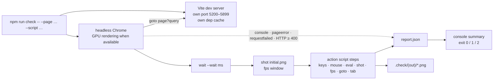

# Testing and verification

> **Purpose.** How Luminati is verified: the headless check harness in depth (its own Vite server,
> Chrome with GPU rendering when available, `report.json`, exit codes), how to write action scripts with keys, real
> mouse drags, tabs and assertions, the sandbox pages and scripted suites, how to measure
> performance without fooling yourself, how to review screenshots, the visual-regression
> techniques used during the build, the JSDoc type check and what it catches, and a pre-commit
> checklist. Example measurements are historical; run the checks on your revision and record
> the browser, platform and rendering conditions with the results.
>
> **Audience:** developers and AI agents who change anything and need to prove it still works.
>
> **Source of truth:** [`tools/check.mjs`](../../tools/check.mjs) (the harness),
> [`sandbox/`](../../sandbox/) (module pages, action scripts, helpers
> [`editor_shell.helpers.js`](../../sandbox/editor_shell.helpers.js) and
> [`editor_perf.helpers.js`](../../sandbox/editor_perf.helpers.js)), the automation hooks in
> [`src/game/Game.js`](../../src/game/Game.js) (`_exposeGlobal`, `state`), [`src/main.js`](../../src/main.js)
> (`window.__luminati`), [`src/editor/EditorApp.js`](../../src/editor/EditorApp.js) (`window.__editor`,
> set in the `EditorApp` constructor), [`src/engine/core/Engine.js`](../../src/engine/core/Engine.js)
> (`window.__engine`), [`src/engine/render/PostFX.js`](../../src/engine/render/PostFX.js)
> (`enableTimings`, `sceneInfo`), [`src/engine/ui/DebugPanel.js`](../../src/engine/ui/DebugPanel.js)
> (`DebugStats`), and for the type check [`tools/typecheck.mjs`](../../tools/typecheck.mjs) with
> [`tsconfig.json`](../../tsconfig.json) and [`tools/tsconfig.json`](../../tools/tsconfig.json).
>
> **Related:** [DEVELOPMENT_WORKFLOW.md](DEVELOPMENT_WORKFLOW.md) (the daily loop and regression
> matrix) · [specs/AUTOMATION_API.md](../specs/AUTOMATION_API.md) (every `window.__*` hook) ·
> [architecture/PERFORMANCE.md](../architecture/PERFORMANCE.md) (budgets and measured numbers) ·
> [CONVENTIONS.md](CONVENTIONS.md) · [ai/TASK_PLAYBOOKS.md](../ai/TASK_PLAYBOOKS.md)

---

## 1. Overview

There is **no unit-test runner and no linter**. Verification means running the real pages in a
real browser with GPU rendering when available and checking three things: nothing threw, the numbers are right, and
the screenshots look right. Beside it, a static **type check** of the JavaScript against its JSDoc
(`npm run typecheck`, [§8.4](#84-the-type-check)) catches renamed members, wrong shapes and arities
before anything runs.

| Kind of check | Tool | Typical use |
| --- | --- | --- |
| Types | `npm run typecheck` (0 errors in both programs) | code and typed interfaces |
| Page runs clean | `npm run check` (0 page errors, 0 console errors, 0 warnings, 0 failed requests) | runtime, UI and HTML changes |
| Documentation | `npm run docs:check` | Markdown, HTML, source links and anchors |
| Behaviour | action scripts with `eval` steps reading `window.__game`, `__editor`, sandbox hooks | gameplay, editor, module APIs |
| Look | screenshots in `.check/<out>/*.png`, read and judged | rendering, art, UI |
| Performance | GPU timer minima, CPU timings, draw calls, program counts, frame pacing | engine, big levels, editor strokes |
| "Nothing changed" | world fingerprint, frozen-frame image diff, editor exactness check | refactors, big-level work |
| Data | level round-trip byte check, generator determinism and validation (Node) | level format, generators |
| Story language | `npm run story:test` (Node self-tests, 648 + 244 assertions, ~4 s: the language, files and checks, then the runtime on a stub game) | story scripts and files, story and campaign checks, the story's party commands, conditions, presence, talk and saves (a stub party), the scripts' `#line:` keys |
| Level checks | `npm run level:test` (Node self-test of `checkLevel` in story states on in-memory levels, ~100 assertions, ~1 s) | `tools/lib/levelcheck.mjs`, `src/engine/level/StoryStates.js`: overlaps and reachability per story state, comparisons read either way, whole-number values, groups and samples, the reused state work against checking every state from scratch |
| Level API | `npm run api:test` (Node self-test: a throwaway Vite server with only the level-API plugin on a temporary folder, then one under a sub-path; 42 checks, ~1 s) | `tools/vite-level-api.js`: status codes, bytes, names, origin check, campaign routes |
| Languages | `npm run i18n:check` (every content table against the units and terms its readers show: untranslated, changed, orphans, texts with no key, markup errors, the UI glossary; one key with two Englishes and a table that is not version 3 are errors; the shipped tables pass `--strict --complete`: 0 errors, 0 warnings, 0 untranslated) and `npm run i18n:test` (Node self-test of the tables, lookup chain, extractor, checker, worklist, PO and the real data, 314 assertions, ~10 s) | `public/i18n/`, `ContentText.js`, `ContentStrings.js`, the string tables, `tools/check-i18n.mjs`, `tools/i18n-worklist.mjs` ([I18N.md](../specs/I18N.md)) |
| Text keys | `npm run i18n:keys` (every text of the shipped level, campaign and story files keyed, 0 problems: missing, stray and repeated keys, one key with two Englishes per table; 26 files, 980 texts) and `npm run keys:test` (Node self-test of the key library, the cleaners, the extractor's keys and `i18n:keys` on a temp tree, 256 checks, ~2 s) | `ContentKeys.js`, `TextKeys.js`, the generators' `keyLevel`, `tools/i18n-keys.mjs`, a new translatable field (`TEXT_KEY_FIELDS`) |
| Content text on screen | the tours `sandbox/i18n.tour.json` (a single level) and `sandbox/i18n.campaign.json` (both campaigns, the story, the party) with `--lang=ja` / `zh`: they fail on any text shown untranslated (`window.__luminati.content.misses`, [§8.5](#85-languages-and-fonts)) | display sites, keys, level and story text, tables |
| Other languages and fonts | the same harness runs with `--lang=ja` / `--lang=zh` and `--fonts=…` ([§3 Options](#options), [§8.5](#85-languages-and-fonts)) | the pixel UI in Japanese and Chinese, the font fallback |



---

## 2. Quick start

```bash
# The game (Emberfall), skipping the title screen (game.html and autostart=1 are the defaults)
npm run check -- --page=game.html --out=game --wait=6000

# Another level: quote the query because of the '&'
npm run check -- --page=game.html "--query=level=starfall-vale&autostart=1" --out=sv --wait=9000

# The editor on a project level, no fps window
npm run check -- --page=editor.html --query=open=emberfall --out=ed --fps=0

# One engine module in isolation
npm run check -- --page=sandbox/terrain.html --out=terrain --script=sandbox/terrain.quick.json

# Editor stroke performance with real mouse drags
npm run check -- --page=editor.html --query=new --out=perf --fps=0 --script=sandbox/editor_perf.json

# The type check (no browser; ~2 s)
npm run typecheck
```

Then read the console summary, open `.check/<out>/report.json` if needed, and **look at the
screenshots** (`.check/<out>/initial.png` and every `shot`).

---

## 3. How the harness works

`tools/check.mjs`, in order:

1. **Parses arguments** of the form `--name=value` (a bare `--name` becomes `true`).
2. **Finds a browser**: `CHROME_PATH` if set, else the first that exists of
   `C:/Program Files (x86)/Google/Chrome/Application/chrome.exe`,
   `C:/Program Files/Google/Chrome/Application/chrome.exe`,
   `C:/Program Files (x86)/Microsoft/Edge/Application/msedge.exe`,
   `C:/Program Files/Microsoft/Edge/Application/msedge.exe`. None → prints
   `No Chrome/Edge found; set CHROME_PATH` and exits with code **2**. `puppeteer-core` does not
   download a browser. Set `CHROME_PATH` to the executable path for a nonstandard installation.
   Browser automation has been verified on Windows; the hard-coded D3D11 flag below means
   setting the path alone does not establish support for macOS or Linux.
3. **Cleans the output folder** `.check/<out>/`: deletes `*.png` and `report.json` only; other files
   you put there survive.
4. **Starts its own Vite dev server** with `createServer` on a random port 5200–5899 (not strict),
   host `127.0.0.1`, HMR off, `logLevel: 'error'`, using the project's `vite.config.js` — so the
   **level API is active** and scripts can write into `public/levels/` (`--base`: under that sub-path;
   `--dist`: `vite preview` on `dist/` instead, without the API). The dependency-optimizer
   cache is `node_modules/.vite-check/<out>-<pid>` (every character of `<out>` other than letters,
   digits, `_` and `-` replaced by `_`), one per run, so several checks can run **in parallel**
   without racing, and the run **deletes it when it ends** — also after a failure, an uncaught
   error or Ctrl+C. Only a hard-killed run (a tool timeout) leaves its cache behind; delete
   `node_modules/.vite-check/` any time no check is running. `--keep-cache` keeps a cache
   named `<out>` and reuses it on later runs with the same output name.
5. **Launches Chrome** (headless `'new'`, or visible with `--headful`) with
   `--window-size=<w>,<h> --ignore-gpu-blocklist --enable-gpu --enable-webgl --use-angle=d3d11
   --autoplay-policy=no-user-gesture-required --no-first-run --no-default-browser-check` and a
   `<w> × <h>` viewport. `--use-angle=d3d11` is Windows-specific. Each launch uses a fresh
   temporary profile, so **the browser profile and its shader cache start fresh** on each run.
   Check the `gl` field before treating a run as a hardware GPU benchmark.
6. **Watches the page** — and every tab the page opens, from its first request — for console
   messages, page errors (uncaught exceptions and unhandled rejections), failed requests and
   HTTP responses ≥ 400.
7. **Navigates** to `http://127.0.0.1:<port>/<page>?<query>` (`…:<port>/project/<page>…` with `--base=project`) and waits for the `load` event
   (60 s timeout), then records the GPU renderer string (`UNMASKED_RENDERER_WEBGL`).
8. **Sleeps `--wait` ms**, takes `initial.png`, and — unless `--fps=0` — measures fps over `--fps`
   ms (label `initial`).
9. **Runs the action script** steps in order ([§5](#5-writing-action-scripts)). An exception in a
   step (a timeout, a missing tab, a `tab: "last"` that saw no new tab open) is recorded as a page
   error `HARNESS: …` and stops the script.
10. **Closes** Chrome and the server, writes `report.json`, prints the summary, exits.

### Options

| Option | Default | Meaning |
| --- | --- | --- |
| `--page=<path>` | `game.html` | Page relative to the project root (`editor.html`, `index.html` — the launcher —, `sandbox/props.html`, `docs/index.html` …). |
| `--query=<query>` | `autostart=1` | Query string without `?`. **Pass `--query=` for none** (a bare `--query` would send `true`). Quote it when it contains `&`. |
| `--out=<name>` | page file name without `.html` | Output folder `.check/<name>/` and cache folder name. Use a new name per concurrent run. |
| `--wait=<ms>` | `4000` | Sleep after `load`, before `initial.png`. The game needs ~4–6 s to reach gameplay (Starfall Vale longer) — or use `--wait=0` and a readiness eval ([§5.4](#54-waiting-for-readiness)). |
| `--width=<px>` `--height=<px>` | `1600` `900` | Window and viewport size (the performance target is 1600 × 900). |
| `--script=<file>` | none | JSON action script, path relative to the project root (absolute paths work too). |
| `--fps=<ms>` | `3000` | Length of the initial fps window; `0` skips it. |
| `--headful` | off | Show the browser window. |
| `--keep-cache` | off | Keep the Vite dependency cache (`node_modules/.vite-check/<out>`) for the next run with the same `--out`; by default each run deletes its own. |
| `--strict` | off | Also exit 1 on console errors, console warnings, failed requests and `eval` steps that throw (each listed on a `Strict:` line and in `report.json` `strictFailures`). Without it only page errors fail the run ([§4](#4-output-reportjson-console-summary-and-exit-codes)). |
| `--lang=<en\|ja\|zh>` | none (English) | The page's language, written to the origin's `localStorage['luminati.lang']` before the first script runs (once per run, so `goto` steps and tabs the page opens inherit it, and a page that saves another language keeps it); `?lang=` in `--query` works for the first page only ([I18N.md §1](../specs/I18N.md#1-choosing-the-language)). |
| `--fonts=<mode>` | `local` | How the page loads its UI fonts, written to `localStorage['luminati.fonts']` the same way: `local` (the `@fontsource` copies built into `dist/`: no network, the same CJK glyphs every run — keep it for screenshots), `google`, `auto` (the game's default: Google first, then `dist/`), `google-fail` / `gstatic-fail` (Google's stylesheet / its font files unreachable: the fallback runs; expected failed requests and console errors, so not `--strict`) ([I18N.md §5](../specs/I18N.md#5-fonts)). `report.json` records `fonts` and `lang`. |
| `--base=<path>` | none (the site root) | Serve the project under a sub-path (Vite's `base`, slashes added: `--base=project` is `/project/` — write it so in Git Bash, which turns an argument `/project/` into a Windows path that the harness refuses): the page opens at `http://127.0.0.1:<port>/project/<page>` and `goto` steps resolve under it — the check that nothing loads from the site root ([AGENTS.md, engineering safeguards](../../AGENTS.md#工程保障规则)). Root paths an `eval` writes itself (`import('/sandbox/…')`, `fetch('/levels/…')`) do not follow it ([KNOWN_ISSUES TOOL-22](../ai/KNOWN_ISSUES.md#tooling-and-harness)), so the action scripts that use them run without it. |
| `--dist` | off | Check the build instead of the sources: `dist/` served by `vite preview` (run `npm run build` first; `index.html`, `game.html` and `editor.html` only, no level API; the launcher's list is the one baked in at build time). With `--base` it is the build deployed under a sub-path (its URLs are relative, `base: './'`). `report.json` records `base` and `dist`. |

---

## 4. Output: `report.json`, console summary and exit codes

`.check/<out>/report.json`:

| Field | Content |
| --- | --- |
| `page`, `query` | What was opened. |
| `gl` | WebGL renderer string identifying the graphics backend and GPU, or `NO WEBGL2`. A software renderer is not a hardware GPU performance result. |
| `console` | Every console message `{ type, text }`. |
| `errors` | Texts of `console.error` messages, **except** those matching `favicon` or `status of 404 (Not Found)`. |
| `warnings` | Texts of `console.warn` messages. |
| `pageErrors` | Uncaught exceptions (with stack) and `HARNESS: …` step failures. |
| `failedRequests` | Network failures and HTTP ≥ 400 responses (except `/favicon.ico`), e.g. a 404 from the level API or a missing module. |
| `evals` | `{ code, result }` or `{ code, error }` per `eval` step, plus `{ code: 'tab last' \| 'tab <n>', result: <url> }` for every `tab` step (the URL gets ` (not loaded after <ms> ms)` when a tab opened during the run had not finished loading). |
| `fps` | `{ label, fps, p50ms, p95ms }` per fps window. |
| `shots` | Paths of the screenshots, relative to the project root. |
| `base`, `dist` | The sub-path the project was served under (`/` without `--base`) and whether `dist/` was checked (`--dist`). |
| `strict`, `strictFailures` | Whether the run had `--strict`, and with it why it exits 1 besides page errors (`"2 console errors"`, `"1 eval step threw"` …); empty without `--strict`. |

The console summary prints the URL, the GPU, every fps window, then the total count and the
first unique entries of page errors (20, first 6 lines of each stack), console errors (20, each
cut to 500 characters), console warnings (10, cut to 300) and failed requests (10), every eval with
its result (truncated to 400 characters; `report.json` has the full value; an eval that threw is
marked `THREW`), the screenshot list and, with `--strict`, a last line `Strict: passed …` or
`Strict: FAILED — <reasons>`. The harness's own Vite server may add a line before the summary: Vite
forwards uncaught page errors to the terminal as `[vite] (client) [Unhandled error] …`.

| Exit code | When |
| --- | --- |
| `0` | No page errors (with `--strict`: and no console errors, warnings, failed requests or throwing evals). |
| `1` | At least one page error (including `HARNESS:` step failures); with `--strict` also any console error, console warning, failed request or `eval` that threw. Also when the harness itself crashes before the page opens — for example an unreadable or invalid `--script` JSON file (parsed first) or a Vite server that cannot start; Node prints the stack and no `report.json` is written. |
| `2` | No Chrome / Edge found, an invalid option (`--fonts`, `--lang`, `--base`), or `--dist` without `dist/<page>`. |

**What does *not* fail a run** (without `--strict`) — you must read the output for these: console
errors, console warnings, failed requests, an `eval` that throws (recorded as `error`), and wrong
results; `--strict` turns the first four into exit code 1 (wrong results still need an assertion,
[§5.3](#53-assertions-that-fail-the-run)). "Clean"
in this project means all four counts are zero, not just the exit code. The only expected warnings
are deliberate ones (for example the `game_levels` cases log the spawn move and the unknown-script
warning on purpose, and the `hostile` case 36: its 15 load warnings, unknown textures, the two prototype colour
names, particle areas and scripts, in the game and the editor).

A missing level is a good example: `game.html?level=zz-missing-level` exits with code 0, 0 page
errors and 0 failed requests — the Vite dev server answers the unknown `/levels/…json` path with
`index.html` (the launcher, HTTP 200), `loadProjectLevel` rejects the HTML, and the only trace is
one warning, `[Luminati] Could not load level "zz-missing-level": Level "zz-missing-level" not found`,
plus the error text on the loading screen. `npm run preview`
behaves the same way (its SPA fallback also answers `/levels/<missing>.json` with `index.html`,
HTTP 200). Only a plain static host of `dist/` returns a real 404, which then also appears under
failed requests.

---

## 5. Writing action scripts

A script is a JSON array of step objects run in order after the initial wait. Each step does
**one** thing; the harness checks the keys in the order of the table and runs the first one it
finds (so `{ "wait": 0 }` does nothing).

### 5.1 Step reference

| Step | Fields | What it does |
| --- | --- | --- |
| `{ "wait": 1000 }` | ms | Sleep. |
| `{ "key": "KeyW", "hold": 800 }` | key name, `hold` ms (default 300) | Hold a key down, then release. |
| `{ "press": "Space" }` | key name | Tap a key. |
| `{ "eval": "…" }` | JS source | Evaluate in the page ([§5.2](#52-eval-semantics)). |
| `{ "shot": "night" }` | name | Save `.check/<out>/night.png`. |
| `{ "fps": 2000, "label": "night" }` | ms, optional label | Measure frame rate over the window with `requestAnimationFrame`: fps, p50 and p95 frame time. |
| `{ "click": [x, y], "button": "left", "count": 1 }` | viewport px; `left` / `right` / `middle`; count | Real mouse click (`count: 2` sends a real `dblclick`). |
| `{ "dblclick": [x, y] }` | viewport px | Real double click. |
| `{ "move": [x, y], "steps": 1 }` | viewport px, interpolation steps | Move the mouse (hover). |
| `{ "mouse": "down", "button": "left" }` | `down` / `up` | Press or release at the current mouse position. |
| `{ "drag": [[x0, y0], [x1, y1], …], "button": "left", "steps": 8, "pause": 0, "modifiers": ["Shift"] }` | points, button, moves per segment, ms pause after each segment, held keys | Real drag: move to the first point, press, move through the others, release. |
| `{ "wheel": [x, y], "deltaY": -240 }` | viewport px, delta (default −240) | Move there and scroll. |
| `{ "type": "text", "selector": "input.name", "delay": 10 }` | text, optional CSS selector, ms per key (default 10) | With `selector`: triple-click that element first (selects its text). Then type into whatever has focus. |
| `{ "combo": ["Control", "KeyZ"] }` | keys | Hold all but the last key, tap the last, release. |
| `{ "goto": "editor.html?open=x" }` | path relative to the dev server, or a full `http…` URL | Navigate; waits for `load`. |
| `{ "tab": "last", "timeout": 10000 }` or `{ "tab": 1 }` | `last` or an index; ms to wait (default 10000) | Continue in another tab; `last` waits for a new tab when the newest is the current one (see [§5.6](#56-tabs-and-navigation)). |

The coordinates of `click`, `dblclick`, `move`, `wheel` and `drag` may also be a **string**: a JS
expression evaluated in the page whose value (or its JSON text) gives them — `"drag": "P.path('2d',
[[30, 30], [31.5, 30.5]])"` aims at world points ([§5.5](#55-real-mouse-input)).

Key names are Puppeteer key names; use the `KeyboardEvent.code` form the game binds (`KeyW`,
`ShiftLeft`, `Space`, `Enter`, `ArrowDown`, `Escape`, `Tab`, `Backquote`, `F5`, `Control`,
`Shift`, `Alt`).

### 5.2 Eval semantics

- The string is evaluated in the page like a script; the value of the **last expression** is the
  result. Statement sequences work: `"__game.setTime(21); 'ok'"`.
- A returned **Promise is awaited** — use this for waits, async checks and async IIFEs
  (`"(async () => { … })()"`).
- The result is JSON-serialised; `undefined` becomes `null`. Return strings or
  `JSON.stringify(…)` for objects with cycles, DOM nodes or three.js objects.
- A thrown exception is recorded as `{ code, error }` and **does not fail the run** (unless the run
  has `--strict`).
- An eval that returns a promise which only settles when a dialog closes (for example calling an
  editor command that opens a dialog) blocks the script; wrap it: `"(app.commands.x.run(), 'ok')"`.
- Every page served by the dev server can `import()` any module under the project root, so helper
  libraries can live in `sandbox/` (versioned) or `.check/` (local): 
  `"import('/sandbox/editor_shell.helpers.js').then((m) => m.install())"`.

### 5.3 Assertions that fail the run

Prefer `--strict` for a suite that should be clean: a synchronous throw inside an `eval` then
fails the run. Existing suites also throw **asynchronously** so the exception becomes a page
error even without strict mode (exit code 1):

```json
{ "eval": "(() => { const s = __game.state(); if (s.pointLights !== 12) setTimeout(() => { throw new Error('ASSERT expected 12 point lights, got ' + s.pointLights); }); return s.pointLights; })()" }
```

Without `--strict`, a synchronous `throw` inside an eval is only recorded in `evals[].error`.
`console.assert` is not counted as a console error (Puppeteer reports it as type `assert`),
so use a thrown assertion.

Such an assertion may be the script's **last step**: before it closes the browser the harness lets
every open tab settle (a macrotask, then a frame — or 100 ms in a background tab —, then 250 ms for
the events to arrive), so a `setTimeout(() => { throw … })` scheduled by the last eval is still
counted. A throw
scheduled further ahead (a `setTimeout`
of more than about 300 ms) still needs a `{ "wait": … }` step after it.

### 5.4 Waiting for readiness

`goto` and the initial navigation only wait for the `load` event; the game then generates
textures, builds the world and compiles shaders. Instead of guessing `--wait`, poll:

```json
[
  { "eval": "new Promise((r) => { const t = setInterval(() => { if (window.__luminati?.loadMs) { clearInterval(t); r(window.__luminati.loadMs); } }, 100); })" }
]
```

`__luminati.loadMs` (navigation start → first gameplay frame) is set only after the warm-up frames,
so it is the readiness signal to wait for before querying the built world.
For the title flow (no `autostart`) the loader lifts to the title screen at the same point.

For the editor: `__editor.app.ready` (level loaded and 3D preview created), `__editor.ready3d`
(the preview's first full build), then wait until `__editor.view3d.busy` is `false` before reading
`view3d.stats`:

```json
{ "eval": "(async () => { const E = window.__editor; await E.ready3d; while (E.view3d.busy) await new Promise((r) => setTimeout(r, 100)); await new Promise((r) => setTimeout(r, 1500)); return JSON.stringify(E.view3d.stats); })()" }
```

### 5.5 Real mouse input

Coordinates are **viewport pixels** (1600 × 900 by default). For the editor, work out the pixel of
a world point once and then hard-code it, or make the layout deterministic first:

- `__editor.view2d.worldToScreen(x, z)` plus the 2D canvas's `getBoundingClientRect()` gives the
  2D map pixel; `editor_shell.helpers.js` wraps this (`T.drag([[x, z], …])` dispatches synthetic
  pointer events in world coordinates, which is fine for logic tests).
- `editor_perf.helpers.js` exposes `P.s2d(x, z)`, `P.s3d(x, z)` and `P.path(view, points)` to turn
  world points into viewport points. A step's coordinates can be such an expression, computed in
  the page when the step runs: `{ "drag": "P.path('2d', [[30, 30], [31.5, 30.5]])", "steps": 3 }`
  (`P.path` returns JSON text, which the harness parses). `editor_perf.json` and
  `editor_perf.stress.json` draw their strokes this way since 2026-10-07 (KNOWN_ISSUES TOOL-07).
  They used fixed pixels of the 1600 × 900 split layout before; the world points were recorded from
  those pixels, so at 1600 × 900 both versions leave the same level byte for byte. At 1280 × 720 the
  old version's three 2D strokes missed the map (no undo step) and its level differed in 261 tiles;
  the new one lands every stroke where it does at 1600 × 900 (the same tiles; 9 of 4 096 height
  cells at stroke edges and the 0.5 u snap of a moved house differ by pixel rounding).
- Fixed pixel coordinates are brittle: they depend on the window size and layout. Several review
  scripts broke when the object palette moved.

Use real drags for focus, pointer capture and transaction checks; synthetic events can miss
browser input behaviour.

### 5.6 Tabs and navigation

- `goto` is relative to the server's base (the site root, or `--base`'s sub-path). In the editor,
  navigating away from unsaved work triggers the browser's "Leave site?" dialog and the harness
  hangs for 60 s. Save, discard, or make the state clean first.
- **`tab: "last"` waits for the tab being opened.** The browser lists the launch's `about:blank`
  (tab 0) and the checked page (tab 1) from the start. `last` takes the newest tab; when that is the
  current page — right after the editor's Play / F5, whose pop-up (the named window
  `luminati-playtest`) is usually not listed yet — the step waits up to `timeout` ms (10 s) for a new
  tab and fails the run (`HARNESS: tab last: no new tab opened …`) if none opens. A tab opened
  during the run is then given the rest of `timeout` to load. A number waits up to `timeout` for
  that tab to exist. Every `tab` step is logged in `evals`. No `wait` is needed:

```json
[
  { "eval": "(async () => { await window.__editor.app.ready; return window.__editor.state.level.name; })()" },
  { "press": "F5" },
  { "tab": "last" },
  { "eval": "(async () => { for (let k = 0; k < 300 && !(window.__luminati && window.__luminati.loadMs); k++) await new Promise((r) => setTimeout(r, 100)); return JSON.stringify({ url: location.search, name: window.name, mode: window.__game.state().mode }); })()" }
]
```

  [`sandbox/editor_shell.playtest.json`](../../sandbox/editor_shell.playtest.json) checks exactly
  this (and `tab 1` back to the editor, then `tab last` to the pop-up again, which switches at
  once). Before 2026-10-07 `last` never waited (KNOWN_ISSUES TOOL-11): placed directly after F5 it
  silently stayed on the editor page. Loading the play-test in the same tab also works: `goto`
  `game.html?level=local:__playtest__&autostart=1` after pressing F5.

### 5.7 Timing pitfalls

- **Two taps in the same frame count as one** (Input keeps per-frame press edges). Put a `wait`
  of ~100–400 ms between repeated `press` steps.
- **Slow frames slow the world.** `Engine` clamps a frame's delta to 1/20 s, so on a busy GPU the
  player walks fewer units per real second. For walk and dialogue scripts, disable the resolution
  governor and speed up the typewriter:
  `__game.game.resolution.enabled = false; __game.ui.dialog.speed = 400`.
- While a dialog is open, gameplay keys (T, R, movement) are ignored.
- `talkTo(id)` returns `false` for an unknown id and whenever the game is busy — a conversation
  or a rest is running, a dialog is open, photo mode is on, or the title screen is still up. After
  a conversation closes, the *confirm key* has a 0.8 s cooldown (`TALK_COOLDOWN` in `Game.js`) so
  the key that closed it does not start the next one; `talkTo` itself is not delayed.
- Audio only unlocks on the first real key press or click; `state().audioReady` tells you.

---

## 6. Worked examples

These examples demonstrate the script format. Match the page, initial state and viewport
to the example, then inspect the results on your revision.

### 6.1 Game: walk with real keys, change the time, open a dialogue

```json
[
  { "eval": "__game.game.resolution.enabled = false; __game.ui.dialog.speed = 400; __game.setTime(17.2); JSON.stringify(__game.teleport(19.5, 24.2))" },
  { "wait": 500 },
  { "key": "KeyW", "hold": 1000 },
  { "eval": "JSON.stringify(__game.state().player)" },
  { "press": "KeyT" },
  { "wait": 2500 },
  { "eval": "JSON.stringify({ time: __game.state().time, phase: __game.state().phase })" },
  { "eval": "__game.talkTo('elder')" },
  { "wait": 1200 },
  { "shot": "elder_talk" },
  { "eval": "(() => { const open = __game.state().dialogOpen; if (!open) setTimeout(() => { throw new Error('ASSERT: the elder dialog did not open'); }); return open; })()" }
]
```

```bash
npm run check -- --page=game.html --out=walk --wait=5000 --fps=0 --script=<file>.json
```

Observed: the player walked from z 24.2 to z ≈ 21.5 (`walk_up`, speed 3.2); `T` moved the clock
from 17.2 to 18.9 (`purple dusk`); `talkTo('elder')` returned `true` and the dialog was open.

### 6.2 Editor: paint with a real drag, then undo

```json
[
  { "eval": "__editor.app.ready.then(() => { __editor.state.setView({ layout: '2d' }); return new Promise((r) => setTimeout(r, 500)); }).then(() => { __editor.view2d.frameLevel(false); return __editor.state.level.width + 'x' + __editor.state.level.depth; })" },
  { "wait": 300 },
  { "press": "KeyB" },
  { "eval": "__editor.state.setToolOption('tile', '.'); __editor.state.setToolOption('brushSize', 2); __editor.state.toolId" },
  { "drag": [[650, 450], [800, 450], [950, 470]], "steps": 10 },
  { "eval": "JSON.stringify({ canUndo: __editor.state.canUndo, dirty: __editor.state.dirty, paths: __editor.state.level.tiles.join('').split('.').length - 1 })" },
  { "shot": "painted" },
  { "combo": ["Control", "KeyZ"] },
  { "eval": "(() => { const n = __editor.state.level.tiles.join('').split('.').length - 1; if (n !== 0) setTimeout(() => { throw new Error('ASSERT undo left ' + n + ' path tiles'); }); return n; })()" }
]
```

```bash
npm run check -- --page=editor.html --query=new --out=paint --wait=5000 --fps=0 --script=<file>.json
```

Observed on the blank 32 × 24 level: the drag painted 26 dirt-path tiles as **one** undo step;
Ctrl+Z restored all of them.

### 6.3 Editor → game: the Play button

See the script in [§5.6](#56-tabs-and-navigation).

### 6.4 Performance probe

See [§9.5](#95-a-complete-measurement-script).

---

## 7. Page hooks for scripts

| Global | Page | What it offers |
| --- | --- | --- |
| `window.__game` | `game.html` | Engine handles (`engine, rig, postfx, lighting, ui, audio, tileMap, textures, particles, godRays, player, npcs, world, weather, game, level, levelSource`) and actions (`setTime, teleport, talkTo, setWeather, cycleTime, cycleWeather, setMusic, photo, map, state`). |
| `window.__luminati` | `game.html` | `level, source, warnings, loadMs, storage, playLocal(level, slot, query)` — `playLocal` saves a level to browser storage and reloads into `?level=local:<slot>`; `content` (the content tables: `misses`, `missCount`, `missDropped`, `clearMisses()`, [§8.5](#85-languages-and-fonts)). |
| `window.IT` / `window.CT` | `game.html` after `import('/sandbox/i18n_tour.js')` / `i18n_campaign.js` | the content-text tours: `IT.ready`, `enter`, `start`, `wait`, `finish`, `last`, `tour`, `talkThrough` …; `CT.go(part)`, `wait`, `check(label)`. |
| `window.__editor` | `editor.html` | `app, state, tools, view3d, view2d, textures, ready3d`. |
| `window.__engine` | pages that create an `Engine` (the game, most sandboxes) when the URL has `?debug` or `?autostart` | the `Engine` instance (`exposeGlobal` option; the editor's 3D view and `lighting_engine.html` pass `exposeGlobal: false`). |
| `window.__core` | `sandbox/core.html` | `runAllTests()`, `tests.*`, `analyzeAudio`, `exerciseAudio`, `teardown` … |
| `window.__tex` | `sandbox/textures.html` | `check()`, `setView`, `setLightAngle` … |
| `window.__sprites` | `sandbox/sprite_art.html` | `sheets`, `creatures`, `props`, `buildMs` … |
| `window.__sb` | `sandbox/sprite_runtime.html` | `stats()`, `setView`, `setNight`, `testPlaySemantics()`, `testRegistryAndWarnings()`, `freeze` … |
| `window.__lighting` / `__lightEngine` | `sandbox/lighting.html` / `lighting_engine.html` | `setTime`, `setView`, `info()`, `shadowLag()` … |
| `window.__postfx` | `sandbox/postfx.html` | `info()`, `set(path, value)`, `freeze`, `flickerTest`, `nanTest`, `zoom`, `postfx` … |
| `window.__props` | `sandbox/props.html` | `info()`, `check()`, `furnitureCheck()`, `disposeTest()`, `frame(view)`, `setNight` … |
| `window.__terrain` | `sandbox/terrain.html` | `runTests()`, `stats()`, `setView`, `setTime`, `setClock` … |
| `window.__ui`, `window.__sandbox` | `sandbox/ui.html` | the `UI` instance and sandbox controls. |
| `window.__vp` | `sandbox/editor3d.html` | `vp` (the `Viewport3D`), `state`, `view()`, `frames(n)`, `hoverWorld()`, `info()` … |
| `window.__levelCases` | `sandbox/game_levels.html` | `CASES`, `runCase(name)`. |
| `window.__smoke` | `sandbox/level_builder.html` | build counts and timings. |

Details and return shapes: [specs/AUTOMATION_API.md](../specs/AUTOMATION_API.md). The sandbox
hooks are documented in the header comment of each `sandbox/*.js`.

---

## 8. Sandbox pages and scripted suites

### 8.1 Sandbox pages

`http://127.0.0.1:5173/sandbox/` (dev server) is a gallery linking all of them. Each page tests one
module against raw three.js ([ARCHITECTURE.md §6](../../ARCHITECTURE.md)).

| Page | Module(s) | Query parameters |
| --- | --- | --- |
| `sandbox/smoke.html` | three.js / WebGL2 smoke test | — |
| `sandbox/core.html` | Engine, Input, CameraRig, AudioSystem | — (its first eval expects `window.__engine`, which the default `autostart=1` query provides) |
| `sandbox/textures.html` | TextureLibrary | `view=gallery0` (default) · `gallery1` · `gallery2` · `gallery3` · `atlas` · `diorama`; `night=1`; `only=a,b`; `group=`; `scale=`; `tiles=` (2); `aux=0` |
| `sandbox/sprite_art.html` | CharacterSprites, PropSprites; MonsterSprites, FxSprites, Sprite3D `combatFx` | `mode=gallery` (default) · `focus` · `frames` · `walk` · `creatures` · `props` · `combat` (enemy sheets, player combat sheet, FX atlas, flash / glow diorama; `focus=`, `z=`, `cols=`) · `hashes` (prints the existing-sheet canvas hashes); `z=` zoom; `t=` frozen time; `names=a,b`; `cols=`; `rows=`; `dir=` |
| `sandbox/sprite_runtime.html` | Sprite3D, SpriteManager, Foliage, Particles | — |
| `sandbox/terrain.html` | TileMap, Water, createWaterfall | `view=diorama` (default) · `overview` · `cliffs` · `waterfall` · `edge` · `pond` · `terrace` · `fringe` …; `time=day` (default) · `golden` · `night` |
| `sandbox/props.html` | PropFactory | `mode=lot` (default) · `gallery` · `interior` (three furnished rooms and every furniture option); `merge=1`; `night=1`; `view=overview` (default; `interior` in that mode) or a named view |
| `sandbox/lighting.html` | LightingSystem, Sky, GodRays | `t=17.2` (start hour); `speed=0` (hours per second); `post=0` (no bloom); `view=default` · `far` · `wide` · `low` · `sky` · `close` |
| `sandbox/lighting_engine.html` | lighting through the real Engine + PostFX | — |
| `sandbox/postfx.html` | PostFX | `gui`; `label`; `freeze`; `samples=4`; `scale=0.5` (dofScale) |
| `sandbox/ui.html` | UI components | `combat=1` (the combat UI: vitals, skills, loot, boss bar, 40 numbers, 30 bars, edge arrows, announcer, death screen, title destinations; `window.__sandbox.combat`) |
| `sandbox/ui_art.html` | the pixel UI kit (`src/engine/ui/art/`, `layout/`, `UiScale.js`, the fonts), every painter hashed against the baseline `sandbox/ui_art.hashes.json` | `page=frames` · `pieces` · `type` · `logo` · `titles`; `lang=` (`window.__uiArt`) |
| `sandbox/title_ui.html` | TitleScreen over the title backdrop (`docs/assets/screenshots/ui-backdrop-title.jpg`) | `state=menu` (default) · `chooser` · `changed` · `plain`; `langs=1` (the language row), `focus=1`; `name=cinderwatch\|ferryman\|interiors\|brightwater\|long` (`window.__titleUi`) |
| `sandbox/map_ui.html` | Minimap and WorldMap fed from a shipped level | `case=emberfall` (default) · `cinderwatch` · `campaign` · `painted`; `map=1` opens the world map (`window.__map`) |
| `sandbox/story_ui.html` | the story UI (journal, emotes and barks, letterbox and skip hint, end card) | — (`window.__story`) |
| `sandbox/party_ui.html` | the party UI (tactics panel, party frames, the maps' party dots) | `combat=1` (the frames under the vitals, with bars) (`window.__party`) |
| `sandbox/combat_fx.html` | FxQuads, GroundMarkers, combat bursts, combat SFX / music, Input mouse buttons, `CameraRig.stickZoom` | `view=overview` (default) · `gallery` · `galleryNear` · `stepped` · `steppedYaw` · `steppedYawL` · `quads` · `probe` · `probeYaw` · `bursts`; `t=` hour. Self-test: `window.__cfx.results.allOk` |
| `sandbox/combat_audio.html` | the combat audio QA and listening page: every combat SFX, stinger, music section and dense scene rendered offline and measured, with waveform, spectrogram and live playback per row | — (`window.__caudio`: `results.allOk`, `identity()`, `compare(url)`) |
| `sandbox/enemy_ai.html` | Enemy + the eight brains against a scripted player with a mock `CombatContext` (with the real walk grid, `Nav`) | — (scenarios via `window.__sb`; `assertAll()`) |
| `sandbox/level_builder.html` | LevelFormat, ObjectCatalog, ObjectBuilder | — |
| `sandbox/game_levels.html` | the game's level loading | `case=tiny` · `bare` · `wetspawn` · `stormnight` · `everything` · `hamlet` · `moved` · `hostile` (`Object.prototype` names and `{"toString": 1}` values in level data, KNOWN_ISSUES LVL-17); `autostart=0` |
| `sandbox/editor3d.html` | the editor's Viewport3D on a generated 64 × 64 valley | `level=<name>`; `empty`; `size=64`; `time=14`; `postfx`; `atmosphere`; `realtools` |

### 8.2 Scripted suites

| Suite(s) | Run with | Checks |
| --- | --- | --- |
| `core.actions.json` (+ `core.audio.actions.json`, `core.audio2.actions.json`) | `--page=sandbox/core.html` | 12 sync self-tests (`runAllTests().allOk`), resize and delayed-sfx tests, offline audio analysis |
| `textures.actions.json` | `--page=sandbox/textures.html` | `check()` (colour spaces, cache keys), galleries and dioramas |
| `sprite_art.actions.json` | `--page=sandbox/sprite_art.html` | sheet counts, robustness evals, galleries |
| `sprite_runtime.actions.json` | `--page=sandbox/sprite_runtime.html` | play / setFrame semantics, day and night views, particles; `testRegistryAndWarnings()`: `SpriteManager` removals from inside an update skip no sprite (SPR-06), one warning per unknown animation name (SPR-13), `parseColor` numbers / CSS names / hex / the unknown-colour warning (PROP-11) — a failure throws a page error |
| `terrain.actions.json` (+ `.quick`, `.detail`, `.perf`) | `--page=sandbox/terrain.html` | `runTests()` (36 assertions), views and hours, build timings |
| `props.interior.json` | `--page=sandbox/props.html --query=mode=interior --fps=0 --wait=2500` | the interior furniture: `check()`, `furnitureCheck()` (every piece's colliders equal its catalog footprint, `interiorFootprint`), the three rooms at the room camera by day and night, the gallery rows |
| `interior_room.game.json` | `--page=game.html --query= --wait=1500 --fps=0` | a furnished test room (`sandbox/interior_room.js`, `environment.interior`) played through `__luminati.playLocal` (browser slot `furniture-test`, removed at the end): by day, at the north wall, at night |
| `editor_shell.furniture.json` | `--page=editor.html --query=new --fps=0` (saves nothing) | the same room in the editor: every piece built in the 3D view, picked on the 2D map, the 2D sketches, the Interior palette group |
| `props.actions.json`, `props.flame.json`, `props.wind.json`; `props.gallery.json`; `props.merge.json` | `--page=sandbox/props.html`; `--query=mode=gallery`; `--query=merge=1` | `check()`, `disposeTest()`, flames, wind, merged batches |
| `lighting.actions.json` (+ `.quick`, `.shadow`) | `--page=sandbox/lighting.html` | the day cycle, shadows |
| `lighting_engine.actions.json` | `--page=sandbox/lighting_engine.html` | shadow-frustum lag through the real Engine |
| `postfx.actions.json` (+ `.flicker`, `.nan`, `.perf`, `.robust`) | `--page=sandbox/postfx.html` | DOF, bloom, grade; temporal flicker; NaN resistance; GPU timings; refocus robustness |
| `ui_art.json` | `--page=sandbox/ui_art.html --query= --fps=0 --width=1280 --height=720` (also `--lang=ja` / `zh`, `--width=1920 --height=1080`) | the pixel UI kit ([PIXEL_UI.md](../specs/PIXEL_UI.md)): every frame style, glyph, keycap, bar, icon, portrait, the logo of every shipped title and every type role, drawn at the page's `--px`; checks every painter case's hash (FNV-1a over size and RGBA) against the baseline `sandbox/ui_art.hashes.json` — recorded while the cases matched mockup G's own code; a changed or missing hash fails; after an intentional art change re-record it from `__uiArt.hashes()` in en, ja and zh, merged as its `comment` says; the portrait, sprite-crop and minimap cases read `public/levels/cinderwatch-pass.json` and the traveler preset, so a change to either means re-recording those cases —, the palette tokens, the Jersey aliases' widths, the scale table, `fitScale`, the shipped titles and `canLogo` (`?page=logo`, `?page=titles` for single sheets) — a failure throws a page error |
| `ui.actions.json` | `--page=sandbox/ui.html` | title, banner, dialog, choices, HUD, animations stopped after the title; toasts hit-tested over the banner and the dialog (UI-06), `DEFAULT_CONTROLS` with the world map and zoom keys (UI-07), drawn arrow keycaps (UI-03) — a failure throws a page error |
| `title_ui.json` | `--page=sandbox/title_ui.html --query=state=plain --fps=0 --wait=1500` (also `--lang=ja` / `zh`, at `--width=1280 --height=720`, `--width=1920 --height=1080` and `--width=1024 --height=768`) | the title screen ([PIXEL_UI.md §5](../specs/PIXEL_UI.md#5-component-recipes)): every key, pad and pointer path of the level chooser, the menu (Continue / New journey) and the language row (L / LB · RB focus, ← →, Enter, Esc; a click), texts inside their plates, nothing over another, the logo and the rows inside the screen, the logo's fits, no group shrunk from 512 × 360 art px up; shots of each state — a failure throws a page error |
| `map_ui.json` | `--page=sandbox/map_ui.html --query=case=cinderwatch --fps=0` (also `case=emberfall`, `case=campaign`; `--lang=ja` / `zh`; the three sizes) | the minimap and the world map: the minimap's party hashes, the *Companion* legend row, the world map not laid out before it opens, the markers drawn over the region names (`at()` moves the player onto a marker), both maps shot |
| `story_ui.json` | `--page=sandbox/story_ui.html --query= --fps=0` (also at `--width=1280 --height=720`, `--width=1920 --height=1080` and `--width=1024 --height=768`; also `--lang=ja` / `zh`: `sandbox/story_ui.js` compares the UI's words in the page's language) | the story UI: journal (keys, clicks, wheel, closes, empty and hostile data), emotes (pool, expiry, culling), cutscene letterbox with a dialog, the skip ring, `setHudVisible`, toast kinds, the end card's guard and dismissal, `disableStoryUI`; a failed check throws a page error (exit 1) |
| `story_ui.bark.json` | `--page=sandbox/story_ui.html --query= --fps=0` | the barks' placement: lifted over a shown interaction prompt, turned over under the speaker's feet when there is no room above (`is-flipped`), a bark from before a conversation stepping aside in it while one the conversation says stays |
| `party_ui.shots.json` | `--page=sandbox/party_ui.html --query=combat=1 --fps=0` (also `--lang=ja` / `zh`, `--width=1280 --height=720` / `1920 × 1080` / `1024 × 768`) | shots of the party states: Sela's frame, the frame when down, the tactics panel |
| `party_ui.timing.json` | `--page=sandbox/party_ui.html --query=combat=1 --fps=0` | report only: the tactics panel's open cost (first and later opens) and its input costs |
| `party_ui.json` | `--page=sandbox/party_ui.html --query= --fps=0` and `--query=combat=1` (also at `--width=1280 --height=720`, `--width=1024 --height=768`, `--width=1920 --height=1080`, and the short windows `--width=1366 --height=640`, `--width=1280 --height=600`, `--width=1024 --height=600`; also `--lang=ja` / `zh`) | the party UI (docs/specs/PARTY.md §6): the tactics panel by keys and mouse (rows, cards, values, members, presets, the focused row scrolled into view where the body scrolls, every `onRule` a full valid rule, `setRule`, `open()` while open keeping the member and the row, Esc / a click outside / the game closing it, `onClose`, the four sounds, hostile and no members), the party frames (placement under the location plate or the vitals, clear of the controls legend — compact without MP bars on short or wide windows —, no DOM write without a change, list changes, `setVisible`, `setHudVisible`, the dialog dim; low HP, down, fighting on combat), the maps with no / an empty / a party (canvas hashes), `dispose`; a failed check throws a page error (exit 1) |
| `launcher.json` | `--page=index.html --query= --fps=0` (dev server only: it reads the level API; also with `--base=project`) | the launcher ([`tools/vite-launcher.js`](../../tools/vite-launcher.js), the list written into `index.html`): its links against the level API's lists (`api/levels`, `api/campaigns`) — a Play (`game.html?level=`) and an Edit link (`editor.html?open=`) per file in `public/levels/`, a Play link (`game.html?campaign=`) per campaign and an Edit link (`editor.html?open=<c>/<level>`) per file in its `levels/` folder —, the editor links (`editor.html`, `?new`, `?new=room`) and the dev links (`sandbox/index.html`, `docs/index.html`), no link from the site root, no *Not listed* note; then a real click on Willowmere's Play opens it in the game (`game.html?level=sample-hamlet`) and one on a campaign level's Edit (`ferrymans-lantern/mill-cellar`) opens it in the editor. A failed check throws a page error (exit 1). Screenshots: the launcher, the game, the editor |
| `editor3d.actions.json`, `editor3d.audit.actions.json` | `--page=sandbox/editor3d.html --query=` | 3D viewport tour, stroke robustness |
| `editor3d.real.actions.json` | `--page=sandbox/editor3d.html "--query=level=emberfall&realtools"` | the real tools on Emberfall |
| `editor3d.tilemap.actions.json` | `--page=sandbox/editor3d.html --query=level=emberfall` | incremental terrain rebuilds equal full builds |
| `editor3d.app.actions.json` | `--page=editor.html --query=open=emberfall` | the viewport inside the real editor |
| `editor_shell.{build,io,tools,keys,map2d,inspector,perf,perf2,audit}.json` | `--page=editor.html --query=open=emberfall --fps=0` | menus, tools, keys, 2D map, inspector, file I/O, stroke timing, audit regressions |
| `editor_shell.small.json` | same, plus `--width=1280 --height=720` | inspector and dialogs at 1280 × 720 |
| `editor_shell.playtest.json` | `--page=editor.html --query=open=sample-hamlet --fps=0` | the harness `tab` step following the play-test: F5, then `{ "tab": "last" }` with no `wait` lands in the `luminati-playtest` tab with the game loaded on the play-test slot (`?level=local:__playtest__&autostart=1`, plus `&i18n=<origin>` for a level outside a campaign: the table of the file it was opened from; mode `play`, the level's name), `{ "tab": 1 }` returns to the editor, `last` switches back; a failed check throws a page error (exit 1; with the pre-2026-10-07 harness it exits 1) |
| `editor_shell.cancel.json` | `--page=editor.html --query=open=emberfall --fps=0` (saves nothing) | interrupted strokes (KNOWN_ISSUES ED-16), in the split layout, in the 2D map (`T.fire`, pointer 7) and the 3D view (projected world points, pointer 41). Each case is ended by a `pointercancel`, a lost pointer capture and a window blur (3D: the blur, then a move without the button — a blur alone does not end a 3D stroke), then gets a late pointerup that must change nothing, and has a normal-release control: box select and click-narrowing leave the selection unchanged; Rectangle, Place region and fence apply nothing (no undo step, no open transaction; the next click does not finish the dropped fence); a Paint stroke, an object move and a player-start drag keep what was applied as one undo step (an interrupted spawn drag leaves the selection alone); in 2D also a switch to *3D only* mid-drag. The last step checks the level JSON against the opened one, no open transaction, no undo steps left, not dirty. A failed check throws a page error (exit 1; the old code exits 1). Screenshots `01`–`10`: held and cancelled previews |
| `editor_shell.issues.json` | `--page=editor.html --query=open=emberfall --fps=0` (saves nothing) | the editor fixes of 2026-10-07 (KNOWN_ISSUES ED-03 … ED-27), in the split layout: a lost release in the 2D map — a Rectangle ended by a move without the button applies nothing, a Paint stroke keeps what it painted as one step and stops painting, a second press of the same pointer drops the stale rectangle and runs its own, a right-drag pan stops (ED-27); a tool exception in the 3D view commits and shows "Tool error" (ED-17); F with nothing selected focuses the hovered 3D point and is not prevented, Escape / Delete are not, Ctrl+R is (ED-15); Alt / Shift / plain arrows nudge 0.1 / 2 / 0.5 with the Place tool (ED-19); a cancelled file picker resolves `null` and File › Open file from disk ends (ED-20); Ctrl+R turns a villager's `talkOffset` and chase `area`, the chickens' yard and the birds' `spotOffsets`, a 15° group turn keeps them with a notice (ED-03); the region *Only above height, world units* field (ED-21); a long region's label clamped into the view on both sides, picked where drawn, centred when its point is in view, hidden out of view, no unplaced label shown (ED-05); the 2D critter dots equal the 3D critters for every group, including a group scattered over the inn, in the split and the 2D-only layout (ED-11); the shortcut dialog lists every command key and a command added at run time (ED-22). Ends with the level as opened, not dirty. A failed check throws a page error (exit 1); the old code exits 1 with 32 page errors. Screenshots: the hovered-point focus, the clamped region labels, the critter dots |
| `editor_perf.json`, `editor_perf.stress.json` | `--page=editor.html --query=new --fps=0` (add `&perf=ember` for Emberfall at 64 × 64) | real-drag stroke frame times + the exactness check; the strokes are world points (`"drag": "P.path(…)"`), so they work at any window size |
| `sprite_art.combat.json` | `--page=sandbox/sprite_art.html --query=mode=combat --fps=0` | `__spriteCombat.verify()`: the 86 existing-sheet hashes equal `sprite_art.hashes.json`, every enemy sheet × pose × direction, the player combat sheet, the FX atlas, value contrast ≥ 1.6, glow texels survive upload |
| `combat_fx.actions.json` | `--page=sandbox/combat_fx.html --query= --fps=0` | 11 checks (`__cfx.results.allOk`): quads and markers API, the draped height texture (and a deliberately slow 128 × 128 bake: still 4 texels per unit, sliced, no long task, the forced finish), one burst pool (the three victory / level-up presets share existing pools and sit at the bloom threshold), one program + one draw call per batch, input on / off the canvas, stick zoom, 35 combat SFX, battle / boss music; a second burst row shows the boss-death bursts before / after |
| `combat_audio.actions.json` | `--page=sandbox/combat_audio.html --query= --fps=0 --wait=1000` (the analysis takes 35–80 s) | 12 checks (`__caudio.results.allOk`): no NaN, true peak ≤ −1 dBTP, truncation cuts ≤ −50 dB, no gain steps or leaks, role loudness windows, 2–6 kHz ≤ the brightest peaceful sound + 3 dB, < 40 Hz ≤ 20 %, tracks within ±3 LU of the song, the stress / pack / boss scenes, the victory sequence; `identity().ok` (the peaceful audio against recorded numbers) and the live victory path through `CombatMusic`. Screenshots: waveforms, spectrograms, the table |
| `ui.combat.actions.json` | `--page=sandbox/ui.html --query=combat=1` | the combat UI components, the title destination rules (D then W does not travel), the death screen and its priming; the world labels' HUD keep-out (`panelOverlaps()`: 0 with every panel shown and with the legend hidden; ≤ 0.5 px drift in the open; 0 layout reads in the frame loop) |
| `enemy_ai.actions.json` | `--page=sandbox/enemy_ai.html --query= --fps=0` | `__sb.assertAll()` → 143 checks of the brains (incl. which player actions start a goblin back-hop), telegraphs, ledge shots, the off-screen rule, paths on the walk grid (chase up the stair to a ledge, the walled-off give-up with its calm, the walk home), zones, determinism, the per-sub-step cost |
| `combat.fight.json`, `combat.iframes.json`, `combat.death.json`, `combat.boss.json` | `--page=sandbox/index.html --query= --fps=0` (they save the fixture level of `combat_fixture.js` into browser storage and `goto` the game; run `combat.boss.json` **alone**: its greedy run steps ≈ 5 900 frames in one `eval`, which a loaded GPU can push past the harness's 180 s protocol limit) | the stepped combo (golden 21 / 13 / 23 = 57 at seed 1), costs, zones (`zoneAt` with `minY`), level-up, the shop (menu, *Tell me again*, *(not enough)*, the engaged refusal, the upgrade toast — read from the texts passed to `HUD.toast`, not the DOM, where it expires on a real timer — a menu screenshot), ledge shots, photo freeze, resume guard, pad legend (each test's `fresh()` also pins the resume state, `_wasActive`, so a test right after a conversation does not lose its first press to the resume guard: KNOWN_ISSUES TOOL-19); perfect-dodge i-frames; death and respawn; the boss intro, phases, kneel cap, brazier stun, rim skid, ring roll (moves forced through `combat.boss.force`), victory, the results card after 100 stepped frames and the greedy-run length (≥ 30 s, phase 3 ≥ 7 s; 99.8 s — phases 29.4 / 37.1 / 33.4 s — since Cinderheart's HP went 1800 → 5200, [party balance](../specs/PARTY.md#9-the-demo-the-companions-of-cinderwatch-pass); 38.9 s before) |
| `combat.fight.cw.json`, `combat.boss.cw.json` | `--page=game.html "--query=level=cinderwatch-pass&autostart=1" --wait=6000 --fps=0` (`combat.boss.cw.json` **alone**, as `combat.boss.json`) | the same checks on Cinderwatch Pass, plus `tests.nav()` (the Ruins ledge archer walks home from the stair foot, a court goblin climbs to the ledge edge without winding up below, stair kiting without give-ups), the greedy run (96.6 s: 29.5 / 33.3 / 33.8 s; 39.9 s at HP 1800) and the equipped greedy run with every chest and shop ware (83.5 s: 24.8 / 30.1 / 28.6 s; 34.7 s at HP 1800), `tests.labelsBoss` (numbers on their anchors in the boss fight) |
| `combat.navrect.json` | `--page=game.html "--query=level=cinderwatch-pass&autostart=1" --wait=6000 --fps=0` (it `goto`s Gildhaven and Starfall Vale) | the enemies' walk grid rebuilt in part (`Nav.buildRect`, KNOWN_ISSUES STORY-04; helpers in `sandbox/nav_rect.js`): `equivalence()` makes random TileMap changes — box and circle colliders and walk surfaces added and removed, bridges with posts, half of them at a cliff, stair or water edge, some in the boss arena or across the map edge — and compares `flags`, `h` and the open / tight counts after each `buildRect` byte for byte with a fresh full build (`mismatches` must be 0; Cinderwatch's own grid with its arena test, a new `Nav` on the peaceful levels); `timing()`: full build against a 10 × 3 u bridge coming and going (medians, and a 200-run batch mean: `performance.now` is coarse). 2026-10-07: 0 / 300, 0 / 150, 0 / 150; full 5 / 14 / 20 ms, the bridge 0.05–0.1 ms |
| `party.combat.json` | `--page=game.html "--query=level=cinderwatch-pass&autostart=1" --wait=6000 --fps=0` | the party's companions in combat ([PARTY.md §5](../specs/PARTY.md#5-companions-in-combat-party-combat), [COMBAT.md §28](../contracts/COMBAT.md#28-party-allies); helpers `sandbox/party_combat.js`, manual stepping from `ready()`: every run repeats frame for frame): Pip joins as a warden, a ranger and a mystic and fights a glade pack alone (the player in god mode never attacks — every kill is the companion's, the player's XP and the kill count credited; the warden's goblins turn on it and hit back — the glade goblins are a pack of three since [party balance](../specs/PARTY.md#9-the-demo-the-companions-of-cinderwatch-pass): the warden's 3 kills in 531 frames; a mid-fight screenshot per class), `passive` never attacks in 10 s, `guardian` stays within leash + reach (3.96 u of 6.45), Mend by threshold (the player at 25 %, then itself; mystic and warden), evade (a filling circle and lane under it: a roll within a frame, outside after it; none with `evade: off`), the Ruins shaman's hex forced onto it (`allyTarget`: 4 rolls, 151 damage against 167 with evade off), down at 0 HP (foes back to the player at once) and up with 30 % 5 s after the fight, then full; a rest, `healAllies` and the player's death (it stops, invulnerable) and respawn (full, 1.1 u from the player, placed by the party); the review fixes (PARTY.md §11 PC15–PC26) — `healStack` (three Support healers, the player knocked to 55 % four times: one Mend begun each time; before: all three, then two), `holdSteady` (three on Hold Back beside the still player for 10 s: 8–11 animation changes, none undone at once, 2–5 facing changes; before: 30–39 / 13–20 undone / 21–35), `leash` (Guard Me shooters while the player walks off twice: 24 attacks begun ≤ 4.78 u from the player — the bound is the leash 4 + 0.75 + the player's step —; before up to 6.9 u), `lead` (a goblin carried across the line of fire at 4 u/s, the pack's other two placed out of the way: ranger 13 of 16 hits, mystic 9 of 13; before 2 of 16, 1 of 13), `partyLevel` (`setPlayer` / `importProgress` keep the HP and MP fractions), `sleepingElite` (`target: strongest` never takes the quarry's sleeping elite boar), `ledgeAndPinned` (an archer on a ledge given up after ≈ 2 s under it, then the goblin; the warden right behind the player attacks in 65 frames; before: 846 of 900 frames under the archer, no attack in 600 frames) —; the boss arena — placed inside and held there 900 frames, 13 hits on the boss, the boss never on it; one left 14 u out waits 2.29 u from the gate; the gate opens at the kill —; determinism (one fight twice: one digest, `ee08f9ab`); programs 63 before the join = after everything. A failed check throws a page error (exit 1). 2026-10-08 (after the review fixes and the balance pass): all pass, no console noise; 2026-10-11 (the level's table for a party of four; `lead` and `ledgeAndPinned` move the glade pack's third goblin too): all pass with the numbers above |
| `party.combat.balance.json` | `--page=sandbox/index.html --query= --wait=0 --fps=0` (≈ 3 min; every fight `goto`s `game.html?level=cinderwatch-pass&autostart=1&fixedstep=1`) | report only (PARTY.md §11 PC25; helpers `balance*` in `sandbox/party_combat.js`): the fixed-step bot of `combat_play.js` plays as a careful human (its `human` preset, seed 1) through the Ruins (Lv 2) and the quarry (Lv 3) beside one companion — warden, ranger, mystic on Balanced, warden and mystic on Support — and beside all three; the last step prints a row per fight: the companions' share of the kills and the damage, damage they took, downs, foes turned on them, HP healed, and how often a member's sprite covered more than a quarter of the player's body (nearer the camera). Deterministic; compare runs before and after a tuning change. Its player levels (`BALANCE_ZONES` in `party_combat.js`: Lv 2 in the Ruins, Lv 3 in the quarry) date from the solo table: since [party balance](../specs/PARTY.md#9-the-demo-the-companions-of-cinderwatch-pass) the packs there are Lv 7–8, so its rows do not compare with those recorded before; the play-through bot with the party (`combat.play.*.json`) is the balance measure now |
| `combat.programs.json`, `combat.perf.json` | `--page=game.html "--query=level=cinderwatch-pass&autostart=1" --wait=6000 --fps=0` (run them **alone**: frame gaps and tick times need an unshared GPU — under load the gap assertion fails even on known-good code, KNOWN_ISSUES TOOL-18) | programs after load == after a full tour and fight, no frame > 45 ms; draw calls ≤ 300 in the busiest zones, tick p95 ≤ 1 ms. 2026-10-11 (the companions and the party-of-four table): 63 = 63 programs; worst 240 draw calls, tick p95 0.4 ms |
| `combat.peaceful.json` | `--page=game.html --query=autostart=1 --wait=5000 --fps=0` | Emberfall and Starfall: no `state().combat`, no combat DOM or bindings, combat keys do nothing, programs 57 / 59 |
| `game_levels.hostile.json` | `--page=sandbox/game_levels.html --query=case=hostile --fps=0` | the `hostile` level (KNOWN_ISSUES LVL-17: `Object.prototype` names — `HOSTILE_NAMES` in `game_levels.js` — in every field that is looked up, and `{"toString": 1}` values where the load converts) loads in the game and then in the editor (`goto editor.html?local=test-hostile`). Game: exactly the 15 expected load warnings (12 *Unknown object type … skipped*: the 10 names plus an object and an array `type`; 2 legend keys; 1 row count), the defaults for the unconvertible values (`region_2`, `subtitle` "", `version` 1, `waterLevel` 0.4, 24 rows of 32), and where the load keeps values (LVL-18: no value `String()` cannot convert left anywhere; an NPC's `name` / `portraitColor`, a legend `top` / `riser`, a house's `opts.roof`, environment `backdrop` / `title.title` dropped for their defaults; the NPC talks), the colour names three.js resolves through `Object.prototype` (LVL-19: two `light` colours → #ffb46b, a particle area's `color` / `colorEnd` / `colors` → white, none black), the fallbacks (flat stairs tiles, magenta textures, both falls toward +Z with frozen direction vectors and no NaN vertex, chickens, villager / wander / down, the scripts' NPCs on their own dialogue, the shop inventory `{ constructor, __proto__ }`), two screenshots. Editor: the *Opened with warnings* list, the paint palette without the long legend keys, painting them changes nothing, paste and `insertObjects` with prototype types (level unchanged, no open transaction), the Inspector on every hostile object, picking over the flat stairs tiles, the particle preview with an unknown preset (a warning, no console error), character-sheet hashes for prototype colour names, a paste of hostile `textKeys` (prototype names, wrong shapes, repeated keys, tags on lines with no text, lower-case tags: cleaned, nothing kept that is not an own well-formed key) and the inspector's read-only key lines and Edit › *Find by text key…* on them. A format step checks the default `waterLevel` 0.4 (LVL-06), the ford rule of `isWalkablePoint` / `validateLevel` (LVL-13) and `normalizeLevel` dropping unconvertible legend / environment / water values. A failed check throws a page error (exit 1); with the old code it exits 1 (since 2026-10-07 the old game does not even start: a legend texture name `{"toString": 1}` threw in `TextureLibrary.has`) |
| `cinderwatch.tour.json` | `--page=game.html "--query=level=cinderwatch-pass&autostart=1" --wait=6000 --fps=0` | every zone at yaw 0 / ±60 (≤ 200 calls with enemies hidden), draped lanes, waystones, night shots |
| `combat.hud.tour.json` | `--page=game.html "--query=level=cinderwatch-pass&autostart=1" --wait=7000 --fps=0` (also `--lang=ja` / `zh`, at `--width=1280 --height=720`, `--width=1920 --height=1080` and `--width=1024 --height=768`) | the combat UI in the game, shot for review (cooldowns and the loot feed, the level-up card, the boss bar, the results card, edge arrows, the death screen); fails on the legend beside the boss bar, beside the results card (it comes back once the card has gone) or under the death screen, a level or results card over the area banner, the banner's keep-out, skill names running into each other, edge arrows closer than 19 art px |
| `gildhaven.tour.json` | `--page=game.html "--query=level=gildhaven&autostart=1" --wait=8000 --fps=0` | 26 views of the town at the default camera (fails above 300 draw calls), and no shader program compiled after load (KNOWN_ISSUES REN-13) |
| `gildhaven.shadows.json` | `--page=game.html --query= --wait=500 --fps=0` (its first step saves Gildhaven **without** the two pines by its spawn to browser storage and opens it with `__luminati.playLocal`) | the load-time shadow primer (KNOWN_ISSUES REN-13): with no pine near the spawn, the program count at load (59) does not grow at High Town and five more districts; without the primer it went 58 → 59 at the Abbey Plaza (exit 1) |
| `campaign.travel.json` | `--page=game.html "--query=campaign=ferrymans-lantern&autostart=1&new=1" --wait=500 --fps=0` | the demo campaign: a walk across the seam (arrival past the way back), the bridge and its debris by flag, the locked cellar door (`locked` text, then the key), the interior, the combat level (combat HUD and bindings on, `showcase()` compiles nothing: 63 = 63) and back (combat gone: no HUD class, no `attack` binding, no `__game.combat`), chapter two's variant, save and continue after a reload; the program count before and after 2.5 s of play in each level |
| `campaign.title.json` | same query | a saved game → the title's Continue / New journey row (hint, verb), New journey travels to the start with no flags |
| `campaign.cleared.json` | same query (`--wait=5000`) | defeated enemy groups stay defeated (KNOWN_ISSUES CMP-03): the quarry's floor pack killed with `combat.kill` (the `cleared` event runs), the save's `cleared` after a travel out, back in the quarry the pack is not there — no kill, drop, XP or story run, its slimes fallen and hidden —, a waystone rest brings it back (the list emptied), killed again, saved, and after a reload's Continue it is gone again. A failed check throws a page error (exit 1) |
| `combat.presence.json` | `--page=game.html --query= --wait=0 --fps=0` (its first step plays the combat fixture with `when` / `unless` on the slimes, the goblins, the boss, a chest and a waystone, plus an event for a story, through `__luminati.playLocal`) | live combat objects (KNOWN_ISSUES CMP-04): at load the absent ones out of play (hidden, dormant, `enemies.absent` 4, the boss's arena open on the walk grid with no map marker, the chest and the waystone without prompt, collider, paint or marker); `story.set` brings the slimes (at home, no reward; before / after screenshots), takes the goblins mid-fight (lock-on, aggro, tokens and the minimap dots gone, home at full HP, engaged off after the linger) and back, keeps a fallen slime fallen, a rest revives an absent group without showing it, the boss comes (arena closed on the grid) and goes mid-fight (gate open, fight over, adds hidden), the chest comes, is opened, goes and comes back offering nothing, the waystone comes, is attuned and goes (the checkpoint back to the spawn, no rest there), `markGroupsCleared` on the boss (defeated, off the map, no kill or XP; a rest keeps it); 54 programs at load = after all of it; `applyPresence` 0.1 ms median. A failed check throws a page error (exit 1) |
| `campaign.prepare.json` | same query | the next level built ahead (KNOWN_ISSUES CMP-01): four rounds of millbrook → mill-road → old-quarry → mill-road → millbrook, each travel after a walk toward its exit; per travel the times (`travelMs`, `buildMs`), the preparation (`prepUsed`: used, CPU ms, slices, longest slice / step), the world's hash right after the build, draw calls, programs; per walk the rAF gaps (`max`, frames over 25 / 34 ms); `CP.summary()` at the end. Run it on the code before a change for the comparison (`prep` fields are null there) |
| `campaign.prepare.big.json` | same query | the same for a 128 × 128 level: Gildhaven saved to a browser slot and played as `mill-road` (`&level=local:cmp01-gildhaven&as=mill-road`), four rounds of a travel to millbrook and back after a walk toward the exit |
| `campaign.prepare.checks.json` | same query | a flag set just before the travel (the level built ahead is not used; the bridge is there), the level built again with the flag (used), a story change that moves nothing (kept), a prepared world that fails to attach and a build that fails (both rolled back to the level left; two `could not enter` console errors are expected), the next travels |
| `campaign.interior.json` | same query | rooms (`environment.interior`, CAMPAIGN_FORMAT.md §6.3 — the levels set aside; helpers `sandbox/campaign_interior.js`, `window.CI`): Millbrook in the rain → the mill cellar (built; Millbrook set aside as the parent; no rain, snow, snow cover or grey sky inside, the rain going on outside) → R in the cellar (the weather changes outside — toast "… outside" —, none shows) → Millbrook leaving at once (attached again, not built; its world hashes as when it was left; the cellar kept as the last room; the rain back) → the cellar and back after waiting 2.5 s by the door (a flag set in the cellar: Hollis gone on return) → at once again. Per travel the times, `kept`, programs at the arrival = after 1.5 s of play, lights 12, the GPU memory and scene size (the same on every return: no leak), the villagers present, animated and walking, nothing built ahead toward a level set aside, travel ≤ 0.65 s and swap ≤ 0.3 s. Then a level set aside that fails to attach and a build that fails with the town set aside (rolled back, nothing set aside after, no ghost copy in the scene, no more memory; two `could not enter` console errors are expected), the travel to mill-road (everything set aside dropped, every geometry and material of the dropped level disposed, the same memory as a mill-road visit with nothing set aside), and a chapter that swaps Millbrook's file while it is set aside (`lantern-found` set in the cellar: Millbrook built from `millbrook-dusk`, not attached; the cellar kept); then a save in the cellar in the rain and Continue after a reload (the rain kept outside, none inside, nothing set aside, the town built on the way out), and a room with a running clock and `weather: snow` played from the browser slot `ci-room-clock` as `mill-cellar` (no weather of its own, rain set there not shown, shown outside, attached again on return; the slot removed). A failed check throws a page error (exit 1) |
| `campaign.interior.big.json` | same query | the same with a 128 × 128 town: Gildhaven (plus a door to the cellar, its entrance, a crate stack `when: ci-crates` and a lamp `unless: ci-crates`) saved to the browser slot `ci-gildhaven` and played as `millbrook`; first four round trips with `campaign.keepRooms = false` (the old path: the "before" times, at once and after waiting 2 s), then seven travels with the levels set aside (attached again, the same hash, memory, scene and programs on every return; the flag set in the cellar brings the crates — shown, colliders in — and takes the lamp, its light hidden in the pool); the slot is removed at the end |
| `campaign.open-doors.json` | `--page=game.html "--query=campaign=emberfall-interiors&autostart=1&new=1" --wait=1500 --fps=0` (≈ 2½ min; English only — it compares villagers' English lines, KNOWN_ISSUES I18N-10) | the rooms demo *Emberfall — Open Doors* ([design page](../design/campaigns/emberfall-interiors.md); helpers `sandbox/campaign_open_doors.js`, `window.OD`, on top of `campaign_interior.js`): the town hashed as a static scene (meshes, colliders, lights, emissives, build stats) and compared with `game.html?autostart=1` — the same as Emberfall played alone; Corporal Hale's hand-written script (its second-visit line) and a room villager's dialogue; the inn's door, *Go out* and the stairs walked with real key presses (W / S / D, the prompt `Enter` / `Go out` / `Go upstairs` / `Go downstairs`, Space); then every building's door and every staircase there and back through `__game.campaign.exit`: each arrival in the right level at the exit's entrance (< 0.6 u), 12 point lights for ≤ 12 descriptors, no program compiled after the arrival, `kept` as expected (the first visit built — from the level built ahead while the player stood by the door —, the town, the last room and the other floor attached again with the hash they were left with); a screenshot per room (`01-inn` … `10-lodge`). Then a second tour of every building and the town alone after each (nothing set aside, nothing built ahead): the same GPU memory, programs and scene size (no leak); travel times: every level set aside back in ≤ 0.65 s (measured ≈ 0.38–0.42 s), every first visit built ahead in ≤ 0.7 s (≈ 0.44–0.47 s). A failed check is a page error (exit 1) |
| `story.play.json` | same query | the demo **story** played through with `__game.story.auto(true)` (choices answered, no windows) and real cutscenes: Bran's `enter` event, Wren's quest, Hollis's planks (the `use` event, the journal's goal), his walk-off (a directed camera, the villager gone live), the ford cutscene with the letterbox (the bridge built live: the deck walkable, the debris gone, programs 58 = 58), the quarry's `arrive` and `cleared` events, Ilse's lantern (chapter two), the chapter-two welcome cutscene (`home ilse`), the version-2 save and Continue (Ilse at her home); every step's `info` has `errors: 0` — read the lines, it asserts nothing itself |
| `party.story.json` | `--page=game.html --query=autostart=1 --fps=0 --wait=2000` | the story's party commands (docs/specs/PARTY.md §7) on a small level it builds and plays from a browser slot (`playLocal`): no party before a join (`game.party` null, no `state().party`), nor after two refused joins (`party join ghost` …: no party, no G binding, no party DOM — their two console warnings are expected); Sela's talk script joins her from a choice (`__game.story.auto([0])`: `party join sela as warden balanced`) — warden, balanced, `party:sela` and `party = 1` hold, her villager hidden, a rock `when: party:sela` there; a script with `if party:sela`, `party rule sela support`, `party set sela evade off` (Custom), `walk sela lookout` (the member walks), an emote; a background event (`change`, `party:sela and lip`) barks and sets `party rule sela guardian` while nobody is held; `party menu sela` opens the tactics panel (a stand-in with its interface while the UI package's is not there) and the run waits until it closes; the panel opened by the hook (not a script): a foreground and a background event set off meanwhile wait (no run, no window) and run once it closed; a `choice` right after an `if` / `else` block puts its options on the line the block left in the window (its speaker and text, not a page of its own; Space picks); talking to the member runs her villager's script — *Part ways* (`party leave sela`): the villager back, the rock gone, `party = 0`; `story.errors` 0. Screenshots: joined, the walk, the background bark with the rule's toast, the choice after the `if` block, left. A failed check throws a page error (exit 1) |
| `party.follow.json` | `--page=game.html --query=autostart=1 --fps=0 --wait=2000` | the party core (docs/specs/PARTY.md §4) on Emberfall, with the helpers `sandbox/party_follow.js` (`window.PF`): nothing of the party before a join (`game.party` null, no `state().party`, no G binding, no party module requested); three villagers join (by id and by name, a class and a preset), a 4th, a member again and an unknown villager are refused; the villagers hidden (not drawn, no collider, off the maps), one map dot per member, *G — Party* in the legend; no program compiled by the joins (57); members walking up to the standing player never through them (≥ 0.5 u); a teleport places them behind the player (standable, apart, facing the player's way, waiting; facing north — up the screen — beside it, none in front of it on the screen); drives with `player.moveOverride` — east over the bridge, north from (40, 28.5) (the trail toward the camera: the first member walks to the side, the members in front of the player cover ≤ 10 % of its body on average; measured ≈ 3 %), then (running) back over the bridge, up the stairs to Windmill Hill and west along it — every frame every member on walkable ground, out of the water, on the ground's height, within 1 u (1.2 u running) of the trail point it follows (a beat late, braking, to the side: `follow.gx / gz`), no jump (≤ 0.9 u in a frame), no halt from a walk in one frame, no snap, running while the player runs, up at the hill's height; resting idle on its spot (never within 0.7 u of the player — also after the player turned back into the party, the members making way —, apart, facing the player's way, none in front of the player on the screen: `PF.coverage` ≤ 0.02); set off and stop (`PF.stopStart`: away from the party, each member a beat after the player and the one before it, easing into its stand over ≥ 3 frames); catch-up straight and round by the stairs on the walk grid (no snap), along the trail where the walk grid has no way (a member held in the plaza while the player squeezes between the lamppost and the brick house and climbs the stairs: back the way the player went, no snap), the snap from 25 u, no follow while the world map is open, a directed member walking and released; the party conversation (Tactics… / Part ways / Carry on), *Tactics…* opening the tactics panel on the member and pausing play, G closing / opening it, a preset picked in the panel by keys, Esc, no reopening in the frame it closed, none in a dialog or over the map; the HUD frames (class, tactic) hidden in photo mode; *Part ways* (asked again) and the hook's `leave` (the villager where the member stood), a rejoin, nobody left: the legend line, the scene and the programs as before. Screenshots: placed, the bridge, the stairs, the rest on the hill, the talk, the tactics panel, parted. A failed check throws a page error (exit 1) |
| `party.follow.review.json` | `--page=game.html --query=autostart=1 --fps=0 --wait=2000` | the review's fixes on Emberfall (docs/specs/PARTY.md §11 C9 – C15): a refused join makes no party (no code, no binding, no state key); a villager named by a number (5) looked up and joined by it, the party's lookups throw nothing; the first join builds the party's walk grid ahead; a post villager who leaves away from home stays there (its home now); the tactics panel open: `talkTo` refuses (a member, a villager), a member leaving or joining keeps the panel on the member it showed; a member placed 1.1 u in front of the player (toward the camera) and another 1.7 u: the player's x-ray silhouette faded out (opacity 0, no colour / depth write), no program compiled, drawn again once they stand aside; `PF.sweep(1)`: three members placed behind the player on every standable spot, four facings (≈ 4 000 placements) — none bad, on the player's own spot only in pockets too small for three (< 1 %). Screenshots: `ghost-faded`, `ghost-off` (silhouette disabled: the same), `ghost-old` (the fade switched off: the pale ghost over the member) |
| `party.follow.combat.json` | `--page=game.html --query="level=cinderwatch-pass&autostart=1" --fps=0 --wait=3000` | the party core on a combat level (batched): three villagers join as the classes their weapons make (warden / mystic / ranger), one 38 u away snapped behind the player; a member's blob drawn by the level's batch and its sun quad only in the shadow pass, its sprite the player's material kind (lit, `combatFx`); no program compiled by the joins (63); *G — Party* in the combat legend; a short drive followed on the trail, the rest; members who left out of the blob batch and the scene; a ranger put behind the player whom a fight takes over at once follows the trail from then on and rests near the player after the fight (it ran back to where it was placed; the fight is the glade goblins, every goblin of the pack — three since [party balance](../specs/PARTY.md#9-the-demo-the-companions-of-cinderwatch-pass) — woken and then killed). Screenshot: the party at the Waystone Camp |
| `party.follow.campaign.json` | `--page=game.html --query="campaign=emberfall-interiors&autostart=1&new=1" --fps=0 --wait=3000` (it goes on to Continue and to `campaign=ferrymans-lantern&autostart=1&new=1` itself) | the party across levels: two town villagers join (the records in the story state with their level); into the inn and out (the town attached again): the members come along both ways, placed behind the player, once each in the scene, no program after an arrival, the inn set aside without them; a member who leaves in the town is its villager again; one who leaves in the inn goes and its villager is home when the town comes back; a travel whose build fails after the members attached to it: back in the town with the member once; hostile records from a save (a bad id, a second id, a bad class / rule / preset / colour, five records) synced as three checked ones and written back, then none (the villagers back); save → Continue: the member back behind the player (`StoryState` saves the party); *The Ferryman's Lantern*: Hollis and Pip join, a story change does not show their villagers, the Mill Road's Hollis (the same actor, another id) hidden though the story shows him, the members follow on the Mill Road and back in Millbrook. The inn's corner facing the counter: every member placed on standable ground reachable from the player (none inside the counter), and `PF.sweep(0.5)` over the inn: no bad placement; a member who leaves in the town: its home there, in the story's memory of the level too; *The Ferryman's Lantern* anew: a party made on the old quarry (a combat level) keeps G on the Mill Road (the combat put back its saved bindings) and G opens the panel there. One console error is expected: the injected failed build (`[Luminati] could not enter "inn"`). Screenshots: the inn, the town again, the Mill Road |
| `story.journal.json` | `--page=game.html "--query=campaign=ferrymans-lantern&autostart=1&new=1" --fps=0 --wait=1500 --width=1280 --height=720 --strict` (also `--lang=ja` / `zh`, `--width=1920 --height=1080`, `--width=1024 --height=768`) | the story UI in the demo campaign, per language: the journal's tabs (日誌 / 日志 in Japanese / Chinese) with every text inside its box, a bark, the skip hint, the end card (the campaign's name in the page's language); the content misses `[]` |
| `i18n.tour.json` | `--page=game.html "--query=level=<name>&autostart=1" --fps=0 --lang=ja` (and `--lang=zh`; every shipped level; without `autostart` (`--query=level=<name>`) it checks the title screen first; Starfall Vale ≈ 5 min, Gildhaven ≈ 7 min) | the content-text tour of a single level ([I18N.md §4.8](../specs/I18N.md); helpers `sandbox/i18n_tour.js`, `window.IT`): what the story runs at the start paged through, every villager talked to three times through every page with real key presses (choices answered with the first option, once more with the last where a talk asked a question), every sign, door and well read, every region entered, the world map opened; a combat level's chests and waystones only prompted. Fails on any miss (`window.__luminati.content.misses`), on a villager there but not talked to (`notTalked`) and on a talk that ended the story or left the level (villagers whose talk may do so are talked to last, `IT.last()`). Its English-leak scan only reports. 2026-10-10: 0 misses on all six levels in both languages (Emberfall 8 villagers / 27 visits / 83 pages, Gildhaven 68 / 221 / 476); 2026-10-11, Cinderwatch Pass with Sister Ilse and Rook: 7 villagers / 26 visits, 0 misses in ja and zh |
| `i18n.campaign.json` | `--page=game.html --query= --wait=0 --fps=0 --lang=ja` (and `--lang=zh`; it `goto`s its pages itself; ≈ 8–10 min) | the content-text check of the campaigns, the story and the party (helpers `sandbox/i18n_campaign.js`, `window.CT`): *The Ferryman's Lantern* from its title to its ending (every level file toured, events, cutscenes, quests, the journal, the chapter-two variant's own file and keys, the end card, the title's Continue line), *Emberfall — Open Doors* (the town and every room through its door), the party on Cinderwatch Pass — Sela's talks, the tactics panel, her background events; then Sister Ilse's and Rook's offers, *Not yet*, their joins, every member option (*Tactics…*, *Lead on*, *Part ways* → stay: each line of their orders), Rook's bark in the Bramble Ruins (`ev_rook_ruins`, his rule set) and Ilse's on the caldera stair (`ev_ilse_caldera`), Sela joining a party that has members (her "the watch marches" line), and a full party (Pip added by the hook) turning each of the three away with their full-party lines after they part ways. Shots `09`–`15` hold the new windows and barks open (`CT.peek`, `CT.enterBark`). Asserts no English text: only the misses and where the story stands (flags, levels, the files played, the party). In English it must run without a page error. 2026-10-11: 0 misses in ja and zh |
| `party.cinderwatch.json` | `--page=game.html "--query=level=cinderwatch-pass&autostart=1" --wait=3000 --fps=0` (1280 × 720 for the docs' frames: `--width=1280 --height=720`; ≈ 3 min) | the party demo, the three companions ([PARTY.md §9](../specs/PARTY.md#9-the-demo-the-companions-of-cinderwatch-pass); English only — it compares the companions' English lines, KNOWN_ISSUES I18N-10) with the helpers `sandbox/party_cinderwatch.js` (`window.PC`), driven by real input (`talkTo`, Space, clicks on choices, G / Q / E / ← / Space / Esc in the tactics panel, walks with `moveOverride`; key presses held for two drawn frames; the enemies frozen and the player in god mode until the fights); the party hooks only where a player could not (the fourth join, Pip as the third member). Steps `s01`–`s14`, Sela: at her post with her look, a story on the level (the journal key B) and no party before a join; the first talk and *Not yet* (no party made, one visit); the short second talk and the join (warden, Balanced, her villager hidden, the toast, *G — Party*); a walk up the glade road on her trail point (its rest checked after 2.2 s of the game's clock, `PC.settle`); *Tactics…* (the panel on her, the run waits, Esc); the quarry-lip and caldera-stair background events (bark, toast, *Guard Me* / *Support*, nobody held, `done:`); the player picking Balanced back (no toast); *Part ways* twice (she stays; she leaves — her villager where the member stood, keeping that post); the join again; fights with the glade goblins (Balanced) and the terrace goblins after `party rule sela guardian` (healed first; with `allyGod` on — alone against a pack balanced for a party of four she can go down, PARTY.md §11 PC25, and a downed companion would leave the pack to a player who never attacks —; her own kills and hits, within the Guard Me leash + reach; timeouts 30 s to begin, 120 s to finish). Steps `s15`–`s22`, Sister Ilse and then Rook at the Waystone Camp, each with Sela in the party: at the post with the preset and a talk script, name plate and title, the first talk's pages and the offer, *Not yet* (one visit), the short second talk and the join (`mystic` Support / `ranger` Balanced, the toast, fighting beside the player, the villager hidden), a talk as a member (one of the orders' lines, *Tactics…* opens the panel on them), *Part ways* twice. `s23` the full party: Sela leaves by the hook, then Ilse, Rook and Sela join by their talks (Sela's "Then the watch marches with you" line for a company), three members with their classes and presets, a walk across the camp followed and rested; `s24` G opens the panel on three members, E E E steps through them and wraps, Q back, each with its own preset marked; `s25` a fourth join refused (`__game.party.join('pip')` → null), Ilse's full-party line and no offer (Pip in her place by the hook); `s26` Rook into the Bramble Ruins: `ev_rook_ruins` (an emote, his bark, *Hunt Casters* and its toast; Sela's rule untouched); `s27` Ilse joins again and the caldera stair: `ev_ilse_caldera` barks, and `ev_sela_caldera` does not run with Ilse there (its guard `party:sela and not party:ilse`, its `once` key taken out for the check and put back). No story error, 63 programs throughout. Shots `01`–`17` |
| `story.presence.json` | `--page=game.html --query=autostart=1 --fps=0` | live story groups on a small level it builds and plays from a browser slot (`playLocal`): a campfire and a wall torch (no flame drawn while absent, out of `world.fires` and the ambience, the fire marker hidden), a lamp, a sign (its marker), a crate (`mapChanged` false for those three), a bridge over a river with a rock in it (`unless`): the shore equal to a full bake after each change, the deck walkable, the player moved off it when it goes; every group owns vertex ranges in the level's batches and no story change shows or hides a batch (the visible meshes outside the props' own roots stay the same: KNOWN_ISSUES STORY-03); then `settings.backdrop` replaced and changed in place (the clear colour follows) and `LightPool.setDescriptors` with a hidden lamp (stays dark; forgotten when it leaves the set); no new programs. Then Emberfall twice from `__luminati.level` with an event (so it has a story): once without conditions — the reference — and once with its inn (door lantern), windmill, well, both waterfalls, chickens and two particle areas `unless: gone`, two lit houses, the cat and the leaves `when: built`. On entering `built`'s group is absent (ranges collapsed, colliders out, doors and markers off, lanterns hidden, smoke and leaves off, the cat hidden); with everything there each frame draws exactly what the reference draws (every draw of the colour, shadow and post passes by object and material, one-shot bursts aside; the same triangles, lights and programs), by day and at night; `gone` set: every range collapsed, the sails hidden and still, no collider, no prompt at the door step or the well (`state().nearest`), markers hidden, smoke / mists / areas off, the falls hidden with no roar and no spray bursts, the chickens hidden, still and out of `chickens`, the lantern hidden and (at night) dark, programs and point lights unchanged; back: the chickens at their start points, every range restored and the world byte for byte as before (geometry, roots, colliders as a set, prompts, emitters, falls, lamps, markers), the same draws; `built` off and on again the same. Screenshots of the square and the windmill / falls gone and back, day and night. A failed check throws a page error (exit 1) |
| `editor_shell.story.json` | `--page=editor.html --query=open=emberfall --fps=0` | the editor's story support: event and marker placed and drawn, the script field (live errors, Tab, the pop-out editor and its reference; scripts are compared without their `#line:` tags, and which lines carry a tag is checked apart), the condition field, *Check for problems* with story issues (and a campaign's story files, stubbed), a cleared optional field removing its key, View › Story preview hiding `when` objects in 2D and 3D (Mill Road's bridge and debris), undo to the file's bytes; saves six shipped levels unchanged under a temporary name and compares the bytes (deleted again) |
| `editor_shell.story2.json` | `--page=editor.html --query=open=emberfall --fps=0` | the story editing review fixes (scripts compared without their `#line:` tags, as the field shows them): the pop-out editor asks *Discard changes?* on Esc / × after an edit (Keep editing / Discard; unchanged: closes at once), Esc in its command filter clears the filter; an *Apply* / Ctrl+Enter without an edit writes nothing (a trailing blank line, a string script kept; no undo step); a cleared optional key typed again returns to its place (the same JSON); a mixed selection's empty pop-out text keeps every script, Esc in a mixed field brings the blank back; objects the story preview or the outliner's eye hides leave the selection, and `select()` itself leaves them out (Delete and the arrows act on the shown ones); hidden props' smoke / embers stop (story preview, hidden type, *Show objects* off, rebuilt while hidden); Tab with real key presses (reached by keyboard: passes on; indents at a line's start or on several lines; moves on after text, also onto a problem button that keeps the focus; the same in the pop-out); the preview's stage rule (29 cases); the debounced values box (8 keystrokes → one view change); a campaign's story context arriving late, re-read by *Check for problems* and overtaken by a newer read (stubbed); a chapter variant's `level`; undo to the files' bytes. With the old code it exits 1 |
| `editor_shell.story3.json` | `--page=editor.html --query=open=emberfall --fps=0` (saves nothing; opens Mill Road and Millbrook at dusk of the demo campaign) | KNOWN_ISSUES STORY-05 and STORY-06. The condition hint by the field's rule, in the words of *Check for problems* (`storyIssues`): `when: gold` / `Day` / `unless: weather` (a reserved word: a flag that can never be set), a text that does not parse, a flag name, `done:` of nothing, of a `once` block, of an event that is not `once`; an event's `if: gold` fine (the script rule); an exit's *Open only with story flag* is a condition field (`requires: gold`). A campaign level's story context (`storyCheckContext`): every level file's events (a variant's under its base level), the story files' events and `once` keys; nine `done:` keys on Mill Road where the hint and the check agree, the open level's events as edited (ev_ford deleted), a level file that cannot be read (stubbed 404: no events, no `done:` warnings, the hint follows the re-read by itself), *Check for problems* listing the warning, Millbrook at dusk checking as `millbrook`. A hidden object is never selected: a click, Ctrl / Shift + click on its dimmed outliner row (the status message), the group's Shift+click, Ctrl+A, `select()`, a click and Ctrl+click on its place in the 2D map, a box; an edit of `when` that hides the selected tree deselects it (status, inspector), undo / redo of that edit and of a delete taken while shown, the weather, a paste (not selected, said); the eye's drop message, double-click on a dimmed row (type shown again; story preview off; both), a tree placed while trees are hidden. A background event's tag `(background)` in 2D and 3D. Ends with the file's bytes. With the old code it exits 1 |
| `editor_shell.story4.json` | `--page=editor.html --query=open=emberfall --fps=0` (writes only a browser slot, deleted again; opens Mill Road with `campaign.json`, `millbrook.json` and `story/main.json` stubbed) | the review fixes of the hidden-object rule, the condition hint and the campaign story context: undo / redo / a cancelled stroke that leave hidden objects out of the selection say so (`selectionFiltered`); the context menu's *Place Tree here* with trees hidden says why; *View › Show objects* / *Show markers* off hide as the 2D map does (a selected prop leaves, Ctrl+A takes only what the map shows and Delete removes none of the rest, the dimmed row, a click on a hidden prop's place, a double-click turning the switch on); the hint and *Check for problems* from one per-field function (a house — live — whose `when` reads a flag a villager sets: nothing; an entry-only type, while one is left — a chest today —, whose `when` / only `unless` does: a warning filed under that field —, a change event with a blank condition, the trigger changed); the hint's cost (getters count the reads of 60 villagers' scripts: none for a condition without `done:` keys, none per stroke frame, one read after an object edit inside the stroke); the outliner from the keyboard (Home, ↓, ← / →, Enter, Shift+Enter, Ctrl+Space, ← to the header, Enter on a dimmed row, F revealing it, ↓ from the filter, real key presses); a filtered group header's Shift+click; the "is hidden" message dropped once shown; a campaign level before its context arrives (no `done:` warning), a level saved since read again on open, a failed refresh keeping the context, an unreadable story file declaring nothing; Save As into a browser slot (the preview's `level` follows: deselected, said, views redrawn, Delete removes nothing) and into a campaign (its context read, the hint follows). Ends with the files' bytes. With the old code it exits 1 |
| `editor_shell.travel.json` | `--page=editor.html --query=open=emberfall --fps=0` | exits and entrances placed, drawn in 2D and 3D, their inspector fields and story fields, *Check for problems* (duplicate names, an exit without a target), undo to the file's bytes |
| `editor_shell.campaign.json` | `--page=editor.html --query=open=ferrymans-lantern/mill-road --fps=0` | a campaign level opened (`?open=<c>/<level>`), the Open dialog's campaign group, Save As into the campaign folder (a temporary level, deleted again), the play-test of a chapter variant inside its campaign and a travel out of it |
| `editor_shell.textkeys.json` | `--page=editor.html --query=open=emberfall --fps=0` (writes and deletes `public/levels/zz-textkeys-rt.json`, `zz-textkeys-a.json` and `zz-textkeys-b.json`; opens `ferrymans-lantern/millbrook-dusk` and `emberfall-interiors/emberfall` without saving) | the editor's text keys ([I18N.md §4.10](../specs/I18N.md); helpers `sandbox/editor_textkeys.js`, `window.K`; keys asserted exactly through `__editor.seedTextKeys`): a level from before keys (Emberfall without its keys and tags, saved under the temporary name), Level › *Assign text keys* (one undo step); the read-only key lines under each field (a dialogue behind *Text keys (n)*, closed; no key shown inside a field); edits — a page edited keeps its key, a page inserted gets a new one, swapped choices and swapped script lines keep theirs, a keyless text the edit left alone stays keyless —, keys an edit brings in (a pasted `#line:` tag, a patch writing another text's key: not kept), a duplicated page, a field cleared and retyped, an id rename; the subtitle's key; Edit › *Find by text key…* on a script line's tag; *Check for problems* with key lines; the round trip (opened and saved unchanged: the same bytes, read through the level API, KNOWN_ISSUES ED-29); copy-on-write in a campaign (millbrook-dusk's shared texts) and after a *Save As* (the file left keeps the keys; a text typed back takes the shared key back), *Assign* on a campaign's copy of a shipped level (Open Doors' Emberfall: 45 of 45 keys shared), the play-test's `&i18n=<origin>` after a Save As; `K.fails` empty at the end |
| `editor_shell.interior.json` | `--page=editor.html --query=open=emberfall --fps=0` (saves `public/levels/zz-interior-test.json` and deletes it; ends with a play-test of the new room in the same tab) | rooms (`environment.interior`, [EDITOR.md §3.8](../architecture/EDITOR.md#38-rooms-interiors)): Emberfall's round trip, *Level settings › Environment* with Interior off (no dimmed rows, no offer; an unchanged *Apply* writes nothing, no undo step); outdoor rain as the comparison (rain particles, grey light, sky, scenery); Interior switched on (the *Weather* / *Map border* / *Outer scenery* / *God rays* rows dimmed, the room-look offer), *Use the room look* (border none, outer scenery and god rays off, clock stopped, minimap off, backdrop `#0d0b12`; Emberfall's camera with bounds left alone), *Apply* as one undo step (undo gives the file's bytes back, redo the room); the room with rain and with snow set: no precipitation, overcast or snow cover, no scenery or god rays, the sky hidden behind the backdrop (clear and fog colour `#0d0b12`), the inspector's room hint; Interior switched off in the dialog removes only the key (undo / redo); the flag alone on Emberfall (no border trees, outer scenery, god rays or rain; the sky kept); File › New › *Room (interior)* (its rows and defaults, the level equal to `createRoomLevel` — the mill cellar's walls —, valid, one room-worded edge warning and no "no villagers", the preview's backdrop, the game camera 20 / 38°), saved to the project folder, round-tripped, reopened and deleted; `?new=room`; the room in the game (play-test slot). A failed check throws a page error (exit 1). Screenshots `01`–`11`: the dialogs, outdoor rain, the room in rain, the flag alone, the new room in both cameras, the game |
| `editor_shell.combat.json` | `--page=editor.html --query=open=cinderwatch-pass --fps=0` | round trip, enemy previews and their draw cost (the batch: `enemyCalls`, calls per sprite), place / edit / move / delete an enemy group, chest and waystone, boss-arena handles (the gate stays on a dragged edge: `gateGap` 0), Ctrl+R turning the arena and gate, the boss *Count* (field max 1, clamp on Kind → golem, hint and warning), the 2D-only dots against the 3D test (and a rock placed in 2D only), the 2D hit grades (the islet chest picked at zooms 3–36; all 212 dots pick their own group), the Combat setting, a browser-slot save (deleted again), the play-test; step 5: the batch's look (frozen frames batched / unbatched / enemies hidden in three scenes, ≤ 4 pixels off by more than 8) and the far-view cost (= enemies hidden) |
| `combat.play.json` | any page — its first step is a `goto` to `game.html?level=cinderwatch-pass&autostart=1&fixedstep=1`: `--page=sandbox/index.html --query= --wait=0 --fps=0` (≈ 2.5 min on a quiet GPU, 4–8 min shared; ≈ 10–11 min with the three bot scripts side by side) | the **fixed-step** bot (`combat_play.js`) plays the whole level with real key events: the drill and its reward, the party — Rook and Sister Ilse join at the camp, Sela at the Crossroads Waystone after the rest (`join` tasks: the talk paged through, *Walk with me*; the level is balanced for that party of four, [party balance](../specs/PARTY.md#9-the-demo-the-companions-of-cinderwatch-pass)) —, 5 chests, a rest, the Ruins, the quarry and Odo's wares, a planned death and the respawn (the members hold back meanwhile — `__game.party.rule(id, 'passive')`, as a player would pick Hold Back — and get their rules back at the respawn; with no Old Ironhide left to fall beside, the fall is skipped with a note), Cinderheart and the results card; `verify()` fails the run on a missed goal (with the party: three members at the end). Deterministic: the same tree gives the same `summary` line and `digest` on any GPU load — the party's chunk, loaded at the first join, is waited for between two frames (`chunkLoads`), so it lands on the same frame however fast the frames go (before that, `.json` and `.fast` parted: `f0646668` / `60e442e4`). The tree of 2026-10-11 (the party of four): `ok \| fixed done \| f 21924 (365.400 s) \| Lv 6 xp 483 … \| kills 39 deaths 1 chests 5 pickups 133 \| party 3 kills 9 downs 0 \| boss down 57.917 s [16.083 22.000 19.833] \| … \| digest cf165213` (39 kills, 9 of them the companions'; the one death is the planned fall). Solo before it: `1d81f069` (the tree of 2026-10-07: 361.7 s, Lv 6, 36 kills, boss down in 44.4 s — unchanged by Sela and the level's story, 2026-10-08, since the bot reads a villager's visits from the story on a level with one; `54c13fa2` and 304.35 s before the stall and crate-stack colliders changed — KNOWN_ISSUES PROP-14 — which moves the route a little at the camp and the fights after it) — compare the line with the previous run's; `trace` locates where two runs part. `start({ party: false })` plays alone (report only, `/solo` in the line: alone the level is hard by design — the expert fell once to Cinderheart before winning). Need not run alone |
| `combat.play.fast.json` | same (≈ 1.7 min) | the same run drawing every 4th frame (`renderEvery: 4`): the same digest (`cf165213`). Keep the program check on the full script |
| `combat.play.human.json` | same | the seeded human model (`skill: 'human'`, every 4th frame drawn) beside the party: 477.1 s, Lv 6, 39 kills (21 of them the companions'), the boss down in 85.1 s at the first try, no companion down (digest `8c4ef71b` since the party of four, 2026-10-11; solo before it `920a4269` — 390.2 s, the boss down in 98.5 s after one fall — since the PROP-14 colliders, 2026-10-07; `d99e2c65` — 378.5 s, the boss first try in 63.5 s — before them; `171d83e6` before the COMBAT-24 fix) |
| `combat.play.realtime.json` | `--page=game.html "--query=level=cinderwatch-pass&autostart=1" --wait=5000 --fps=0` (**alone**; ≈ 6 min) | the real-time run through the engine loop, for feel checks; frame pacing changes its path (another digest every run) |

**Suites that touch files:** `editor_shell.io.json` saves `public/levels/zz-editor-test.json` through
the dev API and deletes it at the end, `editor_shell.interior.json` does the same with
`public/levels/zz-interior-test.json`, `editor_shell.campaign.json` saves
`public/campaigns/ferrymans-lantern/levels/zz-campaign-test.json` and `editor_shell.story.json`
saves `zz-story-rt` copies (`public/levels/`, `public/campaigns/ferrymans-lantern/levels/`) and
deletes them — if a run aborts, delete the leftover. Suites that call
`saveAs` with the project API mocked away write to browser storage only (fresh profile per run).
Never let a script overwrite an untracked user level or a shipped level; note that `slugify` turns a blank name into the file name `untitled` (names
with no Latin letters or digits get a stable `level-<hash>` name instead).

The self-test hooks return structured results. For example, `core.html` exposes
`runAllTests().allOk`; `terrain.html` exposes `runTests()` with `passed`, `failed`, `total` and
`results`. A nonempty `failed` array is a failed check even if the harness exits successfully.

### 8.3 Checks outside the browser

```bash
# every shipped level survives parse → serialize byte for byte
node --input-type=module -e "
import fs from 'node:fs';
import { parseLevel, serializeLevel } from './src/engine/level/LevelFormat.js';
for (const f of fs.readdirSync('public/levels').filter((f) => f.endsWith('.json'))) {
  const text = fs.readFileSync('public/levels/' + f, 'utf8');
  console.log(f, serializeLevel(parseLevel(text).level) === text ? 'byte-identical' : 'CHANGED');
}"

# the Starfall generator validates and reproduces its file (writes nothing; exit 0 = byte-identical)
node tools/make-starfall-vale.mjs --check
# (or write to a scratch path, then compare)
node tools/make-starfall-vale.mjs --out=.check/sv.json --quiet
git hash-object .check/sv.json public/levels/starfall-vale.json

# the Willowmere generator reproduces its file (writes nothing; exit 0 = byte-identical)
node tools/make-sample-hamlet.mjs --check

# the Cinderwatch generator validates (20 rules) and reproduces its file
node tools/make-cinderwatch-pass.mjs --check

# the Gildhaven generator validates (routes, roofs, sightlines) and reproduces its file
node tools/make-gildhaven.mjs --check

# the demo campaign's generator checks the whole campaign and reproduces its files
node tools/make-ferrymans-lantern.mjs --check

# the rooms demo's generator (the town read from emberfall.json, keys and all) reproduces its files
node tools/make-emberfall-interiors.mjs --check

# the same level checks on any level file — e.g. one made in the editor (read-only; exit 1 on errors)
npm run level:check -- brightwater-crossing emberfall sample-hamlet

# a whole campaign: every level file, the links between them and its story files
npm run level:check -- --campaign=ferrymans-lantern

# the level checks' self-test: story states (a bridge `when: mended` and its debris `unless: mended`
# never overlap; the far bank reached only with `mended`; bounds, wording) on in-memory levels
npm run level:test

# the story system's self-test: conditions, scripts, story files, story conditions on objects,
# campaign.json and the campaign check's story rules on in-memory fixtures — the party's commands,
# `party` / `party:<who>` and their checks too (section P), the format ids the files are written
# with (section Q) —, then the runtime on a stub game (a
# stub party: join / leave / rule / set / menu, presence, a member staged and talked to, heal, the
# save, hostile saves and saves of an older version or none (not read, written over; a newer one
# kept); the scripts' keys from their `#line:` tags, story files' `textKeys`, a chapter variant
# sharing its base's keys, stage keys that are no GUID dropped with their English, misses only for lines shown, parse errors reported once, shop item names)
# (648 + 244 assertions; exit 1 on a failure)
npm run story:test

# the dev-server level API's self-test: a throwaway Vite server with only the plugin, on a temporary
# folder (never public/): bytes, 400 / 403 / 404 / 405 / 415 / 422, campaigns, then the routes under a
# sub-path and none at the site root (exit 1 on a failure)
npm run api:test

# the text keys of the shipped level, campaign and story files (read-only by default; nothing
# named: the shipped tree): every text keyed, no stray or repeated key, no key with two Englishes
# in one table's sources (26 files, 980 texts, 0 problems; exit 1 on a problem)
npm run i18n:keys                  # [<file|campaign> …] [--shipped] [--check | --assign | --fix]

# the text keys' self-test (256 checks, ~2 s): the readers and cleaners, tags, minting, alignTexts,
# the carry functions (objects, level roots, campaign and story files, scripts, .story files),
# assignTextKeys, textKeyIssues, the extractor's keys, TEXT_KEY_FIELDS against the catalog, and
# npm run i18n:keys (--check, --assign, --fix) on a temp tree
npm run keys:test

# the content translations: every table in public/i18n against the units and terms its readers
# show — untranslated, changed (the same key, other English), orphans, texts with no key, markup
# errors, the UI glossary; one key with two Englishes in a table's sources and a table that is not
# version 3 are errors (exit 1 on errors; --strict: warnings too; --complete: anything untranslated too;
# exit 2 on a usage error). The shipped tables pass --strict --complete
npm run i18n:check                 # [--lang=ja] [--table=levels/emberfall] [--strict] [--complete] [--json] [--verbose]

# the i18n self-test (314 assertions, ~10 s): the lookup chain (recorded English, the misses —
# missing, stale, nokey —, terms), loading, extraction, loc() in code, markup, PO files, the checker and
# the worklist on fixtures (write, merge, --prune, refusals, a translator's round trip), and the
# real data: every shipped unit and term translated through the real loader in ja and zh with no
# miss
npm run i18n:test
```

`make-starfall-vale.mjs` exits with code 1 and writes nothing when a validation check fails
(`--force` writes anyway, still exit 1). `make-sample-hamlet.mjs` writes
`public/levels/sample-hamlet.json` unless given `--out=<path>`; `--check` compares without writing
(exit 1 when the file differs, with whether the data or only the key order / formatting differs).

### 8.4 The type check

```bash
npm run typecheck                    # both programs; exit 1 on any error
npm run typecheck -- --pretty false  # one "file(line,col): error TSnnnn: …" line per error
npx tsc -p tools/tsconfig.json       # one program alone
```

[`tools/typecheck.mjs`](../../tools/typecheck.mjs) runs `tsc` (TypeScript 7, `noEmit`) on
[`tsconfig.json`](../../tsconfig.json) — `src/` and `sandbox/` with DOM and `vite/client`
types — and on [`tools/tsconfig.json`](../../tools/tsconfig.json) — `tools/` with Node types, plus
the `src/` modules the generators import — about a second each, and prints
`typecheck <config>: ok` or `FAILED` per program. Both must report **0 errors**. Vite does not type-check, so a type error never shows in
the browser: run it with the other checks. The rules for writing typed code are in
[CONVENTIONS.md §3.1](CONVENTIONS.md#31-the-type-check); the recipe for an error is
[TASK_PLAYBOOKS §21](../ai/TASK_PLAYBOOKS.md#21-fix-a-failing-type-check).

**What it catches.** Typed interfaces let the checker detect renamed or removed members, wrong
literal-union values, invalid call arities, malformed level and option objects, mismatched
contracts and many uses of Node or browser APIs. This includes `GameHooks`, `EditorHooks` and
`CombatHooks` where their consumers are typed.

**What it does not catch** ([KNOWN_ISSUES § Type check](../ai/KNOWN_ISSUES.md#type-check)): the
`eval` strings of the JSON action scripts (for example, only a harness run sees a misspelled `__game.teleprot`); anything that flows through an `any` (`strict` is off: an unannotated parameter, an
unknown member of a plain object literal, a value looked up by a plain string); missing null
checks; and behaviour — the light count, warm-up, determinism, byte-stable levels and peaceful
levels are what the harness, the fingerprints and the generators' validators are for.

**Proving a types-only change changed nothing.** A change that touches only comments, JSDoc,
parenthesised casts or `.d.ts` files must build to the same bytes: build the tree before and after
into two scratch folders (`npx vite build --outDir <scratch>/a --emptyOutDir`) and `diff -r`
them. Use a directory comparison tool appropriate to your shell.

### 8.5 Languages and fonts

Every page check can run in Japanese or Chinese and with another font source ([I18N.md](../specs/I18N.md)).
English stays the default, so every suite runs unchanged; suites whose assertions compare English
text (arrow keycaps' `aria-label`s, villagers' lines, toasts: `ui.actions`, `party.cinderwatch`,
`campaign.open-doors`) are English-only, and the others are checked in the three languages.

```bash
# the game in Japanese / Chinese (the harness seeds localStorage['luminati.lang']; ?lang= works too)
npm run check -- --page=game.html --out=game_ja --wait=6000 --lang=ja
npm run check -- --page=game.html "--query=level=cinderwatch-pass&autostart=1" --out=cw_zh --wait=7000 --lang=zh

# the three reference sizes of the pixel UI: px 2, px 3 and a small screen with unscaled corners
npm run check -- --page=game.html --out=game_1280 --width=1280 --height=720
npm run check -- --page=game.html --out=game_1920 --width=1920 --height=1080
npm run check -- --page=game.html --out=game_1024 --width=1024 --height=768

# the fonts from Google instead of dist/, and the fallback (Google unreachable: expected failed
# requests and console errors — check window.__luminati.fonts.sources, not --strict; KNOWN_ISSUES I18N-01)
npm run check -- --page=game.html --out=fonts_google --fonts=google --lang=ja
npm run check -- --page=game.html --out=fonts_fail --fonts=google-fail --lang=zh

# a dialogue in another language or size (the window's question line too)
#   eval: __game.ui.dialog.open({ speaker: 'Sela', sheet: __game.npcs[0].sheet.canvas, title: 'Warden',
#                                 lines: [{ text: 'Ready?', ask: 'Shall we go on?', choices: ['Yes', 'Not yet'] }] })

# the language switch end to end: __game.setLanguage('ja') saves the choice and reloads the page

# content text on screen: a single level's tour (each shipped level; --query=level=<name> without
# autostart checks the title screen first), then the campaigns, the story and the party
npm run check -- --page=game.html "--query=level=emberfall&autostart=1" --out=tour_ja --fps=0 --lang=ja --script=sandbox/i18n.tour.json
npm run check -- --page=game.html --query= --out=i18n_campaign_zh --wait=0 --fps=0 --lang=zh --script=sandbox/i18n.campaign.json
```

- **Misses.** On a page in Japanese or Chinese, `loc()` and `term()` record each text they could not
  translate (`missing` — no table holds the key —, `stale` — the English was edited —, `nokey` —
  the data holds no key for the text —, `term`), each key, name or keyless English once, at most
  500: `window.__luminati.content.misses` (live; `missCount`, `missDropped`, `clearMisses()`).
  Every miss is shown in English: nothing is translated by its English
  ([content lookup rules](../specs/I18N.md#42-keys-and-lookup)). Both tours fail on any, a
  keyless text shown among them; a probe of your own reads the same list. Lookups of text not shown
  (the glyph preload, a skipped cutscene's lines) record nothing. Run both tours in ja and zh after
  touching level, campaign or story text, the tables or a display site.
- `__game.state().lang` and `state().fonts` (`{ mode, px, sources, ms }`) say what a run used;
  `report.json` records the harness's `lang` and `fonts`.
- Compare CJK screenshots only within one font source: Google serves newer Noto builds than
  `@fontsource` (KNOWN_ISSUES I18N-02). The harness's default `--fonts=local` keeps them stable.
- The editor's play-test of a level outside a campaign opens
  `game.html?level=local:__playtest__&autostart=1&i18n=<origin>`, where `<origin>` is the table of
  the file the level was opened from (`levels/<name>`; a copy saved under another name keeps its
  original's). `&i18n=` only adds that table to the chain: the keys are in the level's data, so the
  play-test is translated like the level itself (`editor_shell.playtest.json` accepts the suffix;
  `editor_shell.textkeys.json` checks it after a Save As).

---

## 9. Measuring performance correctly

### 9.1 Frame rate is not the metric

Headless Chrome presents frames at the compositor's cadence (about 57–60 Hz in the recorded
benchmarks, including a blank page), so `fps` and `p50ms` say only "no worse than the cap". Use fps windows to
spot **hitches** (`p95ms`, maximum frame time), not to compare costs. Budgets are judged with GPU
timers, CPU timings and draw calls.

### 9.2 GPU timings

`PostFX` measures each stage with `EXT_disjoint_timer_query_webgl2`:

- `postfx.enableTimings(true)` — starts (and resets) the timers; returns `false` if unsupported.
  In the game the resolution governor has already enabled them.
- `postfx.timings` — smoothed milliseconds per stage: `scene` (includes the shadow pass), `dof`,
  `bloom`, `output` (OutputPass + grade).
- `postfx.timingsMin` — minimum per stage since the last `enableTimings(true)`. **Report the
  minima alongside the distribution**: other processes sharing the GPU can inflate both
  averages and minima. Interleave before/after runs and keep background load low. In the
  example below, `timingsMin`
  scene 3.51 ms vs `timings` scene 6.02 ms in the same window.
- Hold the resolution fixed while measuring: `__game.game.resolution.enabled = false;
  __game.engine.renderScale = 1`.

### 9.3 CPU timings

Record in the page. A probe system registered with a very low order runs first each frame, and
the engine's `beforeRender` / `afterRender` events bracket the render submission:

```js
(() => {
  const E = __game.engine;
  const cpu = window.__cpu = { update: [], render: [] };
  let t0 = 0, t1 = 0;
  E.addSystem({ name: 'probe-start', update: () => { t0 = performance.now(); } }, -1000);
  E.events.on('beforeRender', () => { t1 = performance.now(); cpu.update.push(t1 - t0); });
  E.events.on('afterRender', () => { cpu.render.push(performance.now() - t1); });
  return 'recording';
})()
```

`update` covers every system's update and late update (game logic, lighting, particles, UI);
`render` is the CPU cost of submitting the scene, shadow and post passes.

### 9.4 Draw calls, triangles and shader programs

- **Do not read `renderer.info.render` from a script.** three.js resets it at the start of every
  `renderer.render()` call when `info.autoReset` is `true` (the default), and PostFX renders the
  scene and then ~20 full-screen passes, so in a sandbox it shows only the last pass. In the game
  it is worse: `Game` calls `ui.debug.stats.update(renderer)` on every `'afterRender'` (whether or
  not the debug panel is open), and `DebugStats` switches `autoReset` off and resets the counters
  after each frame — an eval between frames reads **0 calls** even when a scene was rendered.
- **Use `postfx.sceneInfo`** (`{ calls, triangles, points, lines }` of the scene render, which
  includes the shadow pass; correct whether `autoReset` is on or off) — `__game.state().drawCalls`
  and `.triangles` report exactly that. The budget is ≤ ~300 at the default camera distance.
- The debug panel's stats overlay (`__game.ui.debug.stats.calls`) counts the whole frame: 258
  against a scene figure of 237 in one sample and 254 against 233 in another, i.e. ~21 post-pass
  calls more.
- The editor reports its own `view3d.stats.drawCalls` (it switches `autoReset` off around its
  frame).
- **Shader programs:** `renderer.info.programs.length`. It must be stable after load — through time
  of day, weather, dialogs, the world map and photo mode. Growth means a runtime compile (a hitch).
  Reference: 57 on Emberfall, 59 on Starfall Vale. The count cannot show a program that is released
  and compiled again (the count stays the same): to prove that an action compiles nothing, compare
  the *set* of program ids (`renderer.info.programs.map((p) => p.id)`) before and after it. Editor
  reference (`__editor.view3d.renderer`, since 2026-09-27): 60 in the default view and 87 with
  PostFX and the atmosphere preview on Emberfall and Brightwater (Starfall 62 / 89), constant
  through weather switches, undo and redo.

### 9.5 A complete measurement script

```json
[
  { "eval": "__game.game.resolution.enabled = false; __game.engine.renderScale = 1; __game.setTime(17.2); __game.teleport(20, 19.4); 'ok'" },
  { "wait": 1500 },
  { "eval": "__game.postfx.enableTimings(true)" },
  { "eval": "(() => { const E = __game.engine; const cpu = window.__cpu = { update: [], render: [] }; let t0 = 0, t1 = 0; E.addSystem({ name: 'probe-start', update: () => { t0 = performance.now(); } }, -1000); E.events.on('beforeRender', () => { t1 = performance.now(); cpu.update.push(t1 - t0); }); E.events.on('afterRender', () => { cpu.render.push(performance.now() - t1); }); return 'recording'; })()" },
  { "fps": 3000, "label": "plaza" },
  { "eval": "(() => { const med = (a) => { const s = [...a].sort((x, y) => x - y); return +s[s.length >> 1].toFixed(2); }; const s = __game.state(); return JSON.stringify({ gpuMin: __game.postfx.timingsMin, drawCalls: s.drawCalls, triangles: s.triangles, cpuUpdateMedian: med(__cpu.update), cpuRenderMedian: med(__cpu.render), programs: __game.engine.renderer.info.programs.length }); })()" }
]
```

Historical desktop GPU example at 1600 × 900 (Emberfall plaza, 17:12): three runs of the
same engine code with different background load. These illustrate the method; use the procedure
above and record your own hardware and software for reproducible current results:

| | Run 1 | Run 2 | Run 3 |
| --- | --- | --- | --- |
| fps (p95) | 60.1 (16.8 ms) | 56.3 (18.1 ms) | 60.2 (16.8 ms) — all just the compositor cadence |
| `gpuMin` scene / dof / bloom / output | 3.51 / 1.34 / 0.30 / 0.25 ms | 3.63 / 1.39 / 0.30 / 0.25 ms | 3.45 / 1.32 / 0.29 / 0.24 ms |
| `timings` (smoothed) scene | 6.02 ms | 5.34 ms | — |
| draw calls / triangles | 215 / 336,622 | 212 / 336,652 | 213 / 336,662 |
| CPU update / render submission (medians) | 0.6 / 2.7 ms | 0.3 / 2.0 ms | 0.4 / 2.2 ms |
| programs | 57 | 57 | 57 |

The scene minima agree within 0.2 ms while the smoothed averages differ by 0.7 ms — which is why
before/after comparisons need controlled conditions and more than an average alone.

### 9.6 Frame pacing, loading and memory

- **Frame pacing:** `fps` steps give p50 / p95. For strokes in the editor, `editor_perf.helpers.js`
  has an in-page recorder: `P.start()` … `P.stop(label)` returns rAF frame times, long tasks and
  per-phase costs of the 3D view.
- **Loading:** `__luminati.loadMs` (navigation → first gameplay frame), `__game.game.loadStats`
  (`engine`, `world`, `characters`, `compile`, `map` in ms; `fontsWait` and `glyphsWait`: what the
  build still waited for the UI fonts and, in Japanese and Chinese, the glyphs of the first texts)
  and `__game.world.stats.phases` (`textures`, `terrain`, `props`, `trees`, `water`, `foliage`,
  `lights`, `merge`, `snow`, plus `shoreWait` and `culling` when those steps run — on Emberfall
  they do not appear); `state().fonts.ms` is the fonts' own time. Emberfall measured on a quiet GPU
  (2026-10-10, `bd3aa62`, cold harness runs, `--fonts=local`): `loadMs` 3,306–3,381 in English
  (`loadStats` engine 191–203, world 730–788, characters 155–405, compile 945–1,207, map 36–42,
  `fontsWait` 0; the fonts in 456–533 ms), 3,438 in Japanese and 4,094 in Chinese (`fontsWait` and
  `glyphsWait` 0: the fonts and glyphs arrive while the world builds); with `--fonts=google` 3,272
  (English) and 3,894 (Japanese). With four harness runs sharing the GPU the same load took 6,850 ms,
  so compare load times only between runs made under the same conditions. (Until 2026-09-28 a large
  `.check/` also delayed every cold load by seconds: the dev server's file watcher walked it —
  [KNOWN_ISSUES TOOL-16](../ai/KNOWN_ISSUES.md#tooling-and-harness).) The first load of a
  harness run is **cold** (fresh profile, empty shader
  cache); add a `goto` to the same URL to measure a warm reload. Starfall Vale measured
  4.0–4.4 s cold and 2.4–2.5 s warm in the final verification; 5.7 s cold in the readiness example
  above on a busier GPU.
- **Leaks:** `renderer.info.memory.geometries` / `.textures` and the program count must return to
  the same numbers after repeated open / close cycles (the editor reviews used 4 open cycles and
  50 × undo / redo bursts).

### 9.7 Discipline

- Compare **interleaved** before / after runs (A, B, A, B) on the same machine state.
- Record the conditions with the numbers: resolution, render scale, governor on or off, camera
  spot and hour, whether the GPU was shared.
- Measure at fixed teleports and times (`__game.teleport(x, z)`, `__game.setTime(h)`); the
  resolution governor and wandering villagers otherwise change the scene between runs.

---

## 10. Screenshot review practice

Open the PNGs in an image viewer and compare them with the intended result. Check the following:

- **Name shots by content** (`t1720_golden`, `night_long_pier_end`) and keep a fixed set of
  positions, hours and weathers per area so runs are comparable.
- **Cover the time of day and weather grid** for visual work: dawn 6.5, midday 12.5, golden hour
  17.2, dusk 18.9, night 22.5; clear, rain, snow. Several of the worst art bugs only showed at one
  hour (dusk darker than night; the lake at golden hour).
- **Cover the camera range:** zoom 18 and 42, yaw ±60°, map edges and corners (look for voids,
  sky gaps, orange fog, the player hidden or out of the DOF band).
- **Check more than one resolution** when UI is involved: 1280 × 720, 1600 × 900, 1920 × 1080,
  2560 × 1440, and 640 × 360 for overlap.
- **Crop and zoom** when judging pixels (`__postfx.zoom(x, y, factor)` in the PostFX sandbox;
  otherwise crop the PNG), and compare crops side by side.
- **Look for the known failure modes:** near-black cliff faces, blown-out sprites or white hair
  blooming, muddy red-brown shadows, flat lavender water, fog washing the frame, blurred player,
  UI overlapping, text clipped, lantern glass lit at noon, bokeh flicker between frames.
- **Numbers help:** mean luminance per shot, share of dark pixels and clipped highlights (the art
  reviewers kept a small stats script), before / after montages.
- **A/B live:** change a parameter in an `eval` (`__game.postfx.settings.bloom.threshold = 1.2`,
  `__game.lighting…`) and shoot both variants in one run before touching code.
- **Freeze a combat moment:** real-time fights never repeat, so shoot them in stepped mode —
  `c.seed(n); c.reset(); c.god(true)`, place the player, `c.wake(…)`, then step one frame at a time
  (`c.step(1)`, with `aim` / `press` in between) until a condition holds (a wind-up, a marker, a few
  damage numbers) and leave the loop stopped (`__game.engine.stop()`) for the `shot`; restart it
  with `engine.start()`. DOM banners and bars animate on the wall clock, so add a real `wait`
  after an intro before the frame you shoot. The combat screenshots in `docs/assets/screenshots/`
  were taken this way at 1280 × 720 before the pixel UI.
- **Documentation screenshots** (`docs/assets/screenshots/*.jpg`, re-taken for the pixel UI on
  2026-10-10): shot from the real game with the harness at its default 1600 × 900 (the party
  frames with `party.cinderwatch.json` at 1280 × 720, as its row says), `--fonts=local`, each view
  set up by an `eval` that turns the resolution governor off (`game.resolution.enabled = false`,
  `engine.renderScale = 1`), stops the clock (`lighting.timeSpeed = 0`), sets the hour and
  weather (`__game.weather.setWeather(name, { instant: true })`),
  teleports, snaps the rig and waits ≈ 2.5 s (a region's banner shows on the first entry: wait
  ≈ 5 s to shoot without it). Titles: a run with `--query=` (no `autostart`), shot ≈ 3.5 s after
  `mode` turns `title`, then `{ "press": "Space" }` into play. Other languages: the same with
  `--lang=ja` / `zh`, saved as `<name>-ja.jpg` / `<name>-zh.jpg`. Read every PNG, then save
  1280 × 720 JPEGs at quality 84 under the same file names (links stay valid) and run
  `npm run docs:check`.

---

## 11. Visual regression techniques used in this project

Screenshots of the game are never pixel-identical between runs — villagers wander, particles,
wind, the windmill and the clock move. Three techniques made "nothing changed" provable.

### 11.1 World fingerprint

Hash the static content of the built world and compare before/after runs. The compact version
below records `lights`, `colliders` and `meshes`:

```json
{ "eval": "(() => { const g = window.__game, W = g.world; const r = (v) => Math.round(v * 1000) / 1000; const h = (s) => { let x = 2166136261; for (let i = 0; i < s.length; i++) { x ^= s.charCodeAt(i); x = Math.imul(x, 16777619); } return (x >>> 0).toString(16); }; const lights = W.lights.map((l) => [l.light.position.toArray().map(r), l.light.color.getHexString(), l.light.distance].join()); const cols = W.tileMap.colliders.filter((c) => !c.dynamic).map((c) => c.type === 'circle' ? `c${r(c.x)},${r(c.z)},${r(c.r)}` : `b${r(c.minX)},${r(c.maxX)},${r(c.minZ)},${r(c.maxZ)}`); const meshes = []; W.root.traverse((o) => { if (!o.isMesh) return; const p = o.geometry.getAttribute('position'); let s = 0; if (p) for (let i = 0; i < p.count; i++) s += p.getX(i) + 2 * p.getY(i) + 3 * p.getZ(i); o.updateWorldMatrix(true, false); const e = o.matrixWorld.elements; meshes.push(`${o.material?.name ?? ''}|${p ? p.count : 0}|${Math.round(s)}|${r(e[12])},${r(e[13])},${r(e[14])}`); }); meshes.sort(); const s = g.state(); return JSON.stringify({ lights: `${lights.length}:${h(lights.join('|'))}`, colliders: `${cols.length}:${h(cols.join('|'))}`, meshes: `${meshes.length}:${h(meshes.join('|'))}`, interactables: W.interactables.length, drawCalls: s.drawCalls, triangles: s.triangles, programs: g.engine.renderer.info.programs.length }); })()" }
```

Record a baseline on the revision you are changing, at a fixed position and hour such as
`teleport(19.5, 24.2)` at 17.2 h. Static hashes should match across runs and languages unless the
change intentionally alters the world. Draw calls and triangles can vary because of moving
particles and birds. `colliders` excludes the villagers' dynamic colliders.

A larger fingerprint can include light seeds and flicker, emitters, NPC definitions, critter
spawns, walk surfaces, god rays, camera bounds and audio mix. Check ordering where the runtime
depends on it.

### 11.2 Frozen-frame image diffs

Freeze the world, remove the noise, then compare PNGs:

```json
[
  { "eval": "__game.setTime(17.2); __game.teleport(20, 19.4); 'ok'" },
  { "wait": 1500 },
  { "eval": "__game.engine.time.timeScale = 0; __game.postfx.settings.grade.grain = 0; __game.particles.object.visible = false; 'frozen'" },
  { "wait": 500 },
  { "shot": "plaza_frozen" }
]
```

`timeScale = 0` stops `uTime`, animation, wind, villagers and the clock; grain and particles are the
remaining per-frame noise. A small Node helper computes the mean absolute RGB difference per PNG
pair (save it as `.check/tools/imgdiff.mjs`, which is gitignored). Set `CHROME_PATH` to your
installed browser before running it:

```js
// node .check/tools/imgdiff.mjs <dirA> <dirB>  — mean absolute RGB difference (0–255) per PNG pair
import fs from 'node:fs';
import path from 'node:path';
import puppeteer from 'puppeteer-core';

const [A, B] = process.argv.slice(2);
const executablePath = process.env.CHROME_PATH;
if (!executablePath || !fs.existsSync(executablePath)) throw new Error('Set CHROME_PATH to an installed Chromium browser');
const browser = await puppeteer.launch({ executablePath, headless: true });
const page = await browser.newPage();
const url = (f) => `data:image/png;base64,${fs.readFileSync(f).toString('base64')}`;
for (const f of fs.readdirSync(A).filter((n) => n.endsWith('.png'))) {
  if (!fs.existsSync(path.join(B, f))) continue;
  const r = await page.evaluate(async (a, b) => {
    const load = (src) => new Promise((ok) => { const i = new Image(); i.onload = () => ok(i); i.src = src; });
    const [ia, ib] = await Promise.all([load(a), load(b)]);
    const c = Object.assign(document.createElement('canvas'), { width: ia.width, height: ia.height });
    const x = c.getContext('2d');
    x.drawImage(ia, 0, 0); const da = x.getImageData(0, 0, c.width, c.height).data;
    x.drawImage(ib, 0, 0); const db = x.getImageData(0, 0, c.width, c.height).data;
    let sum = 0, big = 0;
    for (let i = 0; i < da.length; i += 4) {
      const d = (Math.abs(da[i] - db[i]) + Math.abs(da[i + 1] - db[i + 1]) + Math.abs(da[i + 2] - db[i + 2])) / 3;
      sum += d; if (d > 40) big++;
    }
    const n = c.width * c.height;
    return { mean: +(sum / n).toFixed(2), over40: +((100 * big) / n).toFixed(2) };
  }, url(path.join(A, f)), url(path.join(B, f)));
  console.log(`${f.padEnd(32)} mean ${r.mean}  pixels >40: ${r.over40}%`);
}
await browser.close();
```

**Noise floor, measured for this page** (two runs of the same code, Emberfall plaza):
unfrozen mean 5.5–6.6 with 2.3–3.1 % of pixels differing by more than 40; frozen mean 0.37–0.45
with ~0.07 %. The build reports quote run-to-run means of 3–22 unfrozen (the elder dialog shot
depends on where the wandering elder stood) and 0–0.23 frozen, where the remaining differences
were villagers that had walked before the freeze. A real change shows up well above these floors,
and the heat map of differing pixels tells you where.

### 11.3 Exactness checks in the editor

The editor's 3D preview updates incrementally, so it carries its own proof: `P.fingerprint()` and
`P.exactCheck()` in [`editor_perf.helpers.js`](../../sandbox/editor_perf.helpers.js) compare the
current scene (terrain meshes, water mesh, shore texture bytes, every prop) with a forced full
rebuild. `editor_perf.json` runs it after every stroke series; it must report *identical*.
Refactors of `TileMap` were checked the same way: geometry attributes, indices, materials and
height queries bit-identical at chunk sizes 64, 32 and 16.

### 11.4 Byte-level data checks

- Level round trip: [§8.3](#83-checks-outside-the-browser); in the editor, open a level, press
  Ctrl+S, and `git diff public/levels` must be empty.
- Generator determinism: use the generator's `--check` option, or compare the hashes of two
  runs. Generate the baseline from the same revision instead of relying on an old documented hash.

---

## 12. Pre-commit verification checklist

Run what matches your change; "clean" means 0 page errors, 0 console errors, 0 warnings, 0 failed
requests (`--strict` makes the exit code say so: 0 only when all four are zero and no eval threw).

**Code and runtime data changes**
- [ ] `npm run typecheck` reports 0 errors in both programs ([§8.4](#84-the-type-check)).
- [ ] `npm run build` succeeds.
- [ ] `npm run check -- --page=game.html --out=pre_game --wait=6000` is clean and the screenshot looks right.
- [ ] `npm run check -- --page=editor.html --query=open=emberfall --out=pre_editor --fps=0` is clean.
- [ ] `git status`: no temporary levels in `public/levels/`; untracked user levels (if any) untouched and not staged.

**Engine module**
- [ ] The module's sandbox page and its action script(s) are clean; screenshots reviewed.
- [ ] Emberfall fingerprint unchanged ([§11.1](#111-world-fingerprint)) unless the change is meant to alter the world.
- [ ] Shader program count unchanged after load and after cycling time (T) and weather (R).
- [ ] Draw calls ≤ ~300 at the default camera; GPU minima not worse (interleaved A/B).

**Rendering / look**
- [ ] Shots at dawn, midday, golden hour, dusk and night, plus rain and snow, at a few spots.
- [ ] Frozen-frame diffs against the previous build where the change should be invisible.

**Level format, catalog or storage**
- [ ] Round trip byte-identical for every shipped level ([§8.3](#83-checks-outside-the-browser)).
- [ ] Open + Ctrl+S in the editor leaves `git diff` empty.
- [ ] `npm run level:check -- <level>` for a level you changed in the editor: no new errors or warnings.
- [ ] `sandbox/game_levels.html` cases run with only their intended warnings (`case=hostile` with
      its script: exit 0, 0 console errors).
- [ ] After touching the dev-server level API (`tools/vite-level-api.js`): `npm run api:test` passes.
- [ ] After touching the launcher (`index.html`, `tools/vite-launcher.js`, `src/launcher/`), the
      level / campaign fields it lists or a page it links to: `sandbox/launcher.json` clean (also
      with `--base=project`).
- [ ] After touching a URL a page loads (an HTML `src`, a `fetch`, a dynamic `import`, `BASE_URL`,
  `base` in `vite.config.js`): the page with `--base=project`, and after `npm run build` with
  `--dist --base=project` — 0 failed requests.
- [ ] After touching the level checks (`tools/lib/levelcheck.mjs`, `StoryStates.js`, `storyExclusive`): `npm run level:test` passes, and `npm run level:check` on the six shipped levels and `--campaign=ferrymans-lantern` reports what it did before (or only the intended change).
- [ ] `node tools/make-starfall-vale.mjs --check` passes: the file matches byte for byte (or regenerate it deliberately).

**Editor**
- [ ] Relevant `editor_shell.*.json` suites and `editor3d.app.actions.json` clean.
- [ ] `editor_perf.json`: strokes at the display rate and the exactness check *identical*.
- [ ] Play-test (F5) opens the level in the game (`editor_shell.playtest.json`).

**Combat**
- [ ] `combat.peaceful.json` clean (the peaceful levels stay combat-free, programs 57 / 59).
- [ ] The combat scripts of [§8.2](#82-scripted-suites) for the area you touched; `combat.programs.json` and `combat.perf.json` alone.
- [ ] Gameplay changes: `combat.play.json` (or `.fast`) still passes; compare its `summary` line with the previous run and say why the digest moved. Audio changes: `combat_audio.actions.json`.
- [ ] Balance changes on Cinderwatch Pass (its enemy table in `tools/make-cinderwatch-pass.mjs`, `ENEMY_DEFS`, `scaledDef`): the level is balanced for a party of four ([party balance](../specs/PARTY.md#9-the-demo-the-companions-of-cinderwatch-pass)), so re-run the bot with the party (its default: `combat.play.json` / `.fast` and `combat.play.human.json`) and compare the digests and `report()`'s `zones` / `party` with the previous run; a solo run (`start({ party: false })`) for the report; `combat.boss.json` / `combat.boss.cw.json` alone (the greedy floor); `party.combat.json`; the generator's `--check` (rule 15, the start-spot density; rule 16, the banners' `Lv` against the packs).
- [ ] After a change to a plain sprite sheet: `sprite_art.html?mode=hashes` re-taken into `sandbox/sprite_art.hashes.json` in the same commit.
- [ ] `node tools/make-cinderwatch-pass.mjs --check` passes.

**Big-level systems**
- [ ] Emberfall, sample-hamlet and brightwater-crossing: draw calls, triangles and light lists identical to before.
- [ ] Starfall Vale: draw calls at several town spots, load time, program count, night light pool (every lamp within ~9 units lit).
- [ ] Gildhaven: `gildhaven.tour.json` clean (≤ 300 calls at every view, programs at load = programs after the tour) and `gildhaven.shadows.json` clean (the shadow primer); `node tools/make-gildhaven.mjs --check` passes.

**Campaigns** (after touching `Game` init / `swapLevel`, `World`, combat setup or teardown, `src/game/campaign/`)
- [ ] `campaign.travel.json`, `campaign.title.json` and `story.play.json` clean: no errors or warnings, the program count steady after every arrival and every story change, `state().story.errors` 0.
- [ ] After touching `swapLevel`, `World.attach` / `detach`, the weather or the travel policy: `campaign.interior.json` and `campaign.interior.big.json` exit 0 (the two expected `could not enter` errors of the failure tests aside).
- [ ] After touching the story runtime, `World` story groups, `LightPool.setHidden` or the story UI: `story.presence.json`, `editor_shell.story.json`, `story_ui.json`, `combat.peaceful.json`, and the fingerprints of the small levels with [`sandbox/fingerprint.json`](../../sandbox/fingerprint.json) (no `story`, no `journal` binding, the same numbers as before; it waits up to 60 s for `loadMs` and `__game.world`, run it with `--wait=0`).
- [ ] After touching the party UI (`PartyPanel`, `PartyFrames`, `party.css`, `UI.usePartyUI`, the maps' `party` dots): `party_ui.json` in both variants at 1600 × 900, 1280 × 720 and a short window (1366 × 640 or 1280 × 600), `story_ui.json`, `ui.actions.json`, and the Emberfall fingerprint with [`sandbox/fingerprint.json`](../../sandbox/fingerprint.json) (no party node, rule or module; the same numbers as before).
- [ ] `node tools/make-ferrymans-lantern.mjs --check` and `npm run level:check -- --campaign=ferrymans-lantern` pass.
- [ ] After touching rooms, furniture, `World.attach` / `detach`, the travel policy or Emberfall itself: `node tools/make-emberfall-interiors.mjs --check`, `npm run level:check -- --campaign=emberfall-interiors` (0 errors; the town's 39 warnings are Emberfall's own) and `campaign.open-doors.json` exit 0 — and read its room screenshots.
- [ ] After touching the story language, story files or the story / campaign checks (`StoryCondition.js`, `StoryScript.js`, `StoryFormat.js`, `StoryChecks.js`, `Travel.js`, `CampaignFormat.js`, `tools/lib/campaigncheck.mjs`): `npm run story:test` passes (extend it with the new behaviour).
- [ ] After touching the story's party commands (`party …`, `party:<who>`, `StoryRunner` presence / talk, `StoryState.party`): `npm run story:test` and `sandbox/party.story.json` clean.
- [ ] After touching the party core (`Party`, `PartyMember`, the party's wiring in `Game`): `sandbox/party.follow.json`, `party.follow.review.json`, `party.follow.combat.json` and `party.follow.campaign.json` clean, `party.story.json`, the Emberfall fingerprint (57 programs, no `state().party`) and the combat bot's digest (`combat.play.fast.json`; the bot plays beside the party it recruits, so a party change can move it).
- [ ] After touching Cinderwatch's party demo (Sela, Sister Ilse, Rook, their talk scripts, `ev_sela_lip` / `ev_sela_caldera` / `ev_rook_ruins` / `ev_ilse_caldera` in `tools/make-cinderwatch-pass.mjs`): the generator's `--check` (its `coverage()` wants a villager who joins as each class), `npm run level:check -- cinderwatch-pass` (0 errors, no `story:` line), `sandbox/party.cinderwatch.json` clean, `sandbox/i18n.campaign.json` in ja and zh after a text change (0 misses), the combat bot's digest (its `join` tasks recruit all three) and `sandbox/ui_art.json` (its portraits read Sela's spec: re-record those cases if it changed).
- [ ] Single levels unchanged: the fingerprints above and the combat bot's digest.

**UI and languages** (after touching `src/engine/ui/`, a string table, `public/i18n/`, the fonts or a text the game shows)
- [ ] The component's sandbox suite — `ui.actions.json`, `ui.combat.actions.json`, `story_ui.json`, `party_ui.json`, `title_ui.json`, `map_ui.json`, `ui_art.json` — clean with `--strict` at 1280 × 720, 1920 × 1080 and 1024 × 768, in English and (where it does not compare English text) with `--lang=ja` and `--lang=zh`; the PNGs read against [PIXEL_UI.md](../specs/PIXEL_UI.md); after an intentional art change, `sandbox/ui_art.hashes.json` re-recorded from `__uiArt.hashes()` in en, ja and zh (merged, as its `comment` says).
- [ ] In the game: `combat.hud.tour.json` (combat UI), `story.journal.json` (story UI), `party_ui.shots.json` (party UI), and Emberfall / Cinderwatch Pass in the three languages and sizes ([§8.5](#85-languages-and-fonts)); no text over another, nothing clipped.
- [ ] `npm run i18n:check -- --strict --complete` exits 0 (0 errors, 0 warnings, nothing untranslated), `npm run i18n:test` passes; a new UI string has its ja and zh entries.
- [ ] After touching level, campaign or story text, the tables, `ContentKeys.js` / `ContentText.js` / `ContentStrings.js` or a display site: `npm run i18n:keys` (0 problems), `sandbox/i18n.tour.json` on the levels concerned and `sandbox/i18n.campaign.json`, each with `--lang=ja` and `--lang=zh`: 0 misses ([§8.5](#85-languages-and-fonts)). After changing a shipped level's text: the worklist for what is changed or untranslated ([TASK_PLAYBOOKS §26](../ai/TASK_PLAYBOOKS.md#26-translate-or-fix-content-text-with-the-worklist)).
- [ ] After touching the text keys (`ContentKeys.js`, `TextKeys.js`, `src/editor/textKeys.js`, `ui/keyView.js`, `tools/i18n-keys.mjs`, a generator's `keyLevel`, `TEXT_KEY_FIELDS`): `npm run keys:test`, `npm run i18n:test`, `npm run story:test`, `npm run i18n:keys` (0 problems), the six generators' `--check`, `editor_shell.textkeys.json` and `game_levels.hostile.json` clean, and `TextKeys.js` still only in the editor's chunk (`npx vite build --outDir <scratch> --emptyOutDir --manifest`, then read `<scratch>/.vite/manifest.json`).
- [ ] The fonts: a run with `--fonts=google` requests only Jersey 10, Jersey 15, Tiny5 and the language's CJK set; `--fonts=google-fail` falls back (`__luminati.fonts.sources` all `local`).
- [ ] The Emberfall fingerprint unchanged (the UI is DOM: draw calls and programs must not move; 57 programs).

**Docs** (documentation-only edits need these checks; render HTML when its presentation changes)
- [ ] Contracts, reference pages, `README.md` and `MODULE_NOTES.md` updated for new behaviour ([contracts/README.md](../contracts/README.md)).
- [ ] `npm run docs:check` passes (every relative link, image and anchor in `docs/` and root Markdown files resolves); HTML docs rendered with `npm run check -- --page=docs/<file>.html --query= --out=<name> --wait=1000 --fps=0`.
