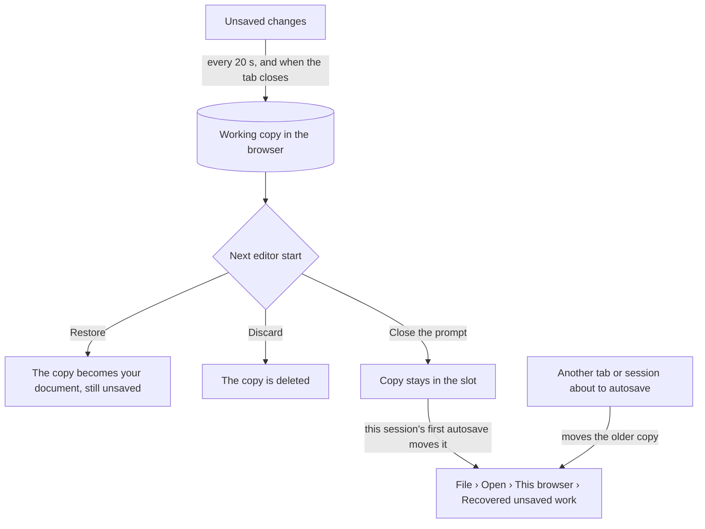

# 关卡编辑器指南

[English](LEVEL_EDITOR_GUIDE.md) | 简体中文

> **用途**——Luminati 关卡编辑器（`editor.html`）的完整手册：布局、视图与相机操作、每个工具及其选项和修饰键、各个面板、检查器（含对话语法）、大纲视图、关卡设置、保存与打开、自动保存与恢复、试玩、剪贴板与撤销、战斗关卡中的敌人、宝箱和路标石、一个 15 分钟教程，以及编辑器的限制。
>
> **读者**——关卡设计师，以及操作或修改编辑器的 AI 智能体。
>
> **权威来源**——[`src/editor/EditorApp.js`](../../src/editor/EditorApp.js)（命令、菜单、快捷键、文件、试玩）、[`src/editor/tools/`](../../src/editor/tools/)（每个工具一个文件）、[`src/editor/ui/`](../../src/editor/ui/)（`ToolOptions`、`Inspector`、`fields`、`Outliner`、`dialogs`、`StatusBar`）、[`src/editor/map2d/Map2DView.js`](../../src/editor/map2d/Map2DView.js)、[`src/editor/viewport3d/Viewport3D.js`](../../src/editor/viewport3d/Viewport3D.js) + `EditorCamera.js`、[`src/editor/autosave.js`](../../src/editor/autosave.js)、[`src/editor/EditorState.js`](../../src/editor/EditorState.js)、[`src/engine/level/ObjectCatalog.js`](../../src/engine/level/ObjectCatalog.js) 和 [`LevelFormat.js`](../../src/engine/level/LevelFormat.js)。
>
> **相关文档**——[入门指南](GETTING_STARTED.zh-CN.md) · [快捷键速查表](shortcuts.html) · [关卡格式规范](../specs/LEVEL_FORMAT.md) · [对象目录](../specs/OBJECT_CATALOG.md) · [关卡存储 API](../specs/LEVEL_STORAGE_API.md) · [编辑器架构](../architecture/EDITOR.md) · [关卡设计指南](../design/LEVEL_DESIGN_GUIDE.zh-CN.md) · 约束性契约：[contracts/LEVEL_EDITOR.md](../contracts/LEVEL_EDITOR.md)


---

## 1. 打开编辑器

启动开发服务器（`npm run dev`），然后打开 **http://127.0.0.1:5173/editor.html**。没有开发服务器时（已构建的站点，`npm run preview`），除项目文件夹相关功能（保存到其中、列出和删除其中的文件；`?open=<name>` 仍可打开已发布的关卡）外，其他功能均可正常使用——参见[入门指南 › 构建与部署](GETTING_STARTED.zh-CN.md#5-构建与部署)。

| URL | 启动时打开 |
| --- | --- |
| `editor.html` | 若上次会话留下了未保存的更改，显示 *Restore unsaved work?*（恢复未保存的工作？）提示；否则打开一个空白关卡 *Untitled*（32 × 24 草地，2 格宽的森林边界）。 |
| `editor.html?open=<name>` | `public/levels/<name>.json`，例如 `?open=emberfall`。 |
| `editor.html?local=<slot>` | 保存在此浏览器中的关卡。 |
| `editor.html?new` | 空白关卡，不显示恢复提示（`?new=room`：新建房间，[§9.2](#92-新建关卡altnctrlnfile--new-level)）。 |

站点首页，即**启动器**（`/`），同样可以打开编辑器：每个关卡以及每个战役中每个关卡文件上的 *Edit*（编辑）、*Open the editor*（打开编辑器）、*New level*（新建关卡）和 *New room*（新建房间）（[入门指南 › 启动器](GETTING_STARTED.zh-CN.md#44-启动页)）。

编辑器会记住上次会话的布局、网格、分隔条位置和 3D 预览选项（`localStorage` 键 `luminati.editor.prefs`）。在 3D 窗格首次完整构建并显示之前，窗格中会显示 "Building the 3D preview…"。

---

## 2. 编辑器概览

```
+-------------------------------------------------------------------------+
| Menu bar: File Edit View Level Help | name * location | undo redo       |
|           layout: split / 3D / 2D | Play                                |
+----+------------+------------------------+---------------+--------------+
| T  | Tool       |                        |               | Inspector    |
| o  | options    |      3D Preview        |    2D Map     |              |
| o  | and        |   (sun slider, help)   |  (grid, tex,  |              |
| l  | palettes   |                        |   zoom, home) +--------------+
| s  |            |                        |               | Outliner     |
+----+------------+------------------------+---------------+--------------+
| Status bar: tile, height, position | tool help, messages | counts, zoom |
+-------------------------------------------------------------------------+
```

| 区域 | 内容 |
| --- | --- |
| **Menu bar**（菜单栏） | *File*、*Edit*、*View*、*Level*、*Help* 菜单（*Help*：*Keyboard shortcuts*（键盘快捷键）、*Open the Emberfall demo*（打开烬落村（Emberfall）演示，即游戏 `game.html`）、*All campaigns and levels*（所有战役和关卡，即启动器 `index.html`）、*About the level editor*（关于关卡编辑器））· **关卡名称**（单击可打开 *Level settings*（关卡设置））· 存在未保存更改时显示的圆点（自动保存失败时为红色）· 关卡的保存位置（`public/levels/x.json`、`browser · slot`、`file · name` 或 *not saved yet*）· **Undo** / **Redo**（撤销 / 重做）· **布局切换**（3D + 2D、仅 3D、仅 2D）· 金色的 **Play**（试玩）按钮。有未保存的更改时，浏览器标签页标题以 ● 开头。 |
| **Toolbar**（工具栏，最左侧） | 分为四组的十个工具：Select · Paint、Fill、Rectangle、Height、Stairs · Place、Player start · Eyedropper、Erase。每个按钮上都标有对应的按键。 |
| **Tool options**（工具选项，左侧） | 当前工具的选项；对于地形和对象工具，还包括**图块面板**或**对象面板**。 |
| **3D Preview**（3D 预览，中间） | 由真实引擎渲染的关卡——地形、水面、道具、灯光、精灵、天空。 |
| **2D Map**（2D 地图） | 带纹理的俯视地图，显示对象图标、标签、区域和粒子区域的轮廓，以及玩家起点（★）。 |
| **Inspector**（检查器，右上） | 所选内容的全部字段——未选择任何内容时显示关卡概要。 |
| **Outliner**（大纲视图，右下） | 按类型列出的所有对象，带有筛选框和按类型的可见性开关。 |
| **Status bar**（状态栏） | 指针下方的信息：图块（列、行）、图块名称、高度层级和世界 y、世界 x / z · 工具帮助或最新消息 · 对象数量、选中数量、关卡尺寸 · 2D 缩放比例。 |

拖动视图之间的分隔条可调整其大小（20–80 %；双击可恢复为 60 %）；拖动检查器与大纲视图之间的分隔条可分配右侧栏的空间。

---

## 3. 视图与相机操作

### 3.1 布局

| 按键 | 布局 |
| --- | --- |
| **1** | 3D 与 2D 地图并排（分屏） |
| **2** | 仅 3D |
| **3** | 仅 2D 地图——在大型关卡上最轻量 |

菜单栏和 *View › Layout* 中也有同样的切换开关。

### 3.2 2D 地图

| 操作 | 作用 |
| --- | --- |
| **滚轮** | 以光标为中心缩放（约 19 % – 800 %；100 % = 每图块 16 px） |
| **右键拖动**、**中键拖动**或 **Space + 左键拖动** | 平移 |
| **右键单击**（不拖动） | 右键菜单 |
| **双击**（Select 工具） | 在两个视图中聚焦指针下方的对象；在区域或粒子区域内部双击则选中它 |
| **Home** | 显示整个关卡（也可使用 2D 工具栏中的 *Frame level* 按钮） |
| **−** / **+** 按钮 | 缩小 / 放大 |
| **Ctrl+G** | 打开 / 关闭网格（也可使用网格按钮） |
| 纹理按钮 | 真实图块纹理或纯色图块（*View › Textured 2D map*） |


### 3.3 3D 预览

3D 预览有两种相机：自由的**编辑相机**（默认）和**游戏相机**（*View › 3D: gameplay camera*：游戏的 28° 镜头，使用关卡的相机俯仰角和距离——除非在 *Level settings › Camera* 中另行设置，否则为 32° 和 30——也就是玩家将会看到的画面）。

| 操作 | 作用 |
| --- | --- |
| **右键拖动** | 环绕（游戏相机下：仅转向） |
| **中键拖动**、**Shift + 右键拖动**或 **Space + 左键拖动** | 平移 |
| **滚轮** | 朝光标下方的点缩放 |
| **F** | 框选显示所选内容（两个视图中均有效） |
| **双击**（Select 工具） | 聚焦对象；在空地上则看向该点 |
| **按住右键 + W A S D** | 飞行（按住 **Shift** 以 2.5 倍速度飞行） |
| **按住右键 + Q / E** | 飞行时转向 |
| **Q / E**（游戏相机，指针位于 3D 视图上） | 旋转 |
| **右键单击**（短按，未飞行） | 右键菜单 |
| 单击天空（Select 工具，无修饰键） | 清除选择 |

窗格底部的 **3D 工具栏**上有一个**太阳滑块**（0–24 时，以一刻钟为步长），可预览一天中的任意时刻。旁边的**链接**按钮亮起时，预览跟随关卡的开始时间；拖动滑块会解除链接，单击链接按钮可重新链接。**?** 按钮会打开键盘快捷键列表。

关卡的**天气**始终以其在游戏中稳定后的样子显示在 3D 预览中：雨雪天气会让阳光变得灰暗清冷，风力增强，路灯和窗户在白天也会微微发光。落下的雨雪、雨雪雾霭以及沉积的积雪则需要开启 *3D: particles & god rays*（见下文）才会出现，这样编辑时图块依然清晰可辨。

*View › 3D preview* 可以开启为保证编辑流畅而默认关闭的部分：

| 菜单项 | 增加的内容 |
| --- | --- |
| *3D: gameplay camera* | 游戏中的取景（窗格中显示 GAME CAMERA 徽标）。 |
| *3D: diorama post effects* | 移轴景深、泛光和调色。 |
| *3D: particles & god rays* | 粒子区域、体积光（god rays）、地面植被——当关卡天气为雨或雪时，还包括**降雨 / 降雪**、雾霭，以及地面、屋顶和草地上的**积雪**。 |


### 3.4 View 菜单——显示哪些内容

| 菜单项 | 效果 |
| --- | --- |
| *Frame selection*（**F**）/ *Frame level*（**Home**） | 将视图居中。 |
| *Grid*（**Ctrl+G**）、*Textured 2D map* | 2D 地图的绘制方式。 |
| *Show objects* | 两个视图中的道具、建筑、村民等。 |
| *Show markers (areas, regions, start)* | 粒子区域、区域、小动物区域、敌人活动范围圈和首领竞技场，以及玩家起点。（在 2D 地图中，敌人群组与小动物群组一样属于标记；在 3D 视图中，它们的精灵遵循 *Show objects*。） |
| *Show all hidden types* | 撤销大纲视图中的所有眼睛开关。 |
| *Story preview…* | 根据所选的剧情值，隐藏剧情条件不成立的对象（[§5.5](#55-剧情事件标记脚本与剧情预览)）。 |

凡是被这些设置隐藏的内容——大纲视图中某个类型的眼睛、关闭 *Show objects* 或 *Show markers*（以 2D 地图的绘制为准：那里的小动物群组和敌人群组遵循 *Show markers*）、剧情预览——都既不能被点选也不能被框选，在大纲视图中显示为灰色，并且永远不会被选中（[§5.5](#55-剧情事件标记脚本与剧情预览)）：关闭某个开关会将其隐藏的内容从选择中移除；**Ctrl+A** 与框选一样只选择 2D 地图上显示的内容，并告知遗漏了多少个以及原因。

### 3.5 右键菜单

- **在对象上**：*Focus*（聚焦）、*Duplicate*（创建副本）、*Copy*（复制）、*Rotate +90°*（旋转 +90°）、*Pick this type*（选用此类型，切换到 Place 工具并使用该类型）、*Delete*（删除）。在玩家起点上：*Focus*。
- **在空地上**：*Paste here*（粘贴到此处）、*Place player start here*（将玩家起点放在此处）、*Place ‹current object type› here*（在此处放置‹当前对象类型›）（仅限点对象；若视图隐藏了该对象——其类型的眼睛关闭、*Show objects* 关闭——则对象会被放置但不会被选中，状态栏会说明原因，与 Place 工具相同）、*Frame level*（显示整个关卡）。

---

## 4. 工具

用按键或工具栏选择工具。一次**笔画**（按下、拖动、松开）始终是**一个撤销步骤**；在笔画过程中按 **Esc** 会取消该笔画，并将关卡恢复原样。

拖动也可能被**中断**而不是被松开：浏览器取消了触摸或手写笔笔画、布局变更隐藏了视图，或者你切换到了其他窗口（2D 地图会立即结束拖动；3D 预览会在按住按钮期间保持拖动，而它没有察觉到的松开则视为中断）。笔画已经完成的部分会保留下来，作为一个撤销步骤——已绘制的图块、已改变的高度、到目前为止的移动、已擦除的对象——但松开时不会再添加任何内容：矩形、区域或拖出的栅栏 / 桥不会被放置，框选或对已选对象的单击会保持选择不变。

| 按键 | 工具 | 一句话说明 |
| --- | --- | --- |
| **V** | Select / Move（选择 / 移动） | 选择、移动、调整形状、旋转、删除 |
| **B** | Paint tiles（绘制图块） | 用画笔绘制所选图块 |
| **G** | Fill（填充） | 泛洪填充连通区域，或在所有位置替换某种图块 |
| **U** | Rectangle（矩形） | 填充（或描边）一个矩形范围的图块 |
| **H** | Height（高度） | 抬高、降低、设定、压平或平滑地形 |
| **T** | Stairs（楼梯） | 将台阶边缘变为楼梯，或建造整段楼梯 |
| **O** | Place object（放置对象） | 放置在面板中选中的对象 |
| **P** | Player start（玩家起点） | 移动玩家起点并设置其朝向 |
| **I** | Eyedropper（吸管） | 拾取图块及其层级，或拾取对象类型 |
| **X** | Erase objects（擦除对象） | 单击或拖过对象以删除它们 |

工具按键以键帽上印的字母为准，且在文本字段获得焦点时不会触发。

### 4.1 选择 / 移动（V）

| 操作 | 作用 |
| --- | --- |
| **单击** | 选择对象（或玩家起点 ★） |
| **Shift + 单击** | 添加到选择中 |
| **Ctrl + 单击** | 在选择中切换 |
| **在空地上拖动** | 框选（Shift 添加，Ctrl 切换）。区域、粒子区域、小动物群组和敌人群组必须完全位于框内；其他对象只需与框接触即可。只会选中 2D 地图上显示的内容：隐藏的类型，以及 *Show markers* 关闭时的小动物 / 敌人群组，都不会被选中。 |
| **拖动对象** | 移动所选内容；吸附到 0.5（玩家起点吸附到图块中心）。按住 **Alt** 可自由移动。 |
| **拖动控制柄** | 栅栏 / 桥：移动端点。区域 / 粒子区域：拖动角点以调整大小。首领敌人群组：拖动竞技场角点以调整竞技场大小（位于被拖动边上的闸门端点会随之移动，因此闸门始终留在边上），或拖动闸门端点以移动闸门。（选中不超过 8 个对象时显示控制柄。） |
| **单击空地** / **Esc** | 取消选择 |
| **双击** | 聚焦；在区域或粒子区域内部：选中它 |
| **R / Shift + R** | 将所选内容旋转 +15° / −15°（从上方看为逆时针 / 顺时针） |
| **Ctrl + R / Ctrl + Shift + R** | 旋转 +90° / −90° |
| **方向键** | 微移 0.5（**Shift**：2，**Alt**：0.1） |
| **Delete / Backspace** | 删除所选内容 |
| **Ctrl + D** | 创建副本（副本偏移 +1, +1） |

区域和粒子区域需单击其**边缘或名称标签**来选取（这样你仍可以在大区域内部进行框选）；在其内部双击即可选中它。一组对象绕其中心旋转；只能朝四个方向的东西（瀑布的 *Falls toward*、村民的朝向）以 90° 为步长转动。转动 90° 时，相对于对象存储的内容也会一并转动——村民的交谈点和追逐区域、小动物院落及其精确位置、敌人群组的竞技场、闸门、区域和位置；以 15° 旋转一组对象时，这些内容保持不变（状态栏会对此加以说明）。

工具选项中有 **Snap to grid**（吸附网格）开关（与 Place 和 Player start 共用）、对象面板（单击会切换到 Place）以及操作手势参考。

### 4.2 绘制图块（B）

拖动以绘制在**图块面板**中选中的图块。

- **Brush**（画笔）：大小 1–9（在编辑器中任意位置按 **[** 和 **]**），形状为方形 / 圆形。
- **Height › Also set height** + **Level**：绘制的图块同时设为该高度层级。
- **Shift + 单击**：从上一次笔画的终点到单击处画一条直线。
- **Alt + 单击**：拾取指针下方的图块及其高度层级。

### 4.3 填充（G）

单击即可用所选图块泛洪填充由相同图块构成的连通区域。

- **Only same height**（仅相同高度）：填充还会在高度变化处停止。
- **Shift + 单击**：在地图上**所有位置**替换该图块。
- **Also set height** + **Level**、**Alt + 单击**拾取，与 Paint 相同。
- 预览标签会显示填充覆盖的图块数（*Fill N tiles → …*，按住 Shift 时为 *Replace N tiles → …*）。

### 4.4 矩形（U）

拖出一个矩形范围的图块；预览会显示其尺寸。

- **Outline only**（仅描边）开关，或在拖动时按住 **Shift**，仅在本次拖动中切换该选项。
- **Also set height** + **Level**、**Alt + 单击**拾取、**Esc** 取消拖动。

### 4.5 高度（H）

以**高度层级**塑造地形：一个层级为 0.5 世界单位，层级范围为 0 到 35。**一个层级是可行走的台阶；两个或更多层级构成悬崖。**

| 模式 | 笔画触及的每个图块…… |
| --- | --- |
| **Raise** | 升高一个层级（**Shift** 则降低） |
| **Lower** | 降低一个层级（**Shift** 则升高） |
| **Set** | 设为 **Target level**（目标层级） |
| **Flatten** | 取笔画起点图块的层级 |
| **Smooth** | 取其 3 × 3 邻域（以笔画开始时的状态为准）的四舍五入平均值 |

每个图块**每次笔画只改变一次**——再次单击可继续升高。**Alt + 单击**会将图块的层级复制到 *Target level*。画笔大小和形状与 Paint 相同。

### 4.6 楼梯（T）

楼梯图块（`^` `v` `>` `<`）沿其上升方向**每个图块爬升一个层级**。

- **沿台阶边缘单击或拖动**：每个图块都会变成朝其较高相邻图块上升的楼梯（*Direction* 为 **Auto**），或朝你指定的方向（**↑ N**、**↓ S**、**→ E**、**← W**）上升。沿台阶边缘拖动可建造宽楼梯。
- **横跨悬崖拖动**——从崖底到崖顶——可建造**整段楼梯**：低侧的图块会变成每格一层的楼梯（紧邻悬崖处为顶部 − 1，一直向下延伸到地面）。三层高的悬崖需要三格楼梯。笔画在延伸过程中会被重新规划，并且始终是一个撤销步骤。
- 状态栏会说明缺少什么：*drag N more tiles away from the cliff*（再向远离悬崖的方向拖动 N 格）、*No higher neighbour here*（此处没有更高的相邻图块）或 *The ledge is N levels high*（该台阶高 N 层）。

### 4.7 放置对象（O）

在**对象面板**中选择一个对象，然后在任一视图中单击。半透明的**虚影**会准确显示单击将放置的内容——包括树木、岩石和房屋的变体（种子）；每次放置后都会随机生成新种子，因此重复放置的道具各不相同。新对象会被选中，其字段会立即显示在检查器中。

| 对象种类 | 放置方法 |
| --- | --- |
| **点**对象（几乎所有对象） | 单击。 |
| **线**——Fence、Bridge | 先单击起点，再单击终点——或从起点拖动到终点。**Esc** 取消已开始的线。 |
| **区域**——Region name | 拖出一个矩形（单纯单击会生成 4 × 4 的区域）。 |

- **R / Shift + R** 将虚影旋转 ±15°，**Ctrl + R / Ctrl + Shift + R** 旋转 ±90°；工具选项中的 *Rotation* 行有 ±15° 按钮和 **0°** 复位按钮。旋转角度会**按对象类型**分别记忆（旋转房屋不会影响下一根路灯）。0° 时房屋的门朝**南**，面向默认相机；+90° 会使其朝东。
- **Snap to grid**（0.5）——按住 **Alt** 可自由定位。
- 无法旋转的类型会在状态栏中加以说明。


### 4.8 玩家起点（P）

单击或拖动以移动玩家出现的位置（★）。它会吸附到图块中心（**Alt**：自由定位）。**R / Shift + R** 转动其朝向（下 → 右 → 上 → 左），也可以使用工具选项中的朝向按钮。如果该位置不可行走，工具会发出警告——玩家起点必须位于可行走地面或桥面上，关卡才能试玩。

### 4.9 吸管（I）

单击图块可拾取其**图块和层级**（如果上一个工具是 Paint、Fill、Rectangle 或 Height，则返回该工具，否则切换到 Paint），单击对象可拾取其**类型**（切换到 Place）。按住 **Shift** 可停留在吸管工具中。

### 4.10 擦除对象（X）

单击对象将其删除，或拖过多个对象——整个笔画是一个撤销步骤。地形不受影响（在图块上重新绘制即可更改地形）。

---

## 5. 面板

### 5.1 图块面板（Paint、Fill、Rectangle）

真实纹理色块，分组排列。将鼠标悬停在色块上可查看其名称、字符和标志。

| 分组 | 图块（字符） |
| --- | --- |
| **Ground**（地面） | Grass（草地）`g` · Dark grass（深色草地）`G` · Flower grass（花草地）`f` · Farmland（农田）`F` · Sand（沙地）`s` · Mossy stone（苔石）`m` |
| **Paths & floors**（道路与地面） | Dirt path（土路）`.` · Dirt（泥土）`d` · Cobblestone（鹅卵石）`c` · Stone tiles（石砖）`k` · Wooden deck（木板平台）`b` |
| **Water**（水） | River（河流）`~` · Plunge pool（跌水潭）`p`（流速慢） · Fast stream（急流）`w` · Still pond（静水池塘）`o` |
| **Stairs**（楼梯） | Stairs up north（向北上行楼梯）`^` · south（向南）`v` · east（向东）`>` · west（向西）`<`（通常用 Stairs 工具生成） |
| **Blocked & void**（阻挡与虚空） | Forest floor (blocked)（森林地面，阻挡）`T`——游戏会在其上生成边界森林 · Rock (blocked)（岩石，阻挡）`x` · Void (space)（虚空）——完全没有地面 |
| **Custom**（自定义） | 关卡文件定义的额外图例字符（例如星落谷（Starfall Vale）中向东流的河流）；仅限单字符键——手写文件中更长的键会列在 *Opened with warnings* 对话框中，且无法用于绘制 |

**水深。** 河床低于关卡**水位**（默认 0.4 世界单位，*Level settings › Water*）的水图块会被注水至水位；河床等于或高于水位的水图块则拥有自己的水面，位于河床上方 0.35 处——因此高原上的溪流也能正常呈现。若要在 2 层的地面上做河流或池塘，请将水图块设为 **0 层**（*Also set height* 开关）；若想要平缓的河岸，再在周围铺一圈 **1 层**的沙地。

### 5.2 对象面板（Place、Select）

| 类别 | 对象 |
| --- | --- |
| **Buildings**（建筑） | House（房屋）· Windmill（风车）· Well（水井）· Market stall（市场摊位） |
| **Nature**（自然） | Tree（树）· Rock（岩石）· Haystack（干草堆） |
| **Lights**（灯光） | Lamppost（路灯）· Wall torch（壁挂火把）· Campfire（篝火）· Point light (invisible)（点光源，不可见） |
| **Props**（道具） | Bench（长椅）· Barrel（木桶）· Crate（板条箱）· Crate stack（板条箱堆）· Flower box（花箱）· Signpost（指示牌） |
| **Interior**（室内） | Bed（床）· Table（桌子）· Chair（椅子）· Shelf（架子）· Hearth（壁炉）· Counter（柜台）· Rug（地毯）· Staircase（楼梯）· Wardrobe（衣柜）· Wall window（墙窗）· Grain sacks（粮袋）——房间里的家具：旋转角度为 0 时，家具背靠北墙、正面朝向你；墙窗放在墙面上（[对象目录 § Interior](../specs/OBJECT_CATALOG.md#interior)） |
| **Structures**（结构） | Fence (line)（栅栏，线）· Bridge (line)（桥，线） |
| **Water**（水） | Waterfall（瀑布） |
| **Characters**（角色） | Villager (NPC)（村民）· Critters（小动物） |
| **Markers**（标记） | Particle area（粒子区域）· Region name（区域名称）· Exit (to another level)（出口，通往其他关卡）· Entrance (arrival point)（入口，到达点）——用于战役，参见 [§5.4](#54-战役出口入口和剧情字段) · Story event（剧情事件）· Story marker (named spot)（剧情标记，命名地点）——参见 [§5.5](#55-剧情事件标记脚本与剧情预览) |
| **Combat**（战斗） | Enemy group（敌人群组）· Treasure chest（宝箱）· Waystone (checkpoint)（路标石，检查点）——参见 [§5.3](#53-战斗敌人宝箱和路标石) |

将鼠标悬停在按钮上可查看其帮助文本。每种类型的所有字段都列在[对象目录规范](../specs/OBJECT_CATALOG.md)中；最有用的几点如下：

- **House**——只有当 *Text when knocking*（敲门文本）有内容时，门才可以交互；*Door lantern casts light*（门灯投射光照）会在夜间添加真实光源。
- **Lights**——想放多少就放多少：游戏有 12 个真实点光源，由玩家周围的灯光共享（行走时它们会交叉淡入淡出）。检查器的关卡卡片会显示数量（*10 / 12*，或 *30 · 12 lit*）。
- **Waterfall**——放在较高与较低水图块之间的**边缘**上；*Falls toward*（N / S / E / W）是水流落下的方向。
- **Villager**——参见 [§6.3](#63-村民对话动作和行为)。
- **Critters**——鸡、猫、鸟或狗：*Count* 1–8 只，在 *Roam radius*（漫游半径）范围内活动。鸡会躲开玩家；鸟会飞走。
- **Particle area**——一个装有萤火虫（仅夜间）、落叶、花瓣、灰尘、余烬、烟雾、薄雾或闪光的盒子。*Size X / Y / Z*、*Height above ground*（离地高度）、*Particles* 1–200。（*rain* 和 *snow* 预设会跟随相机；降水请使用关卡的天气设置。）
- **Region name**——玩家位于区域内时，HUD 会显示其名称。*Only above height, world units* 将其限制在高地上——这是一个**世界高度**（层级 × 0.5），玩家必须严格高于该高度；*Arrival banner subtitle*（到达横幅副标题）会在玩家首次进入时显示一条横幅。**按对象顺序，第一个匹配的区域生效**——请把小区域放在包含它们的大区域之前。

### 5.3 战斗：敌人、宝箱和路标石

关卡一旦包含 **Enemy group**（敌人群组），就会**以战斗模式运行**（或者当 *Level settings › Environment › Combat* 设为 *On* 时，[§8.1](#81-关卡设置)）。此时玩家会携带一把剑，拥有生命值、法力值和体力，可以升级，并在最后一个路标石处复活。没有敌人的关卡则和以前完全一样，保持和平。演示关卡烬望隘口（Cinderwatch Pass）展示了所有战斗对象——打开它（`editor.html?open=cinderwatch-pass`）看看它是如何搭建的。

| 对象 | 字段 | 说明 |
| --- | --- | --- |
| **Enemy group**（敌人群组，⚔） | *Kind*（种类：Moss Slime（苔藓史莱姆）、Bramble Goblin（荆棘哥布林）、Thorn Archer（荆刺弓手）、Hex Shaman（咒术萨满）、Cinder Bat（烬火蝙蝠）、Ironhide Boar（铁皮野猪）、Straw Dummy（稻草假人）、Cinderheart (boss)（烬心，首领））、*Count* 1–8、*Home radius* 0.5–12、*Level* 1–10、*Elite*、*Name plate (optional)* | 一个对象就是一整群敌人。敌人起始时分散在活动半径内的可行走地面上（蝙蝠也可以从水面上方开始），丢失玩家目标后会返回那里。*Level* 会缩放生命值、伤害、经验值和金币（首领的等级仅作显示）；*Elite*（精英）拥有更多生命值和伤害、价值更高、必定掉落一颗心，并以金框显示其生命条和 *Name plate*（铭牌，或 *Elite …*）。**Straw Dummy** 从不攻击——是训练用的靶子。 |
| **Cinderheart**（烬心，首领） | 同上（其 *Count* 固定为 1），另加 **Boss arena** 部分 | 每个群组始终只有一个首领：其 *Count* 字段最大为 1，将群组的 *Kind* 切换为 Cinderheart 时也会将其设为 1。首领需要一个**竞技场**（战斗被锁定在其中）以及位于竞技场边缘上的一道**闸门**（在玩家身后关闭）。选中该群组并在检查器中单击 **Add arena and gate**（添加竞技场和闸门）：会在其周围生成一个 18 × 18 的竞技场，闸门位于南边；然后用选择工具拖动竞技场角点和闸门端点，或直接输入数值（相对于该群组）。通过角点调整竞技场大小时，闸门会保持在边缘上；**Ctrl+R** 会将竞技场和闸门随首领一起旋转（仅限 90° 步长——以 15° 旋转选择时它们保持不变）。只有首领种类会使用它们：切换为其他 *Kind* 的群组仍会在文件中保留其竞技场，但视图不再显示它，*Check for problems* 会提醒你将其移除。每个关卡只能有一个首领。 |
| **Treasure chest**（宝箱，▣） | *Rotation*（0° 时正面朝向相机）、*Gold* 0–500、*Healing Draughts*（治疗药水）0–5、*Upgrade*（None、Max HP +20、Max MP +10、Attack +3） | 在战斗关卡中按 **Space** 打开它；其中的物品会以拾取物的形式弹出。请在它前方留出空间。在和平关卡中只能查看它。 |
| **Waystone**（路标石，◆） | *Name* | 检查点：走近即可与其共鸣（被击败后玩家会在那里复活）；按 **Space** 休息（完全回复，敌人重新出现）。在起点附近放一个，每场艰难的战斗之前再放一个。 |


视图中显示的内容：

- **2D 地图**——敌人群组显示为表示其活动半径的红色虚线圆环（精英为金色），每个敌人的起始位置有一个圆点；放大或选中时还会显示类似 `slime ×3 · Lv1` 的标签；首领会显示其竞技场（虚线）和闸门（亮条）。宝箱绘制为正面带锁的小箱子，路标石绘制为带蓝色水晶的石头。
- **3D 预览**——敌人在其起始位置处于待机状态（蝙蝠悬停），地面上绘有活动范围圈以及首领竞技场和闸门；选中的群组还会显示名称标签。同一种类的敌人会合并绘制（整个关卡的所有敌群只需少量绘制调用）。首次选用 *Enemy group* 工具时，视图可能会为准备它们而短暂停顿一次。预览只显示普通精灵：受击闪光、发光的眼睛和岩浆、战斗 HUD 和攻击标记只在游戏中出现——按 **F5** 试玩。
- **起始位置**与游戏中一致：敌人从可站立的地面上开始——可行走图块或桥面，绝不会在开阔水面上（蝙蝠也可以从水面上方开始）——且不会位于道具或村民内部。在敌群下方绘制水面，或在其中放置岩石、宝箱或村民，其成员会立即移动，与游戏中一样——在所有布局中都是如此，包括**仅 2D** 布局（此时圆点也会使用道具的真实碰撞形状）。刚打开关卡时，当 3D 视图构建完道具后，圆点可能会移动一次。
- **检查器**——未选择任何内容时，关卡卡片会增加一行 *Enemies n (groups g) · Waystones n · Chests n*（当放置了敌人却关闭了战斗，或战斗关卡没有路标石时，以警告颜色显示）。

*Level › Check for problems* 会对常见的战斗错误发出警告（[§8.3](#83-检查问题)）。良好做法：让敌人与玩家起点至少相距 12 格，让其他敌群与首领竞技场相距 6 格（其他敌人无法进入竞技场，但紧挨着它的敌群会挤在其边缘，并在战斗开始时被送回原处），并且经常试玩。

---

### 5.4 战役：出口、入口和剧情字段

**战役**将多个关卡连成一个故事（[CAMPAIGN_FORMAT.md](../specs/CAMPAIGN_FORMAT.md)）：其关卡存放在 `public/campaigns/<name>/levels/` 中，并通过以下对象相互连接（均位于 *Markers* 分组中；单独游玩的关卡会忽略它们）：

| 对象 | 放置方法 | 字段 |
| --- | --- | --- |
| **Exit (to another level)**（出口）`⇨` | 在道路离开地图处拖出一个矩形（走入即触发），或覆盖在门前台阶上（按 Space 触发）。绘制为绿色虚线矩形，标签为 `→ level · entrance`。 | *Leads to level*（目标关卡的文件名）、*Arrive at entrance*（留空：如果战役同时放置了两个关卡，则穿过接缝到达，否则到达目标关卡的玩家起点）、*Travel*（*Walk into it* / *Press Space*）、*Prompt*、*Open only with story flag*、*Text while closed* |
| **Entrance (arrival point)**（入口）`⊙` | 在玩家应到达的位置单击；带箭头的绿色圆环表示到达时的朝向。 | *Name*（出口引用它时使用的名称；留空 = 其 id）、*Facing on arrival* |

每个对象最后还有两个**剧情**字段：*Story: only when*（`when`）和 *Story: gone when*（`unless`）——在战役中，对象只在前者成立时存在，在后者成立时消失。每个字段都是一个标志名或一个剧情条件（[§5.5](#55-剧情事件标记脚本与剧情预览)）。村民还有 *Story: sets flag after talking*（`flag`）。*Check for problems* 会列出没有目标或没有可行走地面的出口、重复的入口名称以及不在可行走地面上的入口；演示战役摆渡人的提灯（The Ferryman's Lantern）展示了以上全部内容（`editor.html?open=ferrymans-lantern/mill-road`）。

### 5.5 剧情：事件、标记、脚本与剧情预览

另外两种 *Markers* 对象承载着关卡的剧情；二者在游戏中都不可见：

| 对象 | 放置方法 | 绘制为 | 字段 |
| --- | --- | --- | --- |
| **Story event**（剧情事件）`!` | 拖出一个矩形。 | 金色虚线矩形，标签显示其触发方式和提示（`! use · Read`；放大时还显示其条件、时刻或群组）。后台事件（`background: true`：运行时不会锁定玩家）在两个视图中均显示为点线，并带有 `(background)` 标签。 | *Runs when*（在其中按 Space、走入或走出、到达关卡、其条件变为真、时钟到达某个时刻、某个敌人群组被击败）、*Prompt (Space)*、*Condition*、*Only once*、*At hour (clock)*、*Group (enemy id)*、*Script* |
| **Story marker**（剧情标记）`✦` | 单击。 | 带有指向其朝向箭头的金色圆环，以其 *Name*（或 id）命名。 | *Name*（脚本引用它时使用的名称）、*Facing* |

村民还有 *Talk script* 和 *Actor*。两个视图绘制事件和标记的方式与出口和入口相同：通过事件的边缘或中心徽标（在 3D 视图中也可通过其标签）选取事件，或在其内部双击；拖动其角点可调整大小。

**脚本字段**（*Script*、*Talk script*）保存用剧情语言编写的脚本，每行一条命令，以缩进（两个空格）划分代码块。在字段中：

- **Tab** / **Shift+Tab** 在可以的地方缩进 / 取消缩进两个空格：选中多行时（对其中每一行），或光标位于某行的缩进部分时——即从行首到该行第一个字符之间的任意位置（Tab 在该处插入两个空格；如果该行有缩进，Shift+Tab 会删除两个空格）。在其他位置——光标位于行的第一个字符之后——它们会像在其他字段中一样移到下一个 / 上一个字段；对于通过键盘到达的脚本字段，在你输入、移动光标或单击它之前，Tab / Shift+Tab 也是如此：键盘永远不会被困在脚本中。**Enter** 会保持该行的缩进，并在代码块头（`if`、`elif`、`else`、`choice`、`loop`、`once`、`cycle`、`seq`、`pick`）以及选项（`>`）或备选项（`*`）之后再增加两个空格；**Ctrl+Enter** 或离开字段即提交，**Esc** 恢复；
- 标签会显示行数；前三个问题以 *line N: …* 的形式列在字段下方——单击其中一个（或用 Tab 移到它上面并按 Enter）即可选中该行；
- **⤢** 会打开**脚本编辑器**：一个带行号（标出有问题的行）的宽窗口，按键操作相同，列出所有问题，并提供各类行和所有命令的参考（可以筛选——在筛选框中按 **Esc** 清空；单击命令即可插入）。*Apply*（或 **Ctrl+Enter**）是一个撤销步骤；未做任何更改的 *Apply* 不会写入任何内容（不产生撤销步骤，已存储的行保持原样）。*Cancel* 放弃更改；如果文本已被更改，**Esc** 和 **×** 会先询问 *Discard changes?*。选中多个脚本互不相同的对象时，编辑器会以空白状态打开：在其中写入的文本会替换每个选中对象的脚本，留空则不做任何更改。

末尾的空行不会被保存；没有默认值的脚本字段（*Talk script*）被清空后会从对象中移除。

**脚本中的文本键。** 在关卡文件中，每个显示文本的脚本行都以一个 `#line:<key>` 标签结尾：这是该行的文本键，翻译依据它进行匹配（[§6.1](#61-显示内容)）。脚本字段和脚本编辑器从不显示这些标签，*Apply* 会保留它们：编辑过的行保留其键（其翻译等待审阅），被移动的行或周围插入了新行的行保留其键，新行获得新键。你永远不需要输入标签。粘贴带标签的脚本文本（从关卡文件中复制而来）是安全的：如果某个标签已被关卡中的其他文本占用，它会被替换。

**条件字段**（*Story: only when*、*Story: gone when*、出口的 *Open only with story flag*、事件的 *Condition*）接受一个标志名，或诸如 `bridge-mended and not flood`、`item:plank >= 3`、`quest:find-ilse = active`、`hour >= 20 or hour < 6` 的条件。文本始终按输入原样保留；字段下方会以警告颜色、每行一条，显示 *Check for problems* 对它的评价，并按该字段自身的规则解读（[STORY_SCRIPT.md §3](../specs/STORY_SCRIPT.md#3-conditions)）：*only when*、*gone when* 和 *Open only with story flag* 遵循**标志规则**——单独一个名称就是该标志，因此单独的保留字（`gold`、`day`、`weather` ……）是一个永远无法被设置的标志（"write `gold > 0`"），无法解析的文本会被解读为以该文本为名的单个标志；事件的 *Condition* 则按脚本中的写法解读（`gold` 读取钱包；无法解析的文本永远不成立）。提示还会指出关卡（或其战役）中不存在的内容：不属于任何 `once` 事件或代码块、或属于非 `once` 事件的 `done:` 键，不对应任何关卡的 `visited:`，未声明的物品和任务，任务未声明的阶段——以及对象会如何处理它：敌人群组、宝箱或路标石只在进入关卡时才依据其剧情条件（其他所有类型都会实时出现和消失），因此如果它们的 *only when* / *gone when* 读取的是本关卡自身设置的标志，就会产生警告（变化在下次访问时才会显现；警告显示在读取该标志的字段下方）；在*其条件变为真*时运行的事件需要填写 *Condition*（留空：错误）。清空一个可选字段——即该类型没有默认值的字段，例如剧情字段、*Talk script*、*Actor*、*Story: sets flag after talking*，或事件的 *Prompt*、*Condition*、*At hour* 和 *Group*——会将其从对象中移除，因此不使用它的关卡，其文件保持不变；重新输入后，它会回到对象中原来的位置（清空一个值后再重新输入，保存的文件与原来一致）。

**Check for problems**（[§8.3](#83-检查问题)）还会列出剧情方面的问题：无法解析的脚本行和条件（附行号）、缺少其触发方式所需内容的事件、关卡中不存在的角色、地点和说话者。对于属于某个战役的关卡，它会读取战役的 `campaign.json`，并报告不属于该战役关卡的 `travel` 目标；当 `campaign.json` 列出了剧情文件时，它也会读取这些文件，并报告其中未声明的物品、任务、任务阶段、命名脚本和角色。它还会读取战役中的每个关卡文件（包括每个章节变体），因此 `done:` 键的检查方式与 `npm run level:check -- --campaign=<c>` 相同：对照每个关卡的事件（`done:<level>.<id>`）、剧情文件中的事件以及每个 `once` 代码块——本关卡自身的部分以你当前编辑的状态为准，而不是上次保存的状态。每当打开战役中的某个关卡时（因此之后保存过的关卡会被重新读取）、关卡以另一个名称保存到战役中时，以及执行 *Check for problems* 时，都会读取这些文件。无法读取的内容不会导致误报：无法读取的关卡文件会使 `done:` 键只对照本关卡检查；无法读取的剧情文件会使剧情文件所声明的一切（物品、任务、阶段、脚本、角色——要么全有，要么全无）都被略去；读取失败时保留之前读到的内容；在战役尚未被读取之前，不会报告战役关卡的 `done:` 和 `visited:` 键、`travel` 目标、物品、任务、被调用的脚本和角色。

**剧情预览**（*View › Story preview…*）。工作时，可以隐藏 *Story: only when* / *Story: gone when* 不允许其出现的对象。输入剧情值，每行一个——单独的标志名（`bridge-mended`）、`deliveries = 3`、`item:plank = 2`、`quest:find-ilse = active`、`stage:find-ilse = cross-ford`、`hour = 20`、`chapter = lanterns-home`、`party:sela`（瑟拉（Sela）在玩家队伍中）、`party = 2`（`#` 开始注释；未给出 `hour` 时取 3D 预览的时刻）——然后打开 *Preview on*。视图会在你输入时（短暂停顿后）随之更新：隐藏的对象在两个视图中都不绘制（其烟囱烟雾、余烬和薄雾也会停止），无法被点选或框选，并在大纲视图中显示为灰色；状态栏会显示 *Story preview: on*。

**隐藏的对象永远不会被选中**——无论是被剧情预览隐藏、属于被大纲视图眼睛隐藏的类型，还是被关闭的 *View › Show objects* / *Show markers* 隐藏（[§3.4](#34-view-菜单显示哪些内容)）——因此 **Delete**、方向键和检查器永远不会作用于你看不见的内容：

- 任何改变隐藏内容的操作——预览的值或开关、眼睛、*Show objects* / *Show markers*、编辑对象的 *Story: only when* / *Gone when*（或天气）、撤销 / 重做、粘贴、以另一个名称保存（预览的 `level` 跟随文件，保存消息会说明哪些对象离开了选择）——都会将隐藏的对象从选择中移除，状态栏会说明原因（"*tree_3 left the selection: hidden by the story preview (bridge-mended) — turn the preview off to edit it*"）；
- 单击灰色的大纲视图行（包括 Shift / Ctrl 单击，或用键盘在其上按 Enter），或单击视图中隐藏对象所在的位置，都不会选中任何内容；状态栏会说明原因："*tree_3 is hidden by the story preview (bridge-mended) — turn the preview off to edit it*"、"*… hidden by the outliner's eye (Tree objects) — show Tree objects again to edit it*" 或 "*… hidden by View › Show objects (off) — turn View › Show objects on to edit it*"——对象一旦重新显示，该消息即会消失。框选、**Ctrl+A**、Shift+单击分组标题以及粘贴都会排除隐藏的对象并告知数量；放置在视图所隐藏位置的对象（通过 Place 工具，或右键菜单的 *Place ‹type› here*）会被放置但不会被选中，消息会说明原因；
- **双击灰色的大纲视图行**（或在其上按 **F**）即可找到该对象：这会关闭导致隐藏的原因——剧情预览、其类型的眼睛、*Show objects* / *Show markers*（所有隐藏它的设置）——并选中它；
- 撤销和重做永远不会把隐藏的对象带回选择中，即使该步骤是在其显示时执行的；状态栏会说明哪些对象离开了选择。

预览不会随关卡一起保存；剧情值由此浏览器记住，而开关在每次会话中都从关闭状态开始。可以在 `editor.html?open=ferrymans-lantern/mill-road` 上试一试：没有剧情值时，渡口有洪水留下的残骸而没有桥；加上 `bridge-mended` 后，出现了桥而残骸消失。

剧情值的解读方式与游戏中相同。`stage:find-ilse = cross-ford` 表示任务处于该阶段，并且已经经历了在其之前声明的各个阶段（在战役的剧情文件中声明；没有剧情文件时，只有该阶段），同时它会开始该任务（除非你另行指定，否则 `quest:find-ilse` 读作 *active*）。任务尚未到达的阶段，或剧情文件未声明的阶段，被视为位于所有已到达阶段之后：`stage:find-ilse >= found` 和 `stage:find-ilse = found` 为假，`stage:find-ilse < found` 为真。在战役中，`level` 是战役的关卡 id：章节变体的文件（`millbrook-dusk`）读作它所代表的关卡（`millbrook`）；以另一个名称保存或保存到浏览器存档位的关卡会立即读作其新名称。战役的剧情文件会在其某个关卡打开时、关卡以另一个名称保存到战役中时，以及执行 *Check for problems* 时被读取；文件一到，视图就会随之更新。

## 6. 检查器

### 6.1 显示内容

| 选择 | 检查器 |
| --- | --- |
| **无** | **关卡卡片**：名称、副标题（或 *by ‹author›*）、*Size*、*Objects*、*Lights*、*Villagers*、*Water* 和 *Walkable*（占图块的百分比），战斗关卡还有一行 *Enemies n (groups g) · Waystones n · Chests n*，以及一行状态（*Ready to play-test* 或问题列表）。**Environment**：*Start time*、*Weather*、*Water level*。设置了雨或雪且粒子预览关闭时，会显示提示 "Rain and haze show in the 3D view with particles on."（或 "Snowfall and snow cover show …"），并附带一个可将其开启的 **Show it** 按钮。按钮：*Level settings…*、*Resize…*、*Play-test*。 |
| **一个对象** | 标题栏包含类型、类别和可编辑的 **id**，下面是该类型的帮助、**Properties**（目录字段）、**Transform**，以及 *Focus* / *Duplicate* / *Delete*。首领敌人群组还有 **Boss arena** 部分（[§5.3](#53-战斗敌人宝箱和路标石)）。 |
| **多个对象** | 数量、每种类型一行（单击某行可只保留该类型）、*Focus*、*−90°*、*+90°*、*Duplicate*、*Delete*；当所有对象类型相同时，显示 **Shared … properties**——编辑会应用于每个选中的对象，值不同的字段显示为空白或 *mixed*（在此类字段中按 **Esc** 可恢复空白）。 |
| **玩家起点** | *X*、*Z*、*Facing*、一行状态（*On walkable ground*、*On a bridge deck*、*Not walkable — …*、*Outside the map*）、*Focus*、*Snap to tile centre*。 |

**Transform** 包含点对象的 *X / Z*，栅栏和桥的 *Start / End X / Z* 及长度，区域的 *Min / Max X / Z* 及尺寸，以及适用时的 *Rotation*。

**Id** 可以在标题栏中重命名：由字母、数字、`_` 和 `-` 组成，必须唯一，且不能是 `spawn`（保留给玩家起点）。重命名对象会保留其文本的翻译。

**文本键。** 在玩家会读到的每个字段下方——指示牌、门和水井的文本，村民的头衔、对话和交谈脚本，区域的副标题和横幅，出口或事件的标签、锁定页面和脚本——每条文本都有一行等宽小字显示其**文本键**：即为翻译、QA 和配音工作命名该文本的 ID（一个 32 位的 GUID）。键是只读的，每个键都带有一个 **Copy** 按钮；包含多条文本的字段（页面、对话、脚本）会将它们收在 *Text keys (n)* 折叠开关后面，没有键的文本会注明这一点。编辑器会为每条新文本分配一个键，并在每次编辑中保留它——编辑过的文本保留其键，插入、重新排序和重命名永远不会移动键——因此你永远不需要输入键。*Level settings…* 会显示副标题的键。键按钮不在 Tab 顺序中，因此 Tab 仍然在字段之间移动。

每次编辑都可以撤销；拖动滑块算作一个撤销步骤。

### 6.2 字段类型

| 字段 | 控件 | 行为 |
| --- | --- | --- |
| 数字 / 整数 | 滑块 + 数字框 | 输入的值会被限制在字段的范围内。数字框获得焦点时，可用鼠标滚轮按步长调整。**Enter** 提交，**Esc** 恢复。 |
| **可空数字** | 滑块 + 留空时显示 *auto* 的数字框 + × 按钮 | 留空表示"自动"：桥的 *Deck height, world units (blank = auto)*、区域的 *Only above height, world units (blank = any)*。× 将其清空。 |
| 角度 | 滑块 + 以度为单位的数字框 | −180° 到 180°，步长 15°；输入的值会循环折返。以弧度存储。 |
| 开关 | 切换开关 | |
| 选项 | 下拉列表 | 空选项显示为 *(none)*。 |
| 颜色 | 色块 + 十六进制框 | `#abc` 会展开为 `#aabbcc`。 |
| 文本 | 单行 | 按 **Enter** 或离开字段时提交；**Esc** 恢复。 |
| **页面**（指示牌文本、敲门文本、水井文本） | 带页数统计的多行文本框 | **每段一页**——用空行分隔页面；单个换行在页面内仍是换行。**Ctrl + Enter** 提交。 |
| **对话**（村民） | 带页数和选项数统计的多行文本框 | 页面规则同上，另加选项——见下一节。 |

在任何文本中，`{word}` 在游戏中都以**金色**显示——可用于人名和地名。

### 6.3 村民：对话、动作和行为


**对话语法**

```text
Welcome to the {Copper Kettle}! Soft beds and a
fire that never goes out.

Will you rest until morning? [Not yet | Rest until morning]
```

- **空行**开始新的一页。
- **以 `[answer | answer | …]` 结尾**的页面是带选项的提问。不含 `|` 的方括号组是普通文本。写成 `[Okay |]` 的单个答案是只有一个答案的提问；游戏会将其显示为只有一项的选项列表。
- `\[`、`\]`、`\|` 和 `\\` 用于按字面输入这些字符。
- 字段标题会统计页数和选项数，例如 *2 pages · 1 choice*。
- 选项**不会**让对话产生分支：无论玩家如何回答，后续页面都会照常显示。答案只对村民的 *Special action*（见下文）有影响。

**Special action**（特殊动作）

| 动作 | 游戏中的效果 |
| --- | --- |
| *Just talk* | 仅对话。 |
| *Innkeeper: offer rest until morning* | 如果你的对话不以提问结尾，游戏会添加 *Will you rest until morning? [Not yet \| Rest until morning]*（中文界面为「要休息到天亮吗？」[还不是时候 \| 休息到天亮]）。除第一个答案外的任何答案都会让画面淡出到 08:00。如果你的对话以只有一个答案的提问结尾（`[Good night \|]`），则由该答案触发。 |
| *Merchant: sell an item* | 除非你的对话以提问结尾，否则会添加 *Would you like the ‹item›? [Just looking \| Yes, please]*（中文界面为「要‹物品›吗？」[随便看看 \| 好的，谢谢]）。除第一个答案外的任何答案都会给出该物品（字段 *Item sold (shop action)*，留空 = "Crisp Apple"（脆甜苹果））；如果你自己写了只有一个答案的结尾提问，则由该答案给出物品。 |
| *Bard: play music (offers quiet when playing)* | 没有音乐时开始播放音乐。音乐已在播放时，游戏会询问 *Another song, or a little quiet?*（「再来一曲，还是安静一会儿？」）；选择 *Some quiet*（「安静一会儿」）会停止音乐。如果你的对话以自己的提问结尾，除第一个答案外的任何答案都会播放音乐（只有一个答案的提问：即该答案）。 |

**其他村民字段**：*Name*（显示在铭牌上）、*Title*（可选：村民说话时铭牌旁的小头衔，例如 *Warden of the Cinderwatch*（烬望守卫）；留空 = 无）、*Look*（14 种角色预设：traveler、swordsman、merchant、cleric、scholar、dancer、hunter、villager、farmer、elder、child、guard、innkeeper、bard）、*Facing*、*Behaviour*——**wander**（在其位置周围的 *Wander radius* 范围内闲逛）、**post**（站立并四处张望）、**perform**（像吟游诗人一样面向观众）、**chase**（追赶鸡）——*Walk speed*、*Name plate colour*，以及 *Built-in script*，它会用烬落村手写的某段对话（elder、innkeeper、merchant、guard、farmer、child、bard、scholar）替换对话内容。

**语言。** 请用英文编写关卡文本。游戏通过与关卡分开保存的翻译表（`public/i18n/`，[I18N.md](../specs/I18N.md)）以日文或中文显示它们——关卡文件不包含任何翻译。（编辑器自身的菜单和面板可以显示中文：*视图 › 语言*；你写入的关卡文本保持原样。）你自己制作的关卡在为其制作翻译表之前都以英文运行（[I18N.md §4.7](../specs/I18N.md#47-checker-worklist-and-exchange)）；项目关卡的试玩（F5）在存在翻译表时，会加载其打开来源文件的翻译表（`&i18n=levels/<name>`）。

翻译依据的是每条文本的**文本键**——编辑器存储在文本旁边、并以只读方式显示在其字段下方的 ID（[§6.1](#61-显示内容)）——而不是英文措辞，也不是文本所在的位置。因此，在已有翻译的关卡（随附的关卡）中：

- **编辑某行的英文**会保留其键，但在翻译者审阅之前，该行在日文和中文中会以英文显示——旧译文不会用于新的措辞。
- **插入、删除或重新排序页面、选项或脚本行**会保留其他所有文本的键和翻译；新文本会获得新键并等待翻译。
- **重命名对象的 id** 会保留其文本的翻译。删除对象会留下其翻译（用 *Duplicate* 创建的副本会获得新键：对翻译者来说它是新文本）。
- **通过 *Save as* 保存的副本**在你编辑其文本之前，与原关卡共享键和翻译（写时复制，[§9.4](#94-保存ctrls与另存为ctrlshifts)）。

完成此类更改后，请运行 `npm run i18n:check`；翻译者请遵循 [TASK_PLAYBOOKS §26](../ai/TASK_PLAYBOOKS.md#26-translate-or-fix-content-text-with-the-worklist)。

---

## 7. 大纲视图

- 对象按类型分组并显示数量；**Player start** 行位于顶部。
- **Filter objects…** 会匹配 id、名称、类型名称和类别（**Esc** 清空）。
- 单击**分组标题**可折叠该分组；**Shift / Ctrl + 单击**分组标题可将该类型中被筛选列出的对象（无筛选时为全部）添加到选择中。
- 分组标题上的**眼睛**会在两个视图中隐藏该类型（并使其无法被点选和全选）；该类型的对象会离开选择。
- 单击行以选择，**Shift + 单击**以添加，**Ctrl + 单击**以切换，**双击**以聚焦。各行会显示每个对象的位置。
- **灰色行**是视图所隐藏的对象（隐藏的类型、*Show objects* / *Show markers* 关闭，或剧情预览——§5.5）。隐藏的对象永远不会被选中：单击其行只会在状态栏中说明原因；**双击**它可关闭导致隐藏的原因（重新显示该类型、打开 *Show objects* / *Show markers* 或关闭剧情预览）并选中它。
- **使用键盘时**，整个列表是一个焦点停靠点：用 **Tab** 移到列表（或在筛选框中按 **↓**）。**↑ / ↓** 在玩家起点、分组标题和各行之间移动（**Home / End**、**Page Up / Down** 移动得更远）；**← / →** 折叠和展开分组（在行上按 ← 会跳到其分组标题，在已展开的标题上按 → 会跳到其第一行）；在行上按 **Enter** 或 **Space** 与单击效果相同（加 **Shift** 为添加，加 **Ctrl** 为切换；在灰色行上则说明原因），在标题上则折叠该分组（**Shift+Enter**：选择该类型中被列出的对象）；在行上按 **F** 与双击效果相同——聚焦该对象，在灰色行上则重新显示并选中它。当前所在的行会显示轮廓。（用鼠标单击某行之后，按键会像以前一样作用于选择：方向键会微移所选内容。）

---

## 8. Level 菜单

### 8.1 关卡设置…

也可以通过单击菜单栏中的关卡名称打开。*Apply* 会生成一次可撤销的编辑。

| 选项卡 | 字段 |
| --- | --- |
| **General** | *Name*（标题画面和横幅）、*Subtitle*、*Author*、*Description* |
| **Environment** | *Interior (room)*（见下文的*房间*）、*Start time*（0–24 时；17.2 = 黄金时刻，21+ = 夜晚）、*Clock runs*、*Weather*（clear / rain / snow——3D 预览会显示其灰暗光照和灯火；雨 / 雪、雾霭和积雪需开启 *View › 3D: particles & god rays* 才会显示）、*Map border*（forest / none）、*Outer scenery*、*God rays*、*Backdrop*（none——即天空——、void 或某种颜色：背景和雾使用同一种颜色，适用于房间和洞穴；只有选择天空以外的选项才会写入文件）、*Dust motes*、*Music*、*Minimap*、*Combat*——*Auto*（关卡有敌人群组时开启战斗；默认值）、*On*（即使没有敌人，玩家也有剑、技能和药水）或 *Off (peaceful)*（不生成敌人；宝箱和路标石只能查看）。只有 *On* 和 *Off* 会写入关卡文件；重新选择 *Auto* 会移除该设置。 |
| **Camera** | *Distance*（12–60，留空 = 30）、*Pitch*（10–80°，留空 = 32°）、*High ground: steeper camera on high ground*，以及 *…above height (world units)*（世界高度 = 层级 × 0.5；默认 3）和 *…pitch*（默认 40°） |
| **Water** | *Water level (world units)*、*Flow*（x · z 方向的波纹漂移）、*Reflection*、*Neutral tint*、*Glints*（1 = 默认；平静的大湖适合更少的闪光） |

相机焦点边界、标题文本、标题相机、体积光区域、植被和森林区域、外围景观调校（`scenery`）以及 `fogScale` 没有对应的对话框字段；编辑时它们会被保留。参见 [specs/LEVEL_FORMAT.md](../specs/LEVEL_FORMAT.md)。

**房间。** 房屋的某一层或地窖是一个独立的小关卡，开启了 *Interior (room)*：游戏在室内不显示森林边界、外围景观、体积光或天气（战役的天气在室外继续），3D 预览也以同样方式显示房间。开启它会使这四行变灰（保留其值，以便关卡再次变为室外时使用），并提供 **Use the room look**（使用房间外观）：地图边界为 none，关闭外围景观和体积光，用暗色背景代替天空，不显示小地图，时钟停止，并在相机为自动时使用更近的相机（20 / 38°）。*Apply* 会将其与其他设置一起保存为一次可撤销的编辑。关闭 *Interior* 会再次将其从文件中移除。新建房间最简单的方法是使用 **File › New › Room (interior)**（[§9.2](#92-新建关卡altnctrlnfile--new-level)）。

### 8.2 调整关卡大小…

新的宽度和深度（各 8–128）、一个 **3 × 3 锚点**（内容保持贴附在该侧；箭头显示地图向哪个方向扩展或收缩）以及新地面所用的图块。缩小会移除新边界之外的图块；对象会被保留（并随内容一起移动）。

### 8.3 检查问题

列出试玩前必须修复的**问题**（例如 *The player start is on water, void or blocked ground…*）以及**需要考虑的事项**：

- 桥的一端比其河岸高出或低出超过一个台阶（0.55）——玩家将无法上桥或下桥；
- 位于地图之外的对象；
- 还没有村民（在房间中不会提示）；
- 没有 *Text when knocking* 的房屋（其门不可交互）；
- 可行走地面延伸到了地图边缘（"the player can walk to the edge of the world there"）——请用森林 `T` 或岩石 `x` 将其挡住；在房间中，该警告针对的是房门，房门应通过放置在其上的出口通往外面；
- 战斗关卡中：没有路标石；敌人会在不可行走的地面上开始；敌人（训练假人除外）在玩家起点 12 格以内开始；首领没有竞技场或闸门；首领闸门的端点距离竞技场边缘超过半格（其余烬之墙将无法与屏障相接）；多于一个首领；不是首领的群组上残留了竞技场（游戏会忽略它）；首领的 *Count* 大于 1（手动编辑过的文件——游戏只会生成一个）；敌人群组的活动范围（半径 + 2）与首领竞技场的距离不足 6 格；放置了敌人却将战斗设为 *Off*；
- **文本键**（[§8.4](#84-分配文本键)）：没有键的文本（它们在所有语言中都保持英文）以及不对应任何文本的键，各汇总为一行（*Assign text keys* 可同时修复二者）；一个键对应两条文本时，每个键显示一行 *Text key error*（最多 20 行）——如果两条文本内容相同，*Assign text keys* 会为第二条分配新键；如果不同，请保存关卡并运行该行给出的命令（`npm run i18n:keys -- --fix <file>`），它会根据翻译来决定哪条文本保留该键。位置的命名方式与 Find 相同（`npc_2 › dialogue, page 1`）。这些都不会阻止试玩。

**更深入的检查。** 生成的关卡会通过比此菜单更严格的检查。若要对你的关卡进行同样的检查，请先保存，然后在项目文件夹的终端中运行：

```bash
npm run level:check -- my-level
```

（`my-level` 是 `public/levels/` 中的文件名，不含 `.json`。）它会列出**错误**——无人能够到达的村民、门、指示牌或水井，损坏的楼梯、瀑布或桥——以及**警告**——被屋顶或树木遮挡而相机看不到的内容、重叠的道具、不平整的占地、不属于任何区域的位置。它永远不会修改文件。详情：[关卡设计指南 §14](../design/LEVEL_DESIGN_GUIDE.zh-CN.md#从命令行任何关卡)。

### 8.4 分配文本键

玩家读到的每条文本在关卡文件中都带有一个**文本键**，即其翻译所依据的 ID（[§6.1](#61-显示内容)）。编辑器会立即为你放置或输入的每条文本分配键，因此在此编辑器中制作的关卡无需任何额外操作。在键机制出现之前制作的关卡，或手写的关卡，会有没有键的文本：它们在所有语言中都保持英文，*Check for problems* 会统计它们的数量。*Level › Assign text keys* 会为每条这样的文本分配一个键，作为一个可撤销的步骤；已有键的文本保留其键。在战役中，它还会在文本是副本的地方共享键：章节变体采用其基础关卡的键，战役中随附关卡的副本（同名文件）采用随附关卡的键，前提是英文相同——这样这些文本就能保留已有的翻译。之后请保存。

### 8.5 试玩（F5，Play 按钮）

检查关卡，将其存储到浏览器存档位 `__playtest__`，并在名为 *luminati-playtest* 的标签页中打开 `game.html?level=local:__playtest__&autostart=1`——之后再次按 **F5** 会复用该标签页。从项目文件夹打开的关卡会使用该关卡的翻译运行（`&i18n=levels/<name>`，即使在你用 *Save As* 以另一个名称保存之后也是如此），因此你可以用日文或中文检查它。游戏会直接进入游玩状态；音频在你第一次按键或单击时开始。有敌人的关卡会以战斗模式运行（参见 [§8.1](#81-关卡设置) 中的 *Combat*）。如果有问题阻止试玩，会弹出对话框列出这些问题（当问题出在起点时，附带 *Select player start* 按钮）。如果弹出窗口被拦截，请允许编辑器弹出窗口——关卡已经存储在存档位中了。

*Level › Open saved level in the game*（对保存在项目文件夹中的关卡可用）会在新标签页中打开 `game.html?level=<name>`。

**战役中的关卡**（从其战役中打开，[§9.1](#91-关卡存放位置)）会**在其战役内**试玩：`game.html?campaign=<c>&level=local:__playtest__&as=<name>`，因此其出口会通往战役中的其他关卡（使用它们已保存的文件）。*Open saved level in the game* 同样会打开 `game.html?campaign=<c>&level=<name>`。章节变体（例如 `millbrook-dusk`）会作为它所代表的关卡运行。

---

## 9. 文件：新建、打开、保存

### 9.1 关卡存放位置

| 位置 | 存储形式 | 保存方式 | 打开方式 | 游玩方式 |
| --- | --- | --- | --- | --- |
| **项目文件夹**（仅限开发服务器） | `public/levels/<name>.json`——随游戏一起发布 | *Save as › Project folder* | *Open › Project folder*、`editor.html?open=<name>` | `game.html?level=<name>` |
| **此浏览器** | `localStorage` 键 `luminati.level.<slot>` | *Save as › This browser* | *Open › This browser*、`editor.html?local=<slot>` | `game.html?level=local:<slot>` |
| **文件** | 下载目录中的 `<name>.level.json` | *Save as › Download file*、**Ctrl+E**（副本） | *Open › File on disk*，或将其拖放到窗口上 | 将其复制到 `public/levels/<name>.json` |
| **战役文件夹**（仅限开发服务器） | `public/campaigns/<c>/levels/<name>.json` | *Save* / *Save as › Campaign folder*（适用于从战役中打开的关卡） | *Open › Project folder*（列在 *Campaign · ‹name›* 下）、`editor.html?open=<c>/<name>` | `game.html?campaign=<c>&level=<name>`（在其战役中） |

文件名和存档位名称都是 **slug**：小写字母、数字和短横线（*My River Village!* → `my-river-village`；不含拉丁字母或数字的名称会变成 `level-<hash>`）。随附的关卡包括 `emberfall` 和 `brightwater-crossing`，它们的 JSON 文件可以直接编辑。`starfall-vale`、`sample-hamlet`、`gildhaven` 和 `cinderwatch-pass` 是生成的：若要做持久的修改，请编辑其 `tools/make-*.mjs` 源文件，或在编辑前以新名称保存一个副本。重新运行生成器会覆盖编辑器对其输出所做的更改。关于战役，也请参见[关卡来源表](../development/DEVELOPMENT_WORKFLOW.zh-CN.md#7-处理关卡)。

### 9.2 新建关卡（Alt+N、Ctrl+N、File › New level…）

*Name*、*Size*（每个方向 8–128；预设 **Small 24 × 18**、**Medium 32 × 24**、**Large 48 × 40**、**Huge 64 × 64**）、*Ground* 图块、*Ground level*（默认 2 = 1.0 单位——在下方为河流和池塘留出空间）以及 *Forest border* 宽度（0–8，默认 2）。随后编辑器会切换到 Paint 工具。Chrome 将 **Ctrl+N** 保留用于新建窗口——请使用 **Alt+N**。

对话框顶部的 **Room (interior)** 会改为新建一个房间：*Size*（预设 **Small 12 × 10**、**Room 16 × 12**、**Hall 24 × 18**）、*Floor* 图块（默认为石砖）、*Floor level*（默认 1）和 *Wall height*（高出地板的层级数，默认 5 = 2.5 单位）。你会得到一块地板，北、西、东三面是岩石墙，南面是一堵矮墙，其中间有一扇两格宽的门（相机越过矮墙向北看），玩家起点位于门内，并且已经设置好 *Interior (room)* 和房间外观（[§8.1](#81-关卡设置)）。在门上放置一个 **Exit** 以通往外面（在此之前，*Check for problems* 会提示玩家可以从那里走出去）。`editor.html?new=room` 也会新建一个房间。

### 9.3 打开（Ctrl+O）

三个选项卡：**Project folder**（名称、文件、大小、修改时间；仅限开发服务器——项目关卡下方是每个战役的关卡，位于 *Campaign · ‹name›* 标题下）、**This browser**（已保存的关卡和 *Recovered unsaved work*）以及 **File on disk**。双击某行、按 Enter 或使用 *Open*；垃圾桶图标会在确认后删除文件或浏览器中的关卡。你也可以将 **`.json` 文件拖放**到编辑器的任意位置，或**粘贴**整个关卡的 JSON（Ctrl+V）——它会作为一个新的未保存文档打开。

每次打开都会**先**读取并检查关卡，然后才询问未保存的更改，因此损坏的文件永远不会让你丢失当前的工作。数据需要调整的关卡打开时会附带一个 *Opened with warnings* 列表。

### 9.4 保存（Ctrl+S）与另存为（Ctrl+Shift+S）

**Ctrl+S** 会保存回关卡的来源位置：项目文件、浏览器存档位，或者——对于从文件打开的关卡——重新下载一份。新关卡会转到 *Save as*。

*Save as* 会询问 **File name**，并提供目标卡片（**Project folder**——"ships with the game; playable at ?level=‹name›"——或者对于战役中的关卡，**Campaign folder**——与战役的其他关卡放在一起——、**This browser**、**Download file**），并显示确切的目标位置。编辑器可以将关卡保存到已有的战役中，但不会创建战役（请先创建文件夹及其 `campaign.json`，[CAMPAIGN_FORMAT.md §10](../specs/CAMPAIGN_FORMAT.md#10-making-a-campaign)）。当关卡仍名为 *Untitled* 时，还会询问显示在标题画面上的 **Level name**。覆盖已有的文件或存档位前会先询问；覆盖由**更新的引擎版本**写入的文件时，会警告未知数据可能丢失。

下载算作已保存，但浏览器中仍会保留一份恢复副本。**Ctrl+E**（*Download .json*）会下载一份副本，而不改变关卡的保存位置。**Ctrl+S**、**Ctrl+Shift+S** 和 **F5** 即使在你于字段中输入时也有效（字段会先提交）。

**保存与翻译。** 打开和保存永远不会改变文本键：未经修改就打开并保存的关卡，与原文件逐字节相同。*Save as* 副本保留所有键，因此与原关卡共享翻译。之后你在副本中编辑的文本会获得新键（**写时复制**）：原关卡保留旧键及其翻译，副本中被编辑的文本则等待自己的翻译；如果改回原关卡的措辞，该文本会重新取回共享的键。编辑器在战役的各文件之间（章节变体与其基础关卡、剧情文件）也采取同样的做法。它只了解你编辑时已读取的文件：在 *Save as* *之前*所做的编辑，或在从磁盘文件打开的关卡中所做的编辑，不会被拆分——`npm run i18n:keys` 会找出它们，`npm run i18n:keys -- --fix` 会拆分它们。以另一个名称保存的副本没有自己的翻译表：编辑器的试玩在本次会话中会使用原关卡的翻译表，而游戏会以英文运行该副本。

### 9.5 自动保存与恢复



工作副本存放在浏览器存档位 `__autosave__` 中（`localStorage` 键 `luminati.level.__autosave__`，元数据位于 `luminati.editor.autosave`）；参见 [`src/editor/autosave.js`](../../src/editor/autosave.js)。通过下载（*Save as › Download file*）生成的副本会作为安全保障保留下来，但不会在下次启动时提供恢复。

- 存在未保存的更改时，工作副本每 **20 秒**写入一次，并在你关闭标签页时写入（浏览器还会询问 *Leave site?*）。
- 保存会移除工作副本。在未保存更改对话框中选择 *Don't save*，会在另一个关卡真正替换了当前文档之后将其移除。
- 编辑器无法提供恢复的副本——来自另一个编辑器标签页、被关闭的提示、通过 `?open=`、`?local=` 或 `?new` 启动——永远不会被覆盖：它会被移到 **Recovered unsaved work**（保留最新的 3 份）。当副本属于该关卡时，`?open=` / `?local=` 会提供恢复。
- 如果浏览器存储已满，未保存圆点会变为红色，并显示 *Autosave failed* 消息——请保存你的关卡。

未保存更改对话框（新建、打开、粘贴关卡时出现）提供 **Don't save**（不保存）、**Cancel**（取消）和 **Save**（保存）。

---

## 10. 编辑

| 操作 | 按键 | 说明 |
| --- | --- | --- |
| 撤销 / 重做 | **Ctrl+Z** / **Ctrl+Y** 或 **Ctrl+Shift+Z** | 最多 200 步。一次笔画、拖动或滑块拖动 = 一步。撤销按钮的提示会显示该步骤的名称。打开或新建关卡会清空历史记录。 |
| 复制 / 剪切 / 粘贴 | **Ctrl+C** / **Ctrl+X** / **Ctrl+V** | 仅限对象。指针位于视图上方时粘贴到指针处（吸附到 0.5），否则偏移 +1, +1。复制的对象还会以 JSON 形式（`"format": "luminati-objects"`）放入系统剪贴板，因此你可以在编辑器标签页之间粘贴。剪切后粘贴会保留对象的文本键；第二次粘贴相同的对象时会获得新键。 |
| 创建副本 | **Ctrl+D** | 偏移 +1, +1。副本的文本会获得新键（一个键只命名一条文本），因此副本一开始是未翻译的——若要移动对象，请直接移动它或剪切后粘贴。 |
| 按文本键查找 | *Edit › Find by text key…* | 粘贴一个键（任意大小写，带或不带花括号和连字符，或者脚本的 `#line:` 标签，或横幅副标题的 `<key>.2`）：编辑器会选中该对象——如果某个视图隐藏了它，则将其重新显示——在其字段中选中对应的页面或脚本行，并标记其键所在的行（[§6.1](#61-显示内容)）。它在当前打开的关卡中搜索；如果该键属于战役中的另一个文件，消息中会给出该文件。 |
| 删除 | **Delete** / **Backspace** | |
| 选择所有对象 | **Ctrl+A** | 仅限 2D 地图上显示的内容：跳过在大纲视图中隐藏的类型，以及被关闭的 *Show objects* / *Show markers* 和剧情预览所隐藏的内容（状态栏会显示数量）。 |
| 取消选择 / 取消 | **Esc** | 优先取消当前的拖动或未完成的线 / 区域。 |
| 旋转 | **R / Shift+R** ±15°，**Ctrl+R / Ctrl+Shift+R** ±90° | 作用于所选内容或 Place 虚影。 |
| 微移 | **方向键** 0.5，**Shift** 2，**Alt** 0.1 | 任何工具下均可使用。 |
| 画笔大小 | **[** / **]** | 1–9。 |
| 框选显示 | **F** 所选内容，**Home** 整个关卡 | 未选择任何内容时，在 3D 视图上按 **F** 会聚焦指针下方的点。 |
| 快捷键列表 | **?** | 也可通过 *Help › Keyboard shortcuts* 打开。 |
| 脚本中的缩进 | **Tab** / **Shift+Tab** | 在行首或选中多行时；在其他位置则移到下一个 / 上一个字段（[§5.5](#55-剧情事件标记脚本与剧情预览)）。 |

在 Mac 上，凡是列出 Ctrl 的地方都可以使用 **Cmd**。完整的可打印列表见 [shortcuts.html](shortcuts.html)。

---

## 11. 制作美观关卡的技巧

[关卡设计指南](../design/LEVEL_DESIGN_GUIDE.zh-CN.md)详细讲解了其中的技巧；要点如下：

- **在下方留出空间**：在 2 层地面上建造，将河流和池塘下沉到 0 层并在 1 层铺沙，把山丘抬高到 5–8 层。高度是让微缩景观层次分明的关键。
- **打破大片区域**：混合使用草地、深色草地和花草地，让道路蜿蜒曲折；游戏还会在上面添加草丛、花朵和灌木。
- **相机朝北看**：不要让高大的树木和房屋紧挨在村民、门和指示牌的南侧——它们会挡住后者。可用 *View › 3D: gameplay camera* 检查。
- **照亮夜晚**：沿路放置路灯、门灯、篝火；用太阳滑块查看关卡的夜景。
- **让事物开口说话**：敲门文本、指示牌文本和带有特殊动作的村民会让地方显得生机勃勃。带有到达横幅的区域可以为各片区域命名（小区域放在前面）。
- **封闭边缘**：保留森林边界，或用 `T` / `x` 图块挡住开放的边缘。
- **亲自玩一玩**：经常按 F5 试玩，并在游戏中按 **T** 查看每个时段。

---

## 12. 教程：15 分钟搭建一个小村落

我们将搭建 **Thistledown**：一个铺着鹅卵石、带有旅店的广场，一条架着桥的小溪，一座有风车和楼梯的山丘，一块农田，两位村民和一个区域——然后试玩它。留意**状态栏**：它会显示指针下方的图块（列、行）。下文的坐标均以图块为单位。

**1. 新建关卡（1 分钟）。** 按 **Alt+N**。Name：`Thistledown`；尺寸 **Medium 32 × 24**；Ground 选择 *Grass*；Ground level **2**；Forest border **2** → **Create**。可游玩区域为第 2–29 列、第 2–21 行。塑造地形期间，按 **3** 切换为仅显示 2D 地图。

**2. 广场和道路（1 分钟）。** 按 **U**（Rectangle），在图块面板中选择 **Cobblestone**，从图块 (12, 8) 拖到 (19, 13)。按 **B**（Paint），选择 **Dirt path**，按一次 **]**（画笔 2）。在 (15, 14) 单击，然后在 (15, 20) **Shift + 单击**：一条两格宽的笔直道路向南延伸到森林。

**3. 小溪（2 分钟）。** 按 **U**，选择 **River**，打开 **Also set height** 并将 *Level* 设为 **0**。从 (23, 0) 拖到 (24, 23)——一条贯穿整张地图的两格宽小溪。要做沙质河岸，按 **B**，按 **[**（画笔 1），选择 **Sand**，将 *Level* 设为 **1**，单击 (22, 2) 并 **Shift + 单击** (22, 21)；然后单击 (25, 2) 并 **Shift + 单击** (25, 21)。完成后再关闭 *Also set height*。

**4. 带楼梯的山丘（2 分钟）。** 按 **H**（Height），选择 **Set**，*Target level* 设为 **5**，画笔设为 **3**，涂满西北角的第 3–9 列、第 2–6 行。按 **T**（Stairs），从 (6, 9) 径直向上拖到 (6, 6)：三格楼梯爬升三个层级。再从 (7, 9) 拖到 (7, 6)，得到宽楼梯。（如果状态栏提示缺少图块，请从再往南一格的位置开始拖动。）

**5. 建筑（2 分钟）。** 按 **O**（Place）并选择 **House**。在 (15.5, 6) 单击：虚影显示门朝南面向广场。在检查器中将 *Name* 设为 `The Copper Kettle`，*Stories* 设为 2，打开 *Hanging sign* 和 *Door lantern casts light*，并将 *Text when knocking* 设为 `Laughter and the smell of stew drift through the door.`。要在广场西侧再建一座房屋，先按 **Ctrl + R**（虚影旋转 +90°，门朝东），然后在 (10, 12) 单击；也为它写一段敲门文本（之后按 **Ctrl + Shift + R** 把虚影转回来）。接着从面板中放置：(15.5, 10.5) 处的一口 **Well**，(18, 12) 处的一个 **Market stall**，广场四角的 **Lampposts**，山丘上 (6, 3.5) 处的一座 **Windmill**，以及沿边缘的几棵 **Trees**（每棵都有自己的种子）。

**6. 桥和农场（2 分钟）。** 选择 **Bridge**，依次单击西岸的 (21.5, 11.5) 和东岸的 (26.5, 11.5)。在对岸，按 **U**，选择 **Farmland**，从 (26, 14) 拖到 (28, 18)。选择 **Fence**，沿地块北侧依次单击 (26, 13.5) 和 (29.5, 13.5)；在 (27, 16) 处放置 **Critters**（默认为 4 只鸡）。在路边 (14, 15) 处添加一个 **Signpost**，*Sign text* 设为 `↑ {Thistledown} · → the brook`。

**7. 村民（2 分钟）。** 选择 **Villager (NPC)**，在旅店外的 (14, 8.5) 单击。在检查器中：*Name* 设为 `Hazel`，*Look* 设为 innkeeper，*Special action* 设为 **Innkeeper: offer rest until morning**，*Dialogue* 设为：

```text
Welcome to the {Copper Kettle}, traveller!

Will you rest until morning? [Not yet | Rest until morning]
```

在摊位旁的 (18, 13.5) 放置第二位村民：*Name* 设为 `Bram`，*Look* 设为 merchant，*Behaviour* 设为 **post**，*Special action* 设为 **Merchant: sell an item**，*Item sold* 设为 `Honey Bun`，*Dialogue* 设为 `Fresh from the oven, still warm!`。

**8. 区域（1 分钟）。** 选择 **Region name**，在山丘上从 (2, 2) 拖到 (10, 7)：*Name* 设为 `Mill Hill`，*Only above height* 设为 **2**，*Arrival banner subtitle* 设为 `Where the sails turn`。然后在整个可游玩区域上从 (2, 2) 拖到 (30, 22)，再画一个区域：*Name* 设为 `Thistledown`，*Subtitle* 设为 `A Hamlet on the Brook`。山丘区域在列表中排在前面，因此在山丘上它优先生效。

**9. 玩家起点和设置（1 分钟）。** 按 **P**，单击道路上的 (15.5, 20.5)；在工具选项中单击 **↑**，让玩家朝北。单击菜单栏中的关卡名称（*Level settings*）：*Subtitle* 设为 `A Hamlet on the Brook`；在 **Camera** 选项卡中打开 *High ground*（above height **2**，pitch **40**）→ **Apply**。

**10. 检查、保存、试玩（1 分钟）。** 执行 *Level › Check for problems*，并修复列出的问题。按 **Ctrl+S**：文件名 `thistledown`，目标 **Project folder** → **Save**（会写入 `public/levels/thistledown.json`）。按 **F5** 试玩，沿路走上去，敲敲旅店的门，与 Hazel 和 Bram 交谈，爬上楼梯——再按几次 **T** 进入夜晚。从现在起，该关卡也可以在 **http://127.0.0.1:5173/game.html?level=thistledown** 上游玩，启动器（**http://127.0.0.1:5173/**）也会列出它，并提供 *Play* 和 *Edit*。

按 **1** 回到分屏布局，在 3D 中欣赏你的小村落；试试 *View › 3D: diorama post effects* 和太阳滑块。

---

## 13. 键盘与鼠标操作汇总

| 分组 | 按键 |
| --- | --- |
| **文件** | Ctrl+N / Alt+N 新建 · Ctrl+O 打开 · Ctrl+S 保存 · Ctrl+Shift+S 另存为 · Ctrl+E 下载 .json · F5 试玩 |
| **工具** | V 选择 · B 绘制 · G 填充 · U 矩形 · H 高度 · T 楼梯 · O 放置 · P 玩家起点 · I 吸管 · X 擦除 |
| **编辑** | Ctrl+Z 撤销 · Ctrl+Y / Ctrl+Shift+Z 重做 · Ctrl+C / X / V 复制、剪切、粘贴 · Ctrl+D 创建副本 · Delete / Backspace 删除 · Ctrl+A 全选 · Esc 取消选择 / 取消 |
| **选择与放置** | R / Shift+R ±15° · Ctrl+R / Ctrl+Shift+R ±90° · 方向键微移 0.5（Shift 2，Alt 0.1）· Alt 不吸附 · Shift+单击添加 · Ctrl+单击切换 |
| **地形** | [ / ] 画笔大小 · Alt+单击拾取图块 / 层级 · Shift+单击画直线（绘制）· Shift 反转升高 / 降低（高度）· Shift 全部替换（填充）· Shift 仅描边（矩形） |
| **视图** | 1 / 2 / 3 布局 · F 框选显示所选内容 · Home 显示整个关卡 · Ctrl+G 网格 · ? 快捷键列表 |
| **2D 地图** | 滚轮缩放 · 右键 / 中键 / Space+拖动平移 · 双击聚焦 · 右键菜单 |
| **大纲视图** | 单击选择 · Shift+单击添加 · Ctrl+单击切换 · 双击聚焦 · 双击灰色（隐藏）行：重新显示并选中 · Shift+单击分组标题：选择其中显示且被列出的对象 · 键盘（Tab 移到列表，或在筛选框中按 ↓）：↑ / ↓ / Home / End 移动 · ← / → 折叠 / 展开 · Enter / Space 选择（Shift 添加，Ctrl 切换）· F 聚焦（灰色行：重新显示并选中） |
| **3D 视图** | 右键拖动环绕 · 中键 / Shift+右键 / Space+拖动平移 · 滚轮缩放 · F / 双击聚焦（未选择任何内容时按 F：聚焦指针下方的点）· 右键 + WASD 飞行（Shift 加速）· 右键 + Q / E 转向 · Q / E 旋转（游戏相机） |

---

## 14. 限制与已知问题

下文的耗时数据是历史示例。实际耗时取决于场景内容、浏览器、GPU 和后台负载；参见[性能](../architecture/PERFORMANCE.md)。

| 限制 | 详情 |
| --- | --- |
| 关卡尺寸 | 每个方向 8 到 128 格。宽度或深度超过 64 格的关卡会使用大型关卡批处理（游戏和预览中均如此）。 |
| 高度 | 层级 0–35（世界高度最高 17.5）。 |
| 打开大型关卡 | 超过 72 × 72 = 5 184 个图块或超过 300 个对象的关卡会在加载遮罩下打开（`EditorApp._withLoading`）；构建地形期间，页面会阻塞约 **0.6 s**（96 × 96）到 **2 s**（128 × 128）。 |
| 大型关卡上的笔画 | 在分屏视图中于星落谷上测得：笔画帧 p95 为 18–36 ms，最大值为 36–54 ms（早期的 128 × 128 压力测试中，有 15–28 % 的笔画帧约为 33 ms）。进行大量地形工作时，请使用**仅 2D** 布局。 |
| 放置水井 | 放置一口水井会产生一个 66–83 ms 的帧（实测；尚未修复）。 |
| 预览中的敌人 | 待机精灵，没有游戏中的受击闪光、发光、生命条或攻击标记；它们不会移动。其起始位置与游戏一致（包括道具、村民、桥面和水面的影响）；如果 WebGL 不可用，或 3D 视图尚未构建该文档，2D 圆点会使用更简单的放置测试，可能与某些道具重叠。在**仅 2D** 模式下，隐藏但已初始化的 3D 视图仍会提供道具碰撞信息。 |
| 撤销 | 200 步；新建 / 打开时清空。 |
| 浏览器存储 | 按地址和端口共享（`127.0.0.1:5173` ≠ `localhost:5173`），且容量有限；重要的关卡请保存在项目文件夹中或保存为文件。 |
| 项目保存 | 仅限开发服务器；名称由 `a–z`、`0–9`、`-` 组成（最多 60 个字符）；`con` 等 Windows 设备名会加上 `-level` 后缀；文件最大 4 MB。 |
| Ctrl+N | 在普通标签页中被 Chrome 保留——请使用 **Alt+N**。 |
| 预览中的雨雪 | 灰暗的光照、风和发光的灯火始终显示；落下的雨 / 雪、雾霭和积雪只在开启 *View › 3D: particles & god rays* 时显示。预览显示的是已稳定下来的天气（游戏中会在几秒内逐渐过渡），并保持其自己的昼夜外观（没有夜间去饱和，体积光不与黄金时刻绑定）。 |
| 只有一个答案的结尾提问 | 对话以 `Question? [Okay \|]` 结尾的村民会以这唯一的答案执行其 *Special action*（休息、商店、音乐）——玩家无法拒绝。如果应当允许玩家拒绝，请使用两个答案，并把无害的那个放在前面。 |
| 文本字段中的浏览器快捷键 | 文本字段获得焦点时，编辑器只处理 Ctrl+S、Ctrl+Shift+S 和 F5；其他浏览器快捷键（例如 Ctrl+R 重新加载）会交给浏览器处理。*Leave site?* 提示和自动保存仍会保护未保存的工作。 |
| 文本键与副本 | 写时复制只了解你编辑时编辑器已读取的文件：在 *Save as* 之前所做的编辑，或在从磁盘文件打开的关卡中所做的编辑，会留下两份共用一个键、但英文不同的副本——`npm run i18n:keys -- --fix` 会拆分它们。创建副本后再删除其原对象，副本仍保留其新键，因此其文本需要重新翻译。*Save as* 副本的试玩只在创建它的那次会话中使用原关卡的翻译。脚本行不能包含文本 `#line:`（它会被读作损坏的键标签）。 |

另请参见 [ai/KNOWN_ISSUES.md](../ai/KNOWN_ISSUES.md)，以及 [contracts/LEVEL_EDITOR.md §9](../contracts/LEVEL_EDITOR.md) 中编辑器的性能设计。
