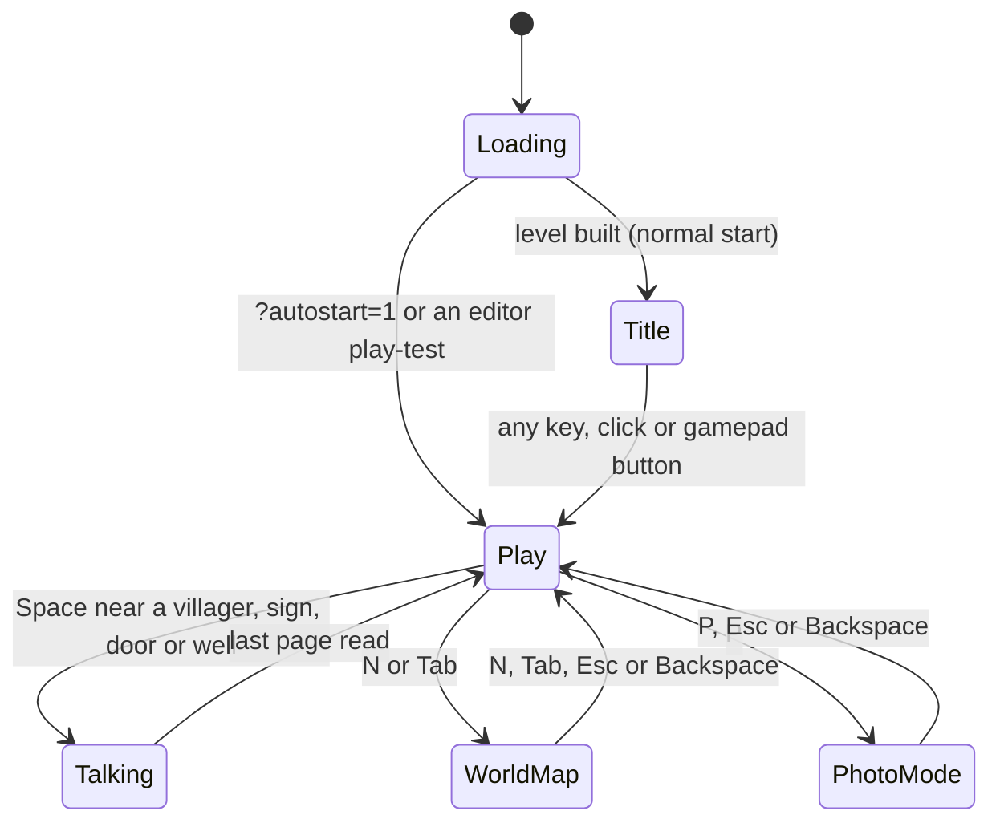
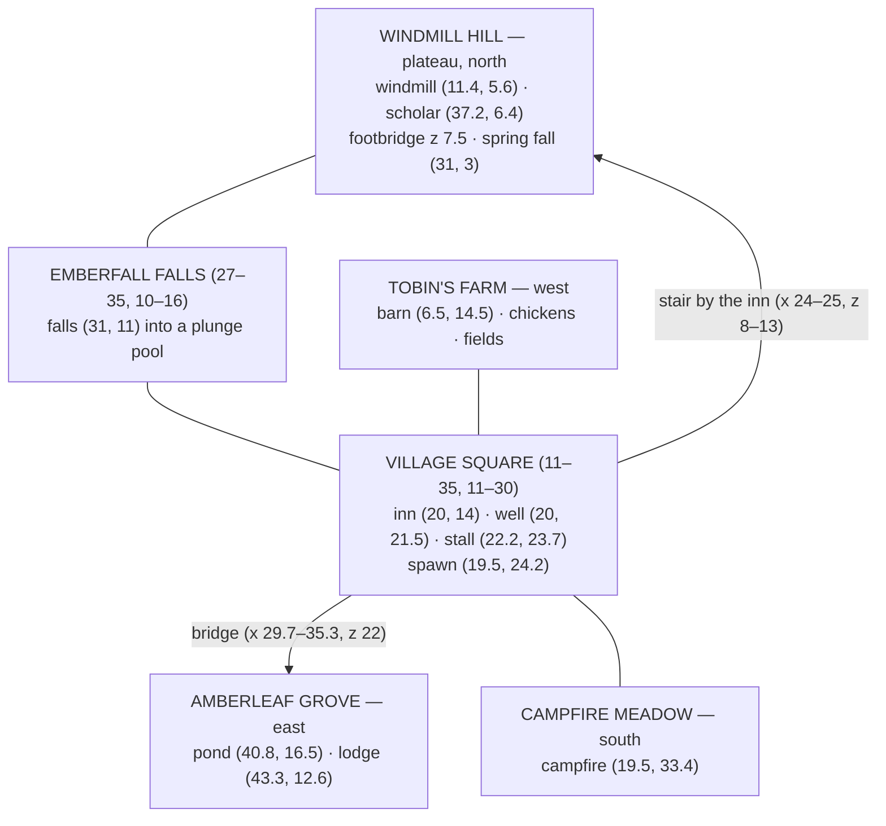

# 游玩指南

[English](PLAYING_THE_GAME.md) | 简体中文

> **目的**——Luminati 演示游戏的完整玩家指南：一局游戏的流程、全部操作、HUD 与地图、与村民交谈、时段与天气、拍照模式、音乐、调试面板、随附的关卡、**烬落村（Emberfall）** 和 **星落谷（Starfall Vale）** 的导览、**烬望隘口（Cinderwatch Pass）** 上的战斗与同伴，以及演示战役 **摆渡人的提灯（The Ferryman's Lantern）**（多个关卡、一个故事、存档）。
>
> **读者**——玩家、检查自己关卡的关卡设计师，以及需要从玩家角度了解游戏行为的 AI 智能体。
>
> **事实来源**——[`src/game/Game.js`](../../src/game/Game.js)（流程、快捷键、交互、`CONTROLS`）、[`src/engine/core/Input.js`](../../src/engine/core/Input.js)（`DEFAULT_BINDINGS`、`DEFAULT_PAD_BINDINGS`）、[`src/engine/core/CameraRig.js`](../../src/engine/core/CameraRig.js)、[`src/game/config.js`](../../src/game/config.js)（`CAMERA`、`TIME_SPEED`）、[`src/game/Weather.js`](../../src/game/Weather.js)（`TIME_PRESETS`、`WEATHERS`）、[`src/game/dialogue.js`](../../src/game/dialogue.js)、[`src/game/DebugControls.js`](../../src/game/DebugControls.js)、[`src/engine/ui/`](../../src/engine/ui/)（HUD、DialogBox、TitleScreen、Minimap / WorldMap）、[`public/levels/*.json`](../../public/levels/)；战斗见 [`src/game/combat/`](../../src/game/combat/CombatSystem.js)（`bindings.js`、`rules.js`、`defs.js`）；战役见 [`src/game/campaign/`](../../src/game/campaign/CampaignRuntime.js) 和 [`public/campaigns/`](../../public/campaigns/ferrymans-lantern/campaign.json)。
>
> **相关文档**——[快速上手](GETTING_STARTED.zh-CN.md) · [快捷键速查表](shortcuts.html) · [输入与操作规范](../specs/INPUT_AND_CONTROLS.md) · [游戏架构](../architecture/GAME.md) · [自动化 API](../specs/AUTOMATION_API.md) · 关卡说明：[烬落村](../design/levels/emberfall.md)、[星落谷](../design/levels/starfall-vale.md)、[明水渡（Brightwater Crossing）](../design/levels/brightwater-crossing.md)、[柳湖村（Willowmere）](../design/levels/sample-hamlet.md)、[烬望隘口](../design/levels/cinderwatch-pass.md) · [战斗契约](../contracts/COMBAT.md) · [摆渡人的提灯](../design/campaigns/ferrymans-lantern.md) · [战役格式](../specs/CAMPAIGN_FORMAT.md)

游戏支持**英文、日文和简体中文**——见 [§17 语言](#17-语言)。

---

## 1. 一局游戏的流程

1. **加载**——一颗像素余烬、关卡名称和一条镀金进度条（“正在展开地图”……“正在唤醒村民”“正在预热灯笼”“准备就绪”——以页面语言显示）。加载画面会一直保留，直到最初几帧（包括雨雪）都已绘制完毕，这样之后就不会卡顿。
2. **标题画面**——关卡名称以镀金像素标志显示（日文和中文显示译名，下方附英文名），下方是副标题和闪烁的 **按任意键开始**（Press any key），同时镜头在关卡上空缓缓漂移；语言栏（EN · 日本語 · 中文）位于右下角（[§17](#17-语言)）。此时时钟暂停。按任意键（Shift、Ctrl、Alt、Windows / Cmd 键、Tab、Caps Lock、F5、F11、F12 除外——见 [`TitleScreen.js`](../../src/engine/ui/TitleScreen.js) 中的 `IGNORED_KEYS`）、点击或按任意手柄按钮即可开始游戏；这一下同时会解锁音频并开始播放音乐（除非该关卡关闭了音乐）。
3. **游玩**——镜头滑向旅人，**抵达横幅**显示关卡名称，**操作说明**出现在左下角。时钟开始走动。

`?autostart=1` 会跳过标题画面；此时音频会在你第一次按键或点击时解锁（见[快速上手 › 没有声音](GETTING_STARTED.zh-CN.md#62-没有声音)）。

---

## 2. 操作

游戏绑定的是**物理按键位置**（`KeyboardEvent.code`），所以在 AZERTY / QWERTZ 键盘上，请使用位于美式键盘对应字母位置的按键。可打印版本：[shortcuts.html](shortcuts.html)。

### 2.1 键盘与鼠标

| 动作 | 按键 | 说明 |
| --- | --- | --- |
| 移动 | **W A S D** 或**方向键** | 相对于镜头：无论镜头角度如何，W 都是“朝屏幕上方”。 |
| 奔跑 | 按住 **Shift** | 步行每秒 3.2 个世界单位，奔跑每秒 5.6 个。 |
| 交谈 / 查看 / 推进文字 | **Space**、**Enter** 或 **F** | 也可以点击对话窗口。 |
| 选择对话回答 | **↑ / ↓** 或 **W / S** | 或将鼠标悬停在某个回答上并点击。 |
| 立即显示完正在打字的文字 | **Esc** 或 **Backspace** | 文字正在逐字显示时，Space / Enter / F 也有同样效果。 |
| 旋转镜头 | 按住 **Q** / **E** | 以正北为基准，左右最多 60°。 |
| 拉近 / 拉远 | 按住 **Z** / **X**，或 **=** / **−**，或**鼠标滚轮** | 镜头距离 18–42，默认 30（见 [`config.js`](../../src/game/config.js) 中的 `CAMERA`；关卡的 `environment.camera.distance` 可以修改默认值，并会扩大范围以包含该值）。 |
| 世界地图 | **N** 或 **Tab** | 按 **N**、**Tab**、**Esc** 或 **Backspace** 关闭。 |
| 下一个时段 | **T** | 黎明 → 正午 → 夕照 → 黄昏 → 夜晚，2 秒平滑过渡。 |
| 下一种天气 | **R** | 晴 → 雨 → 雪 → 晴。 |
| 拍照模式 | **P** | 按 **P** 或 **Esc**（或 Backspace）返回。 |
| 音乐开 / 关 | **M** | |
| 操作说明开 / 关 | **H** | |
| 队伍战术 | **G** | 需有同伴加入后才可用（[§15.7](#157-同伴)）；按 **G** 或 **Esc** 关闭。 |
| 调试面板 | **`**（反引号，1 左边的键）或 **F1** | 操作说明中显示为 **~**。 |

### 2.2 手柄（标准映射）

| 动作 | 按钮 |
| --- | --- |
| 移动 | **左摇杆**或**十字键** |
| 旋转镜头 | **右摇杆**（左 / 右），或 **LB** / **RB** |
| 奔跑 | **RT** |
| 交谈 / 确认 | **A** |
| 取消（显示完文字、关闭地图、退出拍照模式） | **B** |
| 拉近 / 拉远 | **Y** / **X** |
| 对话回答 | **十字键上 / 下** |
| 世界地图 | **Back / View** |
| 操作说明 | **Start / Menu** |
| 拍照模式 | **按下右摇杆** |

时段、天气、音乐和调试面板没有对应的手柄按钮；队伍战术面板也没有——请与同伴交谈（**A**）并选择 *战术…*。任意手柄按钮都可以关闭标题画面——但在标题画面上 **LB / RB** 例外，它们用于选择语言（[§17](#17-语言)）。

---

## 3. HUD

| 元素 | 位置 | 显示内容 |
| --- | --- | --- |
| **地点铭牌** | 左上 | 你所在的区域及其副标题（例如 *村中广场 · 烬落村*）。在区域之间时保留上一个区域。 |
| **时钟** | 右上 | 24 小时制时间，附当前时段的像素图标和名称（见下表）。 |
| **小地图** | 时钟下方 | 关卡的像素风地图，北朝上，覆盖约 34 个世界单位：关卡的地块和建筑、代表你的箭头和镜头视野扇形，以及以小宝石和圆点表示的村民、指示牌、门、水井和篝火。关卡可以关闭小地图（`environment.minimap: false`）。 |
| **操作说明** | 左下 | 以键帽形式显示按键；按 **H** 切换。对话期间会收起。 |
| **提示消息** | 顶部 | 金色横条上的简短消息：新的时段或天气、*获得：……*、*♪ 音乐开启*；其中的按键以键帽形式绘制。它们会避开其他面板和横幅。 |
| **交互提示** | 目标上方 | 一个小对话气泡下方显示 *交谈*、*阅读*、*敲门* 或 *查看*，并附 **Space** 键帽。 |
| **抵达横幅** | 中上 | 开始游玩时显示关卡名称；第一次进入设有横幅的区域时，显示该区域的名称和横幅文字。 |

界面以像素画绘制，在任何窗口尺寸下都保持像素清晰：宽度不超过 1919 px 时，一个美术像素对应 2 个屏幕像素，1920 × 1080 时为 3 个，2560 × 1440 时为 4 个；窗口较小时，面板保持像素尺寸不变，大型窗口会重新排布（只有低于 1024 × 600 时，角落的面板才会缩小）。

时钟的时段（[`HUD.js`](../../src/engine/ui/HUD.js) 中的 `timePhase`）：

| 时段 | 时间 |
| --- | --- |
| 夜晚（Night） | 20:30 – 4:45 |
| 黎明（Dawn） | 4:45 – 7:00 |
| 清晨（Morning） | 7:00 – 11:00 |
| 正午（Midday） | 11:00 – 14:00 |
| 午后（Afternoon） | 14:00 – 16:30 |
| 夕照（Golden Hour） | 16:30 – 18:45 |
| 黄昏（Dusk） | 18:45 – 20:30 |

---

## 4. 探索

- **移动**跟随镜头：向上推永远是走“进”屏幕。旅人面朝四个方向之一，可以顺畅地爬楼梯、走过桥梁和栈桥，但不能进入水域、封闭的森林、岩石或建筑。一个高度级（0.5 单位）的台阶可以直接走上去；两级或更高则构成悬崖——请寻找楼梯。
- **镜头**默认朝北。**Q / E** 可以把镜头向任意一侧转动最多 60°（在地图的东西边缘附近，旋转幅度会受到限制，以免边界森林挡在你和镜头之间）。用 **Z / X** 或滚轮缩放。在高处（烬落村的风车丘（Windmill Hill）、星落谷的流明山（Mount Lumen）），镜头会再向下倾斜一些。
- **在建筑和树木后面**，旅人会显示为浅色剪影，因此你永远不会看丢旅人。
- **景深**让旅人周围的一条带状区域保持清晰，并模糊前景和远景——形成移轴微缩模型的效果。

本指南中使用的**坐标**是世界单位：**x 向东增大**（地图上向右），**z 向南增大**（地图上向下，朝向镜头）；一个地块为一个单位。世界地图和小地图都以北朝上绘制。

> **提示——瞬间移动。** `window.__game` 始终可用。打开浏览器控制台（F12），输入 `__game.teleport(24.5, 6)` 即可跳到某个位置——这里是烬落村楼梯顶端的高台。如果目标位置无法站立（水面、墙壁），会吸附到 3 个单位内可站立的点；如果没有这样的点（例如远在地图之外），则什么也不会发生，并返回 `null`。用 `__game.setTime(22)` 设置为 22:00，或用 `__game.state()` 查看你的位置、区域等信息。完整列表：[specs/AUTOMATION_API.md](../specs/AUTOMATION_API.md)。

---

## 5. 交谈、查看与选项

走到某人或某物面前并面向它；出现提示时，按 **Space**（Enter、F、手柄 A）。

| 目标 | 提示 | 距离 |
| --- | --- | --- |
| 村民 | *交谈* | 1.6 单位（关卡可以为每个村民单独设置，`talkRadius`） |
| 房门 | *敲门* | 距门前台阶 1.0 单位（大约在门前一个单位处）；直接走到门前并面向门也可以 |
| 指示牌 | *阅读* | 1.35 单位 |
| 水井 | *查看* | 1.75 单位 |

只有当关卡为门、指示牌和水井设置了文字时（房屋的 *Text when knocking*、指示牌的 *Sign text*、水井的 *Text when examined*），它们才可以交互。

目标必须大致位于你前方，且与你高度相近。村民会停下来转向你，之后再继续做自己的事。

**对话窗口**（左下）显示说话者的头像、铭牌上的名字——村民有头衔时会一并显示（瑟拉（Sela）：*烬望守卫*）——并逐字打出每一页内容，伴有轻微的提示音，在标点处稍作停顿（日文和中文逐字显示）。**金色**的词是人名和地名（关卡作者用 `{word}` 标记）。对话下方可能会有一个问题，回答选项显示在其上方的小窗口中。

- 文字正在打出时，按 **Space / Enter / F**（或点击窗口）会立即显示完整页；显示完整后再按则翻页。上下浮动的 **▼** 表示“还有”；最后一页以菱形结尾。
- 文字正在打出时，按 **Esc / Backspace** 也会立即显示完整页。对话不能整段跳过。
- **选项**出现在一个带金色宝石光标的小窗口中：用 **↑ / ↓**（或 W / S、十字键）选择并确认，或直接点击。选项出现后的四分之一秒内输入会被忽略，因此连按跳过文字时不会意外选中某个选项——而且在内置的问题中（休息、商店、音乐、烬落村的对话），**第一个回答总是不作决定的那个**（“还不是时候”“随便看看”）。
- 对话结束后的 0.8 秒内，确认键会被忽略，以免立刻开始新的对话。

**村民能为你做什么**

| 行为 | 效果 |
| --- | --- |
| **休息**（旅店老板） | 对“要休息到天亮吗？”选择第一个选项以外的任意回答：画面淡出，时钟跳到 **08:00**，并显示 *你睡了个好觉，精神焕发。*（在自定义关卡中，如果某个村民最后的问题只有一个回答，选择该回答时就会让你休息——或交给你物品。） |
| **商店**（商人） | 接受提议即可获得物品：一声铃响，并显示 *获得：脆甜苹果*（或该关卡设定的物品；重复购买时显示 ×2、×3……）。物品免费，也没有物品栏界面。 |
| **音乐**（吟游诗人） | 没有音乐时开始演奏；正在播放时会询问是否停止。 |

烬落村的八位村民使用手写的对话（[`dialogue.js`](../../src/game/dialogue.js) 中的 `CONVERSATIONS`）。其中四位在之后的拜访中会有变化：长老、守卫、孩子和学者第二次会说不同的话，吟游诗人雷恩（Wren）会询问是否继续演奏（如果没有音乐，他会重新开始演奏）。

---

## 6. 时段与天气

- 游玩时**时钟会走动**：**一个游戏小时 ≈ 90 秒**（`TIME_SPEED = 1/90`，单位为小时每秒）。每个关卡设定自己的起始时间；烬落村从 17:12（夕照）开始，星落谷从 17:24 开始。关卡可以让时钟停止（`environment.clock: false`）。
- **T** 会平滑过渡（2 秒，始终向前推进时间）到下一个预设：

  | 预设 | 时间 |
  | --- | --- |
  | 黎明 | 6:30 |
  | 正午 | 12:30 |
  | 夕照 | 17:12 |
  | 黄昏 | 18:54 |
  | 夜晚 | 22:30 |

- 光照遵循 24 小时调色板：粉色的黎明、白色的正午、夕照时斜射的长影、紫色的黄昏和蓝色的夜晚。夜里路灯和窗户会亮起，火光会照亮周围，萤火虫也会出现。
- **R** 在**晴 → 雨 → 雪 → 晴**之间循环，并在几秒内渐变：雨天光线变灰、雾气变浓、风力变强、阳光变暗；雪会飘落并**积在**地面、草地和屋顶上。阴天时灯笼和窗户会亮起。关卡可以设定开始时就下雨或下雪。
- 在旅店休息会把时钟设为 08:00。

---

## 7. 拍照模式

**P**（手柄：按下右摇杆）会显示 *拍照模式 · 按 P 或 Esc 返回*，片刻后隐藏整个界面。你仍然可以行走、旋转和缩放镜头，以及改变时间（**T**）、天气（**R**）和音乐（**M**）；交谈功能关闭。对话进行中或世界地图打开时无法进入拍照模式。按 **P**、**Esc**、**Backspace** 或手柄 **B** 恢复界面。

想要更自由的构图，可以在进入拍照模式之前在调试面板中设置镜头（面板会和其他界面一起隐藏）：**Camera › free yaw** 让镜头可以 360° 旋转，**Camera › fov / distance** 用于重新取景。**Camera › pitch** 会在游玩时改变关卡的俯仰角——或者在你站在高处（风车丘）时改变高处的倾斜角——并一直保持，直到执行 **Camera › reset** 或进入下一个关卡。在拍照模式中，镜头保持进入时的俯仰角，并且解除地图边缘对 Q / E 的限制（这两项都会跳过 `Game._updatePlayCamera`）。

---

## 8. 音乐与音效

你听到的一切都由 WebAudio 实时合成：竖琴、铺底音色和长笛组成的民谣循环，在木头、石头和沙地上会变化的脚步声，对话提示音，铃声，以及随世界变化的环境音——白天的鸟鸣、夜晚的蟋蟀、离得越近噼啪声越大的篝火，以及在河流和瀑布附近越来越响的水声。**M** 开关音乐。音频在你第一次按键或点击后才开始播放（浏览器规定）。

---

## 9. 世界地图

**N** 或 **Tab**（手柄 **Back / View**）会打开一个镀金窗口，显示整个关卡的地图：区域名称、代表你的箭头、村民、指示牌、门和水井、篝火、建筑、道路、水域和森林，并附有图例和 *当前区域……*。地图打开时你会站着不动——但时钟和村民照常活动。按 **N**、**Tab**、**Esc** 或 **Backspace**（手柄 **B** 或 **Back**）关闭。对话期间或拍照模式中无法打开。

---

## 10. 调试面板

**`**（反引号）或 **F1** 会在时钟下方打开一个主题化的 [lil-gui](https://lil-gui.georgealways.com/) 面板，并附带统计叠加层：**FPS**、帧耗时（毫秒）、小型 fps 曲线图、**Calls**（绘制调用，包括约 20 个后期处理通道）、**Tris**、**Geom**、**Tex**、**Prog**（着色器程序）和 **Worst**（最近四分之一秒内最慢的一帧）。面板只能在游玩时打开。修改会实时生效，但不会被保存。

| 文件夹 | 控件 | 用途 |
| --- | --- | --- |
| **Time & Weather** | time of day（0–24）、*speed (h / s)*（每真实秒 0–2 个游戏小时，步长 0.01；默认 1/90 ≈ 0.011，显示为 0.01）、paused、weather、*next preset (T)* | 冻结或拖动时钟。 |
| **Post FX** | *post-processing* 开 / 关；**Depth of field**（enabled、CoC debug view、autofocus 及 autofocus speed、focus distance / range、max blur、near / far scale、tilt-shift amount / centre / width / feather、bokeh boost / threshold / sprites）；**Bloom**（enabled、strength、radius、threshold、knee、warmth）；**Grade**（enabled、exposure、contrast、saturation、temperature、tint、vignette 及其 softness / roundness、grain 及 grain size、chromatic aberration、sharpen、dither；split-toning 和 vignette colour） | 调整或关闭 2.5D 像素风格的画面效果。 |
| **Lighting** | 太阳光、环境光、雾、曝光和点光源的倍率；阴影；灯笼闪烁；阴影范围；悬崖反射光 | 在时段调色板的基础上调整光照。 |
| **Camera** | fov、pitch、distance、yaw、free yaw、look-ahead、follow speed、reset | 为截图取景；*reset* 恢复关卡的默认取景。pitch 滑块会改变当前地面或高处的俯仰角，直到重置或进入下一个关卡。 |
| **Atmosphere** | 体积光、浮尘、萤火虫、落叶、花瓣、烟囱烟雾、瀑布水雾、风、积雪 | 减少或增强粒子效果。 |
| **Render** | render scale（0.5–1）、dynamic resolution、show stats、*photo mode (P)* | 用清晰度换取速度（[性能建议](GETTING_STARTED.zh-CN.md#63-性能建议)）。 |

每个参数在引擎层面的解释见 [architecture/RENDER_PIPELINE.md](../architecture/RENDER_PIPELINE.md)（后期处理）和 [architecture/modules/lighting.md](../architecture/modules/lighting.md)。

---

## 11. 关卡

| 关卡 | URL | 尺寸 | 开始时 | 内容 |
| --- | --- | --- | --- | --- |
| **烬落村**——*河畔村庄* | `/game.html` | 48 × 40 | 17:12，晴 | 最初的演示：村中广场、风车丘、两道瀑布、一条河和一座桥、一座农场、一片带池塘的秋日树林，以及一片篝火草地。8 位村民、6 座房屋、137 个物体、7 个区域。 |
| **星落谷**——*群星归来之地* | `/game.html?level=starfall-vale` | 128 × 128 | 17:24，晴 | 旗舰关卡：整座山谷里的星落节（Starfall Festival）之夜。29 位村民、27 座房屋、875 个物体、31 个区域、5 道瀑布、10 座桥梁和栈桥。 |
| **明水渡**——*河畔小村落* | `/game.html?level=brightwater-crossing` | 36 × 28 | 16:48，晴 | 完全在关卡编辑器中搭建的小村落：有风车的磨坊主之丘（Miller's Hill）、落入深潭的瀑布、一条河和一座桥、旅店、一座农场和一个睡莲池。4 位村民、68 个物体。 |
| **鎏金港（Gildhaven）**——*鎏金河畔集市日* | `/game.html?level=gildhaven` | 128 × 128 | 16:36，晴 | 一座有城墙环绕的河畔城镇，有集市、码头、桥梁、修道院和农场；68 位村民和 53 座房屋。 |
| **柳湖村**——*池畔小村* | `/game.html?level=sample-hamlet` | 28 × 22 | 16:48，晴 | 小型示例关卡：一片绿地、一处果园台地和一个镜池。3 位村民、38 个物体。 |
| **烬望隘口**——*古火苏醒之地* | `/game.html?level=cinderwatch-pass` | 96 × 120 | 16:48，晴，时钟停止 | **战斗**关卡（[§15](#15-战斗烬望隘口)）：有训练假人的营地、史莱姆出没的林地、荆棘遗迹（Bramble Ruins）或洼地沼泽（Hollow Mire）、烬火采石场（Cinder Quarry），以及火山口（The Caldera）中的首领烬心（Cinderheart）。24 组共 58 个敌人、6 个宝箱、3 块路标石、7 位村民——其中三位会加入你的队伍；隘口按四人队伍平衡（[§15.7](#157-同伴)）。 |

加上 `&autostart=1` 可以跳过标题画面。`public/levels/` 中的任何其他文件都可以用 `?level=<文件名>` 游玩，保存在浏览器中的关卡则用 `?level=local:<slot>`——见[快速上手 › URL](GETTING_STARTED.zh-CN.md#41-游戏的-url)。首页 `/` 是**启动页**：列出项目中的每个关卡和战役，并附有 *Play* 链接（以及进入编辑器的 *Edit*）——见[快速上手 › 启动页](GETTING_STARTED.zh-CN.md#44-启动页)。这些关卡是如何设计的：[烬落村](../design/levels/emberfall.md)、[星落谷](../design/levels/starfall-vale.md)、[明水渡](../design/levels/brightwater-crossing.md)、[柳湖村](../design/levels/sample-hamlet.md)、[鎏金港](../design/levels/gildhaven.md)、[烬望隘口](../design/levels/cinderwatch-pass.md)。

**战役**把多个关卡串成一个故事，你可以一路走下去而无需重新加载页面——演示战役是 *摆渡人的提灯*，`/game.html?campaign=ferrymans-lantern`（[§16](#16-战役摆渡人的提灯)）；*烬落村——敞开的门*（Emberfall — Open Doors），`/game.html?campaign=emberfall-interiors`，打开了烬落村的每一扇门（[§16.5](#165-烬落村敞开的门)）。

---

## 12. 烬落村导览

烬落村是一座被森林环绕、48 × 40 地块的村庄。村庄位于高度级 2，风车丘在北部（z 3–8）升至高度级 8，篝火草地（Campfire Meadow）在南部低一级（z 30 及以南）。河流在 x ≈ 31 处从山丘流下，沿广场东侧向南流去。

1. **村中广场（Village Square）**——你从广场南端（19.5, 24.2）出发。**玛伦长老**（Elder Maren）站在**水井**（20, 21.5）旁，讲述村子的故事；集市摊位（22.2, 23.7）的**伯特伦**（Bertram）会送你一个免费的苹果；**烬火橡木旅店（the Ember & Oak）**（20, 14）门外的**罗莎琳德**（Rosalind）可以让你休息到天亮。阅读指示牌（15.3, 22.9）了解方向，再去敲敲各家的门——每座房子都有话要说。广场上还有一只猫和一群会飞起来的鸟。
2. **托宾农场（Tobin's Farm）**（西）——**老托宾**（Old Tobin）照看着田地（6.8, 26.3），他的孙女**皮普**（Pip）在谷仓院子里追着鸡跑（6.2, 18.6）。鸡见到你也会四散奔逃。
3. **风车丘**（北）——爬上**旅店旁的楼梯**（x 24–25，z 8–13：六个楼梯地块，每个升高一个高度级，直达高台）。到顶后横幅显示 *山谷藏风之处*，镜头向下倾斜。风车在西边转动（11.4, 5.6）；走过溪上的**人行小桥**（z 7.5），就能见到学者**奥托琳·奎尔（Ottoline Quill）**（37.2, 6.4），她会以角色的口吻讲解操作。
4. **烬落瀑布（Emberfall Falls）**（27–35, 10–16）——溪流在（31, 11）处从高台跌落，落入一个水花飞溅、波光闪烁的深潭；另一道小瀑布从高台上缘的泉眼流下。
5. **桥与琥珀叶林（Amberleaf Grove）**（东）——**黑尔下士**（Corporal Hale）守在桥的西端（29, 23.6）。过桥后：秋日的树木、飘落的树叶、樵夫小屋（43.3, 12.6），以及一个小池塘（40.8, 16.5），夜里萤火虫会在那里飞舞。
6. **篝火草地**（南）——鲜花、花瓣，还有篝火旁的吟游诗人**雷恩**（19.5, 33.4）。如果没有音乐，他会演奏《烬落之暮》（*Emberfall Evening*）；之后再来时，他会询问是否继续演奏。
7. **傍晚**——按 **T** 直到 *夜晚*，然后走回广场：路灯、窗户和篝火纷纷亮起，萤火虫在草地和树林上空飘荡。试试按 **R**，看看树林里的雨和屋顶上的雪。

| | |
| --- | --- |
|  |  |
| 风车丘的黎明 | 黄昏时的篝火草地 |
|  |  |
| 雪积在屋顶和草地上 | 琥珀叶林中的雨 |

八位村民：`elder` 玛伦长老 · `innkeeper` 罗莎琳德 · `merchant` 伯特伦 · `guard` 黑尔下士 · `farmer` 老托宾 · `child` 皮普 · `bard` 雷恩 · `scholar` 奥托琳·奎尔（这些 id 可用于 `__game.talkTo(id)`）。

---

## 13. 星落谷导览

`/game.html?level=starfall-vale`——星落节之夜。你在 17:24 抵达山谷南缘的王之大道（King's Road）（70.5, 121.5），面朝北方。时钟在走：大约五分钟后夜幕降临，也可以按 **T**。要经常打开世界地图（**N**）——山谷很大。

| # | 地点 | 位置（x, z） | 可以做什么 |
| --- | --- | --- | --- |
| 1 | **草甸（The Meadowlands）** | 从（70, 120）向北的道路 | 阅读欢迎指示牌（72.8, 122.2）。繁花一直开到“灯火所及”之处，还有许愿橡树（Wishing Oak）的指示牌（60.6, 116.6）。 |
| 2 | **剧团营地（The Troupe Camp）**——*流浪灯火剧团（The Wandering Lanterns）* | (50–70, 91–106) | 吟游诗人**拉克（Lark）**（60.2, 97.7）会介绍剧团和剧团的歌，如果没有音乐还会开始演奏；**萨菲**（Saffi）在练习星之舞（Star Dance）；**奥西诺先生**（Signor Orsino）分发节庆丝带（Festival Ribbon）。夜里再来看看。 |
| 3 | **南门区（Southgate）** | 位于（70.5, 77–81）的桥 | **霍布·韦恩中士**（Sergeant Hobb Vane）守着城门（72.9, 82.6）。渡过银流河（Silverrun）进入城镇。 |
| 4 | **炉火镇广场（Hearthwick Square）** | (61–79, 50–66) | 集镇：古井（70, 57.5）、三位摊主分别出售纸灯笼（Paper Lantern）、月瓣茶（Moonpetal Tea）和星花花环（Starbloom Garland），还有**奥尔德斯·布兰布尔科特镇长（Mayor Aldous Bramblecote）**，以及星光旅店（Starlight Inn）（65, 47.5）旁可以让你休息的**玛丽戈尔德·芬（Marigold Fenn）**。巴纳比·克拉姆（Barnaby Crumb）在东边自家面包房旁卖星光面包（Starlight Bun）。去敲敲门——镇公所的告示、面包房、铁匠铺。 |
| 5 | **礼拜堂街（Chapel Row）** | (78–87, 40–52) | 陨星礼拜堂（Chapel of the Fallen Stars）和星辰名录（Star Register）的保管人**阿玛兰莎修女（Sister Amarantha）**。 |
| 6 | **镜湖码头（Mirrormere Landing）** | (83–99, 56–75) | 镜湖（Lake Mirrormere）边的渔村：**伊索尔德奶奶（Grandmother Isolde）**（92.4, 68.3）会告诉你星星在哪里沉睡。走到**长栈桥**（the Long Pier）的尽头（x 94.7 → 102.6，z 66.5）。 |
| 7 | **黄昏后的栈桥** | (104, 66.5) | 天黑后，沉睡的星星会在长栈桥尽头外和 North Pier 旁的水下闪烁；一团光芒标示出湖中的小岛（无法到达）。 |
| 8 | **三姐妹（The Three Sisters）** | (50–67, 18–41) | 三道瀑布沿流明山逐级而下（60, 36）·（58, 28）·（62, 20），瀑布之间有桥相连。 |
| 9 | **观星者石阶（Stargazer's Steps）→ 流明天文台（the Lumen Observatory）** | (66–79, 18–28) → (66–81, 4–16) | 沿之字形山路爬上高原。**卡西米尔·维大师（Master Casimir Vey）**（75.5, 12.7）会讲述沉睡之星的故事。 |
| 10 | **流明瞭望台（Lumen Lookout）** | (40–52, 12–22) | **漫游者罗文（Rowan the Wayfarer）**，以及整座山谷的全景。 |
| 11 | **琥珀松高地（Amberpine Heights）与镜瀑（the Mirror Falls）** | (94–125, 3–40)，瀑布位于（113, 40） | 湖上方的松林；**守卫伊沃（Warden Ivo）**（107.4, 34.4）。 |
| 12 | **旧采石场（The Old Quarry）与流明旧城（Old Lumen）** | (3–38, 3–38) | 最早那座城镇的遗迹、古井（7.5, 29.6）和无人知晓深度的旧矿井（指示牌位于 19, 15）。 |
| 13 | **金田农庄（Goldenfield Farms）** | (3–44, 37–84) | 风车（15.5, 48.5）、巴利科恩农场（Barleycorn Farm）、追着鸡跑的**坦西（Tansy）**、一只农场狗和果园。 |
| 14 | **烬木林（Emberwood）与隐秘林地（the Hidden Glade）** | (3–45, 83–125)；林地（4–26, 100–122） | 秋日的森林：樵夫营地及其篝火、隐士的小屋，以及立石之间的**老西斯尔（Old Thistle）**。 |
| 15 | **芦苇河口（Reedmouth）与南滩（the South Beach）** | (84–99, 75–90)、(90–125, 93–112) | 湖边的篝火（93.5, 85.2）和**芬恩·阿什当（Finn Ashdown）**，南滩上面朝湖面的长椅，更南边是荆棘洼地（Bramble Hollow）。东岸的鹭鸶沙嘴（the Heron Spit）上站着苍鹭（指示牌位于 120.6, 77.6）。 |

在控制台中快速跳转：`__game.teleport(70, 60)`（广场）、`__game.teleport(101, 66.5)`（长栈桥）、`__game.teleport(74, 13)`（天文台）、`__game.teleport(15, 110)`（林地）；然后执行 `__game.setTime(22)`。

| | |
| --- | --- |
|  |  |
| 夕照时分的炉火镇广场 | ……以及夜晚 |
|  |  |
| 夜晚镜湖码头的栈桥 | 剧团营地 |
|  |  |
| 三姐妹 | 流明天文台 |
|  |  |
| 烬木林中的隐秘林地 | 卡西米尔·维大师 |

---

## 14. 小贴士

- **截图**：使用拍照模式，让夕照时分慢下来（调试面板 › Time & Weather › speed 设为 0 或勾选 *paused*），并用 **Z** 拉近以获得最强的移轴模糊效果。
- **夜晚是最佳时间**，适合欣赏星落谷的节庆和烬落村的萤火虫。
- **迷路了？** 世界地图上的 *当前区域……* 一行会显示所在区域的名称，而且每块指示牌都会指路。
- 你制作的关卡**看起来有问题**？在编辑器中检查一下（*Level › Check for problems*）——见[关卡编辑器指南](LEVEL_EDITOR_GUIDE.zh-CN.md)。

---

## 15. 战斗（烬望隘口）

有敌人的关卡——随附的是**烬望隘口**（`/game.html?level=cinderwatch-pass`）——加入了实时动作战斗。上面介绍的一切在那里依然有效；下面的战斗按键在其他关卡中不起作用。标题画面上会显示一排关卡：用 **← / →**（或十字键）选择关卡，按 **Enter / A** 前往；按其他任意键则开始当前关卡。

### 15.1 战斗操作

| 动作 | 键盘 · 鼠标 | 手柄 |
| --- | --- | --- |
| 攻击——在剑收回时再按一次可打出 3 段连招（第三段是突刺） | **J** · 左键 | **X** |
| 翻滚闪避（带方向；不带方向时为短距离后撤步）——短暂无敌；在攻击即将命中的瞬间翻滚可触发 **完美闪避！**（Perfect!），使敌人减速 | **K** · 右键 | **B** |
| 旋风斩（Lv 1）· 烬火弹（Lv 2）· 光辉新星（Lv 4） | **U / I / O** 或 **1 / 2 / 3** | 按住 **LT** + **X / Y / B** |
| 治疗药水（恢复最大 HP 的 40 %） | **C** 或 **4** | **Y** |
| 锁定 / 下一个目标（长按解除） | **L** · 中键 | **按下右摇杆** |
| 交谈、打开宝箱、在路标石处休息 | **Space**、**Enter**、**F** | **A** |
| 缩放 | **Z / X**、滚轮 | **右摇杆上 / 下** |
| 拍照模式（附近有敌人时无法使用） | **P** | **按下左摇杆** |

操作说明和技能键帽会跟随你最后使用的设备；第一次按下手柄按钮时会显示一次性提示。营地里的玛伦队长（Captain Maren）会讲解按键（按你正在使用的设备），如果你对假人打出一整套连招再加一次翻滚，她会奖励你两瓶药水。

### 15.2 战斗 HUD

地点铭牌下方：等级、**HP**（红色）、**MP**（蓝色）、**SP**（体力，金色）和一条细细的 XP 条。右下角：技能栏（冷却时显示为带秒数的暗色遮罩，未解锁的技能变暗，按下被拒绝时栏位会抖动），以及药水数量和金币。右侧边缘：战利品信息流。敌人上方：伤害数字、HP 条（被击中的敌人、锁定的目标、精英）、已发现你的敌人头上的小红菱形，以及屏幕边缘指向屏幕外敌人的箭头（该敌人蓄力时会闪烁）。首领的血条位于底部中央，带有阶段宝石。

### 15.3 看懂战斗

- **每次敌人攻击都有预警**：敌人蓄力时会闪橙光，大范围或远程攻击会在地面上画出一个逐渐填满的红色标记——填满时攻击命中。箭矢和冲锋的路线在发动前会停止跟踪你并闪白光：向侧面翻滚。
- 敌人轮流出手（同时只有少数几个会攻击）。从背后攻击敌人，或在敌人被眩晕、硬直时攻击，更容易打出暴击。连招第三段威力最大。
- **体力**：翻滚消耗 25 SP；攻击永远不会失败，但 SP 为 0 时你会*气喘吁吁*，恢复变慢。
- **战利品**会从被击败的敌人身上弹出并飞向你：金币、红心（+12 % HP）、魔力碎片（+8 MP）、药水。XP 让你升级（HP / MP 回满，HP、MP 和攻击力提升；Lv 2 和 Lv 4 时习得新技能）。
- **宝箱**按 Space 打开，给予金币、药水或强化（最大 HP、最大 MP、攻击力）；见过之后它们就会显示在地图上。
- **路标石**在你走近时会与你共鸣（成为你的存档点）；在路标石处按 Space 可以**休息**：HP / MP / SP 回满，药水至少补到 3 瓶——但所有敌人群组都会重新出现。附近有敌人时无法休息。
- **倒下**：屏幕显示 *你倒下了*；按任意键会在最后一块路标石处复活，HP 回满，金币减少 10 %，已击杀的敌人不会复活。
- **商店**：营地摊位的**布拉姆**（Bram）和采石场的路标石（Quarry Waystone）旁的**奥多**（Odo）出售治疗药水（25 金币），以及三样各限购一次的物品：**磨刀石**（Whetstone，攻击 +2，120 金币）、**铁木补剂**（Ironbark Tonic，最大 HP +15，90 金币）和**守护护符**（Warding Charm，防御 +3，150 金币）。和他们交谈并从列表中选择——第一项是 *不用了*，所以连按 Space 永远不会买下任何东西，买不起的商品会标注 *（不够）*。买到的东西在你倒下后仍然保留。敌人紧追不舍时，没人会跟你做买卖。第一次拜访之后，奥多关于首领的建议要选 *再说一遍* 才能再听到。
- **敌人会跟着你**上楼梯、上岩台，但只追到一定距离：每群敌人都属于隘口的某个区域，你离开该区域时它们就会折返。如果你站在它们到不了的地方，它们会放弃并回家。

### 15.4 烬心

首领在北端的火山口中等着你。一踏进去，身后的大门就会被一道余烬之墙封住。它有三个阶段（在 HP 降到 70 % 和 35 % 时切换）：锤击（Hammer Slam）、横扫（Sweep）和投石（Rock Toss）；然后是岩浆池、烬火雨（Ember Rain）、冲锋（Charge）和蝙蝠；最后是带有扩散冲击环的震波重击（Shockwave Slam），以及一次短暂的跪地，此时它的核心会暴露出来。**引诱它的冲锋撞上四个火盆之一**——它会被眩晕两秒；**向内翻滚穿过冲击环**；离开岩浆。击败它后竞技场会打开，掉落它的核心（最大 HP +20），并显示一张结算卡，列出你的用时、击败的敌人、倒下次数、完美闪避次数和等级。采石场边缘的奥多和各处的指示牌也会给出同样的提示。

### 15.5 隘口行（轻度剧透）

隘口从南向北——也就是沿屏幕向上——攀升，因此镜头总是朝着前方。

1. **路标石营地（Waystone Camp）**（安全区）。和假人旁的**玛伦队长**交谈：她会讲解按键，对假人打出一整套连招再加一次翻滚可以获得两瓶药水。篝火旁的**伊尔莎修女**（Sister Ilse）会讲解路标石，并提出作为治疗者与你同行；营地的弓手**鲁克**（Rook）就在假人南边，愿意为你张弓。把他们都带上：隘口是按你加三位同伴设计的（[§15.7](#157-同伴)），独自一人会很困难。**布拉姆**用你的金币换取药水和一些强化。营地的路标石是你的第一个存档点。营地里并不是所有东西都摆在明面上。
2. **青苔林地（Mossy Glade）**（Lv 2）。草地上的史莱姆和溪边的三只哥布林——这里是学习连招、翻滚和锁定的地方。西边有一个宝箱。
3. **十字路口（The Crossroads）**。第二块路标石；守望者中的一名守卫**瑟拉**，她会作为第四人加入你；还有**皮普**，会告诉你每条路各有什么。在做出选择之前先在这里休息。
4. **任选一条岔路**——两条路都通往采石场边缘；遗迹那条更难，经验也更多：
   - **荆棘遗迹**（西，Lv 7–8）：残破大门前的哥布林、庭院里的咒术萨满，以及庭院上方岩台上的弓手——拉近距离或者切断它们的视线。岩台上有奖励等着你，遗迹旁的山脊里还藏着一个小小的隐蔽角落。
   - **洼地沼泽**（东，Lv 6–7）：池塘上空的蝙蝠、岸边的史莱姆、一个萨满，以及采石场楼梯脚下的哥布林。大池塘中的小岛是可以到达的——找到那条木栈道。
5. **烬火采石场**（Lv 8）。铁皮野猪沿直线冲锋：闪到一边，让它们撞上岩石或切割好的石块，就会被长时间眩晕。上层台地上有弓手，还有蝙蝠、一伙哥布林——以及一头有名字的老野猪。采石场的路标石旁的**奥多**有关于首领的建议，还有守望者最后的储备——在那里花掉你的金币；在登上通往火山口的楼梯之前，先在那块路标石处休息。
6. **火山口**：烬心（[§15.4](#154-烬心)）。满编队伍的话，你此时应该在 6 级左右。

横幅上的等级是敌人的等级，按四名战斗者设定：满编队伍的话，你离开岔路时自己大约是 4 级。

这个关卡的时钟停在夕照时分；如果你想在夜里战斗，**T** 仍然可以改变时间。两条岔路都走一遍也是可以的，会获得额外的经验和战利品。

### 15.6 你会遇到谁

| 敌人 | 应对方法 |
| --- | --- |
| **苔藓史莱姆**（Moss Slime） | 朝你跳过来并扑击；很弱，但成群出现——任何一击都能打断它。 |
| **荆棘哥布林**（Bramble Goblin） | 绕着你转圈，然后扑上来砍一刀，有时还会补第二刀；你挥剑时它会向后跳开。等它扑过来，翻滚，然后反击。 |
| **荆刺弓手**（Thorn Archer） | 保持距离，沿一条红色路线射击，路线会在箭射出前锁定（每第三发是三连射）。路线闪光时离开它；岩台上的弓手能俯视庭院。 |
| **咒术萨满**（Hex Shaman） | 保持距离，在你即将到达的位置放下一个逐渐填满的火圈，为受伤的同伴治疗，你靠近时会瞬移离开。优先击杀它。 |
| **烬火蝙蝠**（Cinder Bat） | 绕着你盘旋，然后俯冲穿过一个标记出的小区域。在空中很难打中——趁它俯冲时或俯冲后攻击。 |
| **铁皮野猪**（Ironhide Boar） | 先用蹄子刨地，然后沿一条长长的路线冲锋；撞上墙、岩石或石块会被眩晕。近身时会用獠牙进行扇形顶撞。很重：你的攻击几乎推不动它。 |
| **稻草假人**（Straw Dummy） | 营地的训练目标；从不还手。 |
| **烬心** | 首领——见 [§15.4](#154-烬心)。 |

**精英**（金框血条，带名字铭牌）血量更多、攻击更强，击败后奖励也更多。

### 15.7 同伴

隘口的三位村民会与你并肩作战——一支队伍可容纳三名同伴，所以他们可以全部加入：

| 谁 | 在哪里 | 战斗方式 |
| --- | --- | --- |
| **伊尔莎修女** | 路标石营地，篝火旁 | **秘术师**（Mystic，法杖）：烬火弹、在敌人身上炸开的闪焰、最强的治疗。初始战术为 *辅助*。 |
| **鲁克** | 路标石营地，假人南边 | **游侠**（Ranger，弓）：远程射箭和箭雨齐射。 |
| **瑟拉** | 十字路口的路标石（Crossroads Waystone） | **守卫**（Warden，长枪）：近身突刺和横扫一击。 |

当战术允许时，三人都会治疗（*治愈术*）；伊尔莎的治疗量最大。

- **招募。** 与其中一人交谈并回答 *与我同行*（选 *还不是时候* 则保留邀请，以后再说）。提示消息会显示谁加入了队伍。
- **在路上**，同伴会跟着你的脚步走。他们的信息框位于你的状态条下方——名字、等级、职业、战术、HP 和 MP——并在小地图和世界地图上显示为圆点。
- **战术。** 战斗中每个同伴都会按照自己的战术独立作战。**G** 打开战术面板（使用手柄时：与同伴交谈并选择 *战术…*）：**Q / E**（LB / RB）切换同伴，六个预设——*均衡*、*全力进攻*、*贴身护卫*、*辅助*、*猎杀法师*、*避战*——或者它们下方的七条规则决定其战斗方式。面板打开时游戏暂停；按 **G** 或 **Esc** 关闭。在登山途中，同伴有时会自己改变战术（会有提示消息）。
- **战斗。** 被同伴击中的敌人可能会转而攻击该同伴；烬心和它的蝙蝠总是冲着你来，但它的重击、冲击环和岩浆同样会伤害同伴。HP 降到 0 的同伴会倒地，直到战斗结束才会站起来；在战斗之外，他们恢复得很快。他们会随你一起升级，他们击杀的敌人也会给你经验和战利品。
- **与同伴交谈**：*战术…* 打开面板，*分道扬镳*（会询问两次）让他们留在你当前所站的地方——到那里再与他们交谈即可重新带上他们——*继续前进* 则继续同行。
- **平衡。** 隘口是按你加上全部三位同伴设计的；敌人不会因为同行人数而有任何变化。如果独自一人，准备好消耗更多药水、倒下更多次——尤其是面对烬心时。

---

## 16. 战役（摆渡人的提灯）

战役是跨越多个关卡讲述的故事：你沿着道路走出地图边缘就会进入下一个地方，打开一扇门就能进入地窖，游戏会记住你做过的事。它在当前运行的页面中切换关卡——画面淡出，下一个地方加载完毕后再淡入——并且一路保留你的时钟、天气、经验、金币和药水。演示战役是**摆渡人的提灯**：`/game.html?campaign=ferrymans-lantern`。

### 16.1 旅行

| 方式 | 运作方式 |
| --- | --- |
| **走出边缘** | 在道路离开地图通往下一个地方的位置，继续往前走就行：你会出现在另一边的同一条路上。往回走就会回去。 |
| **门**（**Space**） | 通往某处的门、梯子或地窖口，在你站到它面前时会显示提示（*Space · 进入*、*Space · 爬上去*）。按 **Space**（手柄 **A**）穿过。 |
| **上锁的通路** | 需要先满足条件的通路，在你尝试时会说明（“地窖的门锁着……”）；故事中的某个人可以打开它。 |

室内有自己的时间和天气：你在室内时战役时钟会停止，出来后从原来的时间继续。**世界地图**（**N** / **Tab**）会把战役中所有户外地点并排显示；尚未去过的地方会变暗。

### 16.2 故事：对话、任务与日志

- **交谈**和其他地方一样（**Space**），但人们说的话会随故事推进：他们的台词会随着事件发生而变化，有些人会给出改变后续发展的**选项**，有些人会记得你之前问过什么。
- 故事中**可供查看的东西**——一堆木板、一张旧海图——会像门一样显示提示（*Space · 搜寻*、*Space · 阅读*）。
- 你获得的**物品和金币**会以提示消息显示在顶部；**任务**也是如此（“新任务”“任务更新”“任务完成”）。
- **日志**（**B**；按 B 或 Esc 关闭）：*任务*——进行中的任务排在前面，显示你目前了解到的情况和目标（完成后打勾）——以及 *物品*，附带你的金币。←/→ 或 Q/E 切换标签页，↑/↓ 选择条目。
- **过场动画**会暂时接管镜头（屏幕上下出现黑边）：人物走动，镜头看向重要的东西，画面可能会淡出。**长按 Esc** 可以跳过（其中的选项仍会询问）。
- 有些地方和人物会**在你眼前发生变化**——一座桥被建起来，某个人离开了。

### 16.3 保存与继续

游戏会自动保存——每次切换地点时、故事推进时，以及你关闭或隐藏页面时——保存在此浏览器中（`localStorage`，每个战役一个存档；上一个存档会作为备份保留）。过场动画或对话会作为一个整体保存：在其中途关闭页面，回来时会回到它开始之前。之后标题画面会提供 **继续游戏**（回到你离开的地方，保留故事、任务、物品、时钟、你的等级、金币以及你打开过的宝箱）或 **新的旅程**（从头开始，不保留任何记忆）。URL 中的 `&new=1` 也会从头开始；`&autostart=1` 会跳过标题画面。存档只保留在当前浏览器和站点地址中；清除站点数据会删除存档，另一个浏览器、端口或设备有各自独立的进度。

### 16.4 故事流程（轻度剧透）

1. **磨溪村（Millbrook）**（早晨）。雷恩长老（Elder Wren）告诉你，摆渡人伊尔莎（Ilse）带着渡船提灯往东去了旧采石场，一直没有回来——你愿意去找她吗？如果你能为木匠霍利斯（Hollis）找到木料，他就能修好断桥；磨坊主奥多（Miller Odo）保管着一把钥匙。日志（B）会记录这些。
2. **磨坊路（Mill Road）**。沿着道路向东走出地图。洪水冲走了狼渡（Wolf Ford）的桥——要等霍利斯修好之后它才会出现（看着吧）。
3. **旧采石场**——唯一有**战斗**的地方（操作见 [§15](#15-战斗烬望隘口)）：两群史莱姆、一块路标石和一个宝箱。伊尔莎在一处岩台上等着；找到上去的路。
4. **归家**。把提灯带回去，就会开始**第二章——灯火归途**：黄昏时的磨溪村，家家户户窗灯通明。一旦拿到钥匙，磨坊下的地窖随时都值得一看。等渡口重新点亮时，伊尔莎也许会划船送你过河。

### 16.5 烬落村——敞开的门

第二个战役 `/game.html?campaign=emberfall-interiors` 没有任务：它就是每扇门都敞开着的烬落村。走到任意一座房子前——旅店、长老的小屋、河畔小屋、茅草屋、樵夫小屋、托宾的谷仓，甚至山丘上的风车磨坊——在出现 *进入* 时按 **Space**。屋里是陈设齐全的房间，还有新的人可以交谈；*出去* 位于离你最近的矮墙缺口处，而旅店、风车磨坊和谷仓还有楼上一层（在楼梯底部选择 *上楼*，在楼梯口选择 *下楼*）。游戏会把村庄和上一个房间保持在就绪状态，以加快再次进入的速度；第一次进入可能需要额外的加载时间。每个房间都有自己的时间，天气则留在室外。

这个战役是如何搭建的，以及如何制作你自己的战役：[设计页面](../design/campaigns/ferrymans-lantern.md)、[战役格式](../specs/CAMPAIGN_FORMAT.md)和[关卡设计指南 §17](../design/LEVEL_DESIGN_GUIDE.zh-CN.md#17-战役多个关卡一个故事)。

---

## 17. 语言

游戏支持**英文**、**日文**（日本語）和**简体中文**（中文）：界面中的每一个词，以及关卡、战役和故事中显示的所有内容——名字、指示牌、对话、任务、横幅和标题画面。

- **在标题画面上：** 按 **L**（手柄 **LB** 或 **RB**）——右下角的语言栏会高亮当前语言；用 **← / →**（或再次按 L / LB / RB）选择，按 **Enter**（手柄 **A**）切换，按 **Esc** / **Backspace**（手柄 **B**）返回。点击某种语言会立即切换。页面会以该语言重新加载（战役的存档在所有语言中通用；上次保存之后的进度会丢失），并在此浏览器中记住你的选择。
- **在地址中：** `?lang=ja`、`?lang=zh` 或 `?lang=en` 会在本次加载中使用该语言，但不会保存这一选择。游戏从不跟随浏览器本身的语言设置。
- **字体：** 像素字体优先从 Google Fonts 加载，失败时改用游戏自带的副本，因此在本地提供服务的构建无需联网即可游玩；加载失败后的第一次加载可能会多花几秒钟。
- HP、MP、SP、Lv、G、按键名称和数字在所有语言中都保持拉丁字母，与日文和中文 RPG 的惯例一致。关卡编辑器和调试面板保持英文。
- 你自己制作的关卡，或者随附关卡中在翻译之后被修改过的台词，在补上翻译之前会以英文显示——游戏的其余部分仍保持你选择的语言。

| 日本語 | 中文 |
| --- | --- |
|  |  |
